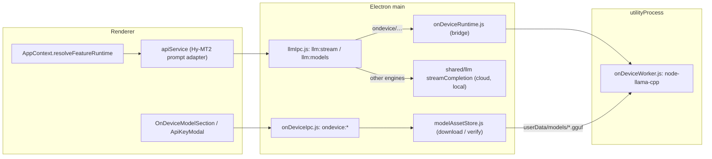

# On-device translation with Hy-MT2 — implementation plan

Status: **plan, not implemented**. Desktop (Electron) only. Web/Docker gets documentation for running Hy-MT2 behind the existing **Local LLM** engine.

<!-- DOCTOC SKIP -->

## 1. Goal

Let desktop users translate offline with [Tencent Hy-MT2](https://github.com/Tencent-Hunyuan/Hy-MT2) without shipping the model in the installer. The user opts in to a one-off download (about 1.1 GB) into the app's user data folder; inference runs locally through [node-llama-cpp](https://node-llama-cpp.withcat.ai/) inside an Electron `utilityProcess`.

## 2. Decisions

| Topic | Decision |
|---|---|
| Placement | New engine `ondevice`. It appears as an Easy-mode provider (**On-device (Hy-MT2)**) and as an Advanced-mode model `ondevice/hy-mt2-1.8b-q4_k_m`. |
| Non-translate features | When Hy-MT2 is selected and another provider is configured, Rewrite, Transform, Rephrase, word alternatives and prompt helpers automatically use that provider. When Hy-MT2 is the only engine, it attempts them itself (one user message, no system prompt). |
| Models (v1) | Hy-MT2-1.8B Q4_K_M only. The registry is structured so 7B can be added later. |
| GPU backends | CPU, Vulkan (Windows/Linux x64) and Metal (macOS arm64). CUDA prebuilt binaries are excluded from installers. |
| Platforms | All current CI targets: Windows x64, Linux x64/arm64, macOS arm64/x64 (ad-hoc signed). |
| Download | Opt-in: **Download** button in Settings → API, and an offer in the first-run "API Key Required" dialog. |
| Isolation | Inference runs in an Electron `utilityProcess` child, so a native crash or out-of-memory error does not take down the app or the SQLite connection. |
| Architecture | Minimal-change design: on-device requests are intercepted in Electron IPC, and the shared LLM layer is untouched. Two additions borrowed from a cleaner design: model **capability metadata** (the renderer routes by capability, not by id prefix) and a reusable **model asset downloader**. |
| Extras in scope | Fix the glossary terms being dropped in `AppContext.translate`; use the Hy-MT2 terminology template for glossary terms; ModelScope mirror fallback; tighten the over-broad unavailable-model regex; web/Docker docs (llama-server + Local LLM). |

## 3. Verified facts (October 2026)

- **Files**: [tencent/Hy-MT2-1.8B-GGUF](https://huggingface.co/tencent/Hy-MT2-1.8B-GGUF) contains `Hy-MT2-1.8B-Q4_K_M.gguf`, 1,133,080,448 bytes, SHA-256 `dc5f44fcf1fa496ee7ad725982c0c8c553a4de00259b53af84c4b89fb0c06699`. Q6_K and Q8_0 also exist; the 7B repo has Q4_K_M (4.62 GB), Q6_K and Q8_0.
- **Pinned source**: `https://huggingface.co/tencent/Hy-MT2-1.8B-GGUF/resolve/1cd5208700acedef4ef93019b6cfc148b8522d45/Hy-MT2-1.8B-Q4_K_M.gguf` (commit of 2026-05-26; repo `main` has moved on with README-only commits).
- **Mirror**: `https://modelscope.cn/models/Tencent-Hunyuan/Hy-MT2-1.8B-GGUF/resolve/master/Hy-MT2-1.8B-Q4_K_M.gguf` serves the same SHA-256 and supports HTTP `Range` (resume).
- **Licence**: Apache-2.0 (`LICENSE.txt` in the GGUF repo, model card `license: apache-2.0`). No regional restrictions.
- **Architecture**: `hunyuan-dense`, standard quant type (`file_type` 15). It does **not** need the STQ1_0 kernel; that is only for the 1.25-bit build, and [llama.cpp PR #22836](https://github.com/ggml-org/llama.cpp/pull/22836) is still open.
- **Context**: README `max_context` is 8192. The GGUF metadata says 262144, so the context size **must** be set explicitly or llama.cpp tries to allocate a huge KV cache.
- **Sampling (1.8B/7B)**: temperature 0.7, top_p 0.6, top_k 20, repetition penalty 1.05, max_tokens 4096. The GGUF metadata says top_p 0.8; follow the README.
- **Prompting**: no default system prompt; use full English language names. Default template:
  `Translate the following text into {target_lang}. Note that you should only output the translated result without any additional explanation:\n\n{source_text}`
  Terminology template (for glossary terms):
  `Reference the following translations:\n{src} translates to {tgt}\n…\n\nTranslate the following text into {target_lang}. Note that you must ONLY output the translated result without any additional explanation:\n\n{source_text}`
- **Chat template**: `<｜hy_begin▁of▁sentence｜>` + `<｜hy_User｜>{content}` + `<｜hy_Assistant｜>`; end-of-turn token `<｜hy_place▁holder▁no▁2｜>`. The GGUF has no `add_bos_token` key, so we emit BOS ourselves.
- **Supported languages**: Chinese, English, French, Portuguese, Spanish, Japanese, Turkish, Russian, Arabic, Korean, Thai, Italian, German, Vietnamese, Malay, Indonesian, Filipino, Hindi, Traditional Chinese, Polish, Czech, Dutch, Khmer, Burmese, Persian, Gujarati, Urdu, Telugu, Marathi, Hebrew, Bengali, Tamil, Ukrainian, Tibetan, Kazakh, Mongolian, Uyghur, Cantonese.
- **node-llama-cpp 3.22.1**: ESM-only with top-level `await`, so `require()` fails with `ERR_REQUIRE_ASYNC_MODULE`; it must be loaded with `import()`, and webpack must treat it as an `import` external. Prebuilt binaries are N-API (no Electron rebuild). Linux arm64 and macOS x64 prebuilds are CPU-only.

## 4. Architecture

Key points:

- `ondevice` is **not** added to the shared `ENGINE_IDS`. That list drives credential merging, encryption, env sync, the web `/status` route and HTTP catalog fetching, none of which apply. Only Electron main knows about the engine, so web/Docker is unaffected by construction.
- `llm:stream` swaps `streamCompletion` for `streamOnDevice` when the model id is on-device. The IPC payload, the preload stream accumulation and the renderer stream handling stay the same.
- The model list row carries `capabilities: ["translate"]` and `promptFormat: "hy-mt2"`. The renderer decides fallback and prompt format from these fields, so a future translation-only model needs a registry entry, not new renderer checks.
- Fallback routing lives in `AppContext` (not in `apiService`) so that unavailable-model handling and preset fallback retries target the model that actually ran.

## 5. Files

### 5.1 Create

| File | Responsibility |
|---|---|
| `src/shared/llm/onDeviceModels.js` | Registry. `ONDEVICE_ENGINE_ID = "ondevice"`, `DEFAULT_ONDEVICE_MODEL_KEY = "hy-mt2-1.8b-q4_k_m"`, `ONDEVICE_MODELS` (key, display name, `fileName`, `sizeBytes`, `sha256`, `sources[]` (Hugging Face pinned, then ModelScope), `contextSize: 8192`, `sampling`, `template` tokens, `capabilities: ["translate"]`, `promptFormat: "hy-mt2"`, licence). Helpers `onDeviceCanonicalId(key)`, `isOnDeviceModelId(id)`, `onDeviceModelKeyFromId(id)`, `getOnDeviceModel(key)`. |
| `src/shared/llm/hyMt2Prompt.js` | `HY_MT2_LANGUAGES`, `toHyMt2LanguageName(appName)` (exact match → alias map → strip trailing `(…)` → `null`), `isHyMt2SupportedLanguage(appName)`, `buildHyMt2TranslatePrompt({ text, targetLang, glossaryTerms })` returning the default or terminology prompt, or `null` for unsupported languages. Aliases include Chinese (Simplified) → Chinese, Chinese (Traditional) → Traditional Chinese, Farsi → Persian, Tagalog → Filipino, Myanmar → Burmese; `English (UK)` and `Portuguese (Brazil)` collapse to English and Portuguese. |
| `src/shared/llm/hyMt2Prompt.test.js` | `node --test` coverage: every `ui-languages.json` `englishName`, the `config_default.json` defaults, free-text names, unsupported languages (Greek, Hungarian, Romanian, Swedish → `null`), glossary formatting. |
| `src/main/onDevice/modelAssetStore.js` | Reusable downloader for large model files (plain Node: `fetch`, `crypto`, `fs`, `stream`). `getModelsDir()` → `userData/models`; `isModelInstalled(key)` (size + `.verified.json` sidecar); `anyOnDeviceModelInstalled()`; `listOnDeviceStatus()`; `listOnDeviceCatalogRows()` (installed models with `pricing: {prompt: 0, completion: 0}`, `pricingKnown: true`, `capabilities`, `promptFormat`); `downloadModel(key, { onProgress })`; `cancelDownload(key)`; `cancelAllDownloads()`; `deleteModel(key)`. Download: free-space check (`fs.promises.statfs`), resume from `.partial` with `Range` (re-hash the existing partial first), `206` appends / `200` restarts, validate total size, stream through a SHA-256 hash, throttle progress to 250 ms, try the next source on network/HTTP errors, verify size and digest, rename, write sidecar. One download per key; cancel keeps the partial for resume. |
| `src/main/onDevice/onDeviceRuntime.js` | Bridge to the worker; signature mirrors `streamCompletion`: `streamOnDevice(canonicalModelId, messages, { signal }, { onText }) → { usage }`. Lazily forks the worker with `utilityProcess.fork`; throws a `404`-status error if the model is not installed (reuses the renderer's unavailable-model path); flattens `[system, user]` into one user prompt; maps abort to a worker `abort`; rejects pending requests on worker exit and respawns on the next request; after a crash during GPU load, forces CPU for the rest of the session; unloads after 10 minutes idle. Usage is returned as `{ prompt_tokens, completion_tokens, total_tokens, cost: 0, cost_known: true }`. Also `unloadOnDevice()` (needed before delete on Windows, where the file is memory-mapped) and `shutdownOnDevice()`. |
| `src/main/onDevice/onDeviceWorker.js` | `utilityProcess` entry. Top-level `const llamaCppReady = import("node-llama-cpp");` with a comment stating node-llama-cpp is ESM-only with top-level await. `getLlama({ gpu: "auto" \| false, build: "never" })`, `loadModel({ modelPath, gpuLayers: "auto" })`, `createContext({ contextSize, sequences: 1 })`, `LlamaCompletion`. Applies the template manually with `LlamaText` + `SpecialTokensText` (user text is tokenised as plain text, so it cannot inject control tokens). At load, checks that each template marker is exactly one token, else `TEMPLATE_MISMATCH`. Serial request queue; clears sequence history per request; clamps `maxTokens` to the remaining context, else `CONTEXT_OVERFLOW`; stops on the end-of-turn token. |
| `src/main/ipc/onDeviceIpc.js` | `registerOnDeviceIpc(ipcMain)`: `ondevice:status`, `ondevice:download`, `ondevice:cancelDownload`, `ondevice:delete`; broadcasts `ondevice:progress` to all windows and `settings-updated` after a completed download or delete. |
| `src/renderer/utils/presets/modelCapabilities.ts` | `LlmFeature` union (`translate`, `translate_alternative`, `translate_word_alternatives`, `translate_prompt_fields`, `improve_prompt_config`, `generate_prompt_config`, `rewrite`, `rewrite_alternative`, `rewrite_word_alternatives`, `transform`). `modelSupportsFeature(modelInfo, feature, targetLang)` uses an exhaustive `switch` with a `never` default. `pickFallbackRuntime(...)` picks the first other configured Easy engine (Local LLM uses `easy_local_llm_model`; cloud engines reuse `resolveEasyRuntime` so preset model, preset fallback and prompt hint still apply), or in Advanced mode the first `available_models` entry without the restricted capability. |
| `src/renderer/hooks/useOnDeviceModel.ts` | `{ status, progress, error, download, cancel, remove }`. Subscribes through `electronAPI.onDevice.onProgress(cb)` (returns an unsubscribe function) and re-reads status on mount, so a settings window opened mid-download catches up. |
| `src/renderer/components/OnDeviceModelSection.tsx` | Card: model name, size, licence and source note; Download / Cancel / Resume / Delete (delete confirms with `ConfirmModal` `danger`); progress bar with source label ("Downloading from ModelScope mirror" after fallback); errors. `compact` variant for the first-run dialog. In Advanced mode, adds the model to `available_models` when the download completes. |
| `src/renderer/components/ui/progress.tsx` | shadcn-style wrapper around the already-installed `@radix-ui/react-progress`. |
| `build/afterPack.cjs` | macOS only: `codesign --force --deep --sign -` on the `.app`, then `codesign --verify --deep`. |

### 5.2 Modify

| File | Change |
|---|---|
| `package.json` | Add `"node-llama-cpp": "3.22.1"` (exact). `build.asarUnpack`: `node_modules/node-llama-cpp/bins/**`, `node_modules/node-llama-cpp/llama/localBuilds/**`, `node_modules/@node-llama-cpp/**`. `build.files`: add `!node_modules/@node-llama-cpp/*-cuda*/**`. `build.afterPack`: `build/afterPack.cjs`. The Linux arm64 config spreads the base `build`, so it inherits these. |
| `pnpm-workspace.yaml` | `allowBuilds: node-llama-cpp: false` (prebuilt binaries only; no cmake builds on install). Add a `minimumReleaseAgeExclude` entry only if pnpm rejects the version. |
| `webpack.main.config.js` | New entry `onDeviceWorker: "./src/main/onDevice/onDeviceWorker.js"`; external `"node-llama-cpp": "import node-llama-cpp"` (not `commonjs`). |
| `Dockerfile` | After the final rebuild in the builder stage, `rm -rf node_modules/node-llama-cpp node_modules/@node-llama-cpp` so the server image does not carry an unused native package. |
| `src/main/main.js` | `registerOnDeviceIpc(ipcMain)` next to `registerLlmIpc`; in `before-quit`, call `cancelAllDownloads()` and `shutdownOnDevice()`. |
| `src/main/ipc/llmIpc.js` | `llm:models`: append `listOnDeviceCatalogRows()`. `llm:stream`: `const run = isOnDeviceModelId(canonicalModelId) ? streamOnDevice : streamCompletion;`. Nothing else changes. |
| `src/main/ipc/configIpc.js` | `config:get` adds `ondevice_model_configured` and ORs it into `llm_configured`, so the first-run dialog closes and Easy mode lists the provider. |
| `src/main/preload.js` | `onDevice: { getStatus, download, cancelDownload, deleteModel, onProgress }`; `onProgress` returns an unsubscribe closure created in the preload. |
| `src/renderer/types/window.d.ts` | Typed `onDevice?` group and `OnDeviceProgress`. |
| `src/shared/presetModelIdUtils.js`, `src/renderer/utils/misc/modelIdUtils.ts` | Add `ondevice` to `DIRECT_LLM_ENGINES` / `DIRECT_LLM_ENGINE_PREFIXES`; otherwise the id is rewritten to `openrouter/ondevice/…`. |
| `src/renderer/utils/presets/easyProviderConstants.ts` | Append `ondevice` to `EASY_ENGINE_IDS` (last, so an existing provider stays the default); `CONFIG_KEY_TO_EASY_ENGINE.ondevice_model = "ondevice"`; label `On-device (Hy-MT2)`. |
| `src/renderer/utils/presets/resolveEasyPresetModel.ts` | No presets for `ondevice` (like `local`); `resolveEasyRuntime` returns the default on-device id with no prompt hint. |
| `src/renderer/contexts/AppContext.tsx` | Add `resolveFeatureRuntime(model, feature, targetLang)`, which replaces the `resolvePresetRuntime()` + `presetModel ?? model` pair at all ten call sites (translate, translate alternative, word alternatives, prompt helpers, rewrite variants, transform). Fix the glossary bug: `translate` accepts the 7th `glossaryTerms` argument that `useProcessing` already passes and forwards it to both `apiService.translate` calls. |
| `src/renderer/services/apiService.ts` | `_streamChatCompletion` accepts a `null` system prompt (sends only a user message). `translate()` uses `buildHyMt2TranslatePrompt` when the model's `promptFormat` is `hy-mt2` (glossary via the terminology template; preset hints are not applicable) and returns a soft error naming the language when it is unsupported and no fallback exists. Replace the ten `/404\|400\|model not found\|…/` checks with one helper that matches the status code or `HTTP error! status: 4xx` / `model not found` only, so messages containing "4000" no longer remove a model. |
| `src/renderer/components/ModelOrPresetPicker.tsx` | Easy + `ondevice` counts as a selection and shows the on-device model read-only. |
| `src/renderer/components/ProviderIcon.tsx` | Icon for `ondevice` (lucide `Cpu`). |
| `src/renderer/components/SettingsPanel.tsx` | Add `On-device (Hy-MT2)` to the engine filter options. |
| `src/renderer/components/SettingsApiTab.tsx` | Render `OnDeviceModelSection` in the Electron-only grid next to the Local LLM section. |
| `src/renderer/components/ApiKeyModal.tsx` | Electron only: "Or download a free on-device translation model (1.1 GB)…" with the compact section. |
| `website/src/content/docs/docs/api-key.md` (English only) | "On-device translation (desktop)" section, plus "Hy-MT2 on web/Docker": `llama-server -hf tencent/Hy-MT2-1.8B-GGUF:Q4_K_M --jinja -c 8192 --temp 0.7 --top-p 0.6 --top-k 20 --repeat-penalty 1.05 --host 0.0.0.0 --port 8080`, then point **Local LLM** at `http://<host>:8080/v1`. Note it is best used for translation. |
| `dev/SYSTEM-OVERVIEW.md` | Add the on-device engine to the engine table, Native Modules and Folder Structure. |
| `dev/CHANGELOG.md` | Under Unreleased (see section 9). |
| `NOTICES` | Regenerate with `pnpm run 3p-notices` (node-llama-cpp and llama.cpp are MIT; mention the Apache-2.0 model as a downloaded asset). |

## 6. Data flows

**Download**

1. The user clicks **Download** (Settings → API or the first-run dialog) → `ondevice:download`.
2. `modelAssetStore` checks free space, resumes any partial file, and downloads from Hugging Face, falling back to ModelScope.
3. `ondevice:progress` is broadcast to all windows (phases `verifying-partial`, `downloading`, `verifying`, `done`, `cancelled`, `error`).
4. After the SHA-256 check passes, `settings-updated` is broadcast; `config:get` now reports `ondevice_model_configured` and `llm_configured`. The provider appears in Easy mode and the model in `llm:models`.

**Translate on Hy-MT2**

1. `useProcessing` → `AppContext.translate(…, glossaryTerms)` → `resolveFeatureRuntime(model, "translate", targetLang)` keeps the on-device model when the target language is supported (otherwise uses the fallback provider with the normal prompt).
2. `apiService.translate` builds the Hy-MT2 prompt and sends a single user message through `llm:stream`.
3. Main routes to `streamOnDevice`; the worker loads the model on first use and streams chunks back as `llm:chunk`.
4. Usage reports cost 0 with `cost_known: true`, so the run shows as free, and history logging works unchanged.

**Rewrite while Hy-MT2 is selected and another provider is configured**

`resolveFeatureRuntime(model, "rewrite")` sees that the on-device model lacks the capability and returns the fallback runtime (for example the OpenRouter preset's model, fallback model and prompt hint). The normal cloud path runs; a 404 retries with that provider's preset fallback and never removes the on-device model.

**Rewrite while Hy-MT2 is the only engine**

No fallback exists, so the on-device id is kept. The bridge merges system and user text into one user message. Plain-text features may work acceptably; JSON features (word alternatives, prompt helpers) will often fail to parse and show the existing error, which is accepted.

## 7. Protocols

**Renderer ↔ main**

| Channel | Kind | Payload → result |
|---|---|---|
| `ondevice:status` | invoke | → `{ models: [{ key, id, name, sizeBytes, installed, downloading, receivedBytes, partialBytes, source }], runtime: { state: "stopped" \| "loading" \| "ready", gpu: "metal" \| "vulkan" \| "cpu" \| null } }` |
| `ondevice:download` | invoke | `{ key }` → `{ ok: true, source }` or `{ ok: false, cancelled?, error? }` |
| `ondevice:cancelDownload` | invoke | `{ key }` → `true` |
| `ondevice:delete` | invoke | `{ key }` → `{ ok, error? }` |
| `ondevice:progress` | main → all windows | `{ key, phase, receivedBytes, totalBytes, source, error? }` |
| `llm:*` | existing | Unchanged. |

The final state always comes from the `invoke` result; progress events are hints for the UI (same rule as `llm:stream`, because IPC events can arrive after the invoke resolves). Errors from main are i18n keys or English source strings that the renderer passes through `t()`.

**Main ↔ worker** (`child.postMessage` / `process.parentPort`)

| Direction | Message |
|---|---|
| main → worker | `{ type: "generate", id, modelPath, contextSize, template, sampling, gpu, prompt }`, `{ type: "abort", id }`, `{ type: "unload" }`, `{ type: "shutdown" }` |
| worker → main | `{ type: "ready" }`, `{ type: "loading" }`, `{ type: "loaded", gpu, contextSize }`, `{ type: "chunk", id, text }`, `{ type: "done", id, aborted, usage }`, `{ type: "error", id?, code, message }` with codes `LOAD_FAILED`, `TEMPLATE_MISMATCH`, `CONTEXT_OVERFLOW`, `GEN_FAILED` |

Worker process exit (crash or out-of-memory) is detected by the bridge, not by a message.

## 8. Build sequence

Each phase ends with `pnpm run lint` (ESLint + typecheck) unless noted.

1. **Phase 0 — spike (gate for everything else).** Add the dependency and the worker; run it in `pnpm dev` against a manually downloaded GGUF. Confirm: `hunyuan-dense` loads in node-llama-cpp 3.22.1; template markers are single tokens and exactly one BOS is emitted; "Hello" → Chinese is clean and stops at the end-of-turn token; output matches `llama-server --jinja` for a few samples; Metal works on arm64 and Vulkan on an x64 GPU machine. Then `pnpm build:main` and `electron-builder --dir` on Linux and confirm the worker can `import("node-llama-cpp")` from the packaged app and finds the unpacked binaries. If the asar import fails, unpack `dist-main/onDeviceWorker.js` and `node_modules/node-llama-cpp/**` and fork from `app.asar.unpacked`.
2. **Phase 1 — shared helpers.** `onDeviceModels.js`, `hyMt2Prompt.js`, tests. Verify with `pnpm test`.
3. **Phase 2 — download.** `modelAssetStore.js`, `onDeviceIpc.js`, preload, `config:get` flag, `main.js` wiring. Verify from DevTools: full download; cancel then resume; corrupted partial → checksum error and partial removed; unreachable Hugging Face → ModelScope; `llm_configured` flips.
4. **Phase 3 — runtime.** `onDeviceRuntime.js`, `llmIpc.js` branch, webpack entry and external. Verify: `dist-main/onDeviceWorker.js` contains a native `import()`; killing the worker mid-generation gives a clean error and the next request respawns it; abort stops generation; idle unload frees memory.
5. **Phase 4 — renderer routing.** Model id prefix sets, Easy constants, `resolveEasyRuntime`, `modelCapabilities.ts`, `AppContext` (ten call sites + glossary fix), `apiService` (prompt adapter, `null` system prompt, regex helper), picker, icon, filter. Verify the four flows in section 6 in Easy and Advanced modes, and that glossary terms now affect cloud translations too.
6. **Phase 5 — UI.** `progress.tsx`, hook, `OnDeviceModelSection`, first-run dialog offer. Verify in the main and settings windows, light and dark themes, and that reopening the settings window mid-download shows live progress.
7. **Phase 6 — packaging.** `package.json` build settings, `afterPack.cjs`, `pnpm-workspace.yaml`, `Dockerfile`. Verify: unpacked build has no `*-cuda*` folders; record installer size change per platform; CI builds Windows, Linux x64/arm64 and macOS arm64/x64; on macOS `codesign --verify --deep` passes and the app translates; Docker image size is unchanged within a few MB.
8. **Phase 7 — docs and housekeeping.** Docs, `SYSTEM-OVERVIEW.md`, CHANGELOG, `pnpm run 3p-notices`, then extract and sync UI strings (see `dev/DEVELOPMENT.md` i18n section; never hand-edit non-English locales), final `pnpm run lint`.

## 9. CHANGELOG entries (Unreleased)

- **Added**: On-device translation with Hy-MT2 1.8B on desktop (node-llama-cpp in a utility process).
- **Added**: Opt-in model download with resume, checksum verification and ModelScope fallback.
- **Changed**: Rewrite, Transform and Rephrase use another configured provider when the on-device model is selected.
- **Changed**: Installers exclude node-llama-cpp CUDA builds; the macOS app is ad-hoc signed.
- **Fixed**: Glossary terms are now included in translate prompts.
- **Fixed**: Errors that merely contain "400" or "404" no longer remove the model from the list.

## 10. Risks

- **Packaged ESM import from a `utilityProcess` inside asar** is the main unknown; phase 0 decides it, with an unpack fallback ready.
- **Memory**: about 1.1 GB of weights plus about 0.5 GB of KV cache at 8192 context. `gpuLayers: "auto"` sizes for VRAM; machines with little RAM may fail to load. Show a clear error rather than crashing (the worker isolation makes this safe).
- **Long inputs**: more than about 4,000 prompt tokens shrinks the output budget; beyond the context the request fails with a clear message. No chunking in v1.
- **Windows file lock**: deleting must stop the worker first because the model file is memory-mapped.
- **GPU drivers**: a Vulkan crash only kills the worker; the session retries on CPU. Linux arm64 and macOS x64 are CPU-only. `build: "never"` prevents source compiles on user machines.
- **Language variants**: Hy-MT2 cannot distinguish Brazilian and European Portuguese, or UK and US English; those collapse to the base language.
- **Installer size**: node-llama-cpp's JavaScript plus CPU and Vulkan binaries add tens of MB per platform; measure in phase 6.
- **Wrong-template quality loss**: guarded by the token check at load and the phase 0 comparison with `llama-server --jinja`.

## 11. Out of scope for v1 (follow-ups)

- 7B and other quantisations (registry entry plus download-size UI).
- An explicit "fallback provider" setting in Advanced mode (v1 uses the first suitable model in `available_models`).
- Greying out unsupported target languages in `LanguageSelector` (v1 falls back or shows a clear error).
- Chunking long documents for the 8192-token context.
- Pinning the ModelScope revision (the SHA-256 check already guarantees integrity).
- Mapping Easy-mode preset hints onto the Hy-MT2 style template.
