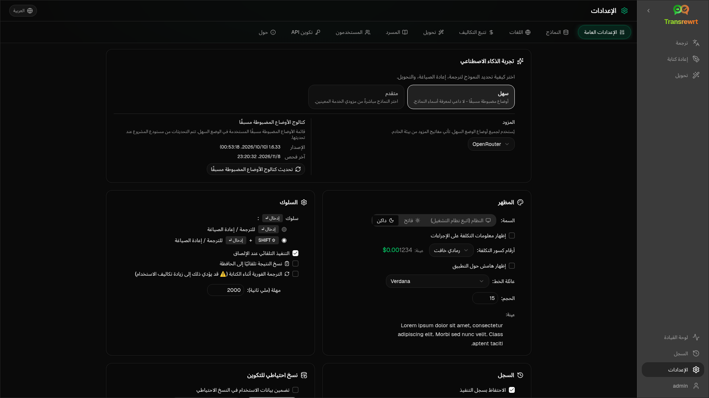

افتح **الإعدادات** من الشريط الجانبي لتخصيص سلوك التطبيق.

| علامة التبويب | سطح المكتب | الويب (المسؤول) | الويب (المستخدم) | ملاحظات |
| --- | :---: | :---: | :---: | --- |
| الإعدادات العامة | ✓ | ✓ | ✓ | تتضمن **تجربة الذكاء الاصطناعي** (سهلة / متقدمة) |
| النماذج | ✓ | ✓ | ✓ | بطاقات الإعدادات المسبقة في الوضع السهل، جدول النماذج في الوضع المتقدم |
| اللغات | ✓ | ✓ | ✓ | |
| تتبع التكلفة | ✓ | ✓ | — | |
| تحويل | ✓ | ✓ | ✓ | استيراد/تصدير جماعي للمطالبات |
| مسرد المصطلحات | ✓ | ✓ | ✓ | أزواج المصطلحات للترجمة |
| المستخدمون | — | ✓ | — | |
| تكوين واجهة برمجة التطبيقات | ✓ | ✓ | — | |
| حول | ✓ | ✓ | ✓ | |

في وضع **السهل**، اختر الذكاء الاصطناعي عبر الإعدادات المسبقة في شريط الأدوات و**المزود** في الإعدادات العامة؛ تعرض علامة التبويب **النماذج** بطاقات إعدادات مسبقة للقراءة فقط.

:::note
في إصدار الويب، لكل مستخدم تكوينه الخاص (تجربة الذكاء الاصطناعي، الموفر، النماذج/الإعدادات المسبقة، اللغات، الخيارات، المطالبات). التغييرات لا تؤثر على المستخدمين الآخرين.
:::

## الإعدادات العامة

**تجربة الذكاء الاصطناعي**

- **سهل** (افتراضي): اختر **مزودًا**. يستخدم موفرو الخدمات السحابية الإعدادات المسبقة لشريط الأدوات. يسرد **نموذج اللغة المحلي** النماذج المحلية المثبتة بدلاً من ذلك. يقوم **تحديث كتالوج الأوضاع المضبوطة مسبقًا** بجلب أحدث قائمة إعدادات مسبقة من مستودع المشروع.
  - **مجاني (OpenRouter)** — خيار بدون تكلفة يتم توجيهه إلى النماذج المجانية المتاحة؛ قد تختلف الجودة والتوافر
  - **قياسي** — خفيف الوزن وفعال من حيث التكلفة؛ الأفضل للنصوص القصيرة والمسودات السريعة والاستخدام بكميات كبيرة
  - **متقدم** — نموذج عالي الدقة للمحتوى المعقد أو الدقيق، بتكلفة أعلى
  - **تقني** — مُعد للتعليمات البرمجية وواجهات برمجة التطبيقات ووثائق المطورين والمحتوى المنظم؛ يحافظ على التنسيق والمصطلحات
- **متقدم**: اختر النماذج في شريط الأدوات؛ وقم بإدارة القائمة ضمن [النماذج](#models).

يمكنك أيضًا التبديل بين السهل ↔ المتقدم من قائمة الإعدادات المسبقة/النماذج في شريط الأدوات (**التبديل إلى الوضع السهل/المتقدم**، فوق فتح الإعدادات).

**المظهر** — السمة؛ **إظهار معلومات التكلفة على الإجراءات**؛ **أرقام كسور التكلفة**؛ هامش حول التطبيق مخصص للويب فقط؛ **عائلة الخط** و**الحجم**.

**السلوك** — **سلوك ENTER**؛ **التنفيذ التلقائي عند الإلصاق**؛ **نسخ النتيجة تلقائيًا إلى الحافظة**؛ **الترجمة في الوقت الفعلي أثناء الكتابة**؛ **المهلة (مللي ثانية)**.

**السجل**

- **الاحتفاظ بسجل التنفيذ** — تخزين المدخلات/المخرجات لعرض [السجل](/docs/history/). يؤدي إيقاف التشغيل إلى طلب تأكيد ويمكن أن يزيل النص المخزن. إذا تم تسميته *معطل بواسطة المسؤول*، فسيتم تعيين `HISTORY_DISABLED` — راجع [التكوين](/docs/configuration/#privacy-mode).
- **حذف بيانات السجل** — إزالة النص المخزن حسب العمر أو مسح الكل. لا **يحذف** إجماليات التكلفة (استخدم تتبع التكلفة لذلك).

**نسخ احتياطي للتكوين** (مسؤولو سطح المكتب والويب)

- اختياري **تضمين بيانات الاستخدام في النسخ الاحتياطي**
- **نسخ احتياطي للتكوين** — ملف ZIP يحتوي على التكوين والحالة والمستخدمين والتفضيلات والمطالبات وبيانات الاستخدام الاختيارية
- **استعادة من النسخة الاحتياطية** — مربع حوار تأكيد مع خيارات للاستعادة و/أو مسح بيانات الاستخدام

يمكن نقل النسخ الاحتياطية بين سطح المكتب والويب؛ يؤدي استعادة نسخة احتياطية لسطح المكتب على الويب إلى تطبيق البيانات على المستخدم المسؤول.

## النماذج

علامة التبويب **النماذج** مدرجة دائمًا. يقوم مفتاح التبديل **سهل / متقدم** بتبديل التطبيق بأكمله بين [تجربتي الذكاء الاصطناعي](#general-settings).

- يعرض **سهل** بطاقة واحدة للقراءة فقط لكل إعداد مسبق (على سبيل المثال **مجاني (OpenRouter)** أو **قياسي**). تسرد كل بطاقة النموذج الرئيسي والنموذج الاحتياطي للإعداد المسبق لكل مزود قمت بتكوينه. تقوم شرائح **المزود** بتصفية البطاقات.
- يعرض **متقدم** جدولاً واحداً لكل نموذج، مع:
  - مربع بحث، وشرائح **المزود**، و**مجاني فقط**، و**المحدد فقط**، و**تحديث**
  - قائمة فرز؛ الافتراضي هو **الفهرس من الأعلى إلى الأدنى**
  - مربع اختيار لكل نموذج لتحديده أو إلغاء تحديده
  - **اختر من الإعدادات المسبقة**، والذي يضيف النماذج الرئيسية والاحتياطية للإعداد المسبق لكل مزود تم تكوينه (يقوم **تحميل الكل** بتحميل كل مزود)
  - **إلغاء تحديد الكل**، والذي يطلب التأكيد أولاً
- تستخدم معرفات النموذج بادئة المزود (`openrouter/…`، `openai/…`، `local/…`، …)

أعمدة النقاط والسعر:

- **المؤشر** — درجة جودة ممزوجة من ChrF وArena Score والسعر. يتم ترتيبها داخل كل مزود، لذا فهي غير قابلة للمقارنة بين المزودين. النماذج التي لا تحتوي على مؤشر يتم فرزها إلى الأسفل.
- **ChrF** — متوسط جودة الترجمة من [languagebench](https://huggingface.co/spaces/fair-forward/languagebench) للغات واجهة المستخدم الخاصة بالتطبيق.
- **Arena** — Arena Score من لوحة المتصدرين [LMArena](https://huggingface.co/datasets/lmarena-ai/leaderboard-dataset).
- **الإدخال** / **الإخراج** — السعر بالدولار الأمريكي لكل مليون رمز، من كتالوج المزود أو [models.dev](https://models.dev/). يتم تمييز السعر المقدر بعلامة نجمية. تعني الشرطة (—) أن السعر غير معروف؛ تعرض النماذج المحلية "لا توجد تكلفة - محلية".

مرر مؤشر الماوس فوق عنوان عمود لرؤية مصدر بياناته وترخيصه. يعرض محدد النموذج في شريط الأدوات مؤشر كل نموذج كشريحة صغيرة؛ مرر مؤشر الماوس فوقها للحصول على قيم ChrF وArena.

النتائج هي دليل فقط: التغطية غير مكتملة، والعديد من النماذج لا تحتوي على درجة ChrF أو Arena.

:::tip
لا تستخدم OpenRouter **Body Builder** (`openrouter/bodybuilder`) للترجمة أو إعادة الكتابة أو التحويل — فهو يُرجع حمولات طلبات JSON، وليس نصًا مكتملًا.
:::

حدد أو ألغِ تحديد نموذج لتحديده أو إلغاء تحديده. نموذج OpenRouter المجاني اختياري — قد تكون النماذج المحددة فارغة. تؤدي إزالة آخر نموذج من شريط الأدوات إلى فتح **الإعدادات ← النماذج**. إذا أصبح النموذج الحالي غير متاح، يحدد التطبيق النموذج التالي في القائمة بدلاً من فرض النموذج المجاني.

## اللغات

- **أهم اللغات** — مثبتة بالقرب من أعلى قوائم اللغات في الترجمة والتحويل
- **لغة مخصصة** — أضف لغة مفقودة من القائمة المضمنة

## تتبع التكاليف

- **إجمالي التكلفة**، **نسخ القيمة**، **إعادة تعيين التكلفة**
- **المزامنة مع استخدام مفتاح API** — المواءمة مع استخدام حساب OpenRouter (OpenRouter فقط)
- **استخدام مفتاح API** — تفاصيل OpenRouter عند توفرها
- **حذف بيانات التكلفة** — جميع البيانات أو الإدخالات الأقدم من تاريخ معين

يعرض OpenRouter وxAI التكلفة الفعلية المفوترة عندما تُرجعها واجهة برمجة التطبيقات؛ يستخدم المزودون الآخرون تقديرات من تسعير [models.dev](https://models.dev/). التقديرات ليست فواتير.

:::caution
لا يمكن التراجع عن حذف بيانات التكلفة. قم بالتصدير عبر السجل أو لوحة التحكم ← جميع المكالمات أولاً إذا كنت بحاجة إلى نسخة احتياطية. يتم أيضًا إزالة سجل الإدخال/الإخراج ذي الصلة لتلك المكالمات API.
:::

## التحويل

إدارة المطالبات بشكل مجمع: مراجعة، حذف، استيراد، تصدير، وتحميل مطالبات نموذجية.

## مسرد المصطلحات

إدارة أزواج المصطلحات المطبقة أثناء [الترجمة](/docs/translate/#use-the-glossary). يحتوي كل مصطلح على لغة المصدر/الهدف ونص المصدر/الهدف.

- أضف عبر الصف السفلي و **+**
- فرز حسب اللغات أو النص
- استيراد/تصدير CSV أو XLSX؛ تحميل قوالب فارغة

يخزن سطح المكتب المسرد محليًا؛ بينما يخزنه الويب لكل مستخدم.

## المستخدمون

الويب فقط (المسؤولون):

- إضافة مستخدمين، تحديث التفاصيل، إعادة تعيين كلمات المرور، حذف الحسابات
- **مهلة الجلسة** — مدة بقاء تسجيل الدخول (من ساعة واحدة إلى 7 أيام)؛ تنطبق التغييرات على تسجيلات الدخول الجديدة فقط
- **إلغاء الجلسات** — تسجيل خروج المستخدم من جميع الأجهزة فورًا

يمكن لكل مستخدم مسجل الدخول (بما في ذلك غير المسؤولين) تغيير كلمة المرور الخاصة به أو تسجيل الخروج من قائمة المستخدم في أسفل الشريط الجانبي.

## تكوين API

قم بتكوين المزودين الذين تستخدمهم فقط: OpenRouter، OpenAI، Anthropic، Google Gemini، DeepSeek، Groq، Mistral، xAI، Cerebras، NVIDIA، Alibaba Cloud، apikey.fun، **نموذج اللغة المحلي** (عنوان URL الأساسي لـ Ollama، LM Studio، llama.cpp، أو ما شابه)، ومزود مخصص اختياري متوافق مع OpenAI.

**الويب (المسؤول):** تأتي المفاتيح من متغيرات البيئة — تعرض هذه الصفحة المفاتيح التي تم تعيينها وتتيح لك **الاختبار**. أعد التشغيل بعد تغيير متغيرات البيئة. راجع [التكوين](/docs/configuration/).

**سطح المكتب:** أدخل المفاتيح (أو عنوان URL لـ Local LLM) و**حفظ** / **تعديل** / **اختبار**. يتم تخزين المفاتيح مشفرة؛ لا يمكنك عرض القيمة الحالية، بل استبدالها فقط.

:::tip
لا يلزم وجود مفتاح مدفوع للبدء: استخدم نماذج OpenRouter المجانية، أو موفري الطبقة المجانية الآخرين، أو خادمًا محليًا متوافقًا مع OpenAI مثل [Ollama](https://ollama.com)، أو LM Studio، أو llama.cpp (على سبيل المثال `translategemma:4b`).
:::

## حول

اسم التطبيق، الإصدار، تاريخ الإنشاء، الترخيص، إشعارات الطرف الثالث، ورابط المستودع.
