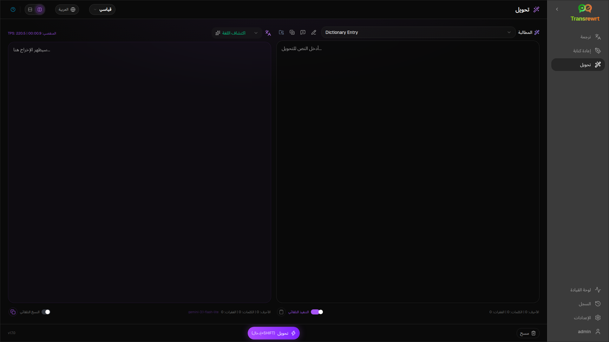
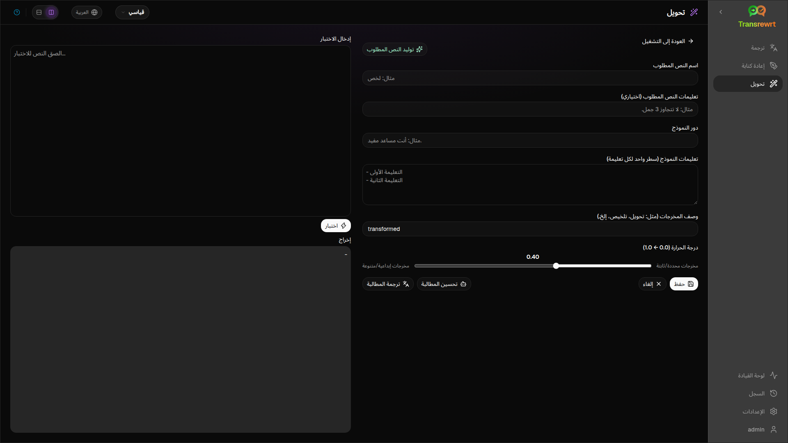

استخدم **التحويل** عندما تريد أن يتبع الذكاء الاصطناعي تعليمات مخصصة — تلخيص، أو صقل بريد إلكتروني، أو استخراج النقاط الرئيسية، أو إعادة تنسيق النص، أو أي سير عمل تحدده.

## تشغيل مطالبة موجودة

1. افتح **التحويل**.
2. اختر مطالبة من القائمة.
3. إذا ظهر مربع لغة **من**، فاضبط اللغة إذا كنت تريد ذلك.
4. اكتب أو الصق النص في **الإدخال**.
5. انقر فوق **تحويل**.
6. اقرأ النتيجة في **الإخراج**.

يعمل [تبديل التخطيط واختصارات لوحة المفاتيح](/docs/translate/#layout-and-keyboard) بنفس الطريقة كما في الترجمة.

## تحميل الأنماط النموذجية

إذا كانت القائمة فارغة، فانقر على **تحميل الأنماط النموذجية** في مساحة عمل التحويل (متوفر أيضًا ضمن [الإعدادات ← تحويل](/docs/settings/#transform)). العينات باللغة الإنجليزية؛ بعد التحميل، قم بتحرير مطالبة واستخدم **ترجمة المطالبة** إذا لزم الأمر.

## إنشاء مطالبة

1. انقر على **مطالبة جديدة**.
2. انقر على **توليد النص المطلوب**.
3. صف ما تريد أن تفعله المطالبة.
4. اختر إعدادًا مسبقًا (سهل) أو نموذجًا (متقدم).
5. راجع المسودة وانقر فوق **حفظ**.

## تعديل مطالبة

المحرر على اليسار؛ منطقة الاختبار على اليمين.

الحقول الرئيسية:

- **اسم النص المطلوب** — يظهر في قائمة المطالبات
- **تعليمات النص المطلوب (اختياري)** — تلميح قصير عند تشغيل المطالبة
- **دور النموذج** — الدور العام للذكاء الاصطناعي
- **تعليمات النموذج (سطر واحد لكل تعليمة)** — القواعد التي يجب اتباعها
- **وصف الإخراج** — تسمية قصيرة للنتيجة (مثل ملخص)
- **درجة الحرارة (0.0 → 1.0)** — الأقل أكثر ثباتًا؛ الأعلى أكثر تنوعًا
- **طلب لغة الهدف** — يضيف محدد لغة عند التشغيل

المساعدون: **توليد النص المطلوب**، **تحسين المطالبة**، **ترجمة المطالبة** (السهل يستخدم الإعدادات المسبقة؛ المتقدم يستخدم قائمة النماذج).

:::caution
انقر فوق **حفظ** قبل **العودة إلى التشغيل**. العودة دون حفظ تتجاهل التعديلات.
:::

## اختبر قبل الاستخدام اليومي

استخدم لوحة الاختبار اليمنى مع نموذج نص عند إنشاء المطالبات أو مقارنتها.

تصدير واستيراد المطالبات بشكل مجمع ضمن [الإعدادات ← تحويل](/docs/settings/#transform).

## الخطوات التالية

- [الإعدادات](/docs/settings/)
- [تصفح السجل](/docs/history/)
- [المشكلات الشائعة](/docs/common-issues/)
