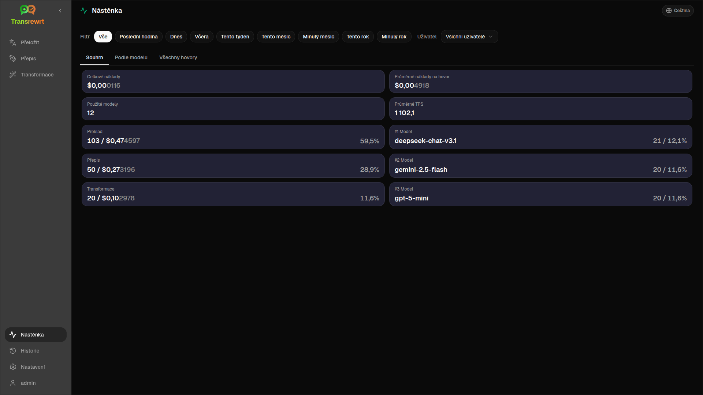

Použijte **řídicí panel** k zobrazení, kolik aplikaci používáte a jaké jsou náklady (u placených modelů).

:::note
Částky nákladů se mohou zobrazit jako **0 $**, pokud používáte bezplatné modely, poskytovatel nepodporuje sledování nákladů nebo používáte lokální LLM. KPI počtu volání v části **Souhrn** odrážejí skutečné využití bez ohledu na to – jsou nulové pouze v případě, že ve vybraném období nebyla žádná aktivita.
:::

## Filtrování dat

Pomocí tlačítek filtru nahoře změňte časové rozmezí.

Filtr **Uživatel** je viditelný pouze pro administrátory ve webové verzi; není k dispozici na počítači.

## Karty

- **Souhrn** – KPI: celkové náklady, použité modely, počet hovorů a náklady podle režimu, průměrné náklady na hovor, průměrné TPS, nejlepší modely podle počtu hovorů
- **Podle modelu** – hovory, náklady a TPS podle modelu; rozbalením řádku zobrazíte rozpis podle režimu
- **Všechny hovory** – úplný protokol hovorů (stránkovaný nebo karty) s exportem

## Export dat

Exportujte tabulky jako **JSON**, **CSV** nebo **XLSX**.

## Odstranění uložených záznamů pro model

V části **Podle modelu** nebo **Všechny hovory** použijte ikonu koše k odebrání záznamů pro model.

:::caution
Odstranění nelze vrátit zpět. Chcete-li odstranit podle stáří nebo vymazat všechna data o nákladech, použijte [Nastavení → Sledování nákladů](/docs/settings/#cost-tracking).
:::

## Další kroky

- [Procházet historii](/docs/history/)
- [Nastavení](/docs/settings/)
- [Běžné problémy](/docs/common-issues/)
