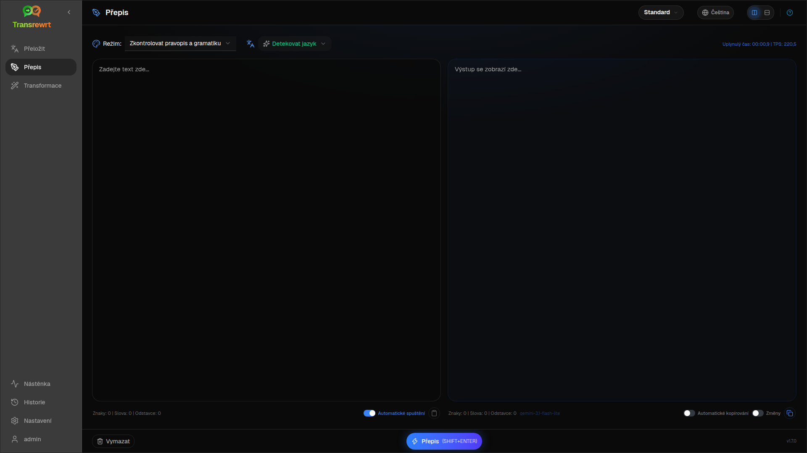

Použijte **Přepsat** ke zlepšení formulace beze změny hlavního významu. Text zůstává ve stejném jazyce.

Režimy zahrnují:

- **Zkontrolovat pravopis a gramatiku**
- **Zlepšit srozumitelnost**
- **Alternativní verze** (několik přeformulování v jednom spuštění)
- **Formální** / **Neformální**
- **Zkrátit** / **Rozšířit**
- **Technický**

## Přepsat text

1. Otevřete **Přepsat**.
2. Zvolte **Režim**.
3. Volitelně nastavte **Z** na jazyk vašeho textu (nebo ponechte **Detekovat jazyk**).
4. Napište nebo vložte text do **Vstup**.
5. Klikněte na **Přepsat**.
6. Přečtěte si výsledek v **Výstup**.

[Přepínač rozložení a klávesové zkratky](/docs/translate/#layout-and-keyboard) fungují stejně jako v Překladu.

:::tip
Po přepsání se vedle **Kopírovat** objeví přepínač **Zobrazit změny** (**Změny**) pro **každý** režim přepsání. Přepnutím zobrazíte nebo skryjete rozdíly mezi vstupem a výstupem.
:::

:::note
**Alternativní verze** vrací několik přeformulování v **jednom** běhu, oddělených `----`. To se liší od **Přeformulovat…**, které postupně vytváří historii verzí.
:::

## Upravit přepsání

Po úspěšném spuštění se na výstupní straně objeví **Přeformulovat…** a rozbalovací nabídka verzí (stejný princip jako [Překlad](/docs/translate/#refine-a-translation), ale text zůstává ve stejném jazyce a zachovává aktuální **Režim**):

1. **Přepsat…** (bez výběru) – další kompletní přepis s jiným zněním. Až pět verzí. Kliknutím na **Zastavit přepis** zrušíte akci.
2. **Náhradní slova** – vyberte text a poté klikněte pravým tlačítkem nebo na **Přepsat…**.
3. Každý požadavek může zvýšit náklady na použití.

## Další kroky

- [Přeložit text](/docs/translate/)
- [Transformovat pomocí výzev](/docs/transform/)
- [Běžné problémy](/docs/common-issues/)
