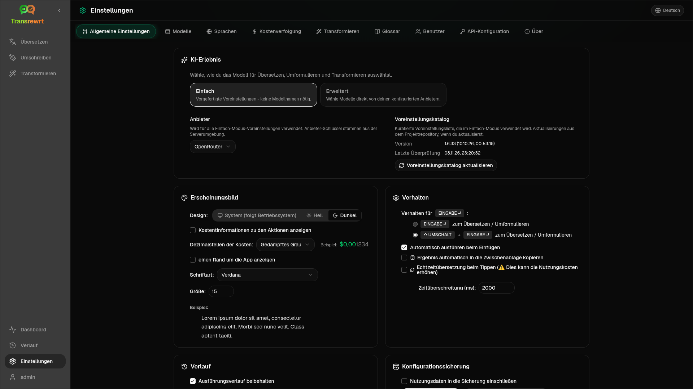

Öffnen Sie die **Einstellungen** über die Seitenleiste, um das Verhalten der App anzupassen.

| Tab | Desktop | Web (admin) | Web (user) | Notes |
| --- | :---: | :---: | :---: | --- |
| Allgemeine Einstellungen | ✓ | ✓ | ✓ | Beinhaltet **KI-Erlebnis** (Einfach / Erweitert) |
| Modelle | ✓ | ✓ | ✓ | Voreingestellte Karten in „Einfach“, Modelltabelle in „Erweitert“ |
| Sprachen | ✓ | ✓ | ✓ | |
| Kostenverfolgung | ✓ | ✓ | — | |
| Transformieren | ✓ | ✓ | ✓ | Massenimport/-export von Prompts |
| Glossar | ✓ | ✓ | ✓ | Begriffspaare für die Übersetzung |
| Benutzer | — | ✓ | — | |
| API-Konfiguration | ✓ | ✓ | — | |
| Über | ✓ | ✓ | ✓ | |

Im Modus **Einfach** wählen Sie die KI über Voreinstellungen in der Symbolleiste und den **Anbieter** in den Allgemeinen Einstellungen aus; die Registerkarte **Modelle** zeigt schreibgeschützte Voreinstellungskarten an.

:::note
In der Webversion hat jeder Benutzer seine eigene Konfiguration (KI-Erfahrung, Anbieter, Modelle/Voreinstellungen, Sprachen, Optionen, Prompts). Änderungen wirken sich nicht auf andere Benutzer aus.
:::

## Allgemeine Einstellungen

**KI-Erlebnis**

- **Einfach** (Standard): Wählen Sie einen **Anbieter**. Cloud-Anbieter verwenden Voreinstellungen der Symbolleiste. **Lokales LLM** listet stattdessen installierte lokale Modelle auf. **Voreinstellungskatalog aktualisieren** ruft die neueste Voreinstellungsliste aus dem Projekt-Repository ab.
  - **Kostenlos (OpenRouter)** – kostenlose Option, die an verfügbare kostenlose Modelle weitergeleitet wird; Qualität und Verfügbarkeit können variieren
  - **Standard** – leicht und kostengünstig; am besten für kurze Texte, schnelle Entwürfe und den Einsatz in großen Mengen geeignet
  - **Erweitert** – hochpräzises Modell für komplexe oder nuancierte Inhalte, zu höheren Kosten
  - **Technisch** – abgestimmt auf Code, APIs, Entwickler-Dokumentation und strukturierte Inhalte; bewahrt Formatierung und Terminologie
- **Erweitert**: Wählen Sie Modelle in der Symbolleiste aus; verwalten Sie die Liste unter [Modelle](#models).

Sie können auch zwischen Einfach ↔ Erweitert über das Voreinstellungs-/Modellmenü der Symbolleiste wechseln (**In den einfachen/erweiterten Modus wechseln**, über „Einstellungen öffnen“).

**Erscheinungsbild** – Design; **Kosteninformationen für Aktionen anzeigen**; **Kosten-Nachkommastellen**; Nur-Web-Rand um die App; **Schriftfamilie** und **Schriftgröße**.

**Verhalten** — **Verhalten für ENTER**; **Automatisch ausführen beim Einfügen**; **Ergebnis automatisch in die Zwischenablage kopieren**; **Echtzeit-Übersetzung während der Eingabe**; **Timeout (ms)**.

**Verlauf**

- **Ausführungsverlauf beibehalten** – speichert Eingaben/Ausgaben für die Ansicht [Verlauf](/docs/history/). Das Deaktivieren erfordert eine Bestätigung und kann gespeicherten Text entfernen. Wenn als *vom Administrator deaktiviert* gekennzeichnet, ist `HISTORY_DISABLED` eingestellt – siehe [Konfiguration](/docs/configuration/#privacy-mode).
- **Verlaufsdaten löschen** – gespeicherten Text nach Alter entfernen oder alles löschen. Löscht **nicht** die Gesamtkosten (verwenden Sie dafür die Kostenverfolgung).

**Konfigurationssicherung** (Desktop- und Web-Administratoren)

- Optional **Nutzungsdaten in die Sicherung aufnehmen**
- **Konfiguration sichern** – ZIP mit Konfiguration, Status, Benutzern, Einstellungen, Prompts und optionalen Nutzungsdaten
- **Aus Sicherung wiederherstellen** – Bestätigungsdialog mit Optionen zum Wiederherstellen und/oder Löschen von Nutzungsdaten

Sicherungen können zwischen Desktop und Web verschoben werden; das Wiederherstellen einer Desktop-Sicherung im Web wendet Daten auf den Administratorbenutzer an.

## Modelle

Die Registerkarte **Modelle** ist immer aufgeführt. Ihr Umschalter **Einfach / Erweitert** schaltet die gesamte App zwischen den beiden [KI-Erfahrungen](#general-settings) um.

- **Einfach** zeigt eine schreibgeschützte Karte pro Vorgabe an (zum Beispiel **Kostenlos (OpenRouter)** oder **Standard**). Jede Karte listet das Haupt- und Fallback-Modell der Vorgabe für jeden von Ihnen konfigurierten Anbieter auf. Die **Anbieter**-Chips filtern die Karten.
- **Erweitert** zeigt eine Tabelle mit jedem Modell an, mit:
  - einem Suchfeld, **Anbieter**-Chips, **Nur kostenlos**, **Nur ausgewählte** und **Aktualisieren**
  - einem Sortiermenü; die Standardeinstellung ist **Index absteigend**
  - einem Kontrollkästchen pro Modell, um es auszuwählen oder abzuwählen
  - **Aus Voreinstellungen auswählen**, das die Haupt- und Fallback-Modelle einer Vorgabe für jeden konfigurierten Anbieter hinzufügt (**Alle laden** lädt jeden Anbieter)
  - **Alle abwählen**, das zuerst eine Bestätigung anfordert
- Modell-IDs verwenden ein Anbieterpräfix (`openrouter/…`, `openai/…`, `local/…`, …)

Die Spalten für Bewertung und Preis:

- **Index** – eine Qualitätsbewertung, die aus ChrF, Arena Score und Preis gemischt wird. Sie wird innerhalb jedes Anbieters eingestuft und ist daher nicht über Anbieter hinweg vergleichbar. Modelle ohne Index werden am Ende sortiert.
- **ChrF** – mittlere Übersetzungsqualität von [languagebench](https://huggingface.co/spaces/fair-forward/languagebench) für die UI-Sprachen der App.
- **Arena** – Arena Score von der [LMArena](https://huggingface.co/datasets/lmarena-ai/leaderboard-dataset)-Bestenliste.
- **Eingabe** / **Ausgabe** – Preis in USD pro 1 Mio. Token, aus dem Anbieterkatalog oder [models.dev](https://models.dev/). Ein geschätzter Preis ist mit einem Sternchen gekennzeichnet. Ein Bindestrich (—) bedeutet, dass der Preis unbekannt ist; lokale Modelle zeigen „kostenlos - lokal“ an.

Fahren Sie mit der Maus über eine Spaltenüberschrift, um deren Datenquelle und Lizenz anzuzeigen. Die Modellauswahl in der Symbolleiste zeigt den Index jedes Modells als kleinen Chip an; fahren Sie mit der Maus darüber, um die ChrF- und Arena-Werte anzuzeigen.

Die Bewertungen dienen nur als Richtlinie: Die Abdeckung ist unvollständig, und viele Modelle haben keinen ChrF- oder Arena-Score.

:::tip
Verwenden Sie OpenRouter **Body Builder** (`openrouter/bodybuilder`) nicht für Übersetzen, Umschreiben oder Transformieren – es gibt JSON-Anforderungs-Payloads zurück, nicht fertigen Text.
:::

Aktivieren oder deaktivieren Sie ein Modell, um es auszuwählen oder abzuwählen. Das kostenlose OpenRouter-Modell ist optional – ausgewählte Modelle können leer sein. Das Entfernen des letzten Modells aus der Symbolleiste öffnet **Einstellungen → Modelle**. Wenn das aktuelle Modell nicht verfügbar wird, wählt die App das nächste Modell in der Liste aus, anstatt das kostenlose Modell zu erzwingen.

## Sprachen

- **Top-Sprachen** – oben in den Sprachlisten in Übersetzen und Transformieren angeheftet
- **Benutzerdefinierte Sprache** – fügt eine Sprache hinzu, die in der integrierten Liste fehlt

## Kostenverfolgung

- **Gesamtkosten**, **Wert kopieren**, **Kosten zurücksetzen**
- **Mit API-Schlüsselnutzung synchronisieren** – Abgleich mit der OpenRouter-Kontonutzung (nur OpenRouter)
- **API-Schlüsselnutzung** – OpenRouter-Details, falls verfügbar
- **Kostendaten löschen** – alle Daten oder Einträge, die älter als ein bestimmtes Datum sind

OpenRouter und xAI zeigen die tatsächlich abgerechneten Kosten an, wenn die API diese zurückgibt; andere Anbieter verwenden Schätzungen aus der Preisgestaltung von [models.dev](https://models.dev/). Schätzungen sind keine Rechnungen.

:::caution
Das Löschen von Kostendaten kann nicht rückgängig gemacht werden. Exportieren Sie zuerst über Verlauf oder Dashboard → Alle Anrufe, wenn Sie eine Sicherung benötigen. Der zugehörige Eingabe-/Ausgabeverlauf für diese API-Aufrufe wird ebenfalls entfernt.
:::

## Transformieren

Prompts in großen Mengen verwalten: überprüfen, löschen, importieren, exportieren und Beispiel-Prompts laden.

## Glossar

Verwalten Sie Begriffspaare, die während der [Übersetzung](/docs/translate/#use-the-glossary) angewendet werden. Jeder Begriff hat eine Quell-/Zielsprache und einen Quell-/Zieltext.

- Hinzufügen über die untere Zeile und **+**
- Filtern nach Sprachen oder Text
- CSV oder XLSX importieren/exportieren; leere Vorlagen herunterladen

Desktop speichert das Glossar lokal; Web speichert es pro Benutzer.

## Benutzer

Nur Web (Administratoren):

- Benutzer hinzufügen, Details aktualisieren, Passwörter zurücksetzen, Konten löschen
- **Sitzungstimeout** — wie lange eine Anmeldung gültig ist (1 Stunde bis 7 Tage); Änderungen gelten nur für neue Anmeldungen
- **Sitzungen widerrufen** — einen Benutzer sofort von allen Geräten abmelden

Jeder angemeldete Benutzer (einschließlich Nicht-Administratoren) kann sein eigenes Passwort ändern oder sich über das Benutzermenü am unteren Rand der Seitenleiste abmelden.

## API-Konfiguration

Konfigurieren Sie nur die von Ihnen verwendeten Anbieter: OpenRouter, OpenAI, Anthropic, Google Gemini, DeepSeek, Groq, Mistral, xAI, Cerebras, NVIDIA, Alibaba Cloud, apikey.fun, **Lokales LLM** (Basis-URL für Ollama, LM Studio, llama.cpp oder ähnliches) und einen optionalen benutzerdefinierten OpenAI-kompatiblen Anbieter.

**Web (Admin):** Schlüssel stammen aus Umgebungsvariablen – diese Seite zeigt, welche gesetzt sind, und ermöglicht Ihnen das **Testen**. Starten Sie nach dem Ändern der Umgebungsvariablen neu. Siehe [Konfiguration](/docs/configuration/).

**Desktop:** Geben Sie Schlüssel (oder die lokale LLM-URL) ein und **Speichern** / **Bearbeiten** / **Testen**. Schlüssel werden verschlüsselt gespeichert; Sie können den aktuellen Wert nicht anzeigen, sondern nur ersetzen.

:::tip
Zum Starten ist kein kostenpflichtiger Schlüssel erforderlich: Verwenden Sie kostenlose OpenRouter-Modelle, andere kostenlose Anbieter oder einen lokalen OpenAI-kompatiblen Server wie [Ollama](https://ollama.com), LM Studio oder llama.cpp (z. B. `translategemma:4b`).
:::

## Über

App-Name, Version, Build-Datum, Lizenz, Hinweise von Drittanbietern und Repository-Link.
