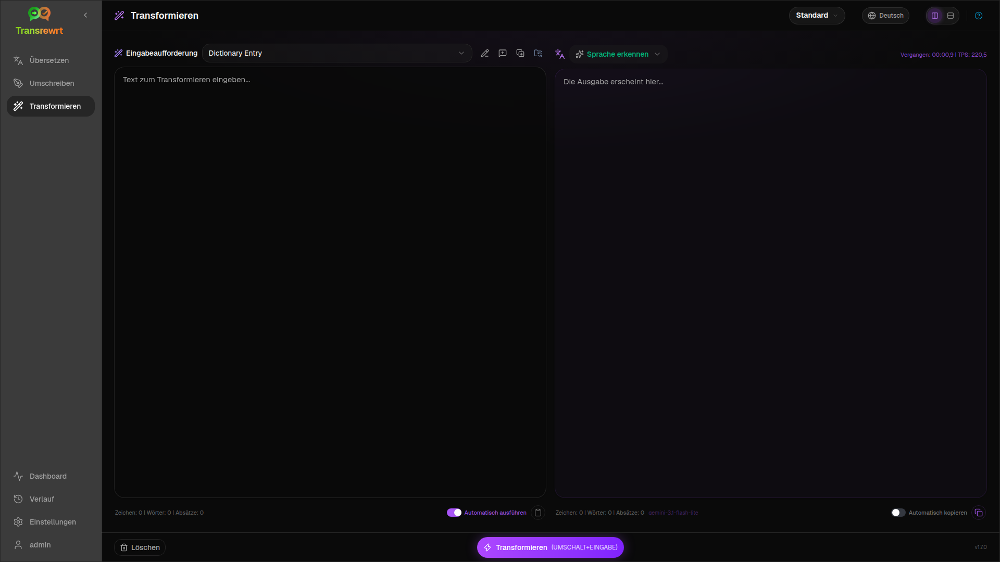
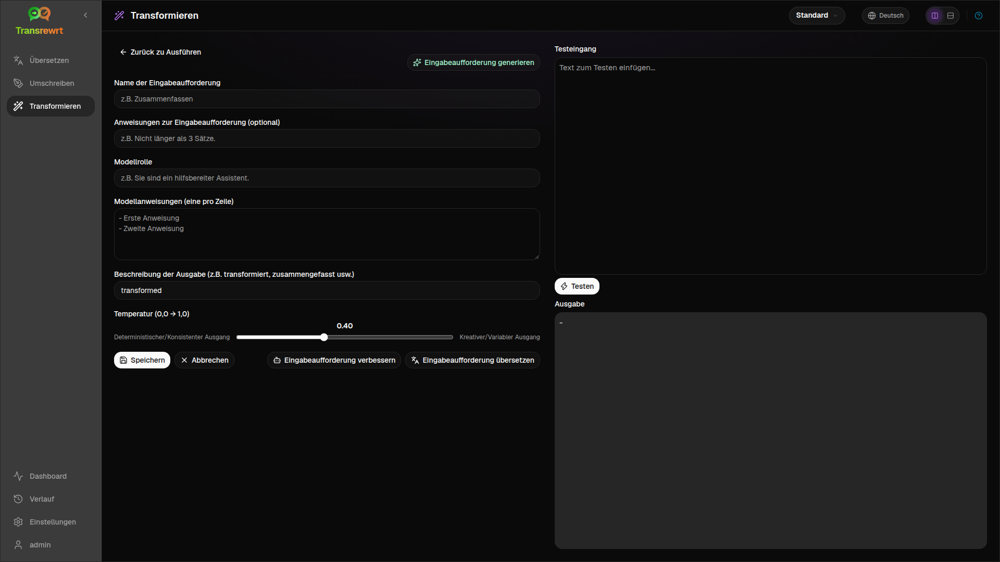

Verwenden Sie **Transform**, wenn die KI benutzerdefinierten Anweisungen folgen soll – fassen Sie zusammen, verfeinern Sie eine E-Mail, extrahieren Sie Kernpunkte, formatieren Sie Text neu oder führen Sie einen beliebigen von Ihnen definierten Workflow aus.

## Vorhandenen Prompt ausführen

1. Öffnen Sie **Transform**.
2. Wählen Sie einen Prompt aus der Liste aus.
3. Wenn ein Feld **Von** Sprache angezeigt wird, stellen Sie eine Sprache ein, falls gewünscht.
4. Geben Sie Text in **Eingabe** ein oder fügen Sie ihn dort ein.
5. Klicken Sie auf **Transformieren**.
6. Lesen Sie das Ergebnis in **Ausgabe**.

Die [Layout-Umschaltung und Tastenkombinationen](/docs/translate/#layout-and-keyboard) funktionieren genauso wie bei der Übersetzung.

## Beispielaufträge laden

Wenn die Liste leer ist, klicken Sie im Transform-Arbeitsbereich auf **Beispielaufträge laden** (auch verfügbar unter [Einstellungen → Transformieren](/docs/settings/#transform)). Die Beispiele sind in englischer Sprache; bearbeiten Sie nach dem Laden eine Eingabeaufforderung und verwenden Sie bei Bedarf **Eingabeaufforderung übersetzen**.

## Prompt erstellen

1. Klicken Sie auf **Neue Eingabeaufforderung**.
2. Klicken Sie auf **Eingabeaufforderung generieren**.
3. Beschreiben Sie, was die Eingabeaufforderung tun soll.
4. Wählen Sie eine Vorgabe (Einfach) oder ein Modell (Erweitert).
5. Überprüfen Sie den Entwurf und klicken Sie auf **Speichern**.

## Prompt bearbeiten

Der Editor befindet sich links; ein Testbereich befindet sich rechts.

Hauptfelder:

- **Name der Eingabeaufforderung** – wird in der Eingabeaufforderungsliste angezeigt
- **Anweisungen zur Eingabeaufforderung (optional)** – kurzer Hinweis beim Ausführen der Eingabeaufforderung
- **Modellrolle** – die allgemeine Rolle für die KI
- **Modellanweisungen (eine pro Zeile)** – zu befolgende Regeln
- **Ausgabebeschreibung** – kurze Bezeichnung für das Ergebnis (z. B. zusammengefasst)
- **Temperatur (0,0 → 1,0)** – niedriger ist stabiler; höher ist variabler
- **Zielsprache abfragen** – fügt bei der Ausführung einen Sprachwähler hinzu

Helfer: **Eingabeaufforderung generieren**, **Eingabeaufforderung verbessern**, **Eingabeaufforderung übersetzen** (Einfach verwendet Vorgaben; Erweitert verwendet die Modellliste).

:::caution
Klicken Sie auf **Speichern**, bevor Sie auf **Zurück zu Ausführen** klicken. Wenn Sie ohne Speichern zurückgehen, werden die Änderungen verworfen.
:::

## Vor dem täglichen Gebrauch testen

Verwenden Sie das rechte Testfeld mit Beispieltext, wenn Sie Prompts erstellen oder vergleichen.

Prompts können unter [Einstellungen → Transformieren](/docs/settings/#transform) in großen Mengen exportiert und importiert werden.

## Nächste Schritte

- [Einstellungen](/docs/settings/)
- [Verlauf durchsuchen](/docs/history/)
- [Häufige Probleme](/docs/common-issues/)
