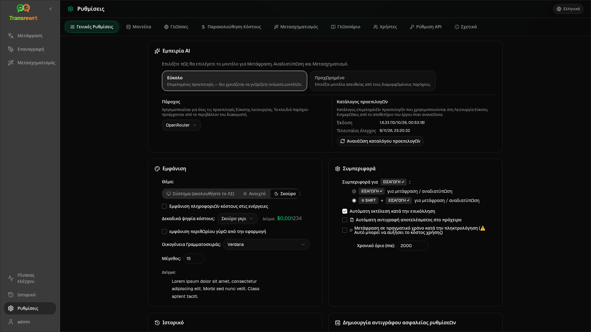

Ανοίξτε τις **Ρυθμίσεις** από την πλαϊνή γραμμή για να προσαρμόσετε τον τρόπο λειτουργίας της εφαρμογής.

| Καρτέλα | Επιφάνεια εργασίας | Web (διαχειριστής) | Web (χρήστης) | Σημειώσεις |
| --- | :---: | :---: | :---: | --- |
| Γενικές ρυθμίσεις | ✓ | ✓ | ✓ | Περιλαμβάνει **εμπειρία AI** (Εύκολη / Προηγμένη) |
| Μοντέλα | ✓ | ✓ | ✓ | Προκαθορισμένες κάρτες σε Εύκολη λειτουργία, πίνακας μοντέλων σε Προηγμένη λειτουργία |
| Γλώσσες | ✓ | ✓ | ✓ | |
| Παρακολούθηση κόστους | ✓ | ✓ | — | |
| Μετασχηματισμός | ✓ | ✓ | ✓ | Μαζική εισαγωγή/εξαγωγή προτροπών |
| Γλωσσάρι | ✓ | ✓ | ✓ | Ζεύγη όρων για μετάφραση |
| Χρήστες | — | ✓ | — | |
| Διαμόρφωση API | ✓ | ✓ | — | |
| Σχετικά | ✓ | ✓ | ✓ | |

Στην **Εύκολη** λειτουργία, επιλέξτε AI μέσω προκαθορισμένων ρυθμίσεων στη γραμμή εργαλείων και **Πάροχο** στις Γενικές Ρυθμίσεις. Η καρτέλα **Μοντέλα** εμφανίζει κάρτες προκαθορισμένων ρυθμίσεων μόνο για ανάγνωση.

:::note
Στην έκδοση web, κάθε χρήστης έχει τη δική του διαμόρφωση (εμπειρία AI, πάροχος, μοντέλα/προεπιλογές, γλώσσες, επιλογές, προτροπές). Οι αλλαγές δεν επηρεάζουν άλλους χρήστες.
:::

## Γενικές ρυθμίσεις

**Εμπειρία AI**

- **Εύκολο** (προεπιλογή): επιλέξτε έναν **Πάροχο**. Οι πάροχοι cloud χρησιμοποιούν προεπιλογές γραμμής εργαλείων. Το **Τοπικό LLM** παραθέτει τα εγκατεστημένα τοπικά μοντέλα. Η **Ανανέωση καταλόγου προεπιλογών** ανακτά την πιο πρόσφατη λίστα προεπιλογών από το αποθετήριο του έργου.
  - **Δωρεάν (OpenRouter)** — επιλογή μηδενικού κόστους που δρομολογείται σε διαθέσιμα δωρεάν μοντέλα· η ποιότητα και η διαθεσιμότητα ενδέχεται να διαφέρουν
  - **Τυπικό** — ελαφρύ και οικονομικό· καλύτερο για σύντομα κείμενα, γρήγορα προσχέδια και χρήση μεγάλου όγκου
  - **Προηγμένο** — μοντέλο υψηλής ακρίβειας για σύνθετο ή λεπτομερές περιεχόμενο, με υψηλότερο κόστος
  - **Τεχνικό** — ρυθμισμένο για κώδικα, API, τεκμηρίωση προγραμματιστών και δομημένο περιεχόμενο· διατηρεί τη μορφοποίηση και την ορολογία
- **Για προχωρημένους**: επιλέξτε μοντέλα στη γραμμή εργαλείων· διαχειριστείτε τη λίστα στην ενότητα [Μοντέλα](#models).

Μπορείτε επίσης να αλλάξετε Εύκολη ↔ Προηγμένη από το μενού προεπιλογών/μοντέλων της γραμμής εργαλείων (**Εναλλαγή σε λειτουργία Εύκολη/Προηγμένη**, πάνω από τις Ανοιχτές Ρυθμίσεις).

**Εμφάνιση** — Θέμα. **Εμφάνιση πληροφοριών κόστους στις ενέργειες**. **Ψηφία κλασμάτων κόστους**. Περιθώριο μόνο για τον ιστό γύρω από την εφαρμογή. **Οικογένεια γραμματοσειράς** και **Μέγεθος**.

**Συμπεριφορά** — **Συμπεριφορά για ENTER**· **Αυτόματη εκτέλεση κατά την επικόλληση**· **Αυτόματη αντιγραφή αποτελέσματος στο πρόχειρο**· **Μετάφραση σε πραγματικό χρόνο κατά την πληκτρολόγηση**· **Λήξη χρονικού ορίου (ms)**.

**Ιστορικό**

- **Διατήρηση ιστορικού εκτέλεσης** — αποθήκευση εισόδου/εξόδου για την προβολή [Ιστορικό](/docs/history/). Η απενεργοποίηση ζητά επιβεβαίωση και μπορεί να αφαιρέσει αποθηκευμένο κείμενο. Εάν επισημανθεί ως *απενεργοποιημένο από τον διαχειριστή*, το `HISTORY_DISABLED` έχει οριστεί — δείτε [Διαμόρφωση](/docs/configuration/#privacy-mode).
- **Διαγραφή δεδομένων ιστορικού** — αφαίρεση αποθηκευμένου κειμένου ανά ηλικία ή εκκαθάριση όλων. **Δεν** διαγράφει τα συνολικά κόστη (χρησιμοποιήστε την Παρακολούθηση Κόστους για αυτό).

**Δημιουργία αντιγράφου ασφαλείας ρυθμίσεων** (διαχειριστές επιτραπέζιων και διαδικτυακών εφαρμογών)

- Προαιρετική **Συμπερίληψη δεδομένων χρήσης στο αντίγραφο ασφαλείας**
- **Δημιουργία αντιγράφου ασφαλείας ρυθμίσεων** — ZIP με ρυθμίσεις, κατάσταση, χρήστες, προτιμήσεις, προτροπές και προαιρετικά δεδομένα χρήσης
- **Επαναφορά από αντίγραφο ασφαλείας** — παράθυρο διαλόγου επιβεβαίωσης με επιλογές για επαναφορά ή/και εκκαθάριση δεδομένων χρήσης

Τα αντίγραφα ασφαλείας μπορούν να μετακινηθούν μεταξύ επιτραπέζιων υπολογιστών και ιστού. Η επαναφορά ενός αντιγράφου ασφαλείας επιτραπέζιου υπολογιστή στον ιστό εφαρμόζει δεδομένα στον χρήστη διαχειριστή.

## Μοντέλα

Η καρτέλα **Μοντέλα** εμφανίζεται πάντα. Ο διακόπτης **Εύκολη / Προηγμένη** εναλλάσσει ολόκληρη την εφαρμογή μεταξύ των δύο [εμπειριών AI](#general-settings).

- Το **Εύκολο** εμφανίζει μία κάρτα μόνο για ανάγνωση ανά προεπιλογή (για παράδειγμα **Δωρεάν (OpenRouter)** ή **Τυπικό**). Κάθε κάρτα παραθέτει το κύριο και το εναλλακτικό μοντέλο της προεπιλογής για κάθε πάροχο που έχετε διαμορφώσει. Τα πλακίδια **Πάροχος** φιλτράρουν τις κάρτες.
- Το **Προχωρημένο** εμφανίζει έναν πίνακα με κάθε μοντέλο, με:
  - ένα πλαίσιο αναζήτησης, πλακίδια **Πάροχος**, **Μόνο Δωρεάν**, **Μόνο τα επιλεγμένα** και **Ανανέωση**
  - ένα μενού ταξινόμησης· η προεπιλογή είναι **Ευρετήριο από το υψηλότερο στο χαμηλότερο**
  - ένα πλαίσιο ελέγχου ανά μοντέλο για επιλογή ή αποεπιλογή του
  - **Επιλογή από προεπιλογές**, το οποίο προσθέτει τα κύρια και τα εναλλακτικά μοντέλα μιας προεπιλογής για κάθε διαμορφωμένο πάροχο (**Φόρτωση όλων** φορτώνει κάθε πάροχο)
  - **Αποεπιλογή Όλων**, το οποίο ζητά πρώτα επιβεβαίωση
- Τα αναγνωριστικά μοντέλων χρησιμοποιούν ένα πρόθεμα παρόχου (`openrouter/…`, `openai/…`, `local/…`, …)

Οι στήλες βαθμολογίας και τιμής:

- **Δείκτης** — μια βαθμολογία ποιότητας που προκύπτει από ChrF, Arena Score και τιμή. Κατατάσσεται εντός κάθε παρόχου, επομένως δεν είναι συγκρίσιμη μεταξύ παρόχων. Τα μοντέλα χωρίς Δείκτη ταξινομούνται στο κάτω μέρος.
- **ChrF** — μέση ποιότητα μετάφρασης από το [languagebench](https://huggingface.co/spaces/fair-forward/languagebench) για τις γλώσσες διεπαφής χρήστη της εφαρμογής.
- **Arena** — Βαθμολογία Arena από τον πίνακα κατάταξης [LMArena](https://huggingface.co/datasets/lmarena-ai/leaderboard-dataset).
- **Είσοδος** / **Έξοδος** — τιμή σε USD ανά 1 εκατομμύριο tokens, από τον κατάλογο παρόχων ή το [models.dev](https://models.dev/). Μια εκτιμώμενη τιμή επισημαίνεται με αστερίσκο. Μια παύλα (—) σημαίνει ότι η τιμή είναι άγνωστη. Τα τοπικά μοντέλα εμφανίζουν "χωρίς κόστος - τοπικό".

Τοποθετήστε τον δείκτη του ποντικιού πάνω από μια επικεφαλίδα στήλης για να δείτε την πηγή δεδομένων και την άδειά της. Ο επιλογέας μοντέλου στη γραμμή εργαλείων εμφανίζει τον Δείκτη κάθε μοντέλου ως ένα μικρό πλακίδιο. Τοποθετήστε τον δείκτη του ποντικιού πάνω του για τις τιμές ChrF και Arena.

Οι βαθμολογίες είναι μόνο ένας οδηγός: η κάλυψη είναι ελλιπής και πολλά μοντέλα δεν έχουν βαθμολογία ChrF ή Arena.

:::tip
Μην χρησιμοποιείτε το OpenRouter **Body Builder** (`openrouter/bodybuilder`) για Μετάφραση, Επανεγγραφή ή Μετασχηματισμό — επιστρέφει ωφέλιμα φορτία αιτημάτων JSON, όχι ολοκληρωμένο κείμενο.
:::

Επιλέξτε ή αποεπιλέξτε ένα μοντέλο για να το επιλέξετε ή να το αποεπιλέξετε. Το δωρεάν μοντέλο OpenRouter είναι προαιρετικό — τα επιλεγμένα μοντέλα μπορεί να είναι κενά. Η αφαίρεση του τελευταίου μοντέλου από τη γραμμή εργαλείων ανοίγει τις **Ρυθμίσεις → Μοντέλα**. Εάν το τρέχον μοντέλο καταστεί μη διαθέσιμο, η εφαρμογή επιλέγει το επόμενο μοντέλο στη λίστα αντί να επιβάλει το δωρεάν μοντέλο.

## Γλώσσες

- **Κορυφαίες γλώσσες** — καρφιτσωμένες κοντά στην κορυφή των λιστών γλωσσών σε Μετάφραση και Μετασχηματισμό
- **Προσαρμοσμένη γλώσσα** — προσθέστε μια γλώσσα που λείπει από την ενσωματωμένη λίστα

## Παρακολούθηση κόστους

- **Συνολικό κόστος**, **Αντιγραφή τιμής**, **Επαναφορά κόστους**
- **Συγχρονισμός με χρήση κλειδιού API** — ευθυγράμμιση με τη χρήση λογαριασμού OpenRouter (μόνο OpenRouter)
- **Χρήση κλειδιού API** — λεπτομέρειες OpenRouter όταν είναι διαθέσιμες
- **Διαγραφή δεδομένων κόστους** — όλα τα δεδομένα ή οι καταχωρίσεις παλαιότερες από μια ημερομηνία

Το OpenRouter και το xAI εμφανίζουν το πραγματικό χρεωμένο κόστος όταν το API το επιστρέφει· άλλοι πάροχοι χρησιμοποιούν εκτιμήσεις από την τιμολόγηση του [models.dev](https://models.dev/). Οι εκτιμήσεις δεν είναι τιμολόγια.

:::caution
Η διαγραφή δεδομένων κόστους δεν μπορεί να αναιρεθεί. Εξαγάγετε μέσω Ιστορικού ή Πίνακα ελέγχου → Όλες οι κλήσεις πρώτα, εάν χρειάζεστε ένα αντίγραφο ασφαλείας. Το σχετικό ιστορικό εισόδου/εξόδου για αυτές τις κλήσεις API αφαιρείται επίσης.
:::

## Μετασχηματισμός

Μαζική διαχείριση προτροπών: αναθεώρηση, διαγραφή, εισαγωγή, εξαγωγή και φόρτωση δειγμάτων προτροπών.

## Γλωσσάρι

Διαχειριστείτε ζεύγη όρων που εφαρμόζονται κατά τη [μετάφραση](/docs/translate/#use-the-glossary). Κάθε όρος έχει γλώσσα πηγής/στόχου και κείμενο πηγής/στόχου.

- Προσθήκη μέσω της κάτω σειράς και του **+**
- Φιλτράρισμα κατά γλώσσες ή κείμενο
- Εισαγωγή/εξαγωγή CSV ή XLSX· λήψη κενών προτύπων

Η επιφάνεια εργασίας αποθηκεύει το γλωσσάρι τοπικά· ο ιστός το αποθηκεύει ανά χρήστη.

## Χρήστες

Μόνο ιστός (διαχειριστές):

- Προσθήκη χρηστών, ενημέρωση λεπτομερειών, επαναφορά κωδικών πρόσβασης, διαγραφή λογαριασμών
- **Λήξη Συνεδρίας** — πόσο διαρκεί μια σύνδεση (1 ώρα έως 7 ημέρες)· οι αλλαγές ισχύουν μόνο για νέες συνδέσεις
- **Ανάκληση συνεδριών** — αποσύνδεση χρήστη από όλες τις συσκευές αμέσως

Κάθε συνδεδεμένος χρήστης (συμπεριλαμβανομένων των μη διαχειριστών) μπορεί να αλλάξει τον δικό του κωδικό πρόσβασης ή να αποσυνδεθεί από το μενού χρήστη στο κάτω μέρος της πλευρικής γραμμής.

## Ρύθμιση API

Διαμορφώστε μόνο τους παρόχους που χρησιμοποιείτε: OpenRouter, OpenAI, Anthropic, Google Gemini, DeepSeek, Groq, Mistral, xAI, Cerebras, NVIDIA, Alibaba Cloud, apikey.fun, **Τοπικό LLM** (βασική διεύθυνση URL για Ollama, LM Studio, llama.cpp ή παρόμοια), και έναν προαιρετικό προσαρμοσμένο πάροχο συμβατό με το OpenAI.

**Ιστός (διαχειριστής):** τα κλειδιά προέρχονται από μεταβλητές περιβάλλοντος — αυτή η σελίδα δείχνει ποιες έχουν οριστεί και σας επιτρέπει να κάνετε **Δοκιμή**. Επανεκκινήστε μετά την αλλαγή των μεταβλητών περιβάλλοντος. Δείτε [Διαμόρφωση](/docs/configuration/).

**Επιφάνεια εργασίας:** εισαγάγετε κλειδιά (ή διεύθυνση URL Τοπικού LLM) και **Αποθήκευση** / **Επεξεργασία** / **Δοκιμή**. Τα κλειδιά αποθηκεύονται κρυπτογραφημένα· δεν μπορείτε να δείτε την τρέχουσα τιμή, μόνο να την αντικαταστήσετε.

:::tip
Δεν απαιτείται πληρωμένο κλειδί για να ξεκινήσετε: χρησιμοποιήστε δωρεάν μοντέλα OpenRouter, άλλους παρόχους δωρεάν επιπέδου ή έναν τοπικό διακομιστή συμβατό με το OpenAI, όπως το [Ollama](https://ollama.com), το LM Studio ή το llama.cpp (π.χ. `translategemma:4b`).
:::

## Σχετικά

Όνομα εφαρμογής, έκδοση, ημερομηνία κατασκευής, άδεια χρήσης, ειδοποιήσεις τρίτων και σύνδεσμος αποθετηρίου.
