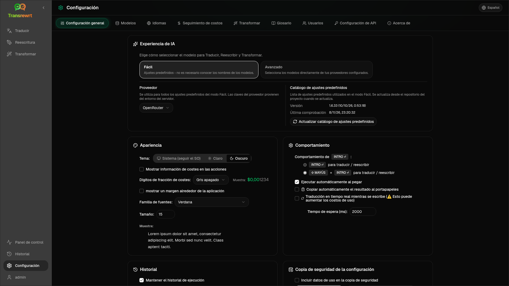

Abre **Configuración** desde la barra lateral para personalizar el comportamiento de la aplicación.

| Pestaña | Escritorio | Web (administrador) | Web (usuario) | Notas |
| --- | :---: | :---: | :---: | --- |
| Configuración general | ✓ | ✓ | ✓ | Incluye **experiencia de IA** (Fácil / Avanzada) |
| Modelos | ✓ | ✓ | ✓ | Tarjetas preestablecidas en Fácil, tabla de modelos en Avanzado |
| Idiomas | ✓ | ✓ | ✓ | |
| Seguimiento de costos | ✓ | ✓ | — | |
| Transformar | ✓ | ✓ | ✓ | Importación/exportación masiva de prompts |
| Glosario | ✓ | ✓ | ✓ | Pares de términos para traducción |
| Usuarios | — | ✓ | — | |
| Configuración de API | ✓ | ✓ | — | |
| Acerca de | ✓ | ✓ | ✓ | |

En el modo **Fácil**, elija la IA mediante los ajustes preestablecidos en la barra de herramientas y el **Proveedor** en la Configuración general; la pestaña **Modelos** muestra tarjetas preestablecidas de solo lectura.

:::note
En la versión web, cada usuario tiene su propia configuración (experiencia de IA, proveedor, modelos/preajustes, idiomas, opciones, prompts). Los cambios no afectan a otros usuarios.
:::

## Configuración general

**Experiencia de IA**

- **Fácil** (predeterminado): elija un **Proveedor**. Los proveedores de la nube utilizan ajustes predefinidos de la barra de herramientas. **LLM local** enumera los modelos locales instalados. **Actualizar catálogo de ajustes predefinidos** obtiene la lista de ajustes predefinidos más reciente del repositorio del proyecto.
  - **Gratis (OpenRouter)**: opción de costo cero dirigida a modelos gratuitos disponibles; la calidad y la disponibilidad pueden variar.
  - **Estándar**: ligero y rentable; ideal para textos cortos, borradores rápidos y uso de gran volumen.
  - **Avanzado**: modelo de alta precisión para contenido complejo o matizado, con un costo más alto.
  - **Técnico**: ajustado para código, API, documentos de desarrollador y contenido estructurado; conserva el formato y la terminología.
- **Avanzado**: elija modelos en la barra de herramientas; administre la lista en [Modelos](#models).

También puedes cambiar entre Fácil ↔ Avanzado desde el menú de preajustes/modelos de la barra de herramientas (**Cambiar a modo Fácil/Avanzado**, encima de Abrir configuración).

**Apariencia** — Tema; **Mostrar información de costos en las acciones**; **Dígitos fraccionarios de costo**; margen solo web alrededor de la aplicación; **Familia de fuentes** y **Tamaño**.

**Comportamiento** — **Comportamiento para ENTER**; **Ejecutar automáticamente al pegar**; **Copiar automáticamente el resultado al portapapeles**; **Traducción en tiempo real mientras se escribe**; **Tiempo de espera (ms)**.

**Historial**

- **Mantener el historial de ejecución**: almacena la entrada/salida para la vista [Historial](/docs/history/). Desactivarlo solicita confirmación y puede eliminar el texto almacenado. Si se etiqueta como *deshabilitado por el administrador*, se establece `HISTORY_DISABLED`; consulte [Configuración](/docs/configuration/#privacy-mode).
- **Eliminar datos del historial**: elimina el texto almacenado por antigüedad o borra todo. **No** elimina los totales de costos (use Seguimiento de costos para eso).

**Copia de seguridad de la configuración** (administradores de escritorio y web)

- **Incluir datos de uso en la copia de seguridad** (opcional)
- **Respaldar configuración**: ZIP con configuración, estado, usuarios, preferencias, indicaciones y datos de uso opcionales.
- **Restaurar desde copia de seguridad**: cuadro de diálogo de confirmación con opciones para restaurar y/o borrar datos de uso.

Las copias de seguridad pueden moverse entre escritorio y web; restaurar una copia de seguridad de escritorio en la web aplica los datos al usuario administrador.

## Modelos

La pestaña **Modelos** siempre aparece en la lista. Su botón de alternancia **Fácil / Avanzado** cambia toda la aplicación entre las dos [experiencias de IA](#general-settings).

- **Fácil** muestra una tarjeta de solo lectura por ajuste predefinido (por ejemplo, **Gratis (OpenRouter)** o **Estándar**). Cada tarjeta enumera el modelo principal y de respaldo del ajuste predefinido para cada proveedor que haya configurado. Los chips de **Proveedor** filtran las tarjetas.
- **Avanzado** muestra una tabla de cada modelo, con:
  - un cuadro de búsqueda, chips de **Proveedor**, **Solo gratis**, **Solo seleccionados** y **Actualizar**
  - un menú de clasificación; el predeterminado es **Índice de mayor a menor**
  - una casilla de verificación por modelo para seleccionarlo o deseleccionarlo
  - **Seleccionar de los preajustes**, que agrega los modelos principal y de respaldo de un ajuste predefinido para cada proveedor configurado (**Cargar todo** carga todos los proveedores)
  - **Deseleccionar todo**, que primero solicita confirmación
- Los ID de modelo usan un prefijo de proveedor (`openrouter/…`, `openai/…`, `local/…`, …)

Las columnas de puntuación y precio:

- **Índice**: una puntuación de calidad que combina ChrF, Arena Score y precio. Se clasifica dentro de cada proveedor, por lo que no es comparable entre proveedores. Los modelos sin índice se ordenan al final.
- **ChrF**: calidad de traducción media de [languagebench](https://huggingface.co/spaces/fair-forward/languagebench) para los idiomas de la interfaz de usuario de la aplicación.
- **Arena**: Arena Score de la tabla de clasificación [LMArena](https://huggingface.co/datasets/lmarena-ai/leaderboard-dataset).
- **Entrada** / **Salida**: precio en USD por 1 millón de tokens, del catálogo del proveedor o de [models.dev](https://models.dev/). Un precio estimado se marca con un asterisco. Un guion (—) significa que el precio es desconocido; los modelos locales muestran "sin coste - local".

Pase el ratón por encima de un encabezado de columna para ver su fuente de datos y licencia. El selector de modelos de la barra de herramientas muestra el índice de cada modelo como un pequeño chip; pase el ratón por encima para ver los valores de ChrF y Arena.

Las puntuaciones son solo una guía: la cobertura es incompleta y muchos modelos no tienen puntuación ChrF o Arena.

:::tip
No utilice OpenRouter **Body Builder** (`openrouter/bodybuilder`) para Traducir, Reescribir o Transformar; devuelve cargas útiles de solicitud JSON, no texto terminado.
:::

Marque o desmarque un modelo para seleccionarlo o anular su selección. El modelo gratuito de OpenRouter es opcional; los modelos seleccionados pueden estar vacíos. Al eliminar el último modelo de la barra de herramientas, se abre **Configuración → Modelos**. Si el modelo actual deja de estar disponible, la aplicación selecciona el siguiente modelo de la lista en lugar de forzar el modelo gratuito.

## Idiomas

- **Idiomas principales** — anclados cerca de la parte superior de las listas de idiomas en Traducir y Transformar
- **Idioma personalizado** — añada un idioma que falte en la lista incorporada

## Seguimiento de costos

- **Costo total**, **Copiar valor**, **Restablecer costo**
- **Sincronizar con el uso de la clave API**: alinear con el uso de la cuenta de OpenRouter (solo OpenRouter)
- **Uso de la clave API**: detalles de OpenRouter cuando estén disponibles
- **Eliminar datos de costes**: todos los datos o entradas anteriores a una fecha

OpenRouter y xAI muestran el costo facturado real cuando la API lo devuelve; otros proveedores utilizan estimaciones de los precios de [models.dev](https://models.dev/). Las estimaciones no son facturas.

:::caution
La eliminación de datos de costos no se puede deshacer. Exporte primero a través de Historial o Panel de control → Todas las llamadas si necesita una copia de seguridad. El historial de entrada/salida relacionado con esas llamadas API también se elimina.
:::

## Transformar

Gestione las indicaciones de forma masiva: revise, elimine, importe, exporte y cargue indicaciones de ejemplo.

## Glosario

Gestiona los pares de términos aplicados durante la [traducción](/docs/translate/#use-the-glossary). Cada término tiene un idioma de origen/destino y un texto de origen/destino.

- Añadir a través de la fila inferior y **+**
- Filtrar por idiomas o texto
- Importar/exportar CSV o XLSX; descargar plantillas vacías

El escritorio almacena el glosario localmente; la web lo almacena por usuario.

## Usuarios

Solo web (administradores):

- Agregar usuarios, actualizar detalles, restablecer contraseñas, eliminar cuentas
- **Tiempo de espera de sesión**: cuánto dura un inicio de sesión (de 1 hora a 7 días); los cambios se aplican solo a los nuevos inicios de sesión
- **Revocar sesiones**: cierra la sesión de un usuario en todos los dispositivos inmediatamente

Cada usuario que ha iniciado sesión (incluidos los no administradores) puede cambiar su propia contraseña o cerrar sesión desde el menú de usuario en la parte inferior de la barra lateral.

## Configuración de API

Configure solo los proveedores que utilice: OpenRouter, OpenAI, Anthropic, Google Gemini, DeepSeek, Groq, Mistral, xAI, Cerebras, NVIDIA, Alibaba Cloud, apikey.fun, **LLM local** (URL base para Ollama, LM Studio, llama.cpp o similar), y un proveedor personalizado opcional compatible con OpenAI.

**Web (administrador):** las claves provienen de variables de entorno; esta página muestra cuáles están configuradas y le permite **Probar**. Reinicie después de cambiar las variables de entorno. Consulte [Configuración](/docs/configuration/).

**Escritorio:** introduzca las claves (o la URL de Local LLM) y **Guardar** / **Editar** / **Probar**. Las claves se almacenan cifradas; no puede ver el valor actual, solo reemplazarlo.

:::tip
No se necesita una clave de pago para empezar: utilice modelos gratuitos de OpenRouter, otros proveedores de nivel gratuito o un servidor local compatible con OpenAI como [Ollama](https://ollama.com), LM Studio o llama.cpp (por ejemplo, `translategemma:4b`).
:::

## Acerca de

Nombre de la aplicación, versión, fecha de compilación, licencia, avisos de terceros y enlace al repositorio.
