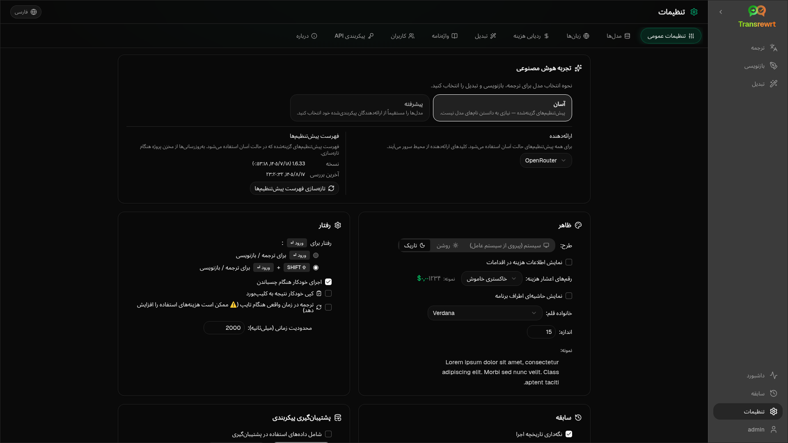

برای سفارشی‌سازی نحوه عملکرد برنامه، **تنظیمات** را از نوار کناری باز کنید.

| تب | دسکتاپ | وب (مدیر) | وب (کاربر) | یادداشت‌ها |
| --- | :---: | :---: | :---: | --- |
| تنظیمات عمومی | ✓ | ✓ | ✓ | شامل **تجربه هوش مصنوعی** (آسان / پیشرفته) |
| مدل‌ها | ✓ | ✓ | ✓ | کارت‌های از پیش تنظیم‌شده در حالت آسان، جدول مدل در حالت پیشرفته |
| زبان‌ها | ✓ | ✓ | ✓ | |
| ردیابی هزینه | ✓ | ✓ | — | |
| تبدیل | ✓ | ✓ | ✓ | واردات/صادرات انبوه پرامپت‌ها |
| واژه‌نامه | ✓ | ✓ | ✓ | جفت‌های اصطلاح برای ترجمه |
| کاربران | — | ✓ | — | |
| پیکربندی API | ✓ | ✓ | — | |
| درباره | ✓ | ✓ | ✓ | |

در حالت **آسان**، هوش مصنوعی را از طریق تنظیمات از پیش تعیین‌شده در نوار ابزار و **ارائه‌دهنده** در تنظیمات عمومی انتخاب کنید؛ برگه **مدل‌ها** کارت‌های از پیش تنظیم‌شده فقط خواندنی را نشان می‌دهد.

:::note
در نسخه وب، هر کاربر پیکربندی خاص خود را دارد (تجربه هوش مصنوعی، ارائه‌دهنده، مدل‌ها/پیش‌تنظیمات، زبان‌ها، گزینه‌ها، پرامپت‌ها). تغییرات بر سایر کاربران تأثیری نمی‌گذارد.
:::

## تنظیمات عمومی

**تجربه هوش مصنوعی**

- **آسان** (پیش‌فرض): یک **ارائه‌دهنده** را انتخاب کنید. ارائه‌دهندگان ابری از پیش‌تنظیم‌های نوار ابزار استفاده می‌کنند. **LLM محلی** مدل‌های محلی نصب‌شده را به جای آن لیست می‌کند. **تازه‌سازی فهرست پیش‌تنظیم‌ها** آخرین لیست پیش‌تنظیم‌ها را از مخزن پروژه دریافت می‌کند.
  - **رایگان (OpenRouter)** — گزینه با هزینه صفر که به مدل‌های رایگان موجود مسیریابی می‌شود؛ کیفیت و در دسترس بودن ممکن است متفاوت باشد
  - **استاندارد** — سبک و کارآمد از نظر هزینه؛ مناسب برای متون کوتاه، پیش‌نویس‌های سریع و استفاده با حجم بالا
  - **پیشرفته** — مدل با دقت بالا برای محتوای پیچیده یا ظریف، با هزینه بیشتر
  - **فنی** — برای کد، API‌ها، مستندات توسعه‌دهنده و محتوای ساختارمند تنظیم شده است؛ قالب‌بندی و اصطلاحات را حفظ می‌کند
- **پیشرفته**: مدل‌ها را در نوار ابزار انتخاب کنید؛ لیست را در [مدل‌ها](#models) مدیریت کنید.

همچنین می‌توانید حالت آسان ↔ پیشرفته را از منوی پیش‌تنظیم/مدل نوار ابزار (**تغییر به حالت آسان/پیشرفته**، بالای باز کردن تنظیمات) تغییر دهید.

**ظاهر** — پوسته؛ **نمایش اطلاعات هزینه روی اقدامات**؛ **ارقام اعشار هزینه**؛ حاشیه فقط وب در اطراف برنامه؛ **خانواده فونت** و **اندازه**.

**رفتار** — **رفتار برای ENTER**؛ **اجرای خودکار هنگام چسباندن**؛ **کپی خودکار نتیجه به کلیپ‌بورد**؛ **ترجمه هم‌زمان هنگام تایپ**؛ **مهلت زمانی (میلی‌ثانیه)**.

**تاریخچه**

- **نگه‌داری تاریخچه اجرا** — ذخیره ورودی/خروجی برای نمای [سابقه](/docs/history/). خاموش کردن نیاز به تأیید دارد و می‌تواند متن ذخیره شده را حذف کند. اگر برچسب *غیرفعال شده توسط مدیر* باشد، `HISTORY_DISABLED` تنظیم می‌شود — به [پیکربندی](/docs/configuration/#privacy-mode) مراجعه کنید.
- **حذف داده‌های تاریخچه** — حذف متن ذخیره شده بر اساس سن یا پاک کردن همه. **این** مجموع هزینه‌ها را حذف نمی‌کند (برای این کار از ردیابی هزینه استفاده کنید).

**پشتیبان‌گیری پیکربندی** (مدیران دسکتاپ و وب)

- اختیاری **شامل داده‌های استفاده در پشتیبان‌گیری**
- **پشتیبان‌گیری پیکربندی** — ZIP شامل پیکربندی، وضعیت، کاربران، تنظیمات برگزیده، اعلان‌ها و داده‌های استفاده اختیاری
- **بازیابی از پشتیبان‌گیری** — گفتگوی تأیید با گزینه‌هایی برای بازیابی و/یا پاک کردن داده‌های استفاده

پشتیبان‌گیری‌ها می‌توانند بین دسکتاپ و وب جابجا شوند؛ بازیابی یک پشتیبان‌گیری دسکتاپ در وب، داده‌ها را برای کاربر مدیر اعمال می‌کند.

## مدل‌ها

برگه **مدل‌ها** همیشه فهرست شده است. کلید **آسان / پیشرفته** آن، کل برنامه را بین دو [تجربه هوش مصنوعی](#general-settings) تغییر می‌دهد.

- **آسان** برای هر پیش‌تنظیم یک کارت فقط خواندنی نمایش می‌دهد (برای مثال **رایگان (OpenRouter)** یا **استاندارد**). هر کارت مدل اصلی و مدل پشتیبان پیش‌تنظیم را برای هر ارائه‌دهنده‌ای که پیکربندی کرده‌اید، فهرست می‌کند. تراشه‌های **ارائه‌دهنده** کارت‌ها را فیلتر می‌کنند.
- **پیشرفته** یک جدول از هر مدل را نمایش می‌دهد، با:
  - یک کادر جستجو، تراشه‌های **ارائه‌دهنده**، **فقط رایگان**، **فقط انتخاب‌شده‌ها** و **تازه‌سازی**
  - یک منوی مرتب‌سازی؛ پیش‌فرض **شاخص از زیاد به کم** است
  - یک کادر انتخاب برای هر مدل برای انتخاب یا لغو انتخاب آن
  - **انتخاب از پیش‌تنظیم‌ها**، که مدل‌های اصلی و پشتیبان یک پیش‌تنظیم را برای هر ارائه‌دهنده پیکربندی‌شده اضافه می‌کند (**بارگذاری همه** هر ارائه‌دهنده را بارگذاری می‌کند)
  - **لغو انتخاب همه**، که ابتدا تأیید می‌خواهد
- شناسه‌های مدل از یک پیشوند ارائه‌دهنده استفاده می‌کنند (`openrouter/…`، `openai/…`، `local/…`، …)

ستون‌های امتیاز و قیمت:

- **شاخص** — یک امتیاز کیفیت ترکیبی از ChrF، Arena Score و قیمت. این امتیاز در هر ارائه‌دهنده رتبه‌بندی می‌شود، بنابراین در بین ارائه‌دهندگان قابل مقایسه نیست. مدل‌هایی که شاخص ندارند به پایین مرتب می‌شوند.
- **ChrF** — میانگین کیفیت ترجمه از [languagebench](https://huggingface.co/spaces/fair-forward/languagebench) برای زبان‌های رابط کاربری برنامه.
- **Arena** — امتیاز Arena از جدول امتیازات [LMArena](https://huggingface.co/datasets/lmarena-ai/leaderboard-dataset).
- **ورودی** / **خروجی** — قیمت به دلار آمریکا به ازای هر ۱ میلیون توکن، از کاتالوگ ارائه‌دهنده یا [models.dev](https://models.dev/). قیمت تخمینی با ستاره مشخص شده است. خط تیره (—) به معنای نامعلوم بودن قیمت است؛ مدل‌های محلی "بدون هزینه - محلی" را نشان می‌دهند.

برای مشاهده منبع داده و مجوز آن، نشانگر ماوس را روی عنوان ستون نگه دارید. انتخابگر مدل در نوار ابزار، شاخص هر مدل را به صورت یک تراشه کوچک نشان می‌دهد؛ برای مشاهده مقادیر ChrF و Arena، نشانگر ماوس را روی آن نگه دارید.

امتیازات فقط یک راهنما هستند: پوشش ناقص است و بسیاری از مدل‌ها امتیاز ChrF یا Arena ندارند.

:::tip
از OpenRouter **Body Builder** (`openrouter/bodybuilder`) برای ترجمه، بازنویسی یا تبدیل استفاده نکنید — این ابزار محموله‌های درخواست JSON را برمی‌گرداند، نه متن نهایی.
:::

یک مدل را علامت بزنید یا علامت آن را بردارید تا آن را انتخاب یا لغو انتخاب کنید. مدل رایگان OpenRouter اختیاری است — مدل‌های انتخاب شده ممکن است خالی باشند. حذف آخرین مدل از نوار ابزار، **تنظیمات ← مدل‌ها** را باز می‌کند. اگر مدل فعلی در دسترس نباشد، برنامه به جای اجبار مدل رایگان، مدل بعدی را در لیست انتخاب می‌کند.

## زبان‌ها

- **زبان‌های برتر** — در بالای لیست زبان‌ها در ترجمه و تبدیل پین شده‌اند
- **زبان سفارشی** — زبانی را که در لیست داخلی موجود نیست اضافه کنید

## ردیابی هزینه

- **مجموع هزینه**، **کپی مقدار**، **بازنشانی هزینه**
- **همگام‌سازی با استفاده از کلید API** — همگام‌سازی با استفاده از حساب OpenRouter (فقط OpenRouter)
- **استفاده از کلید API** — جزئیات OpenRouter در صورت موجود بودن
- **حذف داده‌های هزینه** — همه داده‌ها یا ورودی‌های قدیمی‌تر از یک تاریخ

OpenRouter و xAI هزینه واقعی صورت‌حساب‌شده را زمانی که API آن را برمی‌گرداند، نشان می‌دهند؛ سایر ارائه‌دهندگان از تخمین‌های قیمت‌گذاری [models.dev](https://models.dev/) استفاده می‌کنند. تخمین‌ها فاکتور نیستند.

:::caution
حذف داده‌های هزینه قابل بازگشت نیست. اگر به پشتیبان‌گیری نیاز دارید، ابتدا از طریق تاریخچه یا داشبورد ← همه تماس‌ها خروجی بگیرید. تاریخچه ورودی/خروجی مرتبط برای آن تماس‌های API نیز حذف می‌شود.
:::

## تبدیل

مدیریت انبوه اعلان‌ها: بررسی، حذف، وارد کردن، صادر کردن و بارگذاری اعلان‌های نمونه.

## واژه‌نامه

جفت‌های اصطلاحاتی را که در طول [ترجمه](/docs/translate/#use-the-glossary) اعمال می‌شوند، مدیریت کنید. هر اصطلاح دارای زبان مبدأ/مقصد و متن مبدأ/مقصد است.

- از طریق ردیف پایین و **+** اضافه کنید
- بر اساس زبان‌ها یا متن فیلتر کنید
- CSV یا XLSX را وارد/صادر کنید؛ الگوهای خالی را دانلود کنید

دسکتاپ واژه‌نامه را به صورت محلی ذخیره می‌کند؛ وب آن را برای هر کاربر ذخیره می‌کند.

## کاربران

فقط وب (مدیران):

- افزودن کاربران، به‌روزرسانی جزئیات، بازنشانی گذرواژه‌ها، حذف حساب‌ها
- **مهلت نشست** — مدت زمان فعال بودن یک ورود (۱ ساعت تا 7 روز)؛ تغییرات فقط برای ورودهای جدید اعمال می‌شود
- **لغو نشست‌ها** — بلافاصله کاربر را از همه دستگاه‌ها خارج می‌کند

هر کاربر وارد شده (از جمله غیرمدیران) می‌تواند رمز عبور خود را تغییر دهد یا از منوی کاربر در پایین نوار کناری خارج شود.

## پیکربندی API

فقط ارائه‌دهندگانی را که استفاده می‌کنید پیکربندی کنید: OpenRouter، OpenAI، Anthropic، Google Gemini، DeepSeek، Groq، Mistral، xAI، Cerebras، NVIDIA، Alibaba Cloud، apikey.fun، **LLM محلی** (URL پایه برای Ollama، LM Studio، llama.cpp، یا مشابه)، و یک ارائه‌دهنده اختیاری سازگار با OpenAI سفارشی.

**وب (مدیر):** کلیدها از متغیرهای محیطی می‌آیند — این صفحه نشان می‌دهد کدام یک تنظیم شده‌اند و به شما امکان **تست** را می‌دهد. پس از تغییر متغیرهای محیطی، راه‌اندازی مجدد کنید. به [پیکربندی](/docs/configuration/) مراجعه کنید.

**دسکتاپ:** کلیدها (یا URL LLM محلی) را وارد کنید و **ذخیره** / **ویرایش** / **تست** را انجام دهید. کلیدها به صورت رمزگذاری شده ذخیره می‌شوند؛ نمی‌توانید مقدار فعلی را مشاهده کنید، فقط آن را جایگزین کنید.

:::tip
برای شروع نیازی به کلید پولی نیست: از مدل‌های رایگان OpenRouter، سایر ارائه‌دهندگان رایگان، یا یک سرور محلی سازگار با OpenAI مانند [Ollama](https://ollama.com)، LM Studio، یا llama.cpp (مثلاً `translategemma:4b`) استفاده کنید.
:::

## درباره

نام برنامه، نسخه، تاریخ ساخت، مجوز، اطلاعیه‌های شخص ثالث، و پیوند مخزن.
