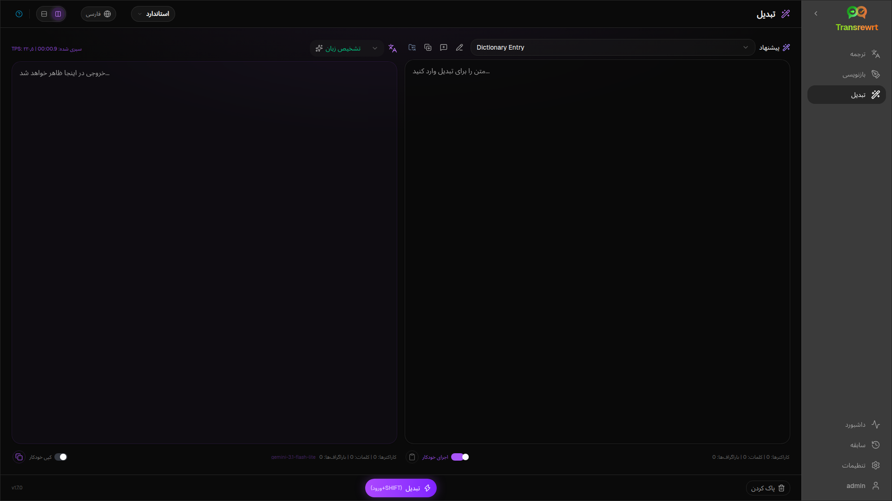
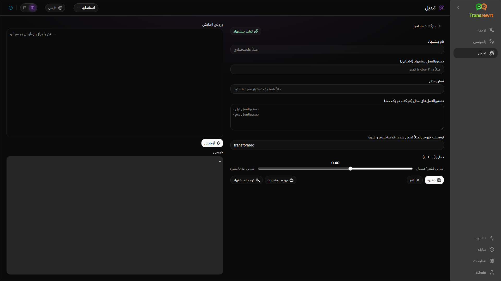

هنگامی که می‌خواهید هوش مصنوعی دستورالعمل‌های سفارشی را دنبال کند — خلاصه کردن، ویرایش یک ایمیل، استخراج نکات کلیدی، تغییر فرمت متن، یا هر گردش کاری که تعریف می‌کنید — از **تبدیل** استفاده کنید.

## اجرای یک دستور موجود

1. **تبدیل** را باز کنید.
2. یک دستور را از لیست انتخاب کنید.
3. اگر کادر زبان **از** ظاهر شد، در صورت تمایل یک زبان را تنظیم کنید.
4. متن را در **ورودی** تایپ یا جای‌گذاری کنید.
5. روی **تبدیل** کلیک کنید.
6. نتیجه را در **خروجی** بخوانید.

[تغییر طرح‌بندی و میانبرهای صفحه‌کلید](/docs/translate/#layout-and-keyboard) همانند Translate کار می‌کنند.

## بارگذاری نمونه پیشنهادات

اگر فهرست خالی است، روی **بارگذاری نمونه پیشنهادات** در فضای کاری تبدیل (Transform) کلیک کنید (همچنین در [تنظیمات ← تبدیل](/docs/settings/#transform) نیز موجود است). نمونه‌ها به زبان انگلیسی هستند؛ پس از بارگذاری، یک پیشنهاد را ویرایش کرده و در صورت نیاز از **ترجمه پیشنهاد** استفاده کنید.

## ایجاد یک دستور

1. روی **پیشنهاد جدید** کلیک کنید.
2. روی **تولید پیشنهاد** کلیک کنید.
3. توضیح دهید که می‌خواهید پیشنهاد چه کاری انجام دهد.
4. یک پیش‌تنظیم (آسان) یا مدل (پیشرفته) را انتخاب کنید.
5. پیش‌نویس را بررسی کرده و روی **ذخیره** کلیک کنید.

## ویرایش یک دستور

ویرایشگر در سمت چپ است؛ یک ناحیه آزمایش در سمت راست قرار دارد.

فیلدهای اصلی:

- **نام پیشنهاد** — در فهرست پیشنهادات نمایش داده می‌شود
- **دستورالعمل پیشنهاد (اختیاری)** — راهنمایی کوتاه هنگام اجرای پیشنهاد
- **نقش مدل** — نقش کلی برای هوش مصنوعی
- **دستورالعمل‌های مدل (هر کدام در یک خط)** — قوانینی که باید رعایت شوند
- **توصیف خروجی** — برچسب کوتاه برای نتیجه (مثلاً خلاصه‌شده)
- **دمای (۰٫۰ → ۱٫۰)** — کمتر پایدارتر است؛ بیشتر متنوع‌تر است
- **درخواست زبان مقصد** — یک انتخابگر زبان را هنگام اجرا اضافه می‌کند

کمک‌کننده‌ها: **تولید پیشنهاد**، **بهبود پیشنهاد**، **ترجمه پیشنهاد** (آسان از پیش‌تنظیمات استفاده می‌کند؛ پیشرفته از فهرست مدل استفاده می‌کند).

:::caution
قبل از **بازگشت به اجرا** روی **ذخیره** کلیک کنید. بازگشت بدون ذخیره کردن، تغییرات را از بین می‌برد.
:::

## قبل از استفاده روزمره آزمایش کنید

هنگام ساخت یا مقایسه اعلان‌ها، از پنل تست سمت راست با متن نمونه استفاده کنید.

اعلان‌ها را به صورت انبوه در [تنظیمات ← تبدیل](/docs/settings/#transform) صادر و وارد کنید.

## مراحل بعدی

- [تنظیمات](/docs/settings/)
- [مرور تاریخچه](/docs/history/)
- [مشکلات رایج](/docs/common-issues/)
