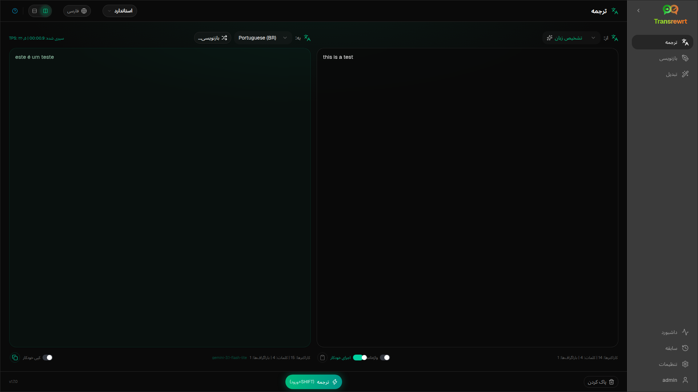

از **Translate** برای تبدیل متن از یک زبان به زبان دیگر استفاده کنید.

## پیش‌نیازها

- حداقل یک کلید ارائه‌دهنده (دسکتاپ) یا کلید محیط سرور (وب) — به [کلید API](/docs/api-key/) مراجعه کنید
- یک **preset** (آسان) یا **model** (پیشرفته) که در نوار ابزار انتخاب شده باشد

## ترجمه متن

1. **ترجمه** را در نوار کناری باز کنید.
2. یک زبان را در **از** (یا **تشخیص زبان**) انتخاب کنید.
3. یک زبان را در **به** انتخاب کنید.
4. یک پیش‌تنظیم یا مدل را در نوار ابزار انتخاب کنید.
5. متن را در **Input** تایپ یا جای‌گذاری کنید.
6. روی **Translate** کلیک کنید.
7. نتیجه را در **Output** بخوانید، سپس در صورت نیاز کپی کنید.

**Top languages** ابتدا در لیست‌ها ظاهر می‌شوند — آن‌ها را در [Settings → Languages](/docs/settings/#languages) تنظیم کنید.

## تنظیمات مفید

در [Settings → General Settings](/docs/settings/#general-settings):

- **اجرای خودکار هنگام چسباندن** — بلافاصله پس از چسباندن اجرا می‌شود
- **کپی خودکار نتیجه به کلیپ‌بورد** — پس از اجرای موفقیت‌آمیز کپی می‌کند
- **ترجمه بی‌درنگ هنگام تایپ** — هنگام تایپ اجرا می‌شود (ممکن است هزینه را افزایش دهد)
- **مهلت زمانی (میلی‌ثانیه)** — قبل از اجرای بی‌درنگ منتظر بمانید
- **Behaviour for ENTER** — اینکه آیا Enter وظیفه را اجرا می‌کند یا یک خط جدید درج می‌کند

## طرح‌بندی و صفحه‌کلید

- **Layout toggle** — دکمه‌های بالای پنل‌ها بین طرح‌بندی‌های ورودی/خروجی **side-by-side** و **stacked** جابجا می‌شوند. این انتخاب برای Translate، Rewrite و Transform اعمال می‌شود و در این دستگاه به خاطر سپرده می‌شود.
- **Enter** یا **Shift+Enter** وظیفه را اجرا می‌کند، بسته به **Behaviour for ENTER** (به بالا مراجعه کنید).
- **Escape** پنل ورودی را پاک می‌کند (یا ابتدا یک منو یا گفتگوی باز را می‌بندد).

## بهبود یک ترجمه

پس از اجرای موفقیت‌آمیز، **Rephrase…** و یک منوی کشویی نسخه در کنار انتخابگر **To:** ظاهر می‌شوند:

1. **بازچینش…** (هیچ انتخابی) — یک ترجمه کامل دیگر از همان ورودی. تا **پنج** نسخه؛ مدل نسخه‌های قبلی را می‌بیند بنابراین کلمات می‌توانند متفاوت باشند. روی **توقف ترجمه** کلیک کنید تا یک بازچینش در حال اجرا را لغو کنید.
2. **جایگزین‌های کلمه** — کلمات یا یک عبارت کوتاه را انتخاب کنید، سپس کلیک راست یا **بازچینش…** را انتخاب کنید. یک جایگزین را برای جایگزینی با 範囲 (ممکن است به دلیل دستور زبان کمی گسترش یابد) انتخاب کنید. در پنج نسخه، فقط نسخه ۵ به روز می‌شود.
3. هر درخواست بازچینش یا جایگزین‌ها از مدل استفاده می‌کند و ممکن است هزینه را اضافه کند.

## استفاده از واژه‌نامه

یک **glossary** جفت‌های اصطلاح منبع/هدف برای یک جفت زبان است. هنگامی که فعال باشد، اصطلاحات منطبق به مدل ارسال می‌شوند تا کلمات ترجیحی ثابت بمانند.

1. **واژه‌نامه** را در پنل ورودی روشن کنید.
2. طبق معمول ترجمه کنید — اصطلاحات مربوط به جفت **از** / **به** به‌طور خودکار اعمال می‌شوند.
3. برای ثبت سریع یک جفت جدید، روی **افزودن به واژه‌نامه** (کنار **از:**) کلیک کنید.
4. همه اصطلاحات را در [تنظیمات ← واژه‌نامه](/docs/settings/#glossary) مدیریت کنید.

:::note
اصطلاحات واژه‌نامه بر اساس جفت زبان مطابقت داده می‌شوند. نمی‌توان از آنها با **تشخیص زبان** به عنوان منبع استفاده کرد.
:::

## مراحل بعدی

- [بازنویسی متن](/docs/rewrite/)
- [تبدیل با اعلان‌ها](/docs/transform/)
- [مشکلات رایج](/docs/common-issues/)
