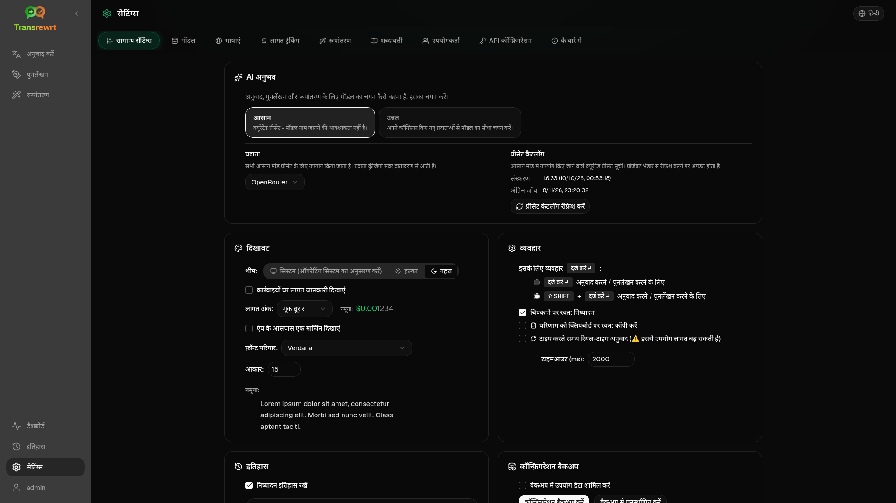

ऐप के व्यवहार को अनुकूलित करने के लिए साइडबार से **सेटिंग्स** खोलें।

| टैब | डेस्कटॉप | वेब (एडमिन) | वेब (उपयोगकर्ता) | नोट्स |
| --- | :---: | :---: | :---: | --- |
| सामान्य सेटिंग्स | ✓ | ✓ | ✓ | इसमें **AI अनुभव** (आसान / उन्नत) शामिल है |
| मॉडल | ✓ | ✓ | ✓ | आसान में प्रीसेट कार्ड, उन्नत में मॉडल तालिका |
| भाषाएँ | ✓ | ✓ | ✓ | |
| लागत ट्रैकिंग | ✓ | ✓ | — | |
| रूपांतरण | ✓ | ✓ | ✓ | प्रॉम्प्ट का थोक आयात/निर्यात |
| शब्दावली | ✓ | ✓ | ✓ | अनुवाद के लिए शब्द युग्म |
| उपयोगकर्ता | — | ✓ | — | |
| API कॉन्फ़िग | ✓ | ✓ | — | |
| के बारे में | ✓ | ✓ | ✓ | |

**आसान** मोड में, टूलबार में प्रीसेट के माध्यम से AI चुनें और सामान्य सेटिंग में **प्रदाता** चुनें; **मॉडल** टैब केवल-पठन प्रीसेट कार्ड दिखाता है।

:::note
वेब संस्करण में, प्रत्येक उपयोगकर्ता की अपनी कॉन्फ़िगरेशन (एआई अनुभव, प्रदाता, मॉडल/प्रीसेट, भाषाएँ, विकल्प, प्रॉम्प्ट) होती है। परिवर्तन अन्य उपयोगकर्ताओं को प्रभावित नहीं करते हैं।
:::

## सामान्य सेटिंग्स

**AI अनुभव**

- **आसान** (डिफ़ॉल्ट): एक **प्रदाता** चुनें। क्लाउड प्रदाता टूलबार प्रीसेट का उपयोग करते हैं। **Local LLM** इसके बजाय इंस्टॉल किए गए स्थानीय मॉडल को सूचीबद्ध करता है। **प्रीसेट कैटलॉग रीफ्रेश करें** प्रोजेक्ट रिपॉजिटरी से नवीनतम प्रीसेट सूची प्राप्त करता है।
  - **मुक्त (OpenRouter)** — उपलब्ध मुक्त मॉडल के लिए शून्य-लागत विकल्प; गुणवत्ता और उपलब्धता भिन्न हो सकती है
  - **मानक** — हल्का और लागत-कुशल; छोटे ग्रंथों, त्वरित ड्राफ्ट और उच्च-मात्रा उपयोग के लिए सबसे अच्छा
  - **उन्नत** — जटिल या सूक्ष्म सामग्री के लिए उच्च-सटीकता मॉडल, उच्च लागत पर
  - **तकनीकी** — कोड, API, डेवलपर डॉक्स और संरचित सामग्री के लिए ट्यून किया गया; फ़ॉर्मेटिंग और शब्दावली को संरक्षित करता है
- **उन्नत**: टूलबार में मॉडल चुनें; [मॉडल](#models) के तहत सूची प्रबंधित करें।

आप टूलबार प्रीसेट/मॉडल मेनू (**आसान/उन्नत मोड पर स्विच करें**, ओपन सेटिंग्स के ऊपर) से आसान ↔ उन्नत भी स्विच कर सकते हैं।

**दिखावट** — थीम; **कार्रवाइयों पर लागत की जानकारी दिखाएँ**; **लागत अंश अंक**; ऐप के चारों ओर वेब-ओनली मार्जिन; **फ़ॉन्ट फ़ैमिली** और **आकार**।

**व्यवहार** — **ENTER के लिए व्यवहार**; **चिपकाने पर स्वत: निष्पादन**; **परिणाम को क्लिपबोर्ड पर स्वत: कॉपी करें**; **टाइप करते समय वास्तविक समय अनुवाद**; **समय-समाप्ति (मि.से.)**।

**इतिहास**

- **निष्पादन इतिहास रखें** — [इतिहास](/docs/history/) दृश्य के लिए इनपुट/आउटपुट संग्रहीत करें। बंद करने पर पुष्टि मांगी जाती है और संग्रहीत टेक्स्ट हटाया जा सकता है। यदि *व्यवस्थापक द्वारा अक्षम किया गया* लेबल किया गया है, तो `HISTORY_DISABLED` सेट है — [कॉन्फ़िगरेशन](/docs/configuration/#privacy-mode) देखें।
- **इतिहास डेटा हटाएं** — आयु के अनुसार संग्रहीत टेक्स्ट हटाएं या सभी साफ़ करें। लागत कुल (उसके लिए लागत ट्रैकिंग का उपयोग करें) को **नहीं** हटाता है।

**कॉन्फ़िगरेशन बैकअप** (डेस्कटॉप और वेब एडमिन)

- वैकल्पिक **बैकअप में उपयोग डेटा शामिल करें**
- **कॉन्फ़िगरेशन बैकअप करें** — कॉन्फ़िग, स्थिति, उपयोगकर्ता, प्राथमिकताएं, प्रॉम्प्ट और वैकल्पिक उपयोग डेटा के साथ ZIP
- **बैकअप से पुनर्स्थापित करें** — उपयोग डेटा को पुनर्स्थापित करने और/या साफ़ करने के विकल्पों के साथ पुष्टि संवाद

बैकअप डेस्कटॉप और वेब के बीच स्थानांतरित हो सकते हैं; वेब पर डेस्कटॉप बैकअप को पुनर्स्थापित करने से प्रशासक उपयोगकर्ता पर डेटा लागू होता है।

## मॉडल

**मॉडल** टैब हमेशा सूचीबद्ध होता है। इसका **आसान / उन्नत** टॉगल पूरे ऐप को दो [AI अनुभवों](#general-settings) के बीच स्विच करता है।

- **आसान** प्रति प्रीसेट एक केवल-पढ़ने योग्य कार्ड दिखाता है (उदाहरण के लिए **मुक्त (OpenRouter)** या **मानक**)। प्रत्येक कार्ड आपके द्वारा कॉन्फ़िगर किए गए प्रत्येक प्रदाता के लिए प्रीसेट के मुख्य और बैकअप मॉडल को सूचीबद्ध करता है। **प्रदाता** चिप्स कार्ड को फ़िल्टर करते हैं।
- **उन्नत** प्रत्येक मॉडल की एक तालिका दिखाता है, जिसमें शामिल हैं:
  - एक खोज बॉक्स, **प्रदाता** चिप्स, **केवल मुफ्त**, **केवल चयनित**, और **ताज़ा करें**
  - एक सॉर्ट मेनू; डिफ़ॉल्ट **इंडेक्स उच्च से निम्न** है
  - इसे चुनने या अचयनित करने के लिए प्रति मॉडल एक चेकबॉक्स
  - **पूर्वनिर्धारित से चुनें**, जो प्रत्येक कॉन्फ़िगर किए गए प्रदाता के लिए प्रीसेट के मुख्य और बैकअप मॉडल जोड़ता है (**सभी लोड करें** प्रत्येक प्रदाता को लोड करता है)
  - **सभी को अचयनित करें**, जो पहले पुष्टि मांगता है
- मॉडल आईडी एक प्रदाता उपसर्ग का उपयोग करते हैं (`openrouter/…`, `openai/…`, `local/…`, …)

स्कोर और मूल्य कॉलम:

- **सूचकांक** — ChrF, एरेना स्कोर और मूल्य से मिश्रित एक गुणवत्ता स्कोर। इसे प्रत्येक प्रदाता के भीतर रैंक किया जाता है, इसलिए यह प्रदाताओं में तुलनीय नहीं है। बिना सूचकांक वाले मॉडल नीचे की ओर सॉर्ट होते हैं।
- **ChrF** — ऐप की UI भाषाओं के लिए [languagebench](https://huggingface.co/spaces/fair-forward/languagebench) से औसत अनुवाद गुणवत्ता।
- **एरेना** — [LMArena](https://huggingface.co/datasets/lmarena-ai/leaderboard-dataset) लीडरबोर्ड से एरेना स्कोर।
- **इनपुट** / **आउटपुट** — प्रति 1M टोकन USD में मूल्य, प्रदाता कैटलॉग या [models.dev](https://models.dev/) से। एक अनुमानित मूल्य को एक तारांकन चिह्न के साथ चिह्नित किया जाता है। एक डैश (—) का अर्थ है कि मूल्य अज्ञात है; स्थानीय मॉडल "कोई लागत नहीं - स्थानीय" दिखाते हैं।

इसके डेटा स्रोत और लाइसेंस को देखने के लिए कॉलम शीर्षक पर होवर करें। टूलबार में मॉडल चयनकर्ता प्रत्येक मॉडल के सूचकांक को एक छोटी चिप के रूप में दिखाता है; ChrF और एरेना मानों के लिए उस पर होवर करें।

स्कोर केवल एक मार्गदर्शक हैं: कवरेज अधूरा है, और कई मॉडलों में कोई ChrF या एरेना स्कोर नहीं है।

:::tip
अनुवाद, फिर से लिखने या रूपांतरित करने के लिए OpenRouter **बॉडी बिल्डर** (`openrouter/bodybuilder`) का उपयोग न करें — यह JSON अनुरोध पेलोड देता है, तैयार टेक्स्ट नहीं।
:::

किसी मॉडल को चुनने या अचयनित करने के लिए उसे टिक या अनटिक करें। OpenRouter मुफ्त मॉडल वैकल्पिक है — चयनित मॉडल खाली हो सकते हैं। टूलबार से अंतिम मॉडल हटाने पर **सेटिंग्स → मॉडल** खुलता है। यदि वर्तमान मॉडल अनुपलब्ध हो जाता है, तो ऐप मुफ्त मॉडल को मजबूर करने के बजाय सूची में अगला मॉडल चुनता है।

## भाषाएँ

- **शीर्ष भाषाएँ** — अनुवाद और परिवर्तन में भाषा सूचियों के शीर्ष के पास पिन की गई
- **कस्टम भाषा** — अंतर्निहित सूची से गायब भाषा जोड़ें

## लागत ट्रैकिंग

- **कुल लागत**, **मूल्य कॉपी करें**, **लागत रीसेट करें**
- **API कुंजी उपयोग के साथ सिंक करें** — OpenRouter खाता उपयोग के साथ संरेखित करें (केवल OpenRouter)
- **API कुंजी उपयोग** — उपलब्ध होने पर OpenRouter विवरण
- **लागत डेटा हटाएं** — सभी डेटा या किसी तिथि से पुराने प्रविष्टियां

OpenRouter और xAI वास्तविक बिल की गई लागत दिखाते हैं जब API इसे वापस करता है; अन्य प्रदाता [models.dev](https://models.dev/) मूल्य निर्धारण से अनुमानों का उपयोग करते हैं। अनुमान चालान नहीं हैं।

:::caution
लागत डेटा विलोपन को पूर्ववत नहीं किया जा सकता है। यदि आपको बैकअप की आवश्यकता है तो पहले इतिहास या डैशबोर्ड → सभी कॉल के माध्यम से निर्यात करें। उन API कॉलों के लिए संबंधित इनपुट/आउटपुट इतिहास भी हटा दिया जाता है।
:::

## रूपांतरण

प्रॉम्प्ट्स का थोक प्रबंधन करें: समीक्षा करें, हटाएँ, आयात करें, निर्यात करें और नमूना प्रॉम्प्ट्स लोड करें।

## शब्दावली

[अनुवाद](/docs/translate/#use-the-glossary) के दौरान लागू किए गए शब्द युग्मों को प्रबंधित करें। प्रत्येक शब्द में स्रोत/लक्ष्य भाषा और स्रोत/लक्ष्य पाठ होता है।

- सबसे नीचे की पंक्ति और **+** के माध्यम से जोड़ें
- भाषाओं या पाठ के अनुसार फ़िल्टर करें
- CSV या XLSX आयात/निर्यात करें; खाली टेम्पलेट डाउनलोड करें

डेस्कटॉप शब्दावली को स्थानीय रूप से संग्रहीत करता है; वेब इसे प्रति उपयोगकर्ता संग्रहीत करता है।

## उपयोगकर्ता

केवल वेब (व्यवस्थापक):

- उपयोगकर्ता जोड़ें, विवरण अपडेट करें, पासवर्ड रीसेट करें, खाते हटाएं
- **सत्र समाप्ति** — एक लॉगिन कितने समय तक रहता है (1 घंटा से 7 दिन); परिवर्तन केवल नए लॉगिन पर लागू होते हैं
- **सत्र रद्द करें** — किसी उपयोगकर्ता को तुरंत सभी उपकरणों से साइन आउट करें

प्रत्येक साइन-इन किया गया उपयोगकर्ता (गैर-व्यवस्थापकों सहित) साइडबार के नीचे उपयोगकर्ता मेनू से अपना पासवर्ड बदल सकता है या साइन आउट कर सकता है।

## API कॉन्फ़िगरेशन

केवल उन प्रदाताओं को कॉन्फ़िगर करें जिनका आप उपयोग करते हैं: OpenRouter, OpenAI, Anthropic, Google Gemini, DeepSeek, Groq, Mistral, xAI, Cerebras, NVIDIA, Alibaba Cloud, apikey.fun, **स्थानीय LLM** (Ollama, LM Studio, llama.cpp, या समान के लिए आधार URL), और एक वैकल्पिक कस्टम OpenAI-संगत प्रदाता।

**वेब (व्यवस्थापक):** कुंजियाँ पर्यावरण चर से आती हैं — यह पृष्ठ दिखाता है कि कौन सी सेट हैं और आपको **परीक्षण** करने देता है। पर्यावरण चर बदलने के बाद पुनरारंभ करें। [कॉन्फ़िगरेशन](/docs/configuration/) देखें।

**डेस्कटॉप:** कुंजियाँ (या स्थानीय LLM URL) दर्ज करें और **सहेजें** / **संपादित करें** / **परीक्षण** करें। कुंजियाँ एन्क्रिप्टेड संग्रहीत की जाती हैं; आप वर्तमान मान नहीं देख सकते, केवल उसे बदल सकते हैं।

:::tip
शुरू करने के लिए किसी सशुल्क कुंजी की आवश्यकता नहीं है: मुफ्त OpenRouter मॉडल, अन्य मुफ्त-टियर प्रदाताओं, या एक स्थानीय OpenAI-संगत सर्वर जैसे [Ollama](https://ollama.com), LM Studio, या llama.cpp (उदाहरण के लिए `translategemma:4b`) का उपयोग करें।
:::

## के बारे में

ऐप का नाम, संस्करण, निर्माण तिथि, लाइसेंस, तृतीय-पक्ष नोटिस और रिपॉजिटरी लिंक।
