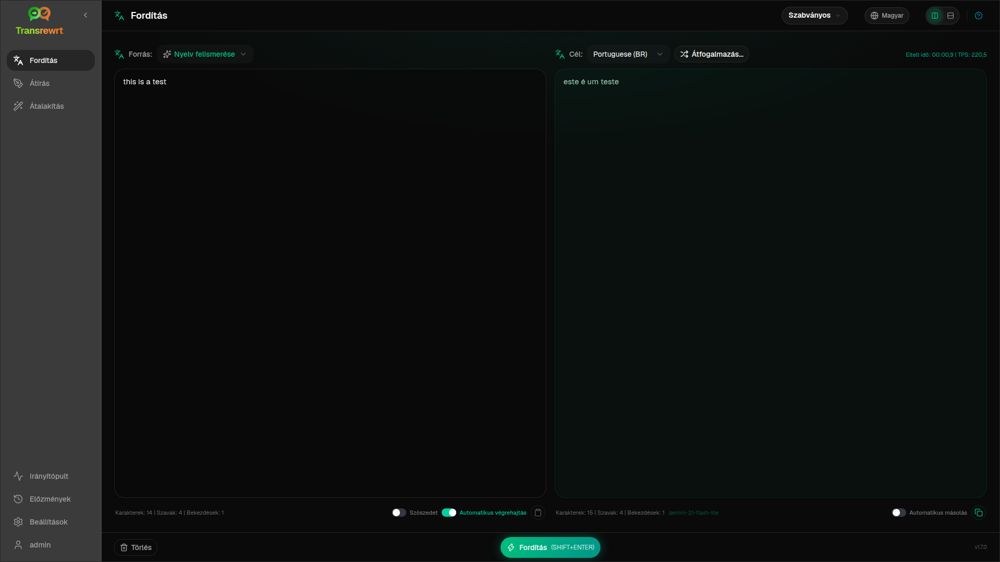

A **Transrewrt** egy nyílt forráskódú, mesterséges intelligencia alapú szöveges eszköz a következőkhöz:

- **Fordítás** – nyelvek tucatjai között, automatikus forrásfelismeréssel és szószedetekkel
- **Átírás** – nyelvtani hibák javítása, egyértelműség javítása, hangnem vagy hosszúság megváltoztatása
- **Átalakítás** – saját egyéni mesterséges intelligencia promptok futtatása bármilyen szövegen

Számos AI-szolgáltatót támogat (OpenRouter, OpenAI, Anthropic, Google Gemini, DeepSeek, Groq, Mistral, xAI, Cerebras, NVIDIA, Alibaba Cloud, apikey.fun, OpenAI-kompatibilis végpontok, és helyi OpenAI-kompatibilis szerverek, mint például az Ollama, LM Studio vagy llama.cpp). Futtatható **asztali alkalmazásként** (Windows / Linux / macOS) vagy **Docker webalkalmazásként**.

Az Ön kulcsai, az Ön modelljei, az Ön hosztja – nincs Transrewrt felhőfiók.

## Az ablak felépítése

- **Oldalsáv** — a fő navigáció: Fordítás, Átírás, Átalakítás, Irányítópult, Előzmények, Beállítások (és a bejelentkezett Felhasználó a weben).
- **Eszköztár** — az oldal címe, az **Előbeállítás** (Egyszerű) vagy **Modell** (Haladó) választó, a **Felület nyelve** (földgömb ikon; nem módosítja a Fordítás innen/ide beállítást), valamint a Súgó (**?**), amely ezekre a dokumentumokra mutat. Az előbeállítás/modell menüben **Váltás Egyszerű/Haladó módra** is lehetséges (a Beállítások megnyitása felett).
- **Munkaterület** — a Bemenet és Kimenet panelek, számlálókkal, időzítéssel, TPS-sel és opcionális Költséggel. A műveleti sávon egy kis alkalmazás **Verzió** hivatkozás látható (jobb alsó sarokban), amely a GitHub Pages oldalra mutat.

Alapértelmezés szerint az alkalmazás **Egyszerű** módban fut: válasszon egy **előbeállítást** és egy **Szolgáltatót** a Beállításokban. Váltson **Haladó** módra a [Beállítások → Általános beállítások](/docs/settings/#general-settings) alatt a teljes modelllista megtekintéséhez, vagy használja az eszköztár előbeállítás/modell menüjében található kapcsolót.

## Első lépések

1. [Gyorsindítás](/docs/quick-start/) – asztali telepítés vagy futtatás Dockerrel
2. [API kulcs](/docs/api-key/) – ingyenes OpenRouter kulcs vagy más szolgáltató csatlakoztatása
3. [Konfiguráció](/docs/configuration/) – környezeti változók, konfigurációs útvonalak, webes hitelesítés

## Útmutatók

- [Szöveg fordítása](/docs/translate/)
- [Szöveg átírása](/docs/rewrite/)
- [Átalakítás promptokkal](/docs/transform/)
- [Az irányítópult használata](/docs/dashboard/)
- [Előzmények böngészése](/docs/history/)

## Referencia és súgó

- [Beállítások](/docs/settings/)
- [Gyakori problémák](/docs/common-issues/)

[Kiadások letöltése](https://github.com/wsj-br/transrewrt/releases) · [GitHub Adattár](https://github.com/wsj-br/transrewrt)
