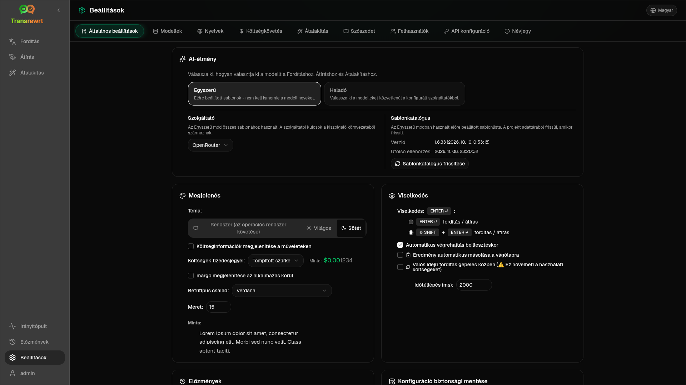

Nyissa meg a **Beállítások** menüt az oldalsávon, hogy testre szabhassa az alkalmazás működését.

| Lap | Asztali | Web (Rendszergazda) | Web (Felhasználó) | Megjegyzések |
| --- | :---: | :---: | :---: | --- |
| Általános beállítások | ✓ | ✓ | ✓ | Tartalmazza az **AI-élmény** (Egyszerű / Haladó) beállítást |
| Modellek | ✓ | ✓ | ✓ | Előre beállított kártyák az Egyszerű módban, modell táblázat a Haladó módban |
| Nyelvek | ✓ | ✓ | ✓ | |
| Költségkövetés | ✓ | ✓ | — | |
| Átalakítás | ✓ | ✓ | ✓ | Promptok tömeges importálása/exportálása |
| Szószedet | ✓ | ✓ | ✓ | Fordítási kifejezéspárok |
| Felhasználók | — | ✓ | — | |
| API konfiguráció | ✓ | ✓ | — | |
| Névjegy | ✓ | ✓ | ✓ | |

**Egyszerű** módban válassza ki az AI-t az eszköztárban található előre beállítások és az Általános beállításokban található **Szolgáltató** segítségével; a **Modellek** lapon csak olvasható előre beállított kártyák láthatók.

:::note
A webes verzióban minden felhasználónak saját konfigurációja van (AI élmény, szolgáltató, modellek/előbeállítások, nyelvek, opciók, promptok). A változtatások nem érintik a többi felhasználót.
:::

## Általános beállítások

**AI-élmény**

- **Egyszerű** (alapértelmezett): válasszon egy **Szolgáltató**-t. A felhőszolgáltatók az eszköztár előbeállításait használják. A **Helyi LLM** ehelyett a telepített helyi modelleket sorolja fel. A **Sablonkatalógus frissítése** lekéri a legújabb előbeállítás-listát a projekt adattárából.
  - **Ingyenes (OpenRouter)** — költségmentes opció, amely az elérhető ingyenes modellekre irányít; a minőség és a rendelkezésre állás változó lehet
  - **Standard** — könnyű és költséghatékony; a legjobb rövid szövegekhez, gyors vázlatokhoz és nagy mennyiségű használathoz
  - **Haladó** — nagy pontosságú modell összetett vagy árnyalt tartalomhoz, magasabb költséggel
  - **Technikai** — kódhoz, API-khoz, fejlesztői dokumentációkhoz és strukturált tartalomhoz hangolva; megőrzi a formázást és a terminológiát
- **Haladó**: válasszon modelleket az eszköztáron; kezelje a listát a(z) [Modellek](#models) alatt.

Az Egyszerű ↔ Haladó mód között az eszköztár előbeállítás/modell menüjéből is válthat (**Váltás Egyszerű/Haladó módra**, a Beállítások megnyitása felett).

**Megjelenés** — Téma; **Költséginformációk megjelenítése a műveleteken**; **Költségtörtrészek**; csak webes margó az alkalmazás körül; **Betűtípus** és **Méret**.

**Viselkedés** — **Viselkedés:** ENTER; **Automatikus végrehajtás beillesztéskor**; **Eredmény automatikus másolása a vágólapra**; **Valós idejű fordítás gépelés közben**; **Időkorlát (ms)**.

**Előzmények**

- **Végrehajtási előzmények megőrzése** — bemenet/kimenet tárolása az [Előzmények](/docs/history/) nézethez. A kikapcsolás megerősítést kér, és eltávolíthatja a tárolt szöveget. Ha a címke *letiltva a rendszergazda által*, a(z) `HISTORY_DISABLED` be van állítva – lásd: [Konfiguráció](/docs/configuration/#privacy-mode).
- **Előzmények adatainak törlése** — tárolt szöveg eltávolítása kor szerint vagy az összes törlése. **Nem** törli a költségek összesítését (ehhez használja a Költségkövetés funkciót).

**Konfiguráció biztonsági mentése** (asztali és webes rendszergazdák)

- Opcionális **Használati adatok belefoglalása a biztonsági mentésbe**
- **Konfiguráció biztonsági mentése** — ZIP fájl konfigurációval, állapottal, felhasználókkal, beállításokkal, promptokkal és opcionális használati adatokkal
- **Visszaállítás biztonsági mentésből** — megerősítő párbeszédpanel opciókkal az adatok visszaállítására és/vagy törlésére

A biztonsági mentések mozgathatók asztali és webes környezetek között; asztali biztonsági mentés visszaállítása weben az adatokat a rendszergazdai felhasználóra alkalmazza.

## Modellek

A **Modellek** lap mindig szerepel a listán. Az **Egyszerű / Haladó** kapcsoló az egész alkalmazást váltja a két [AI élmény](#general-settings) között.

- Az **Egyszerű** nézet előbeállításonként egy írásvédett kártyát jelenít meg (például **Ingyenes (OpenRouter)** vagy **Standard**). Minden kártya felsorolja az előbeállítás fő és tartalék modelljét minden konfigurált szolgáltatóhoz. A **Szolgáltató** chipek szűrik a kártyákat.
- A **Haladó** nézet egy táblázatban mutatja az összes modellt, a következőkkel:
  - keresőmező, **Szolgáltató** chipek, **Csak ingyenes**, **Csak a kijelöltek** és **Frissítés**
  - rendezési menü; az alapértelmezett az **Index szerint csökkenő**
  - jelölőnégyzet modellenként a kijelöléshez vagy a kijelölés megszüntetéséhez
  - **Válasszon előbeállítások közül**, amely hozzáadja az előbeállítás fő és tartalék modelljét minden konfigurált szolgáltatóhoz (az **Összes betöltése** minden szolgáltatót betölt)
  - **Összes törlése**, amely először megerősítést kér
- A modellazonosítók szolgáltatói előtagot használnak (`openrouter/…`, `openai/…`, `local/…`, …)

A pontszám és ár oszlopok:

- **Index** — a ChrF, Arena Score és az ár alapján összeállított minőségi pontszám. Az egyes szolgáltatókon belül rangsorolt, így nem hasonlítható össze a szolgáltatók között. Az Index nélküli modellek a lista aljára kerülnek.
- **ChrF** — átlagos fordítási minőség a [languagebench](https://huggingface.co/spaces/fair-forward/languagebench) alapján az alkalmazás felhasználói felületének nyelveihez.
- **Arena** — Arena Score az [LMArena](https://huggingface.co/datasets/lmarena-ai/leaderboard-dataset) ranglistáról.
- **Bemenet** / **Kimenet** — ár USD-ben 1M tokenenként, a szolgáltatói katalógusból vagy a [models.dev](https://models.dev/) oldalról. A becsült árat csillag jelöli. A kötőjel (—) azt jelenti, hogy az ár ismeretlen; a helyi modellek „ingyenes – helyi” feliratot mutatnak.

Vigye az egérmutatót egy oszlopfejléc fölé, hogy megtekinthesse az adatforrását és licencét. Az eszköztárban található modellválasztó minden modell Indexét kis chipként mutatja; vigye az egérmutatót fölé a ChrF és Arena értékek megtekintéséhez.

A pontszámok csak tájékoztató jellegűek: a lefedettség hiányos, és sok modellnek nincs ChrF vagy Arena pontszáma.

:::tip
Ne használja az OpenRouter **Body Builder** (`openrouter/bodybuilder`) funkcióját fordításhoz, átíráshoz vagy átalakításhoz – az JSON kérés-adatcsomagokat ad vissza, nem kész szöveget.
:::

Jelöljön be vagy töröljön egy modellt a kiválasztáshoz vagy a kiválasztás megszüntetéséhez. Az OpenRouter ingyenes modellje opcionális – a kiválasztott modellek üresek lehetnek. Az utolsó modell eltávolítása az eszköztárból megnyitja a **Beállítások → Modellek** menüt. Ha az aktuális modell elérhetetlenné válik, az alkalmazás a lista következő modelljét választja az ingyenes modell kényszerítése helyett.

## Nyelvek

- **Leggyakoribb nyelvek** — a fordítási és átalakítási nyelvi listák tetején rögzítve
- **Egyéni nyelv** — a beépített listából hiányzó nyelv hozzáadása

## Költségkövetés

- **Teljes költség**, **Érték másolása**, **Költség visszaállítása**
- **Szinkronizálás az API-kulcs használatával** — igazítás az OpenRouter fiókhasználathoz (csak OpenRouter esetén)
- **API-kulcs használata** — OpenRouter részletek, ha elérhetőek
- **Költségadatok törlése** — minden adat vagy egy adott dátumnál régebbi bejegyzések

Az OpenRouter és az xAI a tényleges számlázott költséget mutatja, amikor az API visszaadja; más szolgáltatók a [models.dev](https://models.dev/) árazásából származó becsléseket használják. A becslések nem számlák.

:::caution
A költségadatok törlése nem vonható vissza. Ha szüksége van biztonsági mentésre, először exportálja az előzményekből vagy a műszerfalról → Összes hívásból. Az API-hívásokhoz kapcsolódó bemeneti/kimeneti előzmények is eltávolításra kerülnek.
:::

## Átalakítás

Promptok tömeges kezelése: áttekintés, törlés, importálás, exportálás és mintapromptok betöltése.

## Szószedet

A [fordítás](/docs/translate/#use-the-glossary) során alkalmazott kifejezéspárok kezelése. Minden kifejezésnek van forrás/célnyelve és forrás/célszövege.

- Hozzáadás az alsó soron és a **+** gombbal
- Szűrés nyelvek vagy szöveg alapján
- CSV vagy XLSX importálása/exportálása; üres sablonok letöltése

Az asztali alkalmazás helyben tárolja a szószedetet; a webes alkalmazás felhasználónként tárolja.

## Felhasználók

Csak web (adminok):

- Felhasználók hozzáadása, adatok frissítése, jelszavak visszaállítása, fiókok törlése
- **Munkamenet időkorlát** — mennyi ideig tart egy bejelentkezés (1 órától 7 nap-ig); a módosítások csak az új bejelentkezésekre vonatkoznak
- **Munkamenetek visszavonása** — felhasználó kijelentkeztetése minden eszközről azonnal

Minden bejelentkezett felhasználó (beleértve a nem adminokat is) megváltoztathatja saját jelszavát vagy kijelentkezhet az oldalsáv alján található felhasználói menüből.

## API konfiguráció

Csak az Ön által használt szolgáltatókat konfigurálja: OpenRouter, OpenAI, Anthropic, Google Gemini, DeepSeek, Groq, Mistral, xAI, Cerebras, NVIDIA, Alibaba Cloud, apikey.fun, **Helyi LLM** (alap URL Ollama, LM Studio, llama.cpp, vagy hasonló számára), és egy opcionális egyéni OpenAI-kompatibilis szolgáltató.

**Web (admin):** a kulcsok környezeti változókból származnak — ez az oldal megmutatja, melyek vannak beállítva, és lehetővé teszi a **Tesztelést**. Indítsa újra a környezeti változók megváltoztatása után. Lásd: [Konfiguráció](/docs/configuration/).

**Asztali alkalmazás:** írja be a kulcsokat (vagy a Helyi LLM URL-t), majd **Mentés** / **Szerkesztés** / **Tesztelés**. A kulcsok titkosítva tárolódnak; nem tekintheti meg az aktuális értéket, csak felülírhatja.

:::tip
Nincs szükség fizetős kulcsra az induláshoz: használjon ingyenes OpenRouter modelleket, más ingyenes szintű szolgáltatókat, vagy egy helyi OpenAI-kompatibilis szervert, mint például az [Ollama](https://ollama.com), LM Studio, vagy llama.cpp (pl. `translategemma:4b`).
:::

## Névjegy

Alkalmazás neve, verziója, build dátuma, licenc, harmadik féltől származó értesítések és adattár linkje.
