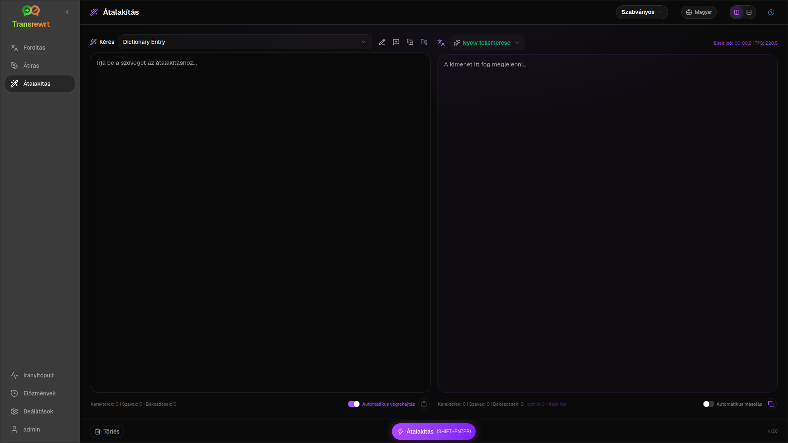
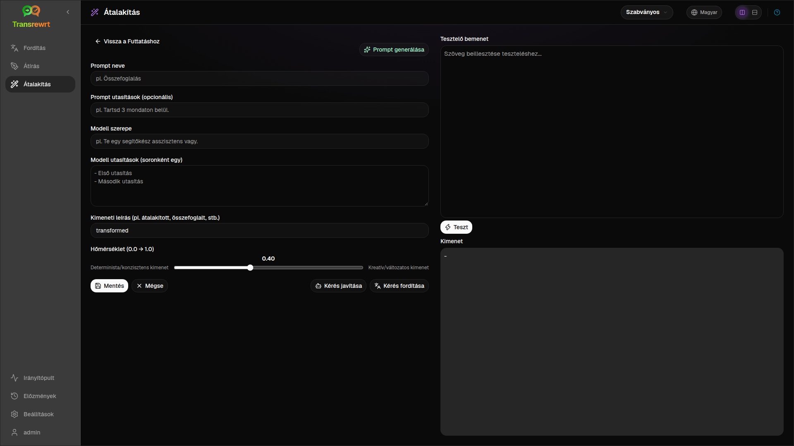

A **Transform** funkciót akkor használja, ha azt szeretné, hogy az AI egyéni utasításokat kövessen – összefoglaljon, finomítson egy e-mailt, kinyerjen kulcsfontosságú pontokat, újraformázza a szöveget, vagy bármilyen munkafolyamatot, amit Ön definiál.

## Meglévő prompt futtatása

1. Nyissa meg az **Átalakítás** funkciót.
2. Válasszon egy promptot a listából.
3. Ha megjelenik egy **Forrás** nyelvi mező, állítson be egy nyelvet, ha szeretne.
4. Írja be vagy illessze be a szöveget az **Input** mezőbe.
5. Kattintson az **Átalakítás** gombra.
6. Olvassa el az eredményt az **Output** mezőben.

Az [elrendezés váltó és a billentyűparancsok](/docs/translate/#layout-and-keyboard) ugyanúgy működnek, mint a Fordítás funkcióban.

## Mintapromptok betöltése

Ha a lista üres, kattintson a **Mintapromptok betöltése** gombra az Átalakítás munkaterületen (elérhető a [Beállítások → Átalakítás](/docs/settings/#transform) menüpont alatt is). A minták angol nyelvűek; betöltés után szerkessze a kérést, és szükség esetén használja a **Kérés fordítása** funkciót.

## Prompt létrehozása

1. Kattintson az **Új kérés** gombra.
2. Kattintson a **Prompt generálása** gombra.
3. Írja le, mit szeretne, hogy a kérés elvégezzen.
4. Válasszon egy előbeállítást (Egyszerű) vagy modellt (Haladó).
5. Tekintse át a vázlatot, majd kattintson a **Mentés** gombra.

## Prompt szerkesztése

A szerkesztő bal oldalon található; a tesztterület jobb oldalon van.

Fő mezők:

- **Prompt neve** – megjelenik a prompt listában
- **Prompt utasítások (opcionális)** – rövid tipp a prompt futtatásakor
- **Modell szerepe** – az AI általános szerepe
- **Modell utasítások (soronként egy)** – követendő szabályok
- **Kimeneti leírás** — rövid címke az eredményhez (pl. összefoglalt)
- **Hőmérséklet (0.0 → 1.0)** — az alacsonyabb érték stabilabb; a magasabb változatosabb
- **Célnyelv kérése** — nyelvválasztót ad hozzá futtatáskor

Segédeszközök: **Prompt generálása**, **Kérés javítása**, **Kérés fordítása** (az Egyszerű az előbeállításokat, a Haladó a modell-listát használja).

:::caution
Kattintson a **Mentés** gombra, mielőtt visszatérne a **Vissza a futtatáshoz** opcióhoz. Mentés nélküli visszatérés esetén a szerkesztések elvesznek.
:::

## Tesztelés mindennapi használat előtt

A jobb oldali tesztpanelt használja mintaszöveggel a promptok összeállításakor vagy összehasonlításakor.

A promptok tömeges exportálása és importálása a [Beállítások → Átalakítás](/docs/settings/#transform) menüpont alatt történik.

## Következő lépések

- [Beállítások](/docs/settings/)
- [Böngészési előzmények](/docs/history/)
- [Gyakori problémák](/docs/common-issues/)
