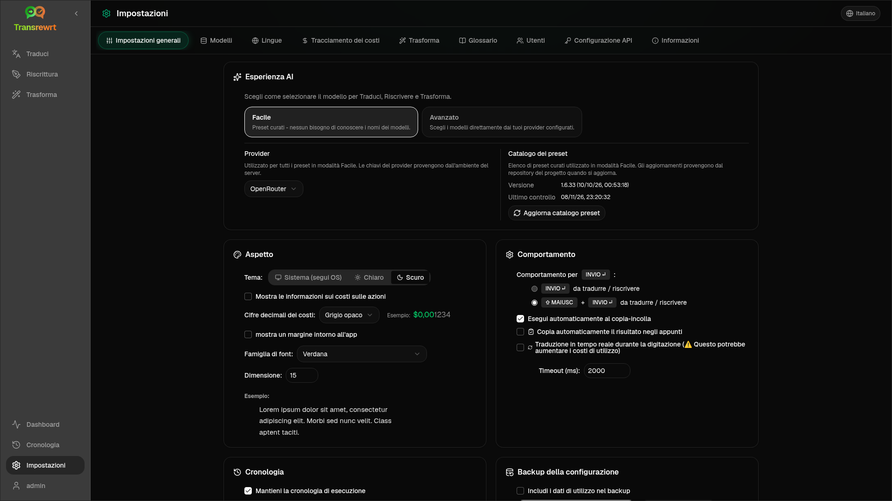

Apri le **Impostazioni** dalla barra laterale per personalizzare il comportamento dell'app.

| Tab | Desktop | Web (admin) | Web (user) | Note |
| --- | :---: | :---: | :---: | --- |
| Impostazioni generali | ✓ | ✓ | ✓ | Include **esperienza AI** (Facile / Avanzata) |
| Modelli | ✓ | ✓ | ✓ | Schede preimpostate in Facile, tabella dei modelli in Avanzate |
| Lingue | ✓ | ✓ | ✓ | |
| Monitoraggio costi | ✓ | ✓ | — | |
| Trasforma | ✓ | ✓ | ✓ | Importazione/esportazione in blocco di prompt |
| Glossario | ✓ | ✓ | ✓ | Coppie di termini per la traduzione |
| Utenti | — | ✓ | — | |
| Configurazione API | ✓ | ✓ | — | |
| Informazioni | ✓ | ✓ | ✓ | |

In modalità **Facile**, scegli l'IA tramite i preset nella barra degli strumenti e il **Fornitore** in Impostazioni generali; la scheda **Modelli** mostra schede preset di sola lettura.

:::note
Nella versione web, ogni utente ha la propria configurazione (esperienza AI, provider, modelli/preset, lingue, opzioni, prompt). Le modifiche non influiscono sugli altri utenti.
:::

## Impostazioni generali

**Esperienza AI**

- **Facile** (predefinito): scegli un **Fornitore**. I fornitori di servizi cloud utilizzano i preset della barra degli strumenti. **LLM locale** elenca invece i modelli locali installati. **Aggiorna catalogo preset** recupera l'elenco più recente di preset dal repository del progetto.
  - **Gratuito (OpenRouter)** — opzione a costo zero instradata a modelli gratuiti disponibili; la qualità e la disponibilità possono variare
  - **Standard** — leggero ed economico; ideale per testi brevi, bozze rapide e uso ad alto volume
  - **Avanzato** — modello ad alta precisione per contenuti complessi o sfumati, a un costo più elevato
  - **Tecnico** — ottimizzato per codice, API, Documentazione per sviluppatori e contenuti strutturati; mantiene la formattazione e la terminologia
- **Avanzato**: scegli i modelli nella barra degli strumenti; gestisci l'elenco in [Modelli](#models).

Puoi anche passare da Facile ↔ Avanzato dal menu preset/modello della barra degli strumenti (**Passa alla modalità Facile/Avanzata**, sopra Apri Impostazioni).

**Aspetto** — Tema; **Mostra informazioni sui costi nelle azioni**; **Cifre decimali del costo**; margine solo web intorno all'app; **Famiglia di caratteri** e **Dimensione**.

**Comportamento** — **Comportamento per INVIO**; **Esegui automaticamente al copia-incolla**; **Copia automaticamente il risultato negli appunti**; **Traduzione in tempo reale durante la digitazione**; **Timeout (ms)**.

**Cronologia**

- **Mantieni la cronologia di esecuzione** — memorizza input/output per la vista [Cronologia](/docs/history/). Disattivando questa opzione viene richiesta una conferma e si può rimuovere il testo memorizzato. Se etichettato come *disabilitato dall'amministratore*, `HISTORY_DISABLED` è impostato — vedi [Configurazione](/docs/configuration/#privacy-mode).
- **Elimina i dati della cronologia** — rimuove il testo memorizzato per età o cancella tutto. **Non** elimina i totali dei costi (usa Tracciamento dei costi per questo).

**Backup della configurazione** (amministratori desktop e web)

- Opzionale **Includi i dati di utilizzo nel backup**
- **Esegui backup della configurazione** — ZIP con configurazione, stato, utenti, preferenze, prompt e dati di utilizzo opzionali
- **Ripristina dal backup** — finestra di dialogo di conferma con opzioni per ripristinare e/o cancellare i dati di utilizzo

I backup possono essere spostati tra desktop e web; il ripristino di un backup desktop sul web applica i dati all'utente amministratore.

## Modelli

La scheda **Modelli** è sempre elencata. Il suo interruttore **Facile / Avanzate** cambia l'intera app tra le due [esperienze IA](#general-settings).

- **Facile** mostra una scheda di sola lettura per ogni preset (ad esempio **Gratuito (OpenRouter)** o **Standard**). Ogni scheda elenca il modello principale e di fallback del preset per ogni provider configurato. I chip **Provider** filtrano le schede.
- **Avanzato** mostra una tabella di ogni modello, con:
  - una casella di ricerca, chip **Provider**, **Solo gratuiti**, **Solo selezionati** e **Aggiorna**
  - un menu di ordinamento; l'impostazione predefinita è **Indice dal più alto al più basso**
  - una casella di controllo per ogni modello per selezionarlo o deselezionarlo
  - **Seleziona da preset**, che aggiunge i modelli principali e di fallback di un preset per ogni provider configurato (**Carica tutto** carica ogni provider)
  - **Deseleziona tutto**, che chiede prima una conferma
- Gli ID del modello utilizzano un prefisso del provider (`openrouter/…`, `openai/…`, `local/…`, …)

Le colonne punteggio e prezzo:

- **Indice** — un punteggio di qualità combinato da ChrF, Arena Score e prezzo. È classificato all'interno di ogni fornitore, quindi non è comparabile tra i fornitori. I modelli senza Indice vengono ordinati in fondo.
- **ChrF** — qualità media della traduzione da [languagebench](https://huggingface.co/spaces/fair-forward/languagebench) per le lingue dell'interfaccia utente dell'app.
- **Arena** — Arena Score dalla classifica [LMArena](https://huggingface.co/datasets/lmarena-ai/leaderboard-dataset).
- **Input** / **Output** — prezzo in USD per 1M di token, dal catalogo del fornitore o da [models.dev](https://models.dev/). Un prezzo stimato è contrassegnato da un asterisco. Un trattino (—) significa che il prezzo è sconosciuto; i modelli locali mostrano "nessun costo - locale".

Passa il mouse su un'intestazione di colonna per visualizzare la sua fonte di dati e licenza. Il selettore del modello nella barra degli strumenti mostra l'Indice di ogni modello come un piccolo chip; passaci sopra il mouse per i valori ChrF e Arena.

I punteggi sono solo una guida: la copertura è incompleta e molti modelli non hanno un punteggio ChrF o Arena.

:::tip
Non usare OpenRouter **Body Builder** (`openrouter/bodybuilder`) per Traduci, Riscrivi o Trasforma: restituisce payload di richieste JSON, non testo finito.
:::

Seleziona o deseleziona un modello. Il modello gratuito OpenRouter è opzionale — i modelli selezionati possono essere vuoti. La rimozione dell'ultimo modello dalla barra degli strumenti apre **Impostazioni → Modelli**. Se il modello corrente diventa non disponibile, l'app seleziona il modello successivo nell'elenco invece di forzare il modello gratuito.

## Lingue

- **Lingue principali** — bloccate vicino all'inizio degli elenchi di lingue in Traduci e Trasforma
- **Lingua personalizzata** — aggiungi una lingua mancante dall'elenco predefinito

## Tracciamento dei costi

- **Costo totale**, **Copia valore**, **Reimposta costo**
- **Sincronizza con l'utilizzo della chiave API** — allinea con l'utilizzo dell'account OpenRouter (solo OpenRouter)
- **Utilizzo della chiave API** — dettagli OpenRouter quando disponibili
- **Elimina dati sui costi** — tutti i dati o le voci più vecchie di una data

OpenRouter e xAI mostrano il costo effettivo fatturato quando l'API lo restituisce; altri fornitori utilizzano stime basate sui prezzi di [models.dev](https://models.dev/). Le stime non sono fatture.

:::caution
L'eliminazione dei dati sui costi non può essere annullata. Esporta prima tramite Cronologia o Dashboard → Tutte le chiamate se hai bisogno di un backup. Anche la cronologia di input/output correlata per tali chiamate API viene rimossa.
:::

## Trasforma

Gestisci in blocco i prompt: rivedi, elimina, importa, esporta e carica prompt di esempio.

## Glossario

Gestisci le coppie di termini applicate durante la [traduzione](/docs/translate/#use-the-glossary). Ogni termine ha lingua di origine/destinazione e testo di origine/destinazione.

- Aggiungi tramite la riga inferiore e **+**
- Filtra per lingue o testo
- Importa/esporta CSV o XLSX; scarica modelli vuoti

Desktop memorizza il glossario localmente; il web lo memorizza per utente.

## Utenti

Solo web (amministratori):

- Aggiungi utenti, aggiorna dettagli, reimposta password, elimina account
- **Timeout sessione** — quanto dura un accesso (da 1 ora a 7 giorni); le modifiche si applicano solo ai nuovi accessi
- **Revoca sessioni** — disconnetti immediatamente un utente da tutti i dispositivi

Ogni utente connesso (inclusi i non amministratori) può cambiare la propria password o disconnettersi dal menu utente nella parte inferiore della barra laterale.

## Configurazione API

Configura solo i provider che utilizzi: OpenRouter, OpenAI, Anthropic, Google Gemini, DeepSeek, Groq, Mistral, xAI, Cerebras, NVIDIA, Alibaba Cloud, apikey.fun, **LLM locale** (URL di base per Ollama, LM Studio, llama.cpp o simili) e un provider opzionale personalizzato compatibile con OpenAI.

**Web (amministratore):** le chiavi provengono da variabili d'ambiente — questa pagina mostra quali sono impostate e ti consente di **Testare**. Riavvia dopo aver modificato le variabili d'ambiente. Vedi [Configurazione](/docs/configuration/).

**Desktop:** inserisci le chiavi (o l'URL LLM locale) e **Salva** / **Modifica** / **Testa**. Le chiavi sono memorizzate crittografate; non puoi visualizzare il valore corrente, solo sostituirlo.

:::tip
Non è necessaria alcuna chiave a pagamento per iniziare: usa modelli OpenRouter gratuiti, altri provider gratuiti o un server locale compatibile con OpenAI come [Ollama](https://ollama.com), LM Studio o llama.cpp (ad es. `translategemma:4b`).
:::

## Informazioni

Nome dell'app, versione, data di build, licenza, avvisi di terze parti e link al repository.
