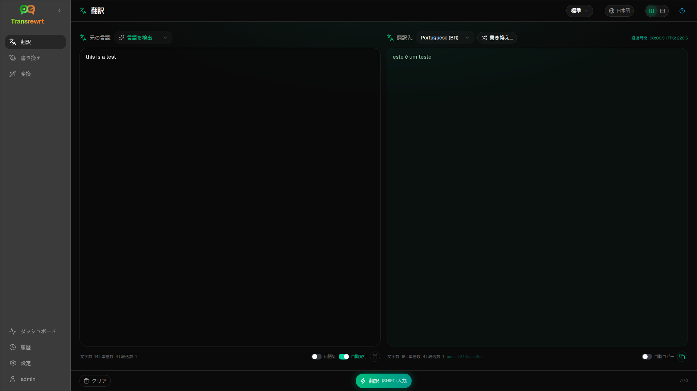

**Transrewrt**は、AIを活用したオープンソースのテキストツールで、以下の機能を提供します：

- **翻訳** — 数十の言語間での翻訳、自動ソース検出、用語集に対応
- **リライト** — 文法の修正、明確さの向上、トーンや長さの変更
- **トランスフォーム** — 任意のテキストに対してカスタムAIプロンプトを実行

多くのAIプロバイダ（OpenRouter、OpenAI、Anthropic、Google Gemini、DeepSeek、Groq、Mistral、xAI、Cerebras、NVIDIA、Alibaba Cloud、apikey.fun、OpenAI互換エンドポイント、およびOllama、LM Studio、llama.cppなどのローカルOpenAI互換サーバー）をサポートしています。**デスクトップアプリ**（Windows / Linux / macOS）または**Docker Webアプリ**として実行できます。

あなたのキー、あなたのモデル、あなたのホスト — Transrewrtのクラウドアカウントはありません。

## ウィンドウの構成

- **サイドバー** — メインナビゲーション: 翻訳、リライト、変換、ダッシュボード、履歴、設定（およびウェブ版のログインユーザー）。
- **ツールバー** — ページタイトル、**プリセット**（かんたん）または**モデル**（高度）セレクター、**インターフェイス言語**（地球アイコン、翻訳元/翻訳先は変更されません）、およびこのドキュメントにリンクするヘルプ（**?**）。プリセット/モデルメニューでは、**かんたん/高度モードに切り替え**（設定を開くの上）も可能です。
- **ワークエリア** — 入力および出力パネル、カウント、タイミング、TPS、およびオプションのコスト。アクションバーには、GitHub Pagesサイトへの小さなアプリ**バージョン**リンク（右下）が表示されます。

デフォルトでは、アプリは**イージーモード**で動作します：設定で**プリセット**と**プロバイダー**を選びます。[設定 → 全般設定](/docs/settings/#general-settings)で**アドバンストモード**に切り替えて完全なモデルリストを表示するか、ツールバーのプリセット/モデルメニュー内のスイッチを使用してください。

## はじめに

1. [クイックスタート](/docs/quick-start/) — デスクトップ版のインストールまたはDockerでの実行
2. [APIキー](/docs/api-key/) — 無料のOpenRouterキーまたはその他のプロバイダーを接続
3. [設定](/docs/configuration/) — 環境変数、設定パス、Web認証

## ガイド

- [テキストを翻訳する](/docs/translate/)
- [テキストをリライトする](/docs/rewrite/)
- [プロンプトでトランスフォームする](/docs/transform/)
- [ダッシュボードを使う](/docs/dashboard/)
- [履歴を閲覧する](/docs/history/)

## リファレンスとヘルプ

- [設定](/docs/settings/)
- [一般的な問題](/docs/common-issues/)

[リリースのダウンロード](https://github.com/wsj-br/transrewrt/releases) · [GitHubリポジトリ](https://github.com/wsj-br/transrewrt)
