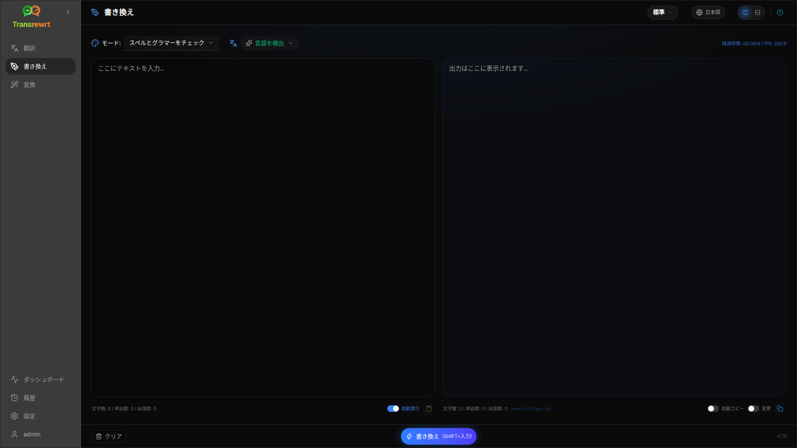

**Rewrite**を使用すると、主な意味を変えずに表現を改善できます。テキストは同じ言語のまま維持されます。

モードには以下が含まれます:

- **スペルとグラマーをチェック**
- **明確性を向上**
- **代替バージョン**（1回の実行で複数の言い換え）
- **正式な表現に変更** / **非公式な表現に変更**
- **短くする** / **長くする**
- **専門用語に変更**

## テキストを書き換える

1. **書き換え**を開きます。
2. **モード**を選択します。
3. 必要に応じて**元言語**をテキストの言語に設定します（または**言語を検出**のままにします）。
4. **入力**にテキストを入力または貼り付けます。
5. **Rewrite**をクリックします。
6. **Output**で結果を確認します。

[レイアウトの切り替えとキーボードショートカット](/docs/translate/#layout-and-keyboard)は、Translateと同じように機能します。

:::tip
書き換え後、**すべての**書き換えモードで**コピー**の横に**変更を表示する**（**変更**）スイッチが表示されます。これを切り替えると、入力と出力の差分の表示・非表示を切り替えられます。
:::

:::note
**代替バージョン**は、1回の**単一**実行で複数の言い換えを返し、それらは`----`で区切られます。これは、時間をかけてバージョン履歴を構築する**Rephrase…** とは異なります。
:::

## 書き換えを調整する

実行が成功すると、出力側に**Rephrase…** とバージョンのドロップダウンが表示されます ([Translate](/docs/translate/#refine-a-translation)と同じ考え方ですが、テキストは同じ言語のままで、現在の**Mode**が維持されます):

1. **言い換え…**（選択なし）— 別の表現による全体の書き換え。最大5つのバージョン。**書き換えを停止**をクリックしてキャンセルします。
2. **単語の候補** — テキストを選択し、右クリックまたは**言い換え…** を実行します。
3. 各リクエストは使用量コストを追加する場合があります。

## 次のステップ

- [テキストを翻訳する](/docs/translate/)
- [プロンプトで変換する](/docs/transform/)
- [一般的な問題](/docs/common-issues/)
