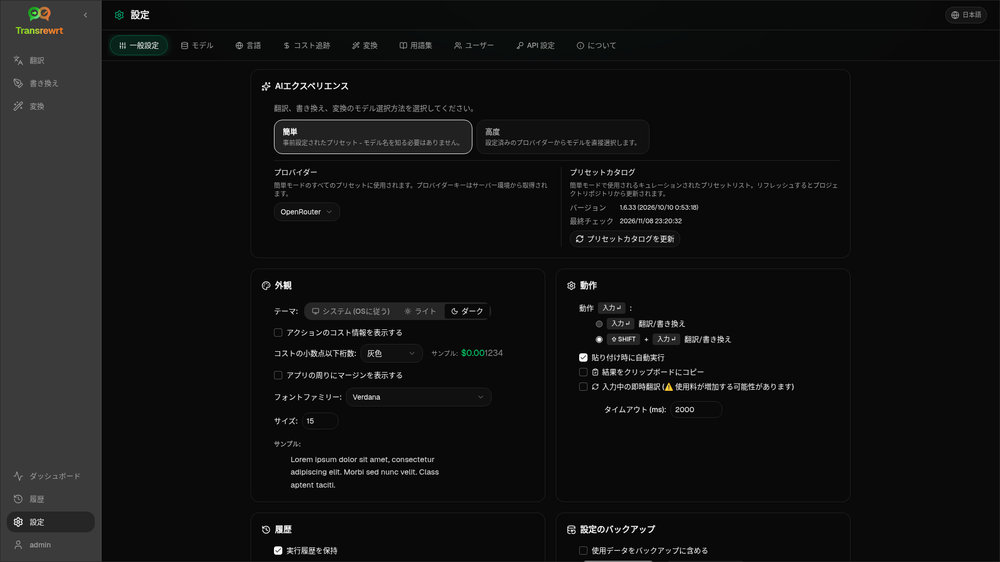

サイドバーから**設定**を開き、アプリの動作をカスタマイズします。

| タブ | デスクトップ | Web (管理者) | Web (ユーザー) | 備考 |
| --- | :---: | :---: | :---: | --- |
| 一般設定 | ✓ | ✓ | ✓ | **AIエクスペリエンス** (簡単 / 詳細) を含む |
| モデル | ✓ | ✓ | ✓ | Easyではプリセットカード、Advancedではモデルテーブル |
| 言語 | ✓ | ✓ | ✓ | |
| コスト追跡 | ✓ | ✓ | — | |
| 変換 | ✓ | ✓ | ✓ | プロンプトの一括インポート/エクスポート |
| 用語集 | ✓ | ✓ | ✓ | 翻訳用の用語ペア |
| ユーザー | — | ✓ | — | |
| API設定 | ✓ | ✓ | — | |
| バージョン情報 | ✓ | ✓ | ✓ | |

**Easy**モードでは、ツールバーのプリセットからAIを選択し、一般設定で**プロバイダ**を選択します。**Models**タブには読み取り専用のプリセットカードが表示されます。

:::note
Web版では、各ユーザーが独自の設定（AIエクスペリエンス、プロバイダー、モデル/プリセット、言語、オプション、プロンプト）を持ちます。変更は他のユーザーに影響しません。
:::

## 一般設定

**AIエクスペリエンス**

- **イージーモード**（デフォルト）：**プロバイダー**を選択。クラウドプロバイダーはツールバーのプリセットを使用。**ローカルLLM**はインストール済みのローカルモデルを一覧表示。**プリセットカタログを更新**はプロジェクトリポジトリから最新のプリセットリストを取得。
  - **無料（OpenRouter）** — 利用可能な無料モデルにルーティングされるゼロコストオプション。品質と可用性は異なる場合があります
  - **スタンダード** — 軽量でコスト効率が高い。短いテキスト、クイック下書き、高用量使用に最適
  - **アドバンスト** — 複雑なコンテンツやニュアンスのあるコンテンツ向けの高精度モデル。コストは高くなります
  - **テクニカル** — コード、API、開発者向けドキュメント、構造化コンテンツ向けに調整。フォーマットと用語を保持
- **アドバンスト**：ツールバーでモデルを選択。[Models](#models)の下でリストを管理。

ツールバーのプリセット/モデルメニュー（「設定を開く」の上にある**かんたん/詳細モードに切り替え**）から、かんたん ↔ 詳細を切り替えることもできます。

**外観** — テーマ; **アクションにコスト情報を表示**; **コストの小数桁数**; Web版のみのアプリ周囲のマージン; **フォントファミリー**および**サイズ**。

**動作** — **Enterキーの動作**; **貼り付け時に自動実行**; **結果をクリップボードにコピー**; **入力中のリアルタイム翻訳**; **タイムアウト（ミリ秒）**。

**履歴**

- **実行履歴を保持** — [履歴](/docs/history/)ビュー用の入力/出力を保存します。オフにすると確認を求め、保存されたテキストが削除される場合があります。*管理者によって無効化されています*と表示される場合、`HISTORY_DISABLED`が設定されています — [設定](/docs/configuration/#privacy-mode)を参照してください。
- **履歴データを削除** — 保存されたテキストを期間別に削除、またはすべて削除します。コスト合計は**削除されません**（コスト追跡を使用してください）。

**設定のバックアップ**（デスクトップ版およびWeb版管理者）

- オプションの**バックアップに使用データを含める**
- **設定をバックアップ** — 設定、状態、ユーザー、プリファレンス、プロンプト、およびオプションの使用データを含むZIP
- **バックアップから復元** — 復元および/または使用データをクリアするオプション付きの確認ダイアログ

バックアップはデスクトップ版とWeb版間で移行できます。デスクトップ版のバックアップをWeb版で復元すると、管理者ユーザーにデータが適用されます。

## モデル

**Models**タブは常にリストに表示されます。**Easy / Advanced**の切り替えにより、アプリ全体を2つの[AIエクスペリエンス](#general-settings)間で切り替えます。

- **イージーモード**はプリセットごとに1つの読み取り専用カードを表示（例：**無料（OpenRouter）** または**スタンダード**）。各カードは、設定したすべてのプロバイダーに対してプリセットのメインとフォールバックモデルを表示。**プロバイダー**チップでカードをフィルター。
- **アドバンスト**はすべてのモデルのテーブルを表示：
  - 検索ボックス、**プロバイダー**チップ、**無料のみ**、**選択のみ**、**更新**
  - ソートメニュー。デフォルトは**インデックス降順**
  - 各モデルのチェックボックスで選択または選択解除
  - **プリセットから選択**は、各設定済みプロバイダーのプリセットのメインとフォールバックモデルを追加（**すべて読み込む**はすべてのプロバイダーを読み込む）
  - **すべて選択解除**は最初に確認を求める
- モデルIDはプロバイダープレフィックスを使用（`openrouter/…`、`openai/…`、`local/…`、…）

スコアと価格の列：

- **Index** — ChrF、Arena Score、価格を組み合わせた品質スコアです。各プロバイダ内でランク付けされるため、プロバイダ間での比較はできません。Indexのないモデルは最後に並べられます。
- **ChrF** — アプリのUI言語における[languagebench](https://huggingface.co/spaces/fair-forward/languagebench)の平均翻訳品質です。
- **Arena** — [LMArena](https://huggingface.co/datasets/lmarena-ai/leaderboard-dataset)リーダーボードのArena Scoreです。
- **Input** / **Output** — プロバイダのカタログまたは[models.dev](https://models.dev/)に基づく、1MトークンあたりのUSD価格です。概算価格にはアスタリスクが付きます。ダッシュ（—）は価格不明を意味し、ローカルモデルには「no cost - local」と表示されます。

列見出しにカーソルを合わせると、データソースとライセンスが表示されます。ツールバーのモデルセレクターには各モデルのIndexが小さなチップで表示され、カーソルを合わせるとChrFとArenaの値が表示されます。

スコアは目安にすぎません：カバレッジは不完全であり、多くのモデルにChrFやArenaスコアがありません。

:::tip
OpenRouter **Body Builder** (`openrouter/bodybuilder`) は、Translate、Rewrite、または Transform に使用しないでください。これは完成したテキストではなく、JSONリクエストペイロードを返します。
:::

モデルのチェックボックスをオン/オフして選択または選択解除します。OpenRouterの無料モデルは任意です — 選択されたモデルが空になることもあります。ツールバーから最後のモデルを削除すると、**Settings → Models**が開きます。現在のモデルが利用不可になった場合、アプリは無料モデルを強制するのではなく、リスト内の次のモデルを選択します。

## 言語

- **上位言語** — 翻訳および変換の言語リストの上部にピン留めされます
- **カスタム言語** — 組み込みリストにない言語を追加します

## コスト追跡

- **合計コスト**、**値をコピー**、**コストをリセット**
- **APIキー使用量と同期** — OpenRouterアカウントの使用量と連携します（OpenRouterのみ）
- **APIキー使用量** — 利用可能な場合のOpenRouterの詳細
- **コストデータを削除** — すべてのデータまたは指定日より古いエントリ

OpenRouterとxAIは、APIが返す実際の請求コストを表示します。他のプロバイダは[models.dev](https://models.dev/)の価格設定からの推定値を使用します。推定値は請求書ではありません。

:::caution
コストデータの削除は元に戻せません。バックアップが必要な場合は、履歴またはダッシュボード → すべての呼び出しからエクスポートしてください。それらのAPI呼び出しに関連する入力/出力履歴も削除されます。
:::

## 変換

プロンプトの一括管理: 確認、削除、インポート、エクスポート、サンプルプロンプトの読み込み。

## 用語集

[翻訳](/docs/translate/#use-the-glossary)時に適用される用語ペアを管理します。各用語には、元言語/対象言語と元テキスト/対象テキストがあります。

- 下行または **+** で追加
- 言語またはテキストでフィルタリング
- CSV または XLSX のインポート/エクスポート；空のテンプレートをダウンロード

デスクトップ版では用語集をローカルに保存し、Web版ではユーザーごとに保存します。

## ユーザー

Web版のみ（管理者）:

- ユーザーの追加、詳細の更新、パスワードのリセット、アカウントの削除
- **セッションタイムアウト** — ログインの持続時間（1時間から7日）。変更は新しいログインからのみ適用されます
- **セッションを取り消す** — ユーザーをすべてのデバイスから即座にサインアウト

サインイン中のすべてのユーザー（非管理者を含む）は、サイドバー下部のユーザーメニューから自身のパスワードを変更したり、サインアウトしたりできます。

## API 設定

使用するプロバイダーのみを設定：OpenRouter、OpenAI、Anthropic、Google Gemini、DeepSeek、Groq、Mistral、xAI、Cerebras、NVIDIA、Alibaba Cloud、apikey.fun、**ローカルLLM**（Ollama、LM Studio、llama.cpp、または同様のベースURL）、およびオプションのカスタムOpenAI互換プロバイダー。

**Web（管理者）:** キーは環境変数から取得されます。このページでは設定済みの環境変数を確認し、**Test**を実行できます。環境変数を変更した後は再起動してください。[設定](/docs/configuration/)を参照してください。

**デスクトップ版:** キー（またはLocal LLMのURL）を入力し、**Save** / **Edit** / **Test**を実行します。キーは暗号化して保存され、現在の値を確認することはできず、置き換えることのみ可能です。

:::tip
開始時に有料キーは不要です: 無料のOpenRouterモデル、他の無料枠プロバイダー、または[Ollama](https://ollama.com)、LM Studio、llama.cpp（例: `translategemma:4b`）などのローカルOpenAI互換サーバーを使用してください。
:::

## バージョン情報

アプリ名、バージョン、ビルド日、ライセンス、サードパーティの通知、リポジトリリンク。
