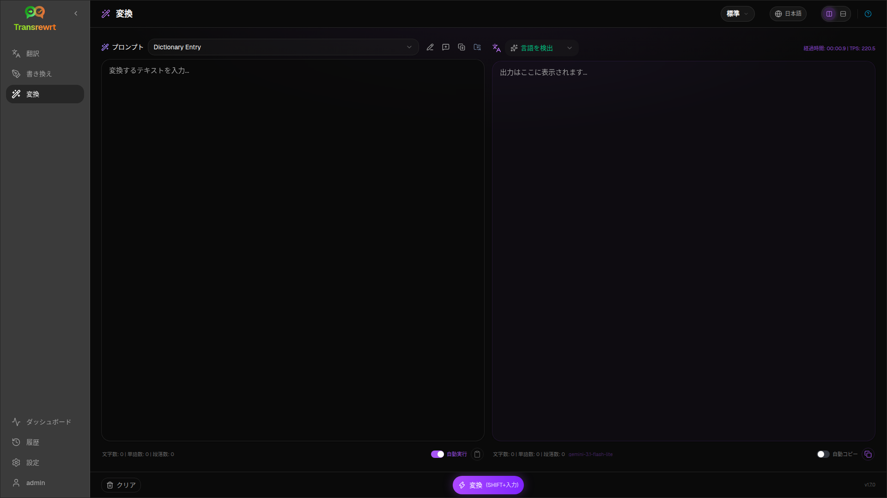
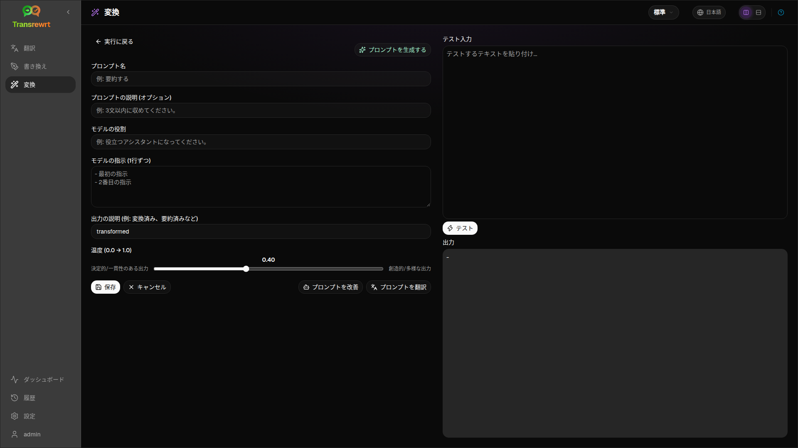

AIにカスタム指示に従わせたい場合（要約、メールの推敲、要点の抽出、テキストの再フォーマット、または独自に定義したワークフローなど）は、**Transform**を使用します。

## 既存のプロンプトを実行する

1. **Transform**を開きます。
2. リストからプロンプトを選択します。
3. **From**言語ボックスが表示された場合は、必要に応じて言語を設定します。
4. **Input**にテキストを入力または貼り付けます。
5. **Transform**をクリックします。
6. **Output**で結果を確認します。

[レイアウトの切り替えとキーボードショートカット](/docs/translate/#layout-and-keyboard)は、Translateと同じように機能します。

## サンプルプロンプトを読み込む

リストが空の場合、Transformワークスペースで**サンプルプロンプトを読み込む**をクリックします（[設定 → Transform](/docs/settings/#transform)からも利用できます）。サンプルは英語です。読み込み後にプロンプトを編集し、必要に応じて**プロンプトを翻訳**を使用します。

## プロンプトを作成する

1. **新しいプロンプト**をクリックします。
2. **プロンプトを生成する**をクリックします。
3. プロンプトに実行させたい内容を記述します。
4. プリセット（簡易）またはモデル（詳細）を選択します。
5. ドラフトを確認し、**Save**をクリックします。

## プロンプトを編集する

エディターは左側、テストエリアは右側にあります。

主なフィールド:

- **プロンプト名** — プロンプトリストに表示されます
- **プロンプトの説明 (オプション)** — プロンプト実行時の短いヒント
- **モデルの役割** — AI全体の役割
- **モデルの指示 (1行ずつ)** — 従うべきルール
- **出力の説明** — 結果の短いラベル（例：要約）
- **温度 (0.0 → 1.0)** — 低いほど安定、高いほど多様
- **ターゲット言語を指定** — 実行時に言語セレクターを追加します

ヘルパー: **プロンプトを生成する**、**プロンプトを改善**、**プロンプトを翻訳**（簡易ではプリセットを使用、詳細ではモデルリストを使用）。

:::caution
**実行に戻る**の前に**保存**をクリックしてください。保存せずに戻ると、編集内容が破棄されます。
:::

## 日常使用前にテストする

プロンプトの作成や比較を行う際は、右側のテストパネルでサンプルテキストを使用してください。

[設定 → 変換](/docs/settings/#transform)でプロンプトを一括でエクスポート・インポートできます。

## 次のステップ

- [設定](/docs/settings/)
- [履歴を参照](/docs/history/)
- [よくある問題](/docs/common-issues/)
