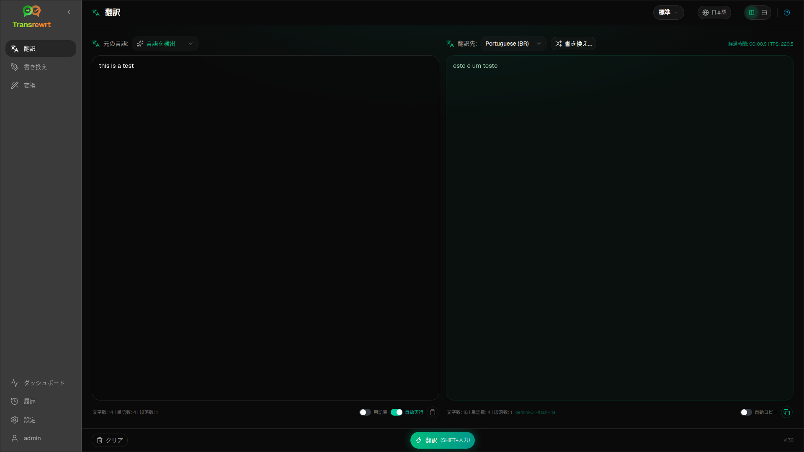

**Translate**を使用して、テキストをある言語から別の言語に変換します。

## 前提条件

- プロバイダーキー(デスクトップ)またはサーバー環境変数キー(Web)が少なくとも1つ — [APIキー](/docs/api-key/)を参照
- ツールバーで**preset**(Easy)または**model**(Advanced)が選択されていること

## テキストを翻訳

1. サイドバーで**Translate**を開きます。
2. **From**で言語を選択します（または**言語を検出**）。
3. **To**で言語を選択します。
4. ツールバーでプリセットまたはモデルを選択します。
5. **Input**にテキストを入力または貼り付けます。
6. **Translate**をクリックします。
7. **Output**で結果を確認し、必要に応じてコピーします。

**Top languages**はリストの先頭に表示されます — [Settings → Languages](/docs/settings/#languages)で設定します。

## 便利な設定

[Settings → General Settings](/docs/settings/#general-settings)で:

- **貼り付け時に自動実行** — 貼り付けるとすぐに実行されます
- **結果をクリップボードにコピー** — 実行成功後にコピーされます
- **入力中のリアルタイム翻訳** — 入力中に実行されます（コストが増加する場合があります）
- **タイムアウト (ms)** — リアルタイム実行前の待機時間
- **Behaviour for ENTER** — Enterでタスクを実行するか改行を挿入するか

## レイアウトとキーボード

- **Layout toggle** — パネル上部のボタンで、Input/Outputのレイアウトを**side-by-side**と**stacked**の間で切り替えます。この選択はTranslate、Rewrite、Transformに適用され、このデバイスで記憶されます。
- **Enter**または**Shift+Enter**でタスクを実行します。動作は**Behaviour for ENTER**(上記参照)に依存します。
- **Escape**でInputパネルをクリアします(開いているメニューやダイアログがある場合は、まずそれを閉じます)。

## 翻訳を調整する

実行成功後、**Rephrase…** とバージョンのドロップダウンが**To:** セレクターの横に表示されます:

1. **Rephrase…**（選択なし）— 同じ入力に対する別の完全な翻訳です。最大**5**バージョンまで作成できます。モデルは以前のバージョンを参照するため、表現が異なる場合があります。実行中のリフレーズをキャンセルするには**Stop Translate**をクリックします。
2. **単語の候補** — 単語または短いフレーズを選択し、右クリックまたは**Rephrase…** を実行します。代替案を選択してその範囲を置き換えます（文法上、範囲がわずかに広がる場合があります）。5バージョンある場合、バージョン5のみが更新されます。
3. 各リフレーズまたは候補リクエストはモデルを再度使用するため、コストが追加される場合があります。

## 用語集を使用する

**glossary**は、言語ペアのソース/ターゲット用語ペアです。有効にすると、一致する用語がモデルに送信され、推奨される表現が一貫して維持されます。

1. 入力パネルで**用語集**をオンにします。
2. 通常通り翻訳します — その**翻訳元** / **翻訳先**ペアの用語が自動的に適用されます。
3. 新しいペアをすばやく登録するには、**翻訳元:** の横にある**用語集に追加**をクリックします。
4. すべての用語は[設定 → 用語集](/docs/settings/#glossary)で管理します。

:::note
用語集の用語は言語ペアによって一致します。ソースとして**言語を検出**を使用している場合は使用できません。
:::

## 次のステップ

- [テキストを書き直す](/docs/rewrite/)
- [プロンプトで変換](/docs/transform/)
- [よくある問題](/docs/common-issues/)
