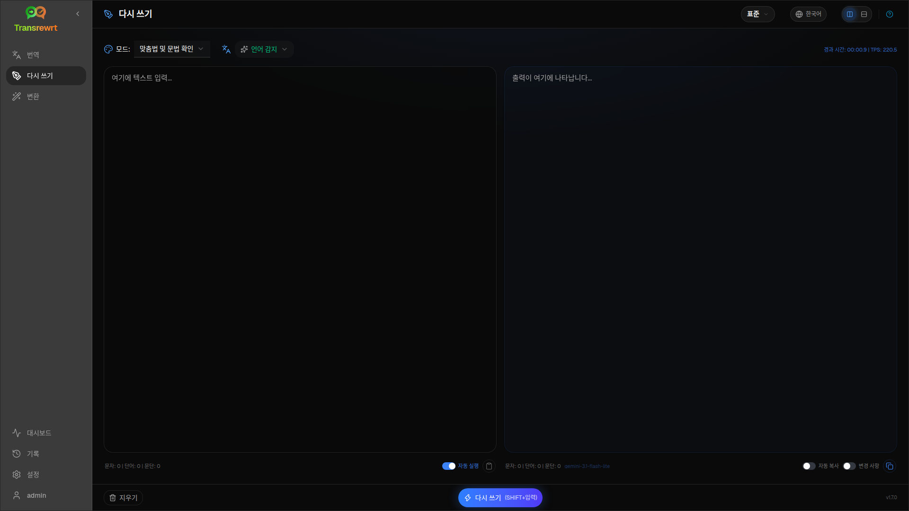

**Rewrite**를 사용하여 주요 의미를 바꾸지 않고 표현을 개선합니다. 텍스트는 같은 언어로 유지됩니다.

모드는 다음과 같습니다:

- **맞춤법 및 문법 확인**
- **명확성 개선**
- **대체 버전** (한 번의 실행으로 여러 가지 표현으로 바꾸기)
- **공식적으로 변경** / **비공식적으로 변경**
- **줄이기** / **늘리기**
- **기술적으로 변경**

## 텍스트 다시 쓰기

1. **다시 쓰기**를 엽니다.
2. **모드**를 선택합니다.
3. 선택적으로 **원본 언어**를 텍스트의 언어로 설정합니다(또는 **언어 감지**로 둡니다).
4. **입력**에 텍스트를 입력하거나 붙여넣습니다.
5. **Rewrite**를 클릭합니다.
6. **Output**에서 결과를 확인합니다.

[레이아웃 전환 및 키보드 단축키](/docs/translate/#layout-and-keyboard)는 번역과 동일하게 작동합니다.

:::tip
다시 쓰기 후, **모든** 다시 쓰기 모드에 대해 **복사** 옆에 **변경 사항 표시** (**변경 사항**) 스위치가 나타납니다. 이 스위치를 전환하여 입력과 출력 간의 차이점을 표시하거나 숨깁니다.
:::

:::note
**대체 버전**은 `----`로 구분된 여러 가지 표현을 **단일** 실행으로 반환합니다. 이는 시간이 지남에 따라 버전 기록을 구축하는 **바꾸기…** 와 다릅니다.
:::

## 다시 쓰기 결과 다듬기

실행이 완료되면 출력 측에 **Rephrase…** 와 버전 드롭다운이 나타납니다 ([번역](/docs/translate/#refine-a-translation)과 동일한 개념이지만, 텍스트는 같은 언어로 유지되고 현재 **Mode**를 유지합니다):

1. **바꾸기…** (선택 없음) — 다른 표현으로 전체를 다시 씁니다. 최대 5개의 버전입니다. 취소하려면 **다시 쓰기 중지**를 클릭합니다.
2. **단어 대안** — 텍스트를 선택한 다음 마우스 오른쪽 버튼을 클릭하거나 **바꾸기…** 를 클릭합니다.
3. 각 요청은 사용 비용을 추가할 수 있습니다.

## 다음 단계

- [텍스트 번역](/docs/translate/)
- [프롬프트로 변환](/docs/transform/)
- [일반적인 문제](/docs/common-issues/)
