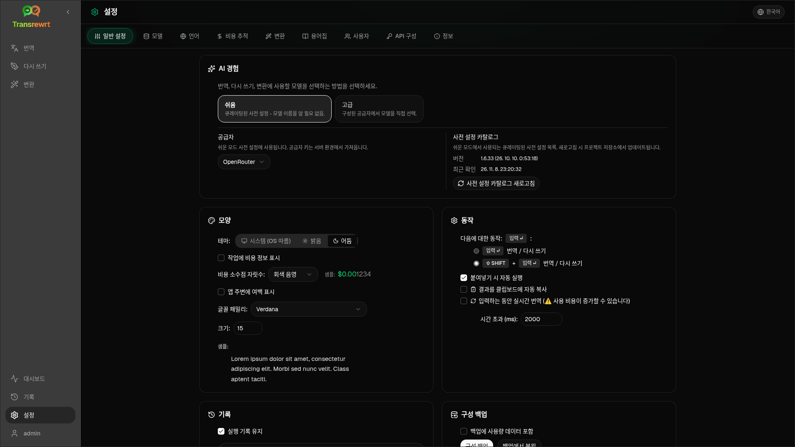

사이드바에서 **설정**을 열어 앱의 동작 방식을 사용자 정의하세요.

| 탭 | 데스크톱 | 웹 (관리자) | 웹 (사용자) | 참고 |
| --- | :---: | :---: | :---: | --- |
| 일반 설정 | ✓ | ✓ | ✓ | **AI 경험** (쉬움 / 고급) 포함 |
| 모델 | ✓ | ✓ | ✓ | Easy의 프리셋 카드, Advanced의 모델 테이블 |
| 언어 | ✓ | ✓ | ✓ | |
| 비용 추적 | ✓ | ✓ | — | |
| 변환 | ✓ | ✓ | ✓ | 프롬프트 일괄 가져오기/내보내기 |
| 용어집 | ✓ | ✓ | ✓ | 번역 용어 쌍 |
| 사용자 | — | ✓ | — | |
| API 설정 | ✓ | ✓ | — | |
| 정보 | ✓ | ✓ | ✓ | |

**Easy** 모드에서는 툴바의 프리셋과 일반 설정의 **Provider**를 통해 AI를 선택하며, **Models** 탭에는 읽기 전용 프리셋 카드가 표시됩니다.

:::note
웹 버전에서는 각 사용자가 자체 구성(AI 경험, 제공자, 모델/프리셋, 언어, 옵션, 프롬프트)을 가집니다. 변경 사항은 다른 사용자에게 영향을 주지 않습니다.
:::

## 일반 설정

**AI 경험**

- **간편** (기본값): **제공자**를 선택합니다. 클라우드 제공자는 도구 모음의 사전 설정을 사용합니다. **로컬 LLM**은 설치된 로컬 모델을 대신 나열합니다. **사전 설정 카탈로그 새로고침**은 프로젝트 리포지토리에서 최신 사전 설정 목록을 가져옵니다.
  - **무료 (OpenRouter)** — 사용 가능한 무료 모델로 라우팅되는 무료 옵션; 품질과 가용성은 다를 수 있습니다
  - **표준** — 가볍고 비용 효율적; 짧은 텍스트, 빠른 초안, 대량 사용에 적합
  - **고급** — 복잡하거나 미묘한 콘텐츠를 위한 고정확도 모델, 더 높은 비용
  - **기술** — 코드, API, 개발자 문서, 구조화된 콘텐츠에 맞게 조정; 서식과 용어를 유지
- **고급**: 도구 모음에서 모델을 선택; [모델](#models)에서 목록을 관리합니다.

도구 모음의 프리셋/모델 메뉴(**쉬움/고급 모드로 전환**, 설정 열기 위)에서도 쉬움 ↔ 고급을 전환할 수 있습니다.

**모양** — 테마; **작업에 비용 정보 표시**; **비용 소수점 자릿수**; 웹 전용 앱 여백; **글꼴 패밀리** 및 **크기**.

**동작** — **다음에 대한 동작: ENTER**; **붙여넣기 시 자동 실행**; **결과를 클립보드에 자동 복사**; **입력 중 실시간 번역**; **시간 초과 (ms)**.

**기록**

- **실행 기록 유지** — [기록](/docs/history/) 보기를 위해 입력/출력을 저장합니다. 끄면 확인을 요청하며 저장된 텍스트를 제거할 수 있습니다. *관리자가 비활성화했습니다*로 표시된 경우 `HISTORY_DISABLED`이(가) 설정된 것입니다 — [구성](/docs/configuration/#privacy-mode)을 참조하세요.
- **기록 데이터 삭제** — 보존 기간별로 저장된 텍스트를 제거하거나 모두 지웁니다. 비용 합계는 **삭제하지 않습니다** (해당 작업에는 비용 추적을 사용하세요).

**구성 백업** (데스크톱 및 웹 관리자)

- 선택 사항 **백업에 사용량 데이터 포함**
- **구성 백업** — 구성, 상태, 사용자, 환경설정, 프롬프트 및 선택적 사용량 데이터가 포함된 ZIP
- **백업에서 복원** — 사용량 데이터 복원 및/또는 삭제 옵션이 있는 확인 대화상자

백업은 데스크톱과 웹 간에 이동할 수 있습니다. 웹에서 데스크톱 백업을 복원하면 데이터가 관리자 사용자에게 적용됩니다.

## 모델

**Models** 탭은 항상 표시됩니다. 이 탭의 **Easy / Advanced** 토글은 전체 앱을 두 가지 [AI 경험](#general-settings) 사이에서 전환합니다.

- **간편**은 사전 설정별로 읽기 전용 카드를 하나씩 표시합니다 (예: **무료 (OpenRouter)** 또는 **표준**). 각 카드는 구성한 모든 제공자에 대해 사전 설정의 기본 모델과 대체 모델을 나열합니다. **제공자** 칩으로 카드를 필터링합니다.
- **고급**은 모든 모델의 테이블을 표시하며, 다음을 포함합니다:
  - 검색 상자, **제공자** 칩, **무료만**, **선택 항목만**, **새로 고침**
  - 정렬 메뉴; 기본값은 **인덱스 내림차순**입니다
  - 모델별 선택 또는 선택 해제를 위한 체크박스
  - **사전 설정에서 선택**, 구성된 각 제공자에 대해 사전 설정의 기본 모델과 대체 모델을 추가합니다 (**모두 불러오기**는 모든 제공자를 불러옵니다)
  - **모두 선택 해제**, 먼저 확인을 요청합니다
- 모델 ID는 제공자 접두사를 사용합니다 (`openrouter/…`, `openai/…`, `local/…`, …)

점수 및 가격 열:

- **Index** — ChrF, Arena Score, 가격을 혼합한 품질 점수입니다. 각 Provider 내에서 순위가 매겨지므로 Provider 간 비교가 가능하지 않습니다. Index가 없는 모델은 하단으로 정렬됩니다.
- **ChrF** — 앱 UI 언어에 대한 [languagebench](https://huggingface.co/spaces/fair-forward/languagebench)의 평균 번역 품질입니다.
- **Arena** — [LMArena](https://huggingface.co/datasets/lmarena-ai/leaderboard-dataset) 리더보드의 Arena Score입니다.
- **Input** / **Output** — Provider 카탈로그 또는 [models.dev](https://models.dev/) 기준 1M 토큰당 USD 가격입니다. 예상 가격은 별표로 표시됩니다. 대시(—)는 가격을 알 수 없음을 의미하며, 로컬 모델은 "no cost - local"로 표시됩니다.

열 제목 위에 마우스를 올리면 데이터 소스와 라이선스를 확인할 수 있습니다. 툴바의 모델 선택기에는 각 모델의 Index가 작은 칩으로 표시되며, 마우스를 올리면 ChrF 및 Arena 값을 볼 수 있습니다.

점수는 참고용입니다: 커버리지가 불완전하며, 많은 모델에 ChrF 또는 Arena 점수가 없습니다.

:::tip
Translate, Rewrite 또는 Transform에는 OpenRouter **Body Builder** (`openrouter/bodybuilder`)를 사용하지 마세요. 완성된 텍스트가 아닌 JSON 요청 페이로드를 반환합니다.
:::

모델을 선택하거나 해제하려면 체크박스를 선택/해제하세요. OpenRouter 무료 모델은 선택 사항이며 — 선택된 모델이 비어 있을 수 있습니다. 툴바에서 마지막 모델을 제거하면 **Settings → Models**가 열립니다. 현재 모델을 사용할 수 없게 되면, 앱은 무료 모델을 강제로 선택하는 대신 목록의 다음 모델을 선택합니다.

## 언어

- **상위 언어** — 번역 및 변환의 언어 목록 상단에 고정됩니다
- **사용자 정의 언어** — 기본 제공 목록에 없는 언어를 추가합니다

## 비용 추적

- **총 비용**, **값 복사**, **비용 초기화**
- **API 키 사용량과 동기화** — OpenRouter 계정 사용량과 맞춤 (OpenRouter만 해당)
- **API 키 사용량** — 가능한 경우 OpenRouter 세부 정보
- **비용 데이터 삭제** — 모든 데이터 또는 특정 날짜 이전 항목

OpenRouter와 xAI는 API가 실제 청구 비용을 반환할 때 이를 표시합니다; 다른 제공자는 [models.dev](https://models.dev/) 가격의 추정치를 사용합니다. 추정치는 청구서가 아닙니다.

:::caution
비용 데이터 삭제는 되돌릴 수 없습니다. 백업이 필요한 경우 먼저 기록 또는 대시보드 → 전체 호출을 통해 내보내세요. 해당 API 호출에 대한 관련 입력/출력 기록도 함께 제거됩니다.
:::

## 변환

프롬프트 일괄 관리: 검토, 삭제, 가져오기, 내보내기 및 샘플 프롬프트 불러오기.

## 용어집

[번역](/docs/translate/#use-the-glossary) 중에 적용되는 용어 쌍을 관리합니다. 각 용어는 원어/대상어 및 원어/대상어 텍스트를 가집니다.

- 하단 행과 **+** 를 통해 추가
- 언어 또는 텍스트로 필터링
- CSV 또는 XLSX 가져오기/내보내기; 빈 템플릿 다운로드

데스크톱은 용어집을 로컬에 저장하고, 웹은 사용자별로 저장합니다.

## 사용자

웹 전용(관리자):

- 사용자 추가, 세부 정보 업데이트, 비밀번호 재설정, 계정 삭제
- **세션 시간 초과** — 로그인 지속 시간 (1시간 ~ 7일); 변경 사항은 새 로그인에만 적용됩니다
- **세션 취소** — 모든 기기에서 사용자를 즉시 로그아웃합니다

로그인한 모든 사용자(비관리자 포함)는 사이드바 하단의 사용자 메뉴에서 자신의 비밀번호를 변경하거나 로그아웃할 수 있습니다.

## API 구성

사용하는 제공자만 구성하세요: OpenRouter, OpenAI, Anthropic, Google Gemini, DeepSeek, Groq, Mistral, xAI, Cerebras, NVIDIA, Alibaba Cloud, apikey.fun, **로컬 LLM** (Ollama, LM Studio, llama.cpp 또는 유사한 기본 URL), 그리고 선택적 사용자 지정 OpenAI 호환 제공자.

**Web (admin):** 키는 환경 변수에서 가져옵니다 — 이 페이지는 설정된 항목을 보여주며 **Test**할 수 있게 합니다. 환경 변수를 변경한 후 다시 시작하십시오. [Configuration](/docs/configuration/)을 참조하십시오.

**Desktop:** 키(또는 Local LLM URL)를 입력하고 **Save** / **Edit** / **Test**하십시오. 키는 암호화되어 저장됩니다; 현재 값을 볼 수는 없고 교체만 할 수 있습니다.

:::tip
시작하는 데 유료 키가 필요하지 않습니다: 무료 OpenRouter 모델, 다른 무료 등급 제공자, 또는 [Ollama](https://ollama.com), LM Studio, llama.cpp(예: `translategemma:4b`)와 같은 로컬 OpenAI 호환 서버를 사용하십시오.
:::

## 정보

앱 이름, 버전, 빌드 날짜, 라이선스, 타사 고지 사항 및 리포지토리 링크.
