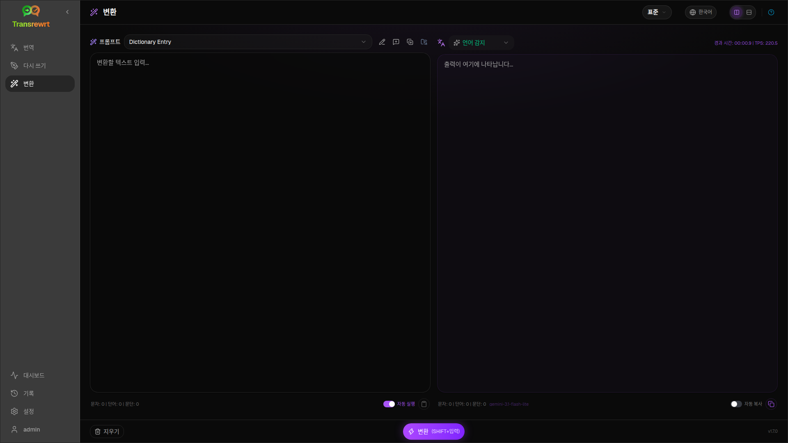
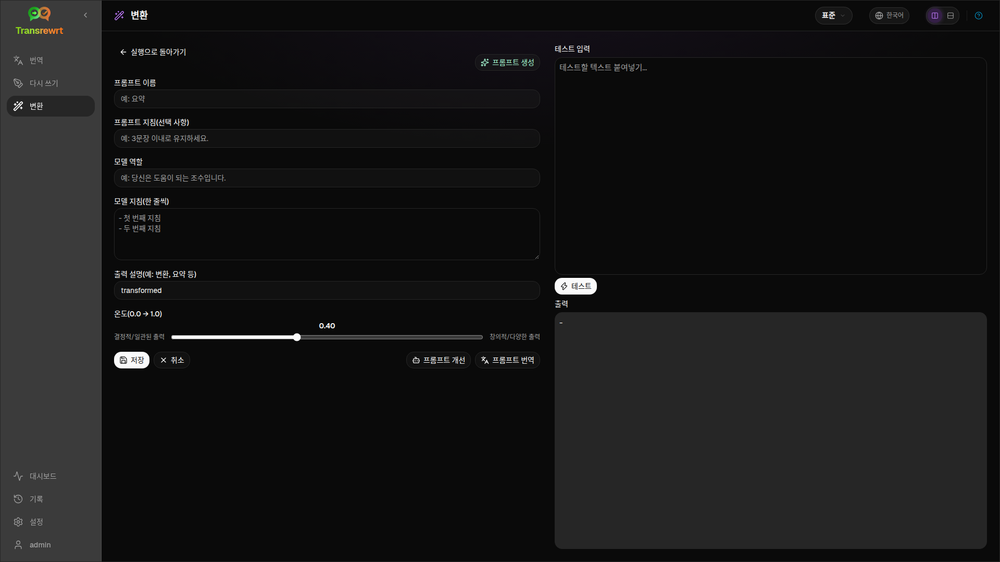

AI가 맞춤 명령어를 따르게 하려면 **Transform**을 사용하세요 — 요약, 이메일 다듬기, 핵심 사항 추출, 텍스트 재서식 지정 또는 정의한 모든 워크플로에 사용할 수 있습니다.

## 기존 프롬프트 실행

1. **Transform**을 엽니다.
2. 목록에서 프롬프트를 선택합니다.
3. **From** 언어 상자가 나타나면, 원하는 언어를 설정합니다.
4. **Input**에 텍스트를 입력하거나 붙여넣습니다.
5. **Transform**을 클릭합니다.
6. **Output**에서 결과를 확인합니다.

[레이아웃 전환 및 키보드 단축키](/docs/translate/#layout-and-keyboard)는 번역과 동일하게 작동합니다.

## 샘플 프롬프트 로드

목록이 비어 있으면 Transform 작업 영역에서 **샘플 프롬프트 로드**를 클릭하십시오([설정 → Transform](/docs/settings/#transform)에서도 사용할 수 있습니다). 샘플은 영어로 제공됩니다. 로드 후 프롬프트를 편집하고 필요한 경우 **프롬프트 번역**을 사용하십시오.

## 프롬프트 생성

1. **새 프롬프트**를 클릭하십시오.
2. **프롬프트 생성**을 클릭하십시오.
3. 프롬프트가 수행할 작업을 설명하십시오.
4. 사전 설정(간편) 또는 모델(고급)을 선택하십시오.
5. 초안을 검토하고 **Save**를 클릭합니다.

## 프롬프트 편집

편집기는 왼쪽에, 테스트 영역은 오른쪽에 있습니다.

주요 필드:

- **프롬프트 이름** — 프롬프트 목록에 표시됨
- **프롬프트 지침(선택 사항)** — 프롬프트 실행 시 표시되는 짧은 힌트
- **모델 역할** — AI의 전반적인 역할
- **모델 지침(한 줄씩)** — 따라야 할 규칙
- **출력 설명** — 결과에 대한 짧은 레이블(예: 요약됨)
- **온도(0.0 → 1.0)** — 낮을수록 안정적이고, 높을수록 다양함
- **대상 언어** 요청 — 실행 시 언어 선택기를 추가함

도우미: **프롬프트 생성**, **프롬프트 개선**, **프롬프트 번역**(간편 모드는 사전 설정을 사용하고, 고급 모드는 모델 목록을 사용합니다).

:::caution
**실행으로 돌아가기** 전에 **저장**을 클릭하십시오. 저장하지 않고 돌아가면 편집 내용이 삭제됩니다.
:::

## 일상 사용 전 테스트

프롬프트를 작성하거나 비교할 때 오른쪽 테스트 패널에서 샘플 텍스트를 사용하세요.

[설정 → 변환](/docs/settings/#transform)에서 프롬프트를 일괄 내보내기 및 가져오기할 수 있습니다.

## 다음 단계

- [설정](/docs/settings/)
- [기록 탐색](/docs/history/)
- [일반적인 문제](/docs/common-issues/)
