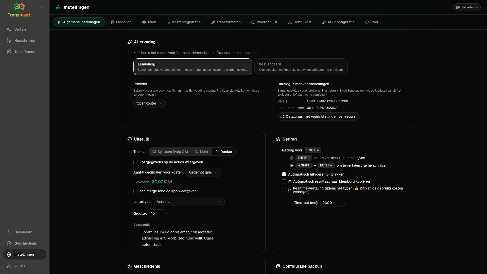

Open **Instellingen** vanuit de zijbalk om aan te passen hoe de app zich gedraagt.

| Tabblad | Desktop | Web (beheerder) | Web (gebruiker) | Opmerkingen |
| --- | :---: | :---: | :---: | --- |
| Algemene instellingen | ✓ | ✓ | ✓ | Inclusief **AI-ervaring** (Eenvoudig / Geavanceerd) |
| Modellen | ✓ | ✓ | ✓ | Vooraf ingestelde kaarten in Eenvoudig, modeltabel in Geavanceerd |
| Talen | ✓ | ✓ | ✓ | |
| Kosten bijhouden | ✓ | ✓ | — | |
| Transformeren | ✓ | ✓ | ✓ | Bulk import/export van prompts |
| Woordenlijst | ✓ | ✓ | ✓ | Termparen voor vertaling |
| Gebruikers | — | ✓ | — | |
| API-configuratie | ✓ | ✓ | — | |
| Over | ✓ | ✓ | ✓ | |

In de modus **Eenvoudig** kiest u AI via voorinstellingen in de werkbalk en **Provider** in Algemene instellingen; het tabblad **Modellen** toont alleen-lezen voorinstelkaarten.

:::note
In de webversie heeft elke gebruiker zijn eigen configuratie (AI-ervaring, provider, modellen/voorinstellingen, talen, opties, prompts). Wijzigingen hebben geen invloed op andere gebruikers.
:::

## Algemene instellingen

**AI-ervaring**

- **Eenvoudig** (standaard): kies een **Provider**. Cloudproviders gebruiken voorinstellingen voor de werkbalk. **Lokale LLM** toont in plaats daarvan geïnstalleerde lokale modellen. **Catalogus met voorinstellingen vernieuwen** haalt de nieuwste lijst met voorinstellingen op uit de projectrepository.
  - **Gratis (OpenRouter)** — gratis optie die wordt doorgestuurd naar beschikbare gratis modellen; kwaliteit en beschikbaarheid kunnen variëren
  - **Standaard** — lichtgewicht en kostenefficiënt; het beste voor korte teksten, snelle concepten en veelvuldig gebruik
  - **Geavanceerd** — zeer nauwkeurig model voor complexe of genuanceerde inhoud, tegen hogere kosten
  - **Technisch** — afgestemd op code, API's, ontwikkelaarsdocumentatie en gestructureerde inhoud; behoudt opmaak en terminologie
- **Geavanceerd**: kies modellen in de werkbalk; beheer de lijst onder [Modellen](#models).

U kunt ook schakelen tussen Eenvoudig ↔ Geavanceerd via het menu voorinstellingen/modellen in de werkbalk (**Schakelen naar Eenvoudige/Geavanceerde modus**, boven Open instellingen).

**Uiterlijk** — Thema; **Kosteninformatie weergeven bij de acties**; **Aantal decimalen voor kosten**; alleen-webmarge rond de app; **Lettertypefamilie** en **Grootte**.

**Gedrag** — **Gedrag voor ENTER**; **Automatisch uitvoeren bij plakken**; **Automatisch resultaat naar klembord kopiëren**; **Realtime vertaling tijdens typen**; **Time-out (ms)**.

**Geschiedenis**

- **Uitvoeringsgeschiedenis bewaren** — slaat invoer/uitvoer op voor de [Geschiedenis](/docs/history/) weergave. Uitschakelen vraagt om bevestiging en kan opgeslagen tekst verwijderen. Indien gelabeld als *uitgeschakeld door de beheerder*, is `HISTORY_DISABLED` ingesteld — zie [Configuratie](/docs/configuration/#privacy-mode).
- **Geschiedenisgegevens verwijderen** — verwijdert opgeslagen tekst op leeftijd of wist alles. Verwijdert **niet** de totale kosten (gebruik hiervoor Kostenregistratie).

**Configuratie backup** (desktop- en webbeheerders)

- Optioneel **Gebruiksgegevens opnemen in de backup**
- **Configuratie backup** — ZIP met configuratie, status, gebruikers, voorkeuren, prompts en optionele gebruiksgegevens
- **Herstellen vanuit backup** — bevestigingsdialoog met opties om gebruiksgegevens te herstellen en/of te wissen

Back-ups kunnen worden verplaatst tussen desktop en web; het herstellen van een desktopback-up op het web past gegevens toe op de beheerdersgebruiker.

## Modellen

Het tabblad **Modellen** wordt altijd weergegeven. De schakelaar **Eenvoudig / Geavanceerd** schakelt de hele app tussen de twee [AI-ervaringen](#general-settings).

- **Eenvoudig** toont één alleen-lezen kaart per voorinstelling (bijvoorbeeld **Gratis (OpenRouter)** of **Standaard**). Elke kaart toont het hoofd- en reservemodel van de voorinstelling voor elke provider die u hebt geconfigureerd. De **Provider**-chips filteren de kaarten.
- **Geavanceerd** toont één tabel van elk model, met:
  - een zoekvak, **Provider**-chips, **Alleen gratis**, **Alleen geselecteerde** en **Vernieuwen**
  - een sorteermenu; de standaard is **Index hoog naar laag**
  - een selectievakje per model om het te selecteren of te deselecteren
  - **Selecteer uit voorinstellingen**, die de hoofd- en reservemodellen van een voorinstelling toevoegt voor elke geconfigureerde provider (**Alles laden** laadt elke provider)
  - **Alles deselecteren**, wat eerst om bevestiging vraagt
- Model-ID's gebruiken een providerprefix (`openrouter/…`, `openai/…`, `local/…`, …)

De score- en prijscolommen:

- **Index** — een kwaliteitsscore samengesteld uit ChrF, Arena Score en prijs. Deze wordt binnen elke provider gerangschikt, dus is niet vergelijkbaar tussen providers. Modellen zonder Index worden onderaan gesorteerd.
- **ChrF** — gemiddelde vertaalkwaliteit van [languagebench](https://huggingface.co/spaces/fair-forward/languagebench) voor de UI-talen van de app.
- **Arena** — Arena Score van het [LMArena](https://huggingface.co/datasets/lmarena-ai/leaderboard-dataset) klassement.
- **Input** / **Output** — prijs in USD per 1M tokens, uit de providercatalogus of [models.dev](https://models.dev/). Een geschatte prijs is gemarkeerd met een asterisk. Een streepje (—) betekent dat de prijs onbekend is; lokale modellen tonen "geen kosten - lokaal".

Beweeg de muisaanwijzer over een kolomkop om de gegevensbron en licentie te zien. De modelkiezer in de werkbalk toont de Index van elk model als een kleine chip; beweeg de muisaanwijzer eroverheen voor de ChrF- en Arena-waarden.

Scores zijn slechts een richtlijn: de dekking is onvolledig en veel modellen hebben geen ChrF- of Arena-score.

:::tip
Gebruik OpenRouter **Body Builder** (`openrouter/bodybuilder`) niet voor Vertalen, Herscheven of Transformeren — het retourneert JSON-aanvraagpayloads, geen voltooide tekst.
:::

Vink een model aan of uit om het te selecteren of te deselecteren. Het gratis OpenRouter-model is optioneel — geselecteerde modellen kunnen leeg zijn. Het verwijderen van het laatste model uit de werkbalk opent **Instellingen → Modellen**. Als het huidige model niet beschikbaar wordt, selecteert de app het volgende model in de lijst in plaats van het gratis model af te dwingen.

## Talen

- **Top talen** — bovenaan vastgezet in taallijsten in Vertalen en Transformeren
- **Aangepaste taal** — voeg een taal toe die ontbreekt in de ingebouwde lijst

## Kostenregistratie

- **Totale kosten**, **Waarde kopiëren**, **Kosten resetten**
- **Synchroniseren met API-sleutelgebruik** — afstemmen op OpenRouter-accountgebruik (alleen OpenRouter)
- **API-sleutelgebruik** — OpenRouter-details indien beschikbaar
- **Kostgegevens verwijderen** — alle gegevens of vermeldingen ouder dan een bepaalde datum

OpenRouter en xAI tonen de werkelijk gefactureerde kosten wanneer de API deze retourneert; andere providers gebruiken schattingen van de prijzen van [models.dev](https://models.dev/). Schattingen zijn geen facturen.

:::caution
Het verwijderen van kostengegevens kan niet ongedaan worden gemaakt. Exporteer eerst via Geschiedenis of Dashboard → Alle oproepen als u een back-up nodig heeft. Gerelateerde invoer-/uitvoergeschiedenis voor die API-aanroepen wordt ook verwijderd.
:::

## Transformeren

Prompts in bulk beheren: bekijken, verwijderen, importeren, exporteren en voorbeeldprompts laden.

## Woordenlijst

Beheer termparen die tijdens de [vertaling](/docs/translate/#use-the-glossary) worden toegepast. Elke term heeft een bron-/doeltaal en bron-/doeltekst.

- Toevoegen via de onderste rij en **+**
- Filteren op talen of tekst
- CSV of XLSX importeren/exporteren; lege sjablonen downloaden

Desktop slaat de woordenlijst lokaal op; web slaat deze per gebruiker op.

## Gebruikers

Alleen web (beheerders):

- Gebruikers toevoegen, details bijwerken, wachtwoorden opnieuw instellen, accounts verwijderen
- **Sessie time-out** — hoe lang een aanmelding duurt (1 uur tot 7 dagen); wijzigingen gelden alleen voor nieuwe aanmeldingen
- **Sessies intrekken** — een gebruiker onmiddellijk afmelden van alle apparaten

Elke aangemelde gebruiker (inclusief niet-beheerders) kan zijn eigen wachtwoord wijzigen of zich afmelden via het gebruikersmenu onderaan de zijbalk.

## API-configuratie

Configureer alleen de providers die u gebruikt: OpenRouter, OpenAI, Anthropic, Google Gemini, DeepSeek, Groq, Mistral, xAI, Cerebras, NVIDIA, Alibaba Cloud, apikey.fun, **Lokale LLM** (basis-URL voor Ollama, LM Studio, llama.cpp of vergelijkbaar), en een optionele aangepaste OpenAI-compatibele provider.

**Web (beheerder):** sleutels komen van omgevingsvariabelen — deze pagina toont welke zijn ingesteld en laat u **Testen**. Herstart na het wijzigen van omgevingsvariabelen. Zie [Configuratie](/docs/configuration/).

**Desktop:** voer sleutels (of Lokale LLM URL) in en **Opslaan** / **Bewerken** / **Testen**. Sleutels worden versleuteld opgeslagen; u kunt de huidige waarde niet bekijken, alleen vervangen.

:::tip
Geen betaalde sleutel nodig om te beginnen: gebruik gratis OpenRouter-modellen, andere gratis providers, of een lokale OpenAI-compatibele server zoals [Ollama](https://ollama.com), LM Studio, of llama.cpp (bijv. `translategemma:4b`).
:::

## Over

Appnaam, versie, builddatum, licentie, mededelingen van derden en repositorylink.
