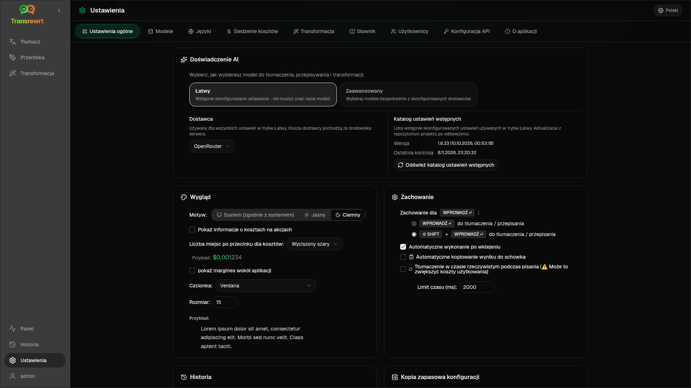

Otwórz **Ustawienia** z paska bocznego, aby dostosować zachowanie aplikacji.

| Karta | Komputer stacjonarny | Sieć (administrator) | Sieć (użytkownik) | Uwagi |
| --- | :---: | :---: | :---: | --- |
| Ustawienia ogólne | ✓ | ✓ | ✓ | Obejmuje **doświadczenie AI** (łatwe / zaawansowane) |
| Modele | ✓ | ✓ | ✓ | Gotowe karty w trybie Łatwym, tabela modeli w trybie Zaawansowanym |
| Języki | ✓ | ✓ | ✓ | |
| Śledzenie kosztów | ✓ | ✓ | — | |
| Transformacja | ✓ | ✓ | ✓ | Masowy import/eksport promptów |
| Słownik | ✓ | ✓ | ✓ | Pary terminów do tłumaczenia |
| Użytkownicy | — | ✓ | — | |
| Konfiguracja API | ✓ | ✓ | — | |
| Informacje | ✓ | ✓ | ✓ | |

W trybie **Łatwym** wybierz AI za pomocą ustawień wstępnych na pasku narzędzi i **Dostawcę** w Ustawieniach ogólnych; zakładka **Modele** pokazuje karty ustawień wstępnych tylko do odczytu.

:::note
W wersji internetowej każdy użytkownik ma własną konfigurację (doświadczenie AI, dostawca, modele/ustawienia wstępne, języki, opcje, podpowiedzi). Zmiany nie wpływają na innych użytkowników.
:::

## Ustawienia ogólne

**Doświadczenie AI**

- **Łatwy** (domyślny): wybierz **Dostawca**. Dostawcy chmurowi używają presetów z paska narzędzi. **Lokalny LLM** wyświetla listę zainstalowanych modeli lokalnych. **Odśwież katalog ustawień wstępnych** pobiera najnowszą listę presetów z repozytorium projektu.
  - **Free (OpenRouter)** — opcja bezpłatna kierująca zapytania do dostępnych darmowych modeli; jakość i dostępność mogą się różnić
  - **Standard** — lekki i efektywny kosztowo; najlepszy do krótkich tekstów, szybkich szkiców i intensywnego użytkowania
  - **Zaawansowany** — model o wysokiej dokładności do złożonych lub zniuansowanych treści, przy wyższym koszcie
  - **Technical** — dostosowany do kodu, API, dokumentacji programistycznej i treści strukturalnych; zachowuje formatowanie i terminologię
- **Zaawansowany**: wybieraj modele na pasku narzędzi; zarządzaj listą w sekcji [Modele](#models).

Możesz również przełączać tryb Łatwy ↔ Zaawansowany z menu ustawień wstępnych/modeli na pasku narzędzi (**Przełącz na tryb Łatwy/Zaawansowany**, powyżej Otwórz Ustawienia).

**Wygląd** — Motyw; **Pokaż informacje o kosztach w działaniach**; **Liczba cyfr po przecinku dla kosztów**; margines wokół aplikacji tylko w wersji webowej; **Rodzina czcionek** i **Rozmiar**.

**Zachowanie** — **Zachowanie dla klawisza ENTER**; **Automatyczne wykonanie po wklejeniu**; **Automatyczne kopiowanie wyniku do schowka**; **Tłumaczenie w czasie rzeczywistym podczas pisania**; **Limit czasu (ms)**.

**Historia**

- **Zachowaj historię wykonania** — przechowuj dane wejściowe/wyjściowe dla widoku [Historia](/docs/history/). Wyłączenie wymaga potwierdzenia i może usunąć przechowywany tekst. Jeśli jest oznaczone jako *wyłączone przez administratora*, ustawione jest `HISTORY_DISABLED` — zobacz [Konfiguracja](/docs/configuration/#privacy-mode).
- **Usuń dane historii** — usuń przechowywany tekst według wieku lub wyczyść wszystko. **Nie** usuwa sum kosztów (do tego służy Śledzenie kosztów).

**Kopia zapasowa konfiguracji** (administratorzy desktopowi i webowi)

- Opcjonalnie **Uwzględnij dane użytkowania w kopii zapasowej**
- **Utwórz kopię zapasową konfiguracji** — plik ZIP z konfiguracją, stanem, użytkownikami, preferencjami, promptami i opcjonalnymi danymi użytkowania
- **Przywróć z kopii zapasowej** — okno dialogowe z potwierdzeniem oraz opcjami przywrócenia i/lub wyczyszczenia danych użytkowania

Kopie zapasowe mogą być przenoszone między wersją desktopową a webową; przywracanie kopii zapasowej z wersji desktopowej w wersji webowej stosuje dane do użytkownika administratora.

## Modele

Zakładka **Modele** jest zawsze widoczna. Jej przełącznik **Łatwy / Zaawansowany** przełącza całą aplikację między dwoma [doświadczeniami AI](#general-settings).

- **Łatwy** wyświetla jedną kartę tylko do odczytu dla każdego presetu (na przykład **Free (OpenRouter)** lub **Standard**). Każda karta zawiera główny i zapasowy model presetu dla każdego skonfigurowanego dostawcy. Filtry **Dostawca** pozwalają filtrować karty.
- **Zaawansowany** wyświetla tabelę wszystkich modeli, zawierającą:
  - pole wyszukiwania, filtry **Dostawca**, **Tylko darmowe**, **Tylko wybrane** oraz **Odśwież**
  - menu sortowania; domyślnie ustawione na **Indeks: od najwyższego do najniższego**
  - pole wyboru przy każdym modelu, aby go zaznaczyć lub odznaczyć
  - **Wybierz z presetów**, co dodaje główny i zapasowy model presetu dla każdego skonfigurowanego dostawcy (**Załaduj wszystko** ładuje każdego dostawcę)
  - **Odznacz wszystko**, co wymaga wcześniejszego potwierdzenia
- Identyfikatory modeli używają prefiksu dostawcy (`openrouter/…`, `openai/…`, `local/…`, …)

Kolumny wyników i cen:

- **Indeks** — wynik jakości połączony z ChrF, Arena Score i ceną. Jest on klasyfikowany w ramach każdego dostawcy, więc nie jest porównywalny między dostawcami. Modele bez Indeksu sortują się na dół.
- **ChrF** — średnia jakość tłumaczenia z [languagebench](https://huggingface.co/spaces/fair-forward/languagebench) dla języków interfejsu użytkownika aplikacji.
- **Arena** — Arena Score z tabeli liderów [LMArena](https://huggingface.co/datasets/lmarena-ai/leaderboard-dataset).
- **Wejście** / **Wyjście** — cena w USD za 1M tokenów, z katalogu dostawcy lub [models.dev](https://models.dev/). Szacunkowa cena jest oznaczona gwiazdką. Myślnik (—) oznacza, że cena jest nieznana; modele lokalne pokazują „brak kosztów - lokalne”.

Najedź kursorem na nagłówek kolumny, aby zobaczyć jej źródło danych i licencję. Selektor modelu na pasku narzędzi pokazuje Indeks każdego modelu jako mały chip; najedź na niego, aby zobaczyć wartości ChrF i Arena.

Wyniki są jedynie wskazówką: pokrycie jest niekompletne, a wiele modeli nie ma wyniku ChrF ani Arena.

:::tip
Nie używaj OpenRouter **Body Builder** (`openrouter/bodybuilder`) do tłumaczenia, przepisywania ani transformacji — zwraca on ładunki żądań JSON, a nie gotowy tekst.
:::

Zaznacz lub odznacz model, aby go wybrać lub odznaczyć. Darmowy model OpenRouter jest opcjonalny — wybrane modele mogą być puste. Usunięcie ostatniego modelu z paska narzędzi otwiera **Ustawienia → Modele**. Jeśli bieżący model stanie się niedostępny, aplikacja wybierze następny model na liście zamiast wymuszać darmowy model.

## Języki

- **Najpopularniejsze języki** — przypięte na górze list języków w funkcjach Tłumacz i Transformacja
- **Niestandardowy język** — dodaj język, którego brakuje na wbudowanej liście

## Śledzenie kosztów

- **Całkowity koszt**, **Kopiuj wartość**, **Resetuj koszt**
- **Synchronizuj z użyciem klucza API** — dopasuj do użycia konta OpenRouter (tylko OpenRouter)
- **Użycie klucza API** — szczegóły OpenRouter, gdy dostępne
- **Usuń dane kosztów** — wszystkie dane lub wpisy starsze niż określona data

OpenRouter i xAI pokazują rzeczywisty koszt rozliczeniowy, gdy API go zwraca; inni Dostawcy używają szacunków z cennika [models.dev](https://models.dev/). Szacunki nie są fakturami.

:::caution
Usunięcia danych kosztów nie można cofnąć. Najpierw wyeksportuj dane za pośrednictwem Historii lub Pulpitu → Wszystkie połączenia, jeśli potrzebujesz kopii zapasowej. Powiązana historia wejść/wyjść dla tych wywołań API również zostanie usunięta.
:::

## Transformacja

Zbiorcze zarządzanie promptami: przeglądanie, usuwanie, importowanie, eksportowanie i ładowanie przykładowych promptów.

## Słownik

Zarządzaj parami terminów stosowanymi podczas [tłumaczenia](/docs/translate/#use-the-glossary). Każdy termin ma język źródłowy/docelowy oraz tekst źródłowy/docelowy.

- Dodaj za pomocą dolnego wiersza i **+**
- Filtruj według języków lub tekstu
- Importuj/eksportuj CSV lub XLSX; pobierz puste szablony

Wersja desktopowa przechowuje słownik lokalnie; wersja webowa przechowuje go dla każdego użytkownika.

## Użytkownicy

Tylko wersja webowa (administratorzy):

- Dodawaj użytkowników, aktualizuj dane, resetuj hasła, usuwaj konta
- **Limit czasu sesji** — jak długo trwa logowanie (od 1 godziny do 7 dni); zmiany dotyczą tylko nowych logowań
- **Unieważnij sesje** — natychmiast wyloguj użytkownika ze wszystkich urządzeń

Każdy zalogowany użytkownik (w tym nie-administratorzy) może zmienić swoje hasło lub wylogować się z menu użytkownika na dole paska bocznego.

## Konfiguracja API

Skonfiguruj tylko używanych dostawców: OpenRouter, OpenAI, Anthropic, Google Gemini, DeepSeek, Groq, Mistral, xAI, Cerebras, NVIDIA, Alibaba Cloud, apikey.fun, **Lokalny LLM** (podstawowy URL dla Ollama, LM Studio, llama.cpp lub podobnych) oraz opcjonalnego niestandardowego dostawcę kompatybilnego z OpenAI.

**Wersja webowa (administrator):** klucze pochodzą ze zmiennych środowiskowych — ta strona pokazuje, które są ustawione i pozwala na **Testowanie**. Uruchom ponownie po zmianie zmiennych środowiskowych. Zobacz [Konfiguracja](/docs/configuration/).

**Wersja desktopowa:** wprowadź klucze (lub URL lokalnego LLM) i **Zapisz** / **Edytuj** / **Testuj**. Klucze są przechowywane zaszyfrowane; nie możesz wyświetlić bieżącej wartości, możesz ją tylko zastąpić.

:::tip
Do rozpoczęcia nie jest potrzebny płatny klucz: użyj darmowych modeli OpenRouter, innych dostawców z darmową warstwą lub lokalnego serwera kompatybilnego z OpenAI, takiego jak [Ollama](https://ollama.com), LM Studio lub llama.cpp (np. `translategemma:4b`).
:::

## Informacje

Nazwa aplikacji, wersja, data kompilacji, licencja, informacje o stronach trzecich i link do repozytorium.
