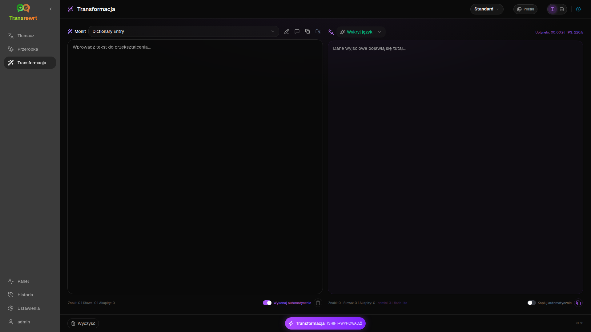
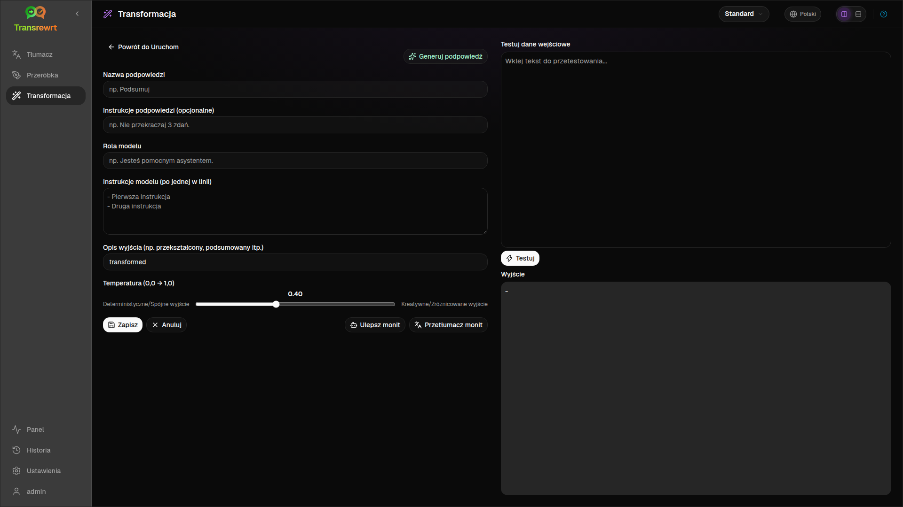

Użyj **Transform**, gdy chcesz, aby AI postępowała zgodnie z niestandardowymi instrukcjami — podsumowywała, poprawiała e-mail, wyodrębniała kluczowe punkty, zmieniała format tekstu lub wykonywała dowolny zdefiniowany przez Ciebie przepływ pracy.

## Uruchom istniejący prompt

1. Otwórz **Transform**.
2. Wybierz prompt z listy.
3. Jeśli pojawi się pole języka **Od**, ustaw język, jeśli chcesz.
4. Wpisz lub wklej tekst do pola **Wejście**.
5. Kliknij **Transformuj**.
6. Przeczytaj wynik w polu **Wyjście**.

[Przełącznik układu i skróty klawiaturowe](/docs/translate/#layout-and-keyboard) działają tak samo jak w Tłumaczeniu.

## Załaduj przykładowe podpowiedzi

Jeśli lista jest pusta, kliknij **Załaduj przykładowe podpowiedzi** w obszarze roboczym Transformacja (dostępne również w [Ustawienia → Transformacja](/docs/settings/#transform)). Przykłady są w języku angielskim; po załadowaniu edytuj monit i w razie potrzeby użyj **Przetłumacz monit**.

## Utwórz prompt

1. Kliknij **Nowy monit**.
2. Kliknij **Generuj podpowiedź**.
3. Opisz, co ma robić monit.
4. Wybierz preset (Łatwy) lub model (Zaawansowany).
5. Przejrzyj szkic i kliknij **Zapisz**.

## Edytuj prompt

Edytor znajduje się po lewej stronie; obszar testowy po prawej.

Główne pola:

- **Nazwa podpowiedzi** — wyświetlana na liście monitów
- **Instrukcje podpowiedzi (opcjonalne)** — krótka wskazówka podczas uruchamiania monitu
- **Rola modelu** — ogólna rola dla sztucznej inteligencji
- **Instrukcje modelu (po jednej w linii)** — zasady, których należy przestrzegać
- **Opis wyjścia** — krótka etykieta wyniku (np. podsumowanie)
- **Temperatura (0,0 → 1,0)** — niższa oznacza większą stabilność; wyższa oznacza większą różnorodność
- **Pytaj o język docelowy** — dodaje selektor języka podczas uruchamiania

Pomocnicy: **Generuj podpowiedź**, **Ulepsz monit**, **Przetłumacz monit** (Łatwy korzysta z presetów; Zaawansowany korzysta z listy modeli).

:::caution
Kliknij **Zapisz** przed **Powrót do uruchomienia**. Powrót bez zapisywania spowoduje odrzucenie zmian.
:::

## Testowanie przed codziennym użyciem

Użyj prawego panelu testowego z przykładowym tekstem podczas tworzenia lub porównywania promptów.

Eksportuj i importuj prompty zbiorczo w [Ustawienia → Transformacja](/docs/settings/#transform).

## Następne kroki

- [Ustawienia](/docs/settings/)
- [Historia przeglądania](/docs/history/)
- [Częste problemy](/docs/common-issues/)
