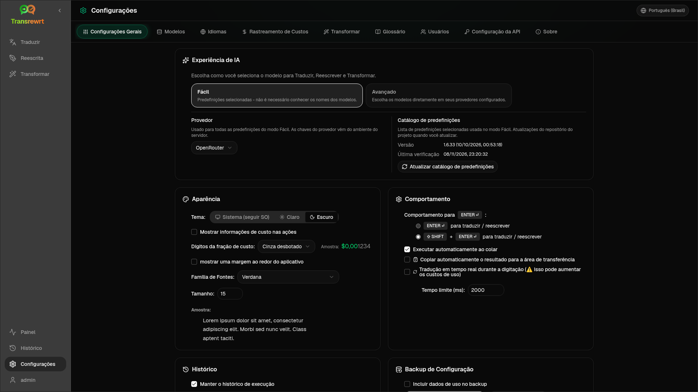

Abra **Configurações** na barra lateral para personalizar o comportamento do aplicativo.

| Guia | Desktop | Web (administrador) | Web (usuário) | Observações |
| --- | :---: | :---: | :---: | --- |
| Configurações Gerais | ✓ | ✓ | ✓ | Inclui **experiência de IA** (Fácil / Avançada) |
| Modelos | ✓ | ✓ | ✓ | Cartões predefinidos em Fácil, tabela de modelos em Avançado |
| Idiomas | ✓ | ✓ | ✓ | |
| Rastreamento de Custos | ✓ | ✓ | — | |
| Transformar | ✓ | ✓ | ✓ | Importação/exportação em massa de prompts |
| Glossário | ✓ | ✓ | ✓ | Pares de termos para tradução |
| Usuários | — | ✓ | — | |
| Configuração da API | ✓ | ✓ | — | |
| Sobre | ✓ | ✓ | ✓ | |

No modo **Fácil**, escolha a IA por meio de predefinições na barra de ferramentas e o **Provedor** em Configurações Gerais; a guia **Modelos** mostra cartões predefinidos somente leitura.

:::note
Na versão web, cada usuário tem sua própria configuração (experiência de IA, provedor, modelos/predefinições, idiomas, opções, prompts). As alterações não afetam outros usuários.
:::

## Configurações Gerais

**Experiência de IA**

- **Fácil** (padrão): escolha um **Provedor**. Os provedores de nuvem usam predefinições da barra de ferramentas. **LLM Local** lista os modelos locais instalados. **Atualizar catálogo de predefinições** busca a lista de predefinições mais recente do repositório do projeto.
  - **Gratuito (OpenRouter)** — opção de custo zero roteada para modelos gratuitos disponíveis; a qualidade e a disponibilidade podem variar
  - **Padrão** — leve e econômico; melhor para textos curtos, rascunhos rápidos e uso de alto volume
  - **Avançado** — modelo de alta precisão para conteúdo complexo ou com nuances, com um custo mais alto
  - **Técnico** — ajustado para código, APIs, documentação de desenvolvedor e conteúdo estruturado; preserva a formatação e a terminologia
- **Avançado**: escolha modelos na barra de ferramentas; gerencie a lista em [Modelos](#models).

Você também pode alternar Fácil ↔ Avançado no menu de predefinições/modelos da barra de ferramentas (**Alternar para o modo Fácil/Avançado**, acima de Abrir Configurações).

**Aparência** — Tema; **Mostrar informações de custo nas ações**; **Dígitos fracionários de custo**; margem somente para web ao redor do aplicativo; **Família da Fonte** e **Tamanho**.

**Comportamento** — **Comportamento para ENTER**; **Executar automaticamente ao colar**; **Copiar automaticamente o resultado para a área de transferência**; **Tradução em tempo real ao digitar**; **Tempo limite (ms)**.

**Histórico**

- **Manter o histórico de execução** — armazena entrada/saída para a visualização [Histórico](/docs/history/). Desativar pede confirmação e pode remover o texto armazenado. Se rotulado como *desabilitado pelo administrador*, `HISTORY_DISABLED` é definido — consulte [Configuração](/docs/configuration/#privacy-mode).
- **Excluir dados do histórico** — remove o texto armazenado por idade ou limpa tudo. **Não** exclui os totais de custo (use Rastreamento de Custos para isso).

**Backup de Configuração** (administradores de desktop e web)

- Opcional **Incluir dados de uso no backup**
- **Fazer backup da configuração** — ZIP com configuração, estado, usuários, preferências, prompts e dados de uso opcionais
- **Restaurar do backup** — caixa de diálogo de confirmação com opções para restaurar e/ou limpar dados de uso

Os backups podem ser movidos entre desktop e web; restaurar um backup de desktop na web aplica os dados ao usuário administrador.

## Modelos

A guia **Modelos** está sempre listada. Seu botão **Fácil / Avançado** alterna todo o aplicativo entre as duas [experiências de IA](#general-settings).

- **Fácil** mostra um cartão somente leitura por predefinição (por exemplo, **Gratuitos (OpenRouter)** ou **Padrão**). Cada cartão lista o modelo principal e de fallback da predefinição para cada provedor que você configurou. Os chips de **Provedor** filtram os cartões.
- **Avançado** mostra uma tabela de cada modelo, com:
  - uma caixa de pesquisa, chips de **Provedor**, **Apenas Gratuitos**, **Somente selecionados** e **Atualizar**
  - um menu de classificação; o padrão é **Índice do maior para o menor**
  - uma caixa de seleção por modelo para selecioná-lo ou desmarcá-lo
  - **Selecionar a partir de predefinições**, que adiciona os modelos principal e de fallback de uma predefinição para cada provedor configurado (**Carregar tudo** carrega todos os provedores)
  - **Desmarcar Todos**, que pede confirmação primeiro
- Os IDs de modelo usam um prefixo de provedor (`openrouter/…`, `openai/…`, `local/…`, …)

As colunas de pontuação e preço:

- **Índice** — uma pontuação de qualidade combinada de ChrF, Arena Score e preço. É classificada dentro de cada provedor, portanto, não é comparável entre provedores. Modelos sem Índice são classificados para o final.
- **ChrF** — qualidade média de tradução de [languagebench](https://huggingface.co/spaces/fair-forward/languagebench) para os idiomas da interface do usuário do aplicativo.
- **Arena** — Arena Score da tabela de classificação [LMArena](https://huggingface.co/datasets/lmarena-ai/leaderboard-dataset).
- **Entrada** / **Saída** — preço em USD por 1M de tokens, do catálogo do provedor ou [models.dev](https://models.dev/). Um preço estimado é marcado com um asterisco. Um traço (—) significa que o preço é desconhecido; modelos locais mostram "sem custo - local".

Passe o mouse sobre o cabeçalho de uma coluna para ver sua fonte de dados e licença. O seletor de modelo na barra de ferramentas mostra o Índice de cada modelo como um pequeno chip; passe o mouse sobre ele para ver os valores de ChrF e Arena.

As pontuações são apenas um guia: a cobertura é incompleta e muitos modelos não têm pontuação ChrF ou Arena.

:::tip
Não use o **Body Builder** (`openrouter/bodybuilder`) do OpenRouter para Traduzir, Reescrever ou Transformar — ele retorna payloads de solicitação JSON, não texto finalizado.
:::

Marque ou desmarque um modelo para selecioná-lo ou desmarcá-lo. O modelo gratuito do OpenRouter é opcional — os modelos selecionados podem estar vazios. A remoção do último modelo da barra de ferramentas abre **Configurações → Modelos**. Se o modelo atual ficar indisponível, o aplicativo seleciona o próximo modelo da lista em vez de forçar o modelo gratuito.

## Idiomas

- **Principais idiomas** — fixados perto do topo das listas de idiomas em Traduzir e Transformar
- **Idioma personalizado** — adicione um idioma que falta na lista integrada

## Rastreamento de custos

- **Custo Total**, **Copiar Valor**, **Redefinir Custo**
- **Sincronizar com o uso da chave da API** — alinhar com o uso da conta OpenRouter (somente OpenRouter)
- **Uso da Chave da API** — detalhes do OpenRouter quando disponíveis
- **Excluir dados de custo** — todos os dados ou entradas mais antigas que uma data

OpenRouter e xAI mostram o custo real faturado quando a API o retorna; outros provedores usam estimativas de preços de [models.dev](https://models.dev/). As estimativas não são faturas.

:::caution
A exclusão de dados de custo não pode ser desfeita. Exporte via Histórico ou Painel → Todas as Chamadas primeiro, se precisar de um backup. O histórico de entrada/saída relacionado para essas chamadas de API também é removido.
:::

## Transformar

Gerencie prompts em massa: revise, exclua, importe, exporte e carregue prompts de exemplo.

## Glossário

Gerencie pares de termos aplicados durante a [tradução](/docs/translate/#use-the-glossary). Cada termo tem idioma de origem/destino e texto de origem/destino.

- Adicione pela linha inferior e **+**
- Filtre por idiomas ou texto
- Importe/exporte CSV ou XLSX; baixe modelos vazios

O Desktop armazena o glossário localmente; a web o armazena por usuário.

## Usuários

Somente web (administradores):

- Adicionar usuários, atualizar detalhes, redefinir senhas, excluir contas
- **Tempo de Sessão** — quanto tempo dura um login (1 hora a 7 dias); as alterações se aplicam apenas a novos logins
- **Revogar sessões** — desconectar um usuário de todos os dispositivos imediatamente

Todo usuário conectado (incluindo não-administradores) pode alterar sua própria senha ou sair do menu do usuário na parte inferior da barra lateral.

## Configuração da API

Configure apenas os provedores que você usa: OpenRouter, OpenAI, Anthropic, Google Gemini, DeepSeek, Groq, Mistral, xAI, Cerebras, NVIDIA, Alibaba Cloud, apikey.fun, **LLM Local** (URL base para Ollama, LM Studio, llama.cpp ou similar) e um provedor compatível com OpenAI personalizado opcional.

**Web (administrador):** as chaves vêm de variáveis de ambiente — esta página mostra quais estão configuradas e permite que você **Teste**. Reinicie após alterar as variáveis de ambiente. Consulte [Configuração](/docs/configuration/).

**Desktop:** insira as chaves (ou URL do LLM Local) e **Salvar** / **Editar** / **Testar**. As chaves são armazenadas criptografadas; você não pode visualizar o valor atual, apenas substituí-lo.

:::tip
Nenhuma chave paga é necessária para começar: use modelos OpenRouter gratuitos, outros provedores de nível gratuito ou um servidor local compatível com OpenAI, como [Ollama](https://ollama.com), LM Studio ou llama.cpp (por exemplo, `translategemma:4b`).
:::

## Sobre

Nome do aplicativo, versão, data de compilação, licença, avisos de terceiros e link do repositório.
