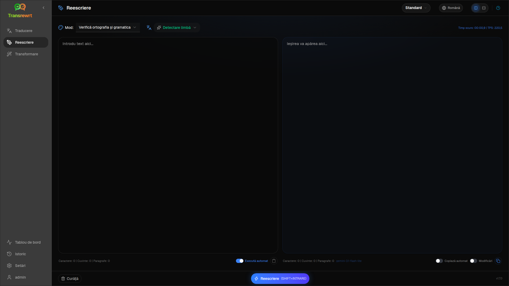

Folosește **Rescrie** pentru a îmbunătăți formularea fără a schimba sensul principal. Textul rămâne în aceeași limbă.

Modurile includ:

- **Verifică ortografia și gramatica**
- **Îmbunătățește claritatea**
- **Versiuni alternative** (mai multe reformulări într-o singură rulare)
- **Fă formal** / **Fă informal**
- **Scurtează** / **Extinde**
- **Fă tehnic**

## Rescrie textul

1. Deschide **Reescriere**.
2. Alege un **Mod**.
3. Opțional, setează **De la** la limba textului tău (sau lasă **Detectare limbă**).
4. Tastează sau lipește text în **Intrare**.
5. Apasă **Rescrie**.
6. Citește rezultatul în **Ieșire**.

[Comutatorul de aspect și scurtăturile de la tastatură](/docs/translate/#layout-and-keyboard) funcționează la fel ca în Traducere.

:::tip
După o rescriere, un comutator **Afișează modificările** (**Modificări**) apare lângă **Copiază** pentru **fiecare** mod de rescriere. Comută-l pentru a afișa sau ascunde o diferență între intrare și ieșire.
:::

:::note
**Versiuni alternative** returnează mai multe reformulări într-o **singură** rulare, separate prin `----`. Aceasta diferă de **Reformulează…**, care construiește un istoric al versiunilor în timp.
:::

## Rafinează o rescriere

După o rulare reușită, **Reformulează…** și meniul derulant pentru versiuni apar în partea de ieșire (aceeași idee ca la [Traducere](/docs/translate/#refine-a-translation), dar textul rămâne în aceeași limbă și păstrează **Modul** curent):

1. **Reformulează…** (fără selecție) — o altă reescriere completă cu o formulare diferită. Până la cinci versiuni. Apasă **Oprește reescrierea** pentru a anula.
2. **Alternative cuvinte** — selectează text, apoi dă clic dreapta sau **Reformulează…**.
3. Fiecare solicitare poate adăuga costuri de utilizare.

## Pașii următori

- [Traduceți text](/docs/translate/)
- [Transformă cu prompturi](/docs/transform/)
- [Probleme comune](/docs/common-issues/)
