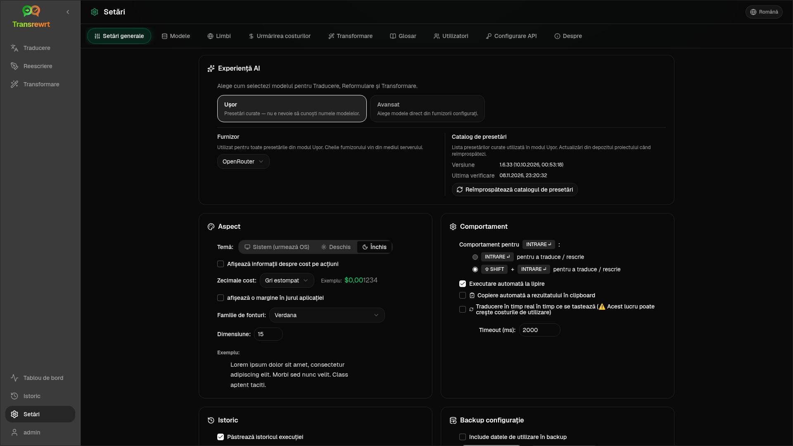

Deschideți **Setări** din bara laterală pentru a personaliza comportamentul aplicației.

| Fila | Desktop | Web (administrator) | Web (utilizator) | Note |
| --- | :---: | :---: | :---: | --- |
| Setări generale | ✓ | ✓ | ✓ | Include **Experiență AI** (Ușor / Avansat) |
| Modele | ✓ | ✓ | ✓ | Carduri presetate în Ușor, tabel de modele în Avansat |
| Limbi | ✓ | ✓ | ✓ | |
| Urmărirea costurilor | ✓ | ✓ | — | |
| Transformare | ✓ | ✓ | ✓ | Import/export în masă de prompturi |
| Glosar | ✓ | ✓ | ✓ | Perechi de termeni pentru traducere |
| Utilizatori | — | ✓ | — | |
| Configurare API | ✓ | ✓ | — | |
| Despre | ✓ | ✓ | ✓ | |

În modul **Ușor**, alegeți AI prin presetări în bara de instrumente și **Furnizor** în Setări generale; fila **Modele** afișează carduri presetate doar pentru citire.

:::note
În versiunea web, fiecare utilizator are propria configurație (experiență AI, furnizor, modele/presetări, limbi, opțiuni, prompturi). Modificările nu afectează alți utilizatori.
:::

## Setări generale

**Experiență AI**

- **Ușor** (implicit): alegeți un **Furnizor**. Furnizorii cloud utilizează presetări din bara de instrumente. **LLM local** listează în schimb modelele locale instalate. **Reîmprospătează catalogul de presetări** preia cea mai recentă listă de presetări din depozitul proiectului.
  - **Gratuit (OpenRouter)** — opțiune cu cost zero, rutată către modele gratuite disponibile; calitatea și disponibilitatea pot varia
  - **Standard** — ușor și eficient din punct de vedere al costurilor; cel mai bun pentru texte scurte, ciorne rapide și utilizare în volum mare
  - **Avansat** — model de înaltă precizie pentru conținut complex sau nuanțat, la un cost mai mare
  - **Tehnic** — optimizat pentru cod, API-uri, documentație pentru dezvoltatori și conținut structurat; păstrează formatarea și terminologia
- **Avansat**: alegeți modelele din bara de instrumente; gestionați lista sub [Modele](#models).

Puteți comuta, de asemenea, Ușor ↔ Avansat din meniul de presetări/modele din bara de instrumente (**Comutați la modul Ușor/Avansat**, deasupra Deschideți Setări).

**Aspect** — Temă; **Afișează informații despre costuri la acțiuni**; **Cifre zecimale cost**; marjă doar pe web în jurul aplicației; **Familia de fonturi** și **Dimensiunea**.

**Comportament** — **Comportament pentru ENTER**; **Executare automată la lipire**; **Copiere automată a rezultatului în clipboard**; **Traducere în timp real în timpul tastării**; **Expirare (ms)**.

**Istoric**

- **Păstrează istoricul execuției** — stochează intrarea/ieșirea pentru vizualizarea [Istoric](/docs/history/). Dezactivarea solicită confirmare și poate elimina textul stocat. Dacă este etichetat *dezactivat de administrator*, `HISTORY_DISABLED` este setat — vezi [Configurație](/docs/configuration/#privacy-mode).
- **Șterge datele istoricului** — elimină textul stocat după vechime sau șterge tot. **Nu** șterge totalurile costurilor (utilizați Urmărirea costurilor pentru asta).

**Backup configurație** (administratori desktop și web)

- Opțional **Include datele de utilizare în backup**
- **Backup configurație** — ZIP cu configurație, stare, utilizatori, preferințe, prompturi și date de utilizare opționale
- **Restaurare din backup** — dialog de confirmare cu opțiuni de restaurare și/sau ștergere a datelor de utilizare

Backup-urile pot fi mutate între desktop și web; restaurarea unui backup desktop pe web aplică datele utilizatorului administrator.

## Modele

Fila **Modele** este întotdeauna listată. Comutatorul său **Ușor / Avansat** schimbă întreaga aplicație între cele două [experiențe AI](#general-settings).

- **Ușor** afișează un card doar pentru citire per presetare (de exemplu **Gratuit (OpenRouter)** sau **Standard**). Fiecare card listează modelul principal și de rezervă al presetării pentru fiecare furnizor pe care l-ați configurat. Etichetele **Furnizor** filtrează cardurile.
- **Avansat** afișează un tabel cu fiecare model, cu:
  - o casetă de căutare, etichete **Furnizor**, **Doar gratuit**, **Doar selectate** și **Reîmprospătare**
  - un meniu de sortare; implicit este **Index descrescător**
  - o casetă de selectare per model pentru a-l selecta sau deselecta
  - **Selectați din preseturi**, care adaugă modelele principale și de rezervă ale unei presetări pentru fiecare furnizor configurat (**Încarcă tot** încarcă fiecare furnizor)
  - **Deselectare totală**, care cere mai întâi confirmare
- ID-urile modelelor utilizează un prefix de furnizor (`openrouter/…`, `openai/…`, `local/…`, …)

Coloanele scor și preț:

- **Index** — un scor de calitate combinat din ChrF, Arena Score și preț. Este clasat în cadrul fiecărui furnizor, deci nu este comparabil între furnizori. Modelele fără Index se sortează la sfârșit.
- **ChrF** — calitatea medie a traducerii de la [languagebench](https://huggingface.co/spaces/fair-forward/languagebench) pentru limbile UI ale aplicației.
- **Arena** — Arena Score din clasamentul [LMArena](https://huggingface.co/datasets/lmarena-ai/leaderboard-dataset).
- **Intrare** / **Ieșire** — preț în USD per 1M de tokenuri, din catalogul furnizorului sau [models.dev](https://models.dev/). Un preț estimat este marcat cu un asterisc. O liniuță (—) înseamnă că prețul este necunoscut; modelele locale afișează „fără cost - local”.

Treceți cu mouse-ul peste un antet de coloană pentru a vedea sursa de date și licența. Selectorul de model din bara de instrumente afișează Indexul fiecărui model ca un cip mic; treceți cu mouse-ul peste el pentru valorile ChrF și Arena.

Scorurile sunt doar un ghid: acoperirea este incompletă, iar multe modele nu au scor ChrF sau Arena.

:::tip
Nu utilizați OpenRouter **Body Builder** (`openrouter/bodybuilder`) pentru Traducere, Rescriere sau Transformare — acesta returnează sarcini utile de cerere JSON, nu text finalizat.
:::

Bifați sau debifați un model pentru a-l selecta sau deselecta. Modelul gratuit OpenRouter este opțional — modelele selectate pot fi goale. Eliminarea ultimului model din bara de instrumente deschide **Setări → Modele**. Dacă modelul curent devine indisponibil, aplicația selectează următorul model din listă în loc să forțeze modelul gratuit.

## Limbi

- **Limbi de top** — fixate în partea de sus a listelor de limbi în Traducere și Transformare
- **Limbă personalizată** — adăugați o limbă care lipsește din lista încorporată

## Urmărirea costurilor

- **Costul total**, **Copiază valoarea**, **Resetează costul**
- **Sincronizează cu utilizarea cheii API** — aliniere cu utilizarea contului OpenRouter (doar OpenRouter)
- **Utilizare cheie API** — detalii OpenRouter când sunt disponibile
- **Șterge datele de cost** — toate datele sau intrările mai vechi decât o anumită dată

OpenRouter și xAI afișează costul facturat real atunci când API-ul îl returnează; alți furnizori utilizează estimări din prețurile [models.dev](https://models.dev/). Estimările nu sunt facturi.

:::caution
Ștergerea datelor de cost nu poate fi anulată. Exportați mai întâi prin Istoric sau Tablou de bord → Toate apelurile dacă aveți nevoie de un backup. Istoricul de intrare/ieșire aferent pentru acele apeluri API este, de asemenea, eliminat.
:::

## Transformare

Gestionați în bloc prompturile: revizuiți, ștergeți, importați, exportați și încărcați prompturi eșantion.

## Glosar

Gestionați perechile de termeni aplicate în timpul [traducerii](/docs/translate/#use-the-glossary). Fiecare termen are limbă sursă/țintă și text sursă/țintă.

- Adăugați prin rândul de jos și **+**
- Filtrați după limbi sau text
- Importați/exportați CSV sau XLSX; descărcați șabloane goale

Desktop stochează glosarul local; web îl stochează per utilizator.

## Utilizatori

Doar web (administratori):

- Adăugați utilizatori, actualizați detalii, resetați parole, ștergeți conturi
- **Expirarea sesiunii** — cât timp durează o autentificare (1 oră până la 7 zile); modificările se aplică numai la noile autentificări
- **Revocare sesiuni** — deconectați imediat un utilizator de pe toate dispozitivele

Fiecare utilizator autentificat (inclusiv non-administratorii) își poate schimba propria parolă sau se poate deconecta din meniul utilizatorului din partea de jos a barei laterale.

## Configurare API

Configurați doar furnizorii pe care îi utilizați: OpenRouter, OpenAI, Anthropic, Google Gemini, DeepSeek, Groq, Mistral, xAI, Cerebras, NVIDIA, Alibaba Cloud, apikey.fun, **LLM local** (URL de bază pentru Ollama, LM Studio, llama.cpp sau similar) și un furnizor personalizat opțional compatibil cu OpenAI.

**Web (administrator):** cheile provin din variabilele de mediu — această pagină arată care sunt setate și vă permite să **Testați**. Reporniți după modificarea variabilelor de mediu. Consultați [Configurare](/docs/configuration/).

**Desktop:** introduceți cheile (sau URL-ul LLM local) și **Salvați** / **Editați** / **Testați**. Cheile sunt stocate criptat; nu puteți vizualiza valoarea curentă, ci doar să o înlocuiți.

:::tip
Nu este necesară o cheie plătită pentru a începe: utilizați modele OpenRouter gratuite, alți furnizori cu nivel gratuit sau un server local compatibil cu OpenAI, cum ar fi [Ollama](https://ollama.com), LM Studio sau llama.cpp (de exemplu `translategemma:4b`).
:::

## Despre

Numele aplicației, versiunea, data construirii, licența, notificări de la terți și linkul către depozit.
