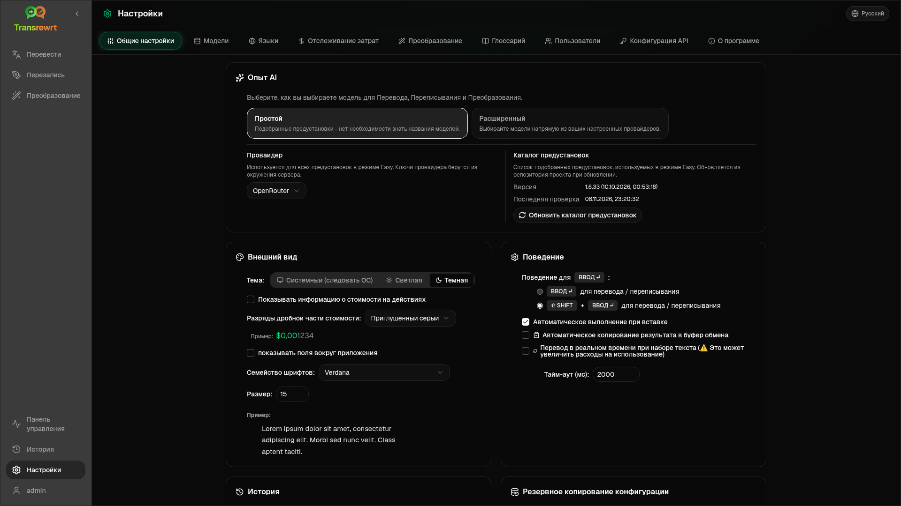

Откройте **Настройки** на боковой панели, чтобы настроить поведение приложения.

| Вкладка | Рабочий стол | Веб (администратор) | Веб (пользователь) | Примечания |
| --- | :---: | :---: | :---: | --- |
| Общие настройки | ✓ | ✓ | ✓ | Включает **Опыт AI** (Простой / Расширенный) |
| Модели | ✓ | ✓ | ✓ | Предустановленные карточки в простом режиме, таблица моделей в расширенном режиме |
| Языки | ✓ | ✓ | ✓ | |
| Отслеживание затрат | ✓ | ✓ | — | |
| Преобразование | ✓ | ✓ | ✓ | Массовый импорт/экспорт промптов |
| Глоссарий | ✓ | ✓ | ✓ | Пары терминов для перевода |
| Пользователи | — | ✓ | — | |
| Конфигурация API | ✓ | ✓ | — | |
| О программе | ✓ | ✓ | ✓ | |

В режиме **Easy** выберите ИИ с помощью предустановок на панели инструментов и **Провайдер** в общих настройках; на вкладке **Модели** отображаются предустановленные карточки только для чтения.

:::note
В веб-версии у каждого пользователя своя конфигурация (опыт ИИ, провайдер, модели/предустановки, языки, опции, промпты). Изменения не влияют на других пользователей.
:::

## Общие настройки

**Опыт AI**

- **Простой** (по умолчанию): выберите **Провайдер**. Облачные провайдеры используют предустановки на панели инструментов. **Локальная LLM** вместо этого перечисляет установленные локальные модели. **Обновить каталог предустановок** получает последний список предустановок из репозитория проекта.
  - **Бесплатно (OpenRouter)** — бесплатный вариант, маршрутизируемый к доступным бесплатным моделям; качество и доступность могут варьироваться
  - **Стандартный** — легкий и экономичный; лучше всего подходит для коротких текстов, быстрых черновиков и большого объема использования
  - **Расширенный** — высокоточная модель для сложного или нюансированного контента, по более высокой цене
  - **Технический** — настроен для кода, API, документации разработчика и структурированного контента; сохраняет форматирование и терминологию
- **Расширенный**: выбирайте модели на панели инструментов; управляйте списком в [Модели](#models).

Вы также можете переключаться между Простым ↔ Расширенным режимами из меню предустановок/моделей панели инструментов (**Переключиться в Простой/Расширенный режим**, над Открыть настройки).

**Внешний вид** — Тема; **Показывать информацию о стоимости в действиях**; **Разряды дробной части стоимости**; поля вокруг приложения только для веб-версии; **Семейство шрифтов** и **Размер**.

**Поведение** — **Поведение для ENTER**; **Автоматическое выполнение при вставке**; **Автоматическое копирование результата в буфер обмена**; **Перевод в реальном времени во время набора текста**; **Тайм-аут (мс)**.

**История**

- **Сохранять историю выполнения** — сохранять ввод/вывод для просмотра [Истории](/docs/history/). Отключение запрашивает подтверждение и может удалить сохраненный текст. Если помечено как *отключено администратором*, установлено значение `HISTORY_DISABLED` — см. [Конфигурация](/docs/configuration/#privacy-mode).
- **Удалить данные истории** — удалить сохраненный текст по возрасту или очистить все. **Не** удаляет общие суммы затрат (для этого используйте Отслеживание затрат).

**Резервное копирование конфигурации** (администраторы настольных и веб-приложений)

- Дополнительно **Включить данные об использовании в резервную копию**
- **Создать резервную копию конфигурации** — ZIP-архив с конфигурацией, состоянием, пользователями, предпочтениями, подсказками и дополнительными данными об использовании
- **Восстановить из резервной копии** — диалоговое окно подтверждения с опциями восстановления и/или очистки данных об использовании

Резервные копии могут перемещаться между настольными и веб-приложениями; восстановление резервной копии настольного приложения в веб-приложении применяет данные к пользователю-администратору.

## Модели

Вкладка **Модели** всегда отображается. Её переключатель **Easy / Advanced** переключает всё приложение между двумя [режимами работы с ИИ](#general-settings).

- В режиме **Простой** отображается одна карточка только для чтения для каждой предустановки (например, **Бесплатно (OpenRouter)** или **Стандартный**). Каждая карточка содержит основную и резервную модель предустановки для каждого настроенного вами провайдера. Фильтры **Провайдер** фильтруют карточки.
- В режиме **Расширенный** отображается таблица всех моделей, содержащая:
  - поле поиска, фильтры **Провайдер**, **Только бесплатные**, **Только выбранные** и **Обновить**
  - меню сортировки; по умолчанию **Индекс от большего к меньшему**
  - флажок для каждой модели, чтобы выбрать или отменить ее выбор
  - **Выбрать из пресетов**, что добавляет основные и резервные модели пресета для каждого настроенного провайдера (**Загрузить все** загружает всех провайдеров)
  - **Отменить выбор всех**, что сначала запрашивает подтверждение
- Идентификаторы моделей используют префикс провайдера (`openrouter/…`, `openai/…`, `local/…`, …)

Столбцы оценки и цены:

- **Индекс** — оценка качества, полученная из ChrF, Arena Score и цены. Она ранжируется внутри каждого провайдера, поэтому не сопоставима между провайдерами. Модели без индекса сортируются в конец списка.
- **ChrF** — среднее качество перевода с [languagebench](https://huggingface.co/spaces/fair-forward/languagebench) для языков пользовательского интерфейса приложения.
- **Arena** — Arena Score из таблицы лидеров [LMArena](https://huggingface.co/datasets/lmarena-ai/leaderboard-dataset).
- **Ввод** / **Вывод** — цена в долларах США за 1 млн токенов, из каталога провайдера или [models.dev](https://models.dev/). Ориентировочная цена отмечена звёздочкой. Прочерк (—) означает, что цена неизвестна; локальные модели показывают «без затрат — локально».

Наведите указатель мыши на заголовок столбца, чтобы увидеть его источник данных и лицензию. Селектор моделей на панели инструментов показывает индекс каждой модели в виде небольшого чипа; наведите на него указатель мыши, чтобы увидеть значения ChrF и Arena.

Оценки являются лишь ориентиром: охват неполный, и многие модели не имеют оценки ChrF или Arena.

:::tip
Не используйте OpenRouter **Body Builder** (`openrouter/bodybuilder`) для перевода, переписывания или преобразования — он возвращает полезные данные JSON-запроса, а не готовый текст.
:::

Установите или снимите флажок модели, чтобы выбрать или отменить её выбор. Бесплатная модель OpenRouter является необязательной — выбранные модели могут быть пустыми. Удаление последней модели с панели инструментов открывает **Настройки → Модели**. Если текущая модель становится недоступной, приложение выбирает следующую модель в списке вместо принудительного использования бесплатной модели.

## Языки

- **Основные языки** — закреплены в верхней части списков языков в Переводе и Преобразовании
- **Пользовательский язык** — добавить язык, отсутствующий во встроенном списке

## Отслеживание затрат

- **Общая стоимость**, **Копировать значение**, **Сбросить стоимость**
- **Синхронизировать с использованием API-ключа** — синхронизация с использованием учетной записи OpenRouter (только OpenRouter)
- **Использование API-ключа** — сведения OpenRouter, если доступны
- **Удалить данные о стоимости** — все данные или записи старше определенной даты

OpenRouter и xAI показывают фактическую стоимость, выставленную по счету, когда API возвращает ее; другие провайдеры используют оценки цен из [models.dev](https://models.dev/). Оценки не являются счетами.

:::caution
Удаление данных о стоимости необратимо. Сначала экспортируйте их через Историю или Панель управления → Все вызовы, если вам нужна резервная копия. Связанная история ввода/вывода для этих вызовов API также удаляется.
:::

## Преобразование

Массовое управление подсказками: просмотр, удаление, импорт, экспорт и загрузка примеров подсказок.

## Глоссарий

Управление парами терминов, применяемых во время [перевода](/docs/translate/#use-the-glossary). Каждый термин имеет исходный/целевой язык и исходный/целевой текст.

- Добавление с помощью нижней строки и **+**
- Фильтрация по языкам или тексту
- Импорт/экспорт CSV или XLSX; загрузка пустых шаблонов

Настольная версия хранит глоссарий локально; веб-версия хранит его для каждого пользователя.

## Пользователи

Только веб (администраторы):

- Добавление пользователей, обновление данных, сброс паролей, удаление учетных записей
- **Время ожидания сеанса** — продолжительность входа в систему (от 1 часа до 7 дней); изменения применяются только к новым входам
- **Отозвать сеансы** — немедленно выйти из учетной записи пользователя на всех устройствах

Каждый вошедший в систему пользователь (включая неадминистраторов) может изменить свой пароль или выйти из системы через меню пользователя в нижней части боковой панели.

## Конфигурация API

Настройте только те провайдеры, которые вы используете: OpenRouter, OpenAI, Anthropic, Google Gemini, DeepSeek, Groq, Mistral, xAI, Cerebras, NVIDIA, Alibaba Cloud, apikey.fun, **Локальная LLM** (базовый URL для Ollama, LM Studio, llama.cpp или аналогичных) и дополнительный пользовательский OpenAI-совместимый провайдер.

**Веб (администратор):** ключи берутся из переменных окружения — эта страница показывает, какие из них установлены, и позволяет **Проверить**. Перезапустите после изменения переменных окружения. См. [Конфигурация](/docs/configuration/).

**Настольная версия:** введите ключи (или URL Local LLM) и **Сохранить** / **Изменить** / **Проверить**. Ключи хранятся в зашифрованном виде; вы не можете просмотреть текущее значение, только заменить его.

:::tip
Для начала работы не требуется платный ключ: используйте бесплатные модели OpenRouter, другие бесплатные провайдеры или локальный сервер, совместимый с OpenAI, такой как [Ollama](https://ollama.com), LM Studio или llama.cpp (например, `translategemma:4b`).
:::

## О программе

Название приложения, версия, дата сборки, лицензия, уведомления сторонних разработчиков и ссылка на репозиторий.
