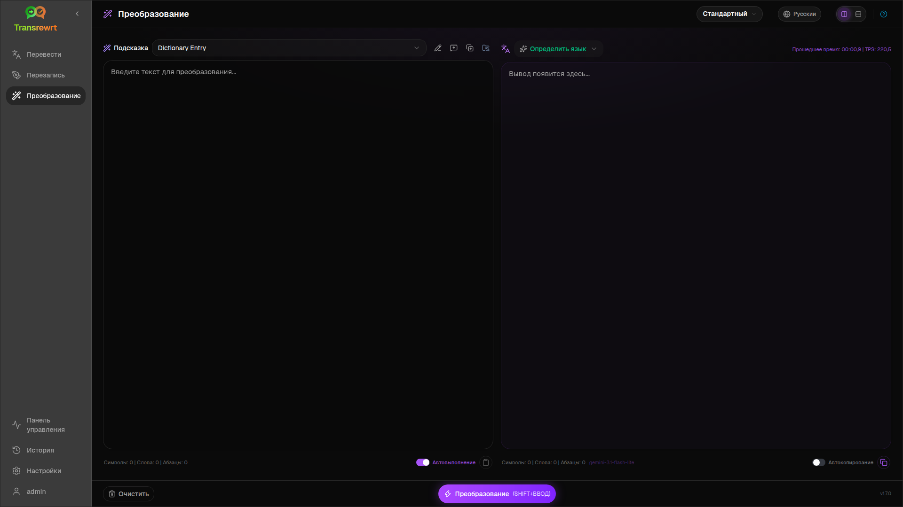
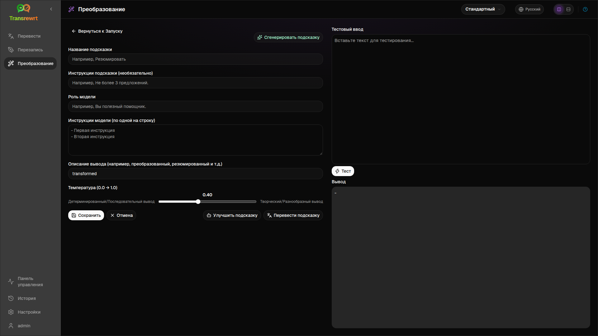

Используйте **Трансформацию**, когда вы хотите, чтобы ИИ следовал пользовательским инструкциям — резюмировал, улучшал электронное письмо, извлекал ключевые моменты, переформатировал текст или выполнял любой рабочий процесс, который вы определяете.

## Запуск существующего промпта

1. Откройте **Трансформацию**.
2. Выберите промпт из списка.
3. Если появляется поле языка **Из**, установите язык, если это необходимо.
4. Введите или вставьте текст в **Ввод**.
5. Нажмите **Трансформировать**.
6. Прочитайте результат в **Вывод**.

[Переключение макета и сочетания клавиш](/docs/translate/#layout-and-keyboard) работают так же, как в Переводе.

## Загрузить примеры подсказок

Если список пуст, нажмите **Загрузить примеры подсказок** в рабочей области Преобразование (также доступно в [Настройки → Преобразование](/docs/settings/#transform)). Примеры на английском языке; после загрузки отредактируйте подсказку и при необходимости используйте **Перевести подсказку**.

## Создание промпта

1. Нажмите **Новая подсказка**.
2. Нажмите **Сгенерировать подсказку**.
3. Опишите, что должна делать подсказка.
4. Выберите пресет (Простой) или модель (Расширенный).
5. Просмотрите черновик и нажмите **Сохранить**.

## Редактирование промпта

Редактор находится слева; область тестирования — справа.

Основные поля:

- **Название подсказки** — отображается в списке подсказок
- **Инструкции подсказки (необязательно)** — краткая подсказка при запуске подсказки
- **Роль модели** — общая роль для ИИ
- **Инструкции модели (по одной на строку)** — правила, которым нужно следовать
- **Описание вывода** — короткая метка для результата (например, суммировано)
- **Температура (0.0 → 1.0)** — ниже — стабильнее; выше — разнообразнее
- **Запросить целевой язык** — добавляет селектор языка при запуске

Помощники: **Сгенерировать подсказку**, **Улучшить подсказку**, **Перевести подсказку** (Простой использует пресеты; Расширенный использует список моделей).

:::caution
Нажмите **Сохранить** перед **Вернуться к Запуску**. Возврат без сохранения отменяет изменения.
:::

## Тестирование перед повседневным использованием

Используйте правую тестовую панель с образцом текста при создании или сравнении запросов.

Экспортируйте и импортируйте запросы массово в разделе [Настройки → Преобразование](/docs/settings/#transform).

## Следующие шаги

- [Настройки](/docs/settings/)
- [Просмотр истории](/docs/history/)
- [Распространенные проблемы](/docs/common-issues/)
