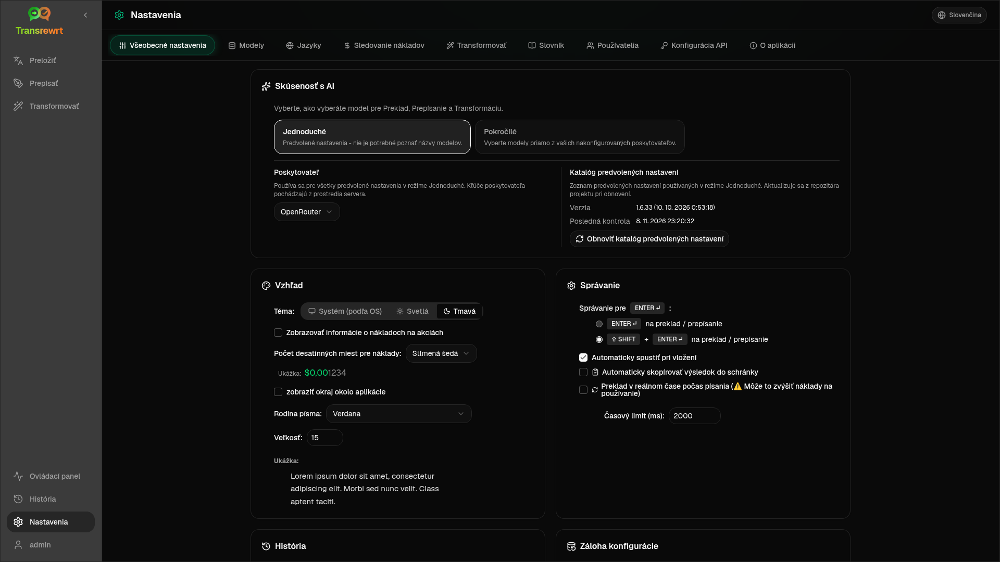

Otvorte **Nastavenia** z bočného panela, aby ste si prispôsobili správanie aplikácie.

| Karta | Desktop | Web (administrátor) | Web (používateľ) | Poznámky |
| --- | :---: | :---: | :---: | --- |
| Všeobecné nastavenia | ✓ | ✓ | ✓ | Zahŕňa **Skúsenosť s AI** (Jednoduché / Pokročilé) |
| Modely | ✓ | ✓ | ✓ | Prednastavené karty v režime Jednoduché, tabuľka modelov v režime Pokročilé |
| Jazyky | ✓ | ✓ | ✓ | |
| Sledovanie nákladov | ✓ | ✓ | — | |
| Transformovať | ✓ | ✓ | ✓ | Hromadný import/export výziev |
| Glosár | ✓ | ✓ | ✓ | Páry výrazov pre preklad |
| Používatelia | — | ✓ | — | |
| Konfigurácia API | ✓ | ✓ | — | |
| O aplikácii | ✓ | ✓ | ✓ | |

V režime **Jednoduché** vyberte AI pomocou predvolieb na paneli nástrojov a **Poskytovateľa** vo Všeobecných nastaveniach; karta **Modely** zobrazuje prednastavené karty len na čítanie.

:::note
Vo webovej verzii má každý používateľ vlastnú konfiguráciu (AI skúsenosti, poskytovateľ, modely/predvoľby, jazyky, možnosti, výzvy). Zmeny neovplyvňujú ostatných používateľov.
:::

## Všeobecné nastavenia

**Skúsenosť s AI**

- **Jednoduché** (predvolené): vyberte **Poskytovateľa**. Poskytovatelia cloudu používajú predvoľby panela nástrojov. **Lokálny LLM** namiesto toho uvádza nainštalované lokálne modely. **Obnoviť katalóg predvolených nastavení** načíta najnovší zoznam predvolených nastavení z repozitára projektu.
  - **Voľné (OpenRouter)** — bezplatná možnosť smerovaná na dostupné voľné modely; kvalita a dostupnosť sa môžu líšiť
  - **Štandardné** — ľahké a nákladovo efektívne; najlepšie pre krátke texty, rýchle návrhy a vysoký objem použitia
  - **Pokročilé** — vysoko presný model pre komplexný alebo nuansovaný obsah, za vyššiu cenu
  - **Technické** — vyladené pre kód, API, dokumentáciu pre vývojárov a štruktúrovaný obsah; zachováva formátovanie a terminológiu
- **Pokročilé**: vyberte modely na paneli nástrojov; spravujte zoznam v časti [Modely](#models).

Môžete tiež prepínať Jednoduché ↔ Pokročilé z ponuky predvolieb/modelov panela nástrojov (**Prepnúť do režimu Jednoduché/Pokročilé**, nad Otvoriť nastavenia).

**Vzhľad** — Téma; **Zobraziť informácie o nákladoch pri akciách**; **Počet desatinných miest pre náklady**; okraj okolo aplikácie len pre web; **Rodina písma** a **Veľkosť**.

**Správanie** — **Správanie pre ENTER**; **Automaticky spustiť pri vložení**; **Automaticky skopírovať výsledok do schránky**; **Preklad v reálnom čase počas písania**; **Časový limit (ms)**.

**História**

- **Uchovávať históriu vykonávania** — ukladá vstup/výstup pre zobrazenie [História](/docs/history/). Vypnutie vyžaduje potvrdenie a môže odstrániť uložený text. Ak je označené ako *zakázané administrátorom*, je nastavené `HISTORY_DISABLED` — pozrite si [Konfigurácia](/docs/configuration/#privacy-mode).
- **Vymazať údaje histórie** — odstráni uložený text podľa veku alebo vymaže všetko. **Neodstraňuje** celkové náklady (na to použite Sledovanie nákladov).

**Záloha konfigurácie** (administrátori pre desktop a web)

- Voliteľné **Zahrnúť údaje o používaní do zálohy**
- **Zálohovať konfiguráciu** — ZIP s konfiguráciou, stavom, používateľmi, preferenciami, výzvami a voliteľnými údajmi o používaní
- **Obnoviť zo zálohy** — potvrdzovací dialóg s možnosťami obnovenia a/alebo vymazania údajov o používaní

Zálohy sa môžu presúvať medzi desktopom a webom; obnovenie zálohy z desktopu na webe aplikuje údaje na administrátorského používateľa.

## Modely

Karta **Modely** je vždy uvedená. Jej prepínač **Jednoduché / Pokročilé** prepína celú aplikáciu medzi dvoma [prostrediami AI](#general-settings).

- **Jednoduché** zobrazuje jednu kartu len na čítanie pre každú predvoľbu (napríklad **Voľné (OpenRouter)** alebo **Štandardné**). Každá karta uvádza hlavný a záložný model predvoľby pre každého poskytovateľa, ktorého ste nakonfigurovali. Čipy **Poskytovateľ** filtrujú karty.
- **Pokročilé** zobrazuje jednu tabuľku všetkých modelov s:
  - vyhľadávacím poľom, čipmi **Poskytovateľ**, **Iba bezplatné**, **Iba vybrané** a **Obnoviť**
  - ponukou zoradenia; predvolené je **Index od najvyššieho po najnižší**
  - zaškrtávacím políčkom pre každý model na jeho výber alebo zrušenie výberu
  - **Vybrať z predvolieb**, ktoré pridá hlavné a záložné modely predvoľby pre každého nakonfigurovaného poskytovateľa (**Načítať všetko** načíta všetkých poskytovateľov)
  - **Zrušiť výber všetkého**, ktoré najprv požiada o potvrdenie
- ID modelov používajú predponu poskytovateľa (`openrouter/…`, `openai/…`, `local/…`, …)

Stĺpce skóre a ceny:

- **Index** — skóre kvality zmiešané z ChrF, Arena Score a ceny. Je zoradené v rámci každého poskytovateľa, takže nie je porovnateľné medzi poskytovateľmi. Modely bez Indexu sa zoradia na koniec.
- **ChrF** — priemerná kvalita prekladu z [languagebench](https://huggingface.co/spaces/fair-forward/languagebench) pre jazyky používateľského rozhrania aplikácie.
- **Arena** — Arena Score z rebríčka [LMArena](https://huggingface.co/datasets/lmarena-ai/leaderboard-dataset).
- **Vstup** / **Výstup** — cena v USD za 1 milión tokenov, z katalógu poskytovateľa alebo [models.dev](https://models.dev/). Odhadovaná cena je označená hviezdičkou. Pomlčka (—) znamená, že cena je neznáma; lokálne modely zobrazujú „bez nákladov – lokálne“.

Podržte kurzor myši nad hlavičkou stĺpca, aby ste videli jeho zdroj údajov a licenciu. Selektor modelu na paneli nástrojov zobrazuje Index každého modelu ako malý čip; podržte nad ním kurzor myši pre hodnoty ChrF a Arena.

Skóre sú len orientačné: pokrytie je neúplné a mnohé modely nemajú skóre ChrF ani Arena.

:::tip
Nepoužívajte OpenRouter **Body Builder** (`openrouter/bodybuilder`) pre funkcie Preložiť, Prepísať alebo Transformovať – vracia JSON dátové časti požiadaviek, nie hotový text.
:::

Zaškrtnite alebo zrušte zaškrtnutie modelu, aby ste ho vybrali alebo zrušili jeho výber. Bezplatný model OpenRouter je voliteľný – vybrané modely môžu byť prázdne. Odstránenie posledného modelu z panela nástrojov otvorí **Nastavenia → Modely**. Ak sa aktuálny model stane nedostupným, aplikácia namiesto vynútenia bezplatného modelu vyberie ďalší model v zozname.

## Jazyky

- **Najpoužívanejšie jazyky** — pripnuté blízko hornej časti zoznamov jazykov v Preklade a Transformácii
- **Vlastný jazyk** — pridajte jazyk, ktorý chýba vo vstavanom zozname

## Sledovanie nákladov

- **Celkové náklady**, **Kopírovať hodnotu**, **Resetovať náklady**
- **Synchronizovať s využitím API kľúča** — zosúladiť s využitím účtu OpenRouter (iba OpenRouter)
- **Využitie API kľúča** — podrobnosti OpenRouter, ak sú k dispozícii
- **Odstrániť údaje o nákladoch** — všetky údaje alebo záznamy staršie ako dátum

OpenRouter a xAI zobrazujú skutočné účtované náklady, keď ich API vráti; ostatní poskytovatelia používajú odhady z cien [models.dev](https://models.dev/). Odhady nie sú faktúry.

:::caution
Vymazanie údajov o nákladoch sa nedá vrátiť späť. Ak potrebujete zálohu, najprv exportujte cez Históriu alebo Panel → Všetky volania. Súvisiaca história vstupov/výstupov pre tieto volania API sa tiež odstráni.
:::

## Transformácia

Hromadná správa výziev: kontrola, odstránenie, import, export a načítanie vzorových výziev.

## Glosár

Spravujte páry výrazov použitých počas [prekladu](/docs/translate/#use-the-glossary). Každý výraz má zdrojový/cieľový jazyk a zdrojový/cieľový text.

- Pridajte pomocou spodného riadku a **+**
- Filtrujte podľa jazykov alebo textu
- Import/export CSV alebo XLSX; stiahnite prázdne šablóny

Desktop ukladá glosár lokálne; web ho ukladá pre každého používateľa.

## Používatelia

Len web (správcovia):

- Pridávať používateľov, aktualizovať podrobnosti, resetovať heslá, mazať účty
- **Časový limit relácie** — ako dlho trvá prihlásenie (1 hodina až 7 dní); zmeny sa vzťahujú len na nové prihlásenia
- **Zrušiť relácie** — okamžite odhlásiť používateľa zo všetkých zariadení

Každý prihlásený používateľ (vrátane ne-správcov) si môže zmeniť svoje vlastné heslo alebo sa odhlásiť z používateľského menu v spodnej časti bočného panela.

## Konfigurácia API

Nakonfigurujte iba poskytovateľov, ktorých používate: OpenRouter, OpenAI, Anthropic, Google Gemini, DeepSeek, Groq, Mistral, xAI, Cerebras, NVIDIA, Alibaba Cloud, apikey.fun, **Lokálny LLM** (základná URL pre Ollama, LM Studio, llama.cpp alebo podobné) a voliteľný vlastný poskytovateľ kompatibilný s OpenAI.

**Web (správca):** kľúče pochádzajú z premenných prostredia — táto stránka ukazuje, ktoré sú nastavené a umožňuje vám ich **otestovať**. Po zmene premenných prostredia reštartujte. Pozrite si [Konfigurácia](/docs/configuration/).

**Desktop:** zadajte kľúče (alebo URL Local LLM) a **Uložiť** / **Upraviť** / **Testovať**. Kľúče sú uložené šifrovane; nemôžete zobraziť aktuálnu hodnotu, len ju nahradiť.

:::tip
Na začiatok nie je potrebný platený kľúč: použite bezplatné modely OpenRouter, iných poskytovateľov s bezplatnou úrovňou alebo lokálny server kompatibilný s OpenAI, ako napríklad [Ollama](https://ollama.com), LM Studio alebo llama.cpp (napr. `translategemma:4b`).
:::

## O aplikácii

Názov aplikácie, verzia, dátum zostavenia, licencia, oznámenia tretích strán a odkaz na úložisko.
