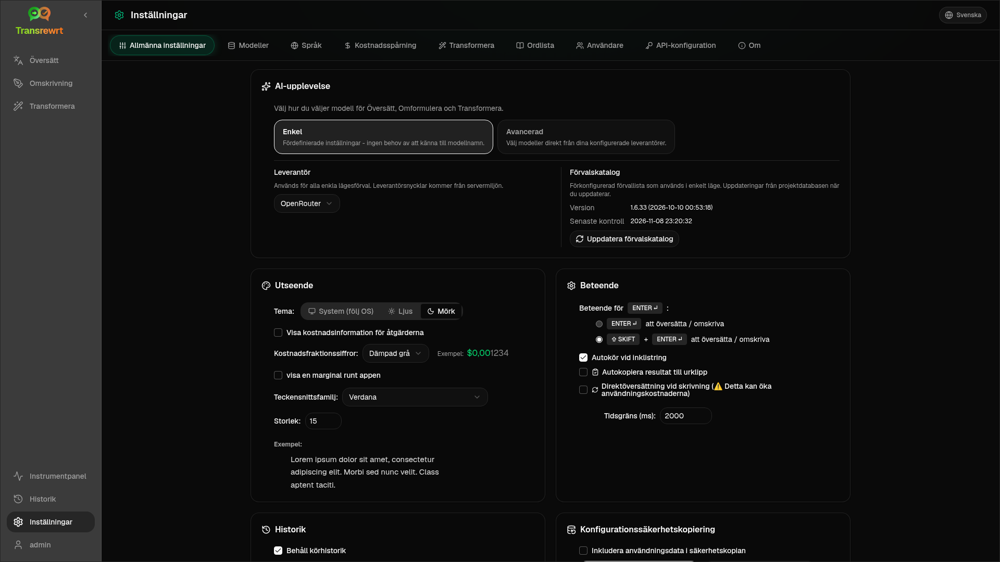

Öppna **Inställningar** från sidofältet för att anpassa hur appen fungerar.

| Flik | Skrivbord | Webb (admin) | Webb (användare) | Anteckningar |
| --- | :---: | :---: | :---: | --- |
| Allmänna inställningar | ✓ | ✓ | ✓ | Inkluderar **AI-upplevelse** (Enkel / Avancerad) |
| Modeller | ✓ | ✓ | ✓ | Förinställda kort i Enkelt, modelltabell i Avancerat |
| Språk | ✓ | ✓ | ✓ | |
| Kostnadsspårning | ✓ | ✓ | — | |
| Transformera | ✓ | ✓ | ✓ | Massimport/export av prompter |
| Ordlista | ✓ | ✓ | ✓ | Termpar för översättning |
| Användare | — | ✓ | — | |
| API-konfiguration | ✓ | ✓ | — | |
| Om | ✓ | ✓ | ✓ | |

I läget **Enkelt** väljer du AI via förinställningar i verktygsfältet och **Leverantör** i Allmänna inställningar; fliken **Modeller** visar skrivskyddade förinställda kort.

:::note
I webbversionen har varje användare sin egen konfiguration (AI-upplevelse, leverantör, modeller/förinställningar, språk, alternativ, prompter). Ändringar påverkar inte andra användare.
:::

## Allmänna inställningar

**AI-upplevelse**

- **Enkel** (standard): välj en **Leverantör**. Molnleverantörer använder förinställningar i verktygsfältet. **Lokal LLM** listar installerade lokala modeller istället. **Uppdatera förvalskatalog** hämtar den senaste förvalslistan från projektets förråd.
  - **Gratis (OpenRouter)** – kostnadsfritt alternativ som dirigeras till tillgängliga gratismodeller; kvalitet och tillgänglighet kan variera
  - **Standard** – lättviktig och kostnadseffektiv; bäst för korta texter, snabba utkast och högvolymanvändning
  - **Avancerad** – modell med hög noggrannhet för komplext eller nyanserat innehåll, till en högre kostnad
  - **Teknisk** – anpassad för kod, API:er, utvecklardokumentation och strukturerat innehåll; bevarar formatering och terminologi
- **Avancerad**: välj modeller i verktygsfältet; hantera listan under [Modeller](#models).

Du kan också växla Enkel ↔ Avancerad från verktygsfältets förinställnings-/modellmeny (**Växla till Enkelt/Avancerat läge**, ovanför Öppna inställningar).

**Utseende** — Tema; **Visa kostnadsinformation om åtgärderna**; **Antal decimaler för kostnad**; endast webbmarginal runt appen; **Teckensnittsfamilj** och **Storlek**.

**Beteende** – **Beteende för ENTER**; **Autokör vid inklistring**; **Autokopiera resultat till urklipp**; **Realtidsöversättning under skrivning**; **Tidsgräns (ms)**.

**Historik**

- **Behåll körhistorik** – lagra inmatning/utdata för vyn [Historik](/docs/history/). Att stänga av frågar om bekräftelse och kan ta bort lagrad text. Om märkt *inaktiverad av administratören*, är `HISTORY_DISABLED` inställt – se [Konfiguration](/docs/configuration/#privacy-mode).
- **Ta bort historikdata** – ta bort lagrad text efter ålder eller rensa allt. Tar **inte** bort kostnadstotaler (använd Kostnadsspårning för det).

**Konfigurationssäkerhetskopiering** (skrivbords- och webbadministratörer)

- Valfritt **Inkludera användningsdata i säkerhetskopian**
- **Säkerhetskopiera konfiguration** — ZIP med konfiguration, tillstånd, användare, inställningar, prompter och valfria användningsdata
- **Återställ från säkerhetskopia** — bekräftelsedialog med alternativ för att återställa och/eller rensa användningsdata

Säkerhetskopior kan flyttas mellan skrivbord och webb; att återställa en skrivbordssäkerhetskopia på webben tillämpar data på administratörsanvändaren.

## Modeller

Fliken **Modeller** visas alltid. Dess växlingsknapp **Enkelt / Avancerat** växlar hela appen mellan de två [AI-upplevelserna](#general-settings).

- **Enkel** visar ett skrivskyddat kort per förinställning (till exempel **Gratis (OpenRouter)** eller **Standard**). Varje kort listar förinställningens huvud- och reservmodell för varje leverantör du har konfigurerat. **Leverantör**-chipsen filtrerar korten.
- **Avancerad** visar en tabell över varje modell, med:
  - en sökruta, **Leverantör**-chips, **Endast gratis**, **Endast valda** och **Uppdatera**
  - en sorteringsmeny; standard är **Index, högt till lågt**
  - en kryssruta per modell för att välja eller avmarkera den
  - **Välj bland förinställningar**, som lägger till en förinställnings huvud- och reservmodeller för varje konfigurerad leverantör (**Ladda alla** laddar varje leverantör)
  - **Avmarkera alla**, som först ber om bekräftelse
- Modell-ID:n använder ett leverantörsprefix (`openrouter/…`, `openai/…`, `local/…`, …)

Kolumnerna för poäng och pris:

- **Index** — en kvalitetspoäng som blandar ChrF, Arena Score och pris. Den rankas inom varje leverantör, så den är inte jämförbar mellan leverantörer. Modeller utan index sorteras längst ner.
- **ChrF** — genomsnittlig översättningskvalitet från [languagebench](https://huggingface.co/spaces/fair-forward/languagebench) för appens UI-språk.
- **Arena** — Arena Score från [LMArena](https://huggingface.co/datasets/lmarena-ai/leaderboard-dataset) topplistan.
- **Input** / **Output** — pris i USD per 1 miljon tokens, från leverantörskatalogen eller [models.dev](https://models.dev/). Ett uppskattat pris markeras med en asterisk. Ett streck (—) betyder att priset är okänt; lokala modeller visar "ingen kostnad - lokal".

Håll muspekaren över en kolumnrubrik för att se dess datakälla och licens. Modellväljaren i verktygsfältet visar varje modells index som ett litet chipp; håll muspekaren över det för ChrF- och Arena-värdena.

Poängen är endast en vägledning: täckningen är ofullständig, och många modeller har ingen ChrF- eller Arena-poäng.

:::tip
Använd inte OpenRouter **Body Builder** (`openrouter/bodybuilder`) för Översätt, Skriv om eller Transformera – den returnerar JSON-begäransnyttolaster, inte färdig text.
:::

Markera eller avmarkera en modell för att välja eller avmarkera den. OpenRouter-gratismodellen är valfri – valda modeller kan vara tomma. Om du tar bort den sista modellen från verktygsfältet öppnas **Inställningar → Modeller**. Om den aktuella modellen blir otillgänglig väljer appen nästa modell i listan istället för att tvinga fram gratismodellen.

## Språk

- **Toppspråk** — fästa nära toppen av språklistorna i Översätt och Transformera
- **Anpassat språk** — lägg till ett språk som saknas i den inbyggda listan

## Kostnadsspårning

- **Totalkostnad**, **Kopiera värde**, **Återställ kostnad**
- **Synkronisera med API-nyckelanvändning** – anpassa till OpenRouter-kontots användning (endast OpenRouter)
- **API-nyckelanvändning** – OpenRouter-detaljer när tillgängliga
- **Ta bort kostnadsdata** – all data eller poster äldre än ett visst datum

OpenRouter och xAI visar den faktiska debiterade kostnaden när API:et returnerar den; andra leverantörer använder uppskattningar från [models.dev](https://models.dev/)-prissättning. Uppskattningar är inte fakturor.

:::caution
Borttagning av kostnadsdata kan inte ångras. Exportera via Historik eller Dashboard → Alla samtal först om du behöver en säkerhetskopia. Relaterad indata-/utdatahistorik för dessa API-anrop tas också bort.
:::

## Transformera

Masshantera prompter: granska, ta bort, importera, exportera och ladda exempelprompter.

## Ordlista

Hantera termpar som används under [översättning](/docs/translate/#use-the-glossary). Varje term har käll-/målspråk och käll-/måltext.

- Lägg till via den nedersta raden och **+**
- Filtrera efter språk eller text
- Importera/exportera CSV eller XLSX; ladda ner tomma mallar

Skrivbordsversionen lagrar ordlistan lokalt; webbversionen lagrar den per användare.

## Användare

Endast webb (administratörer):

- Lägg till användare, uppdatera detaljer, återställ lösenord, ta bort konton
- **Sessionsutloggning** – hur länge en inloggning varar (1 timme till 7 dagar); ändringar gäller endast nya inloggningar
- **Återkalla sessioner** – logga ut en användare från alla enheter omedelbart

Varje inloggad användare (inklusive icke-administratörer) kan ändra sitt eget lösenord eller logga ut från användarmenyn längst ner i sidofältet.

## API-konfiguration

Konfigurera endast de leverantörer du använder: OpenRouter, OpenAI, Anthropic, Google Gemini, DeepSeek, Groq, Mistral, xAI, Cerebras, NVIDIA, Alibaba Cloud, apikey.fun, **Lokal LLM** (bas-URL för Ollama, LM Studio, llama.cpp, eller liknande), och en valfri anpassad OpenAI-kompatibel leverantör.

**Webb (administratör):** nycklar kommer från miljövariabler — den här sidan visar vilka som är inställda och låter dig **Testa**. Starta om efter att ha ändrat miljövariabler. Se [Konfiguration](/docs/configuration/).

**Skrivbordsversion:** ange nycklar (eller Lokal LLM URL) och **Spara** / **Redigera** / **Testa**. Nycklar lagras krypterade; du kan inte se det aktuella värdet, bara ersätta det.

:::tip
Ingen betald nyckel behövs för att komma igång: använd gratis OpenRouter-modeller, andra gratisleverantörer, eller en lokal OpenAI-kompatibel server som [Ollama](https://ollama.com), LM Studio, eller llama.cpp (t.ex. `translategemma:4b`).
:::

## Om

Appnamn, version, byggdatum, licens, meddelanden från tredje part och länk till förråd.
