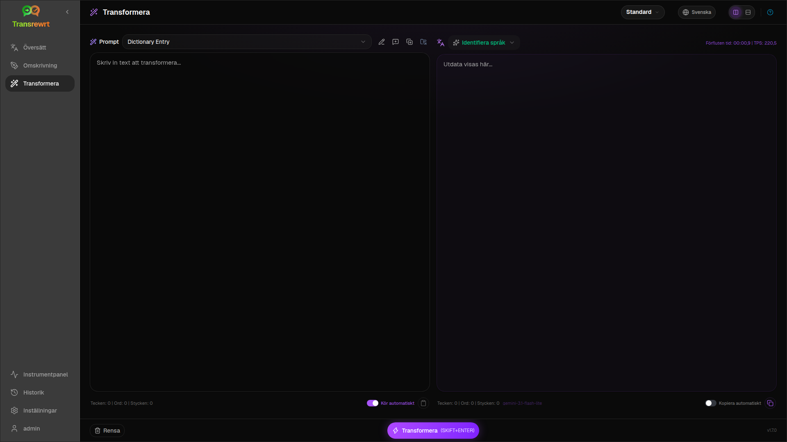
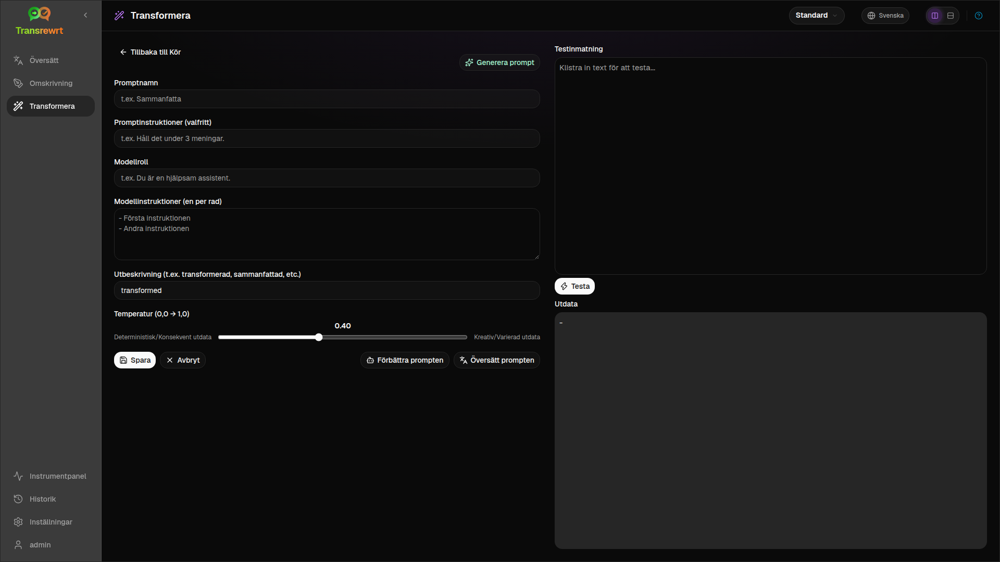

Använd **Transformera** när du vill att AI:n ska följa anpassade instruktioner – sammanfatta, finslipa ett e-postmeddelande, extrahera nyckelpunkter, omformatera text eller någon annan arbetsgång du definierar.

## Kör en befintlig prompt

1. Öppna **Transformera**.
2. Välj en prompt från listan.
3. Om en **Från** språk-ruta visas, ställ in ett språk om du vill ha ett.
4. Skriv eller klistra in text i **Input**.
5. Klicka på **Transformera**.
6. Läs resultatet i **Output**.

[Växlingsknappen för layout och kortkommandon](/docs/translate/#layout-and-keyboard) fungerar på samma sätt som i Translate.

## Ladda exempeluppmaningar

Om listan är tom klickar du på **Ladda exempeluppmaningar** i arbetsytan Transformera (finns även under [Inställningar → Transformera](/docs/settings/#transform)). Exemplen är på engelska; efter att du har laddat dem kan du redigera en prompt och använda **Översätt prompten** om det behövs.

## Skapa en prompt

1. Klicka på **Ny prompt**.
2. Klicka på **Generera prompt**.
3. Beskriv vad du vill att prompten ska göra.
4. Välj en förinställning (Enkel) eller modell (Avancerad).
5. Granska utkastet och klicka på **Spara**.

## Redigera en prompt

Redigeraren är till vänster; ett testområde är till höger.

Huvudfält:

- **Promptnamn** – visas i promptlistan
- **Promptinstruktioner (valfritt)** – kort tips när prompten körs
- **Modellroll** – övergripande roll för AI:n
- **Modellinstruktioner (en per rad)** – regler att följa
- **Utbeskrivning** – kort etikett för resultatet (t.ex. sammanfattat)
- **Temperatur (0,0 → 1,0)** – lägre är stabilare; högre är mer varierat
- **Fråga efter målspråk** – lägger till en språkval när du kör

Hjälpmedel: **Generera prompt**, **Förbättra prompten**, **Översätt prompten** (Enkel använder förinställningar; Avancerad använder modellistan).

:::caution
Klicka på **Spara** innan **Tillbaka till Kör**. Att gå tillbaka utan att spara kasserar ändringar.
:::

## Testa före daglig användning

Använd testpanelen till höger med exempeltext när du skapar eller jämför prompter.

Exportera och importera prompter i bulk under [Inställningar → Transformera](/docs/settings/#transform).

## Nästa steg

- [Inställningar](/docs/settings/)
- [Bläddra i historik](/docs/history/)
- [Vanliga problem](/docs/common-issues/)
