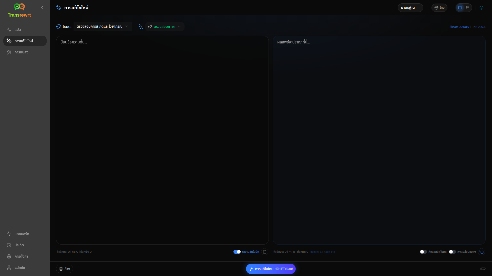

ใช้ **เขียนใหม่** เพื่อปรับปรุงถ้อยคำโดยไม่เปลี่ยนความหมายหลัก ข้อความยังคงอยู่ในภาษาเดิม

โหมดต่างๆ ได้แก่:

- **ตรวจสอบการสะกดและไวยากรณ์**
- **ปรับปรุงความชัดเจน**
- **รุ่นทางเลือก** (การปรับปรุงหลายครั้งในการทำงานครั้งเดียว)
- **ทำให้เป็นทางการ** / **ทำให้เป็นไม่เป็นทางการ**
- **ย่อ** / **ขยาย**
- **ทำให้เป็นเทคนิค**

## เขียนข้อความใหม่

1. เปิด **การแก้ไขใหม่**
2. เลือก **โหมด**
3. เลือกตั้งค่า **จาก** เป็นภาษาของข้อความของคุณ (หรือปล่อยให้เป็น **ตรวจสอบภาษา**)
4. พิมพ์หรือวางข้อความลงใน **ข้อมูลนำเข้า**
5. คลิก **เขียนใหม่**
6. อ่านผลลัพธ์ใน **เอาต์พุต**

[การสลับเลย์เอาต์และแป้นพิมพ์ลัด](/docs/translate/#layout-and-keyboard) ทำงานเหมือนกับใน Translate ทุกประการ

:::tip
หลังจากการเขียนใหม่ สวิตช์ **แสดงการเปลี่ยนแปลง** (**การเปลี่ยนแปลง**) จะปรากฏขึ้นถัดจาก **คัดลอก** สำหรับ **ทุก** โหมดการเขียนใหม่ สลับเพื่อแสดงหรือซ่อนความแตกต่างระหว่างอินพุตและเอาต์พุต
:::

:::note
**รุ่นทางเลือก** จะส่งคืนการปรับปรุงหลายครั้งในการทำงาน **ครั้งเดียว** โดยคั่นด้วย `----` ซึ่งแตกต่างจาก **การปรับสำนวน...** ที่จะสร้างประวัติเวอร์ชันเมื่อเวลาผ่านไป
:::

## ปรับปรุงการเขียนใหม่

หลังจากดำเนินการสำเร็จ **ปรับถ้อยคำใหม่...** และเมนูแบบเลื่อนลงเวอร์ชันจะปรากฏขึ้นที่ด้านเอาต์พุต (แนวคิดเดียวกับ [แปล](/docs/translate/#refine-a-translation) แต่ข้อความยังคงอยู่ในภาษาเดียวกันและคง **โหมด** ปัจจุบันไว้):

1. **การปรับสำนวน...** (ไม่มีการเลือก) — การแก้ไขใหม่ทั้งหมดด้วยถ้อยคำที่แตกต่างกัน สูงสุดห้าเวอร์ชัน คลิก **หยุดการแก้ไขใหม่** เพื่อยกเลิก
2. **คำอื่นๆ** — เลือกข้อความ จากนั้นคลิกขวาหรือ **การปรับสำนวน...**
3. การร้องขอแต่ละครั้งอาจมีค่าใช้จ่ายในการใช้งาน

## ขั้นตอนถัดไป

- [แปลข้อความ](/docs/translate/)
- [แปลงด้วยพร้อมต์](/docs/transform/)
- [ปัญหาทั่วไป](/docs/common-issues/)
