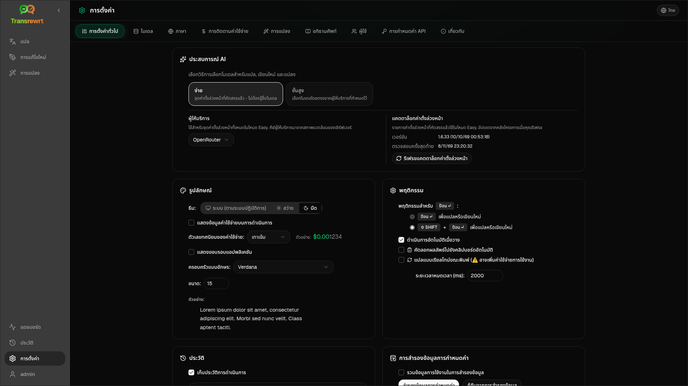

เปิด **การตั้งค่า** จากแถบด้านข้างเพื่อปรับแต่งวิธีการทำงานของแอป

| แท็บ | เดสก์ท็อป | เว็บ (ผู้ดูแลระบบ) | เว็บ (ผู้ใช้) | หมายเหตุ |
| --- | :---: | :---: | :---: | --- |
| การตั้งค่าทั่วไป | ✓ | ✓ | ✓ | รวมถึง **ประสบการณ์ AI** (ง่าย / ขั้นสูง) |
| โมเดล | ✓ | ✓ | ✓ | การ์ดที่ตั้งไว้ล่วงหน้าในโหมด Easy, ตารางโมเดลในโหมด Advanced |
| ภาษา | ✓ | ✓ | ✓ | |
| การติดตามต้นทุน | ✓ | ✓ | — | |
| การแปลง | ✓ | ✓ | ✓ | การนำเข้า/ส่งออกพรอมต์จำนวนมาก |
| อภิธานศัพท์ | ✓ | ✓ | ✓ | คู่คำศัพท์สำหรับการแปล |
| ผู้ใช้ | — | ✓ | — | |
| การกำหนดค่า API | ✓ | ✓ | — | |
| เกี่ยวกับ | ✓ | ✓ | ✓ | |

ในโหมด **Easy** ให้เลือก AI ผ่านค่าที่ตั้งไว้ล่วงหน้าในแถบเครื่องมือและ **Provider** ในการตั้งค่าทั่วไป; แท็บ **Models** จะแสดงการ์ดค่าที่ตั้งไว้ล่วงหน้าแบบอ่านอย่างเดียว

:::note
ในเวอร์ชันเว็บ ผู้ใช้แต่ละคนมีการกำหนดค่าของตนเอง (ประสบการณ์ AI, ผู้ให้บริการ, โมเดล/ค่าที่ตั้งไว้ล่วงหน้า, ภาษา, ตัวเลือก, พร้อมท์) การเปลี่ยนแปลงจะไม่มีผลกับผู้ใช้รายอื่น
:::

## การตั้งค่าทั่วไป

**ประสบการณ์ AI**

- **ง่าย** (ค่าเริ่มต้น): เลือก **ผู้ให้บริการ** ผู้ให้บริการคลาวด์ใช้ค่าตั้งล่วงหน้าในแถบเครื่องมือ **Local LLM** จะแสดงรายการโมเดลในเครื่องที่ติดตั้งไว้แทน **รีเฟรชแคตตาล็อกค่าตั้งล่วงหน้า** จะดึงรายการค่าตั้งล่วงหน้าล่าสุดจากที่เก็บข้อมูลของโปรเจกต์
  - **ฟรี (OpenRouter)** — ตัวเลือกที่ไม่มีค่าใช้จ่ายซึ่งเชื่อมโยงไปยังโมเดลฟรีที่มีอยู่ คุณภาพและความพร้อมใช้งานอาจแตกต่างกันไป
  - **มาตรฐาน** — น้ำหนักเบาและประหยัดค่าใช้จ่าย เหมาะที่สุดสำหรับข้อความสั้นๆ ฉบับร่างด่วน และการใช้งานปริมาณมาก
  - **ขั้นสูง** — โมเดลที่มีความแม่นยำสูงสำหรับเนื้อหาที่ซับซ้อนหรือละเอียดอ่อน โดยมีค่าใช้จ่ายสูงกว่า
  - **เทคนิค** — ปรับแต่งมาสำหรับโค้ด, API, เอกสารสำหรับนักพัฒนา และเนื้อหาที่มีโครงสร้าง รักษาการจัดรูปแบบและคำศัพท์
- **ขั้นสูง**: เลือกโมเดลในแถบเครื่องมือ จัดการรายการภายใต้ [โมเดล](#models)

คุณยังสามารถสลับโหมดง่าย ↔ ขั้นสูงได้จากเมนูค่าที่ตั้งไว้ล่วงหน้า/โมเดลในแถบเครื่องมือ (**สลับไปโหมดง่าย/ขั้นสูง** เหนือเปิดการตั้งค่า)

**ลักษณะที่ปรากฏ** — ธีม; **แสดงข้อมูลค่าใช้จ่ายในการดำเนินการ**; **จำนวนหลักทศนิยมของค่าใช้จ่าย**; ระยะขอบเฉพาะเว็บรอบแอป; **ตระกูลแบบอักษร** และ **ขนาด**

**พฤติกรรม** — **พฤติกรรมสำหรับ ENTER**; **ดำเนินการอัตโนมัติเมื่อวาง**; **คัดลอกผลลัพธ์ไปยังคลิปบอร์ดอัตโนมัติ**; **แปลแบบเรียลไทม์ขณะพิมพ์**; **หมดเวลา (มิลลิวินาที)**

**ประวัติ**

- **เก็บประวัติการดำเนินการ** — จัดเก็บอินพุต/เอาต์พุตสำหรับการดู [ประวัติ](/docs/history/) การปิดจะขอการยืนยันและสามารถลบข้อความที่จัดเก็บไว้ได้ หากระบุว่า *ถูกปิดใช้งานโดยผู้ดูแลระบบ* `HISTORY_DISABLED` จะถูกตั้งค่า — ดู [การกำหนดค่า](/docs/configuration/#privacy-mode)
- **ลบข้อมูลประวัติ** — ลบข้อความที่จัดเก็บไว้ตามอายุหรือล้างทั้งหมด **ไม่** ลบยอดรวมค่าใช้จ่าย (ใช้การติดตามค่าใช้จ่ายสำหรับสิ่งนั้น)

**การสำรองข้อมูลการกำหนดค่า** (ผู้ดูแลระบบเดสก์ท็อปและเว็บ)

- ตัวเลือก **รวมข้อมูลการใช้งานในการสำรองข้อมูล**
- **สำรองข้อมูลการกำหนดค่า** — ZIP ที่มี config, state, ผู้ใช้, การตั้งค่า, พร้อมท์ และข้อมูลการใช้งานที่เป็นทางเลือก
- **กู้คืนจากการสำรองข้อมูล** — กล่องโต้ตอบยืนยันพร้อมตัวเลือกในการกู้คืนและ/หรือล้างข้อมูลการใช้งาน

การสำรองข้อมูลสามารถย้ายระหว่างเดสก์ท็อปและเว็บได้ การกู้คืนการสำรองข้อมูลเดสก์ท็อปบนเว็บจะใช้ข้อมูลกับผู้ดูแลระบบ

## โมเดล

แท็บ **Models** จะแสดงอยู่เสมอ การสลับ **Easy / Advanced** จะเปลี่ยนแอปทั้งหมดระหว่าง [ประสบการณ์ AI](#general-settings) ทั้งสองแบบ

- **ง่าย** แสดงการ์ดแบบอ่านอย่างเดียวหนึ่งใบต่อค่าตั้งล่วงหน้า (เช่น **ฟรี (OpenRouter)** หรือ **มาตรฐาน**) การ์ดแต่ละใบจะแสดงโมเดลหลักและโมเดลสำรองของค่าตั้งล่วงหน้าสำหรับผู้ให้บริการทุกรายที่คุณได้กำหนดค่าไว้ ชิป **ผู้ให้บริการ** จะกรองการ์ด
- **ขั้นสูง** แสดงตารางของทุกโมเดล โดยมี:
  - ช่องค้นหา, ชิป **ผู้ให้บริการ**, **ฟรีเท่านั้น**, **เฉพาะที่เลือก** และ **รีเฟรช**
  - เมนูเรียงลำดับ; ค่าเริ่มต้นคือ **ดัชนีจากสูงไปต่ำ**
  - ช่องทำเครื่องหมายสำหรับแต่ละโมเดลเพื่อเลือกหรือยกเลิกการเลือก
  - **เลือกจากพรีเซ็ต** ซึ่งจะเพิ่มโมเดลหลักและโมเดลสำรองของพรีเซ็ตสำหรับผู้ให้บริการที่กำหนดค่าไว้แต่ละราย (**โหลดทั้งหมด** จะโหลดผู้ให้บริการทุกราย)
  - **ยกเลิกการเลือกทั้งหมด** ซึ่งจะขอการยืนยันก่อน
- รหัสโมเดลใช้คำนำหน้าผู้ให้บริการ (`openrouter/…`, `openai/…`, `local/…`, …)

คอลัมน์คะแนนและราคา:

- **Index** — คะแนนคุณภาพที่ผสมผสานจาก ChrF, Arena Score และราคา จัดอันดับภายในผู้ให้บริการแต่ละราย จึงไม่สามารถเปรียบเทียบข้ามผู้ให้บริการได้ โมเดลที่ไม่มี Index จะถูกจัดเรียงไว้ด้านล่างสุด
- **ChrF** — คุณภาพการแปลเฉลี่ยจาก [languagebench](https://huggingface.co/spaces/fair-forward/languagebench) สำหรับภาษา UI ของแอป
- **Arena** — Arena Score จากกระดานผู้นำ [LMArena](https://huggingface.co/datasets/lmarena-ai/leaderboard-dataset)
- **Input** / **Output** — ราคาเป็น USD ต่อ 1M โทเค็น จากแคตตาล็อกผู้ให้บริการหรือ [models.dev](https://models.dev/) ราคาโดยประมาณจะถูกทำเครื่องหมายด้วยเครื่องหมายดอกจัน ขีดกลาง (—) หมายถึงไม่ทราบราคา; โมเดลในเครื่องจะแสดง "no cost - local"

วางเมาส์เหนือหัวคอลัมน์เพื่อดูแหล่งข้อมูลและใบอนุญาต ตัวเลือกโมเดลในแถบเครื่องมือจะแสดง Index ของแต่ละโมเดลเป็นชิปเล็กๆ; วางเมาส์เหนือชิปเพื่อดูค่า ChrF และ Arena

คะแนนเป็นเพียงแนวทางเท่านั้น: ความครอบคลุมไม่สมบูรณ์ และโมเดลจำนวนมากไม่มีคะแนน ChrF หรือ Arena

:::tip
ห้ามใช้ OpenRouter **Body Builder** (`openrouter/bodybuilder`) สำหรับ Translate, Rewrite หรือ Transform เนื่องจากจะส่งคืนเพย์โหลดคำขอ JSON ไม่ใช่ข้อความที่สมบูรณ์
:::

ทำเครื่องหมายหรือยกเลิกเครื่องหมายโมเดลเพื่อเลือกหรือยกเลิกการเลือก โมเดลฟรีของ OpenRouter เป็นทางเลือก — โมเดลที่เลือกอาจว่างเปล่า การลบโมเดลสุดท้ายออกจากแถบเครื่องมือจะเปิด **Settings → Models** หากโมเดลปัจจุบันไม่พร้อมใช้งาน แอปจะเลือกโมเดลถัดไปในรายการแทนที่จะบังคับใช้โมเดลฟรี

## ภาษา

- **ภาษาหลัก** — ปักหมุดไว้ใกล้ด้านบนของรายการภาษาในการแปลและแปลง
- **ภาษาที่กำหนดเอง** — เพิ่มภาษาที่ขาดหายไปจากรายการในตัว

## การติดตามค่าใช้จ่าย

- **ค่าใช้จ่ายรวม**, **คัดลอกค่า**, **รีเซ็ตค่าใช้จ่าย**
- **ซิงค์กับการใช้งาน API key** — ปรับให้สอดคล้องกับการใช้งานบัญชี OpenRouter (เฉพาะ OpenRouter)
- **การใช้งาน API Key** — รายละเอียด OpenRouter เมื่อมีให้ใช้งาน
- **ลบข้อมูลค่าใช้จ่าย** — ข้อมูลทั้งหมดหรือรายการที่เก่ากว่าวันที่ที่กำหนด

OpenRouter และ xAI แสดงค่าใช้จ่ายที่เรียกเก็บจริงเมื่อ API ส่งคืนค่าดังกล่าว ผู้ให้บริการรายอื่นใช้ค่าประมาณจากการกำหนดราคา [models.dev](https://models.dev/) ค่าประมาณไม่ใช่ใบแจ้งหนี้

:::caution
การลบข้อมูลค่าใช้จ่ายไม่สามารถยกเลิกได้ ส่งออกผ่านประวัติหรือแดชบอร์ด → การโทรทั้งหมดก่อน หากคุณต้องการสำรองข้อมูล ประวัติอินพุต/เอาต์พุตที่เกี่ยวข้องสำหรับการเรียก API เหล่านั้นจะถูกลบออกด้วย
:::

## แปลง

จัดการพร้อมท์จำนวนมาก: ตรวจสอบ, ลบ, นำเข้า, ส่งออก และโหลดพร้อมท์ตัวอย่าง

## อภิธานศัพท์

จัดการคู่คำศัพท์ที่ใช้ระหว่างการ[แปล](/docs/translate/#use-the-glossary) แต่ละคำศัพท์มีภาษาต้นฉบับ/เป้าหมาย และข้อความต้นฉบับ/เป้าหมาย

- เพิ่มผ่านแถวล่างและ **+**
- กรองตามภาษาหรือข้อความ
- นำเข้า/ส่งออก CSV หรือ XLSX; ดาวน์โหลดเทมเพลตเปล่า

เดสก์ท็อปจัดเก็บอภิธานศัพท์ไว้ในเครื่อง; เว็บจัดเก็บตามผู้ใช้

## ผู้ใช้

เฉพาะเว็บ (ผู้ดูแลระบบ):

- เพิ่มผู้ใช้, อัปเดตรายละเอียด, รีเซ็ตรหัสผ่าน, ลบบัญชี
- **หมดเวลาเซสชัน** — ระยะเวลาที่การเข้าสู่ระบบจะคงอยู่ (1 ชั่วโมงถึง 7 วัน); การเปลี่ยนแปลงจะมีผลกับการเข้าสู่ระบบใหม่เท่านั้น
- **ยกเลิกเซสชัน** — ลงชื่อผู้ใช้ออกจากอุปกรณ์ทั้งหมดทันที

ผู้ใช้ที่ลงชื่อเข้าใช้ทุกคน (รวมถึงผู้ที่ไม่ใช่ผู้ดูแลระบบ) สามารถเปลี่ยนรหัสผ่านของตนเองหรือลงชื่อออกได้จากเมนูผู้ใช้ที่ด้านล่างของแถบด้านข้าง

## การกำหนดค่า API

กำหนดค่าเฉพาะผู้ให้บริการที่คุณใช้: OpenRouter, OpenAI, Anthropic, Google Gemini, DeepSeek, Groq, Mistral, xAI, Cerebras, NVIDIA, Alibaba Cloud, apikey.fun, **Local LLM** (URL พื้นฐานสำหรับ Ollama, LM Studio, llama.cpp หรือที่คล้ายกัน) และผู้ให้บริการที่เข้ากันได้กับ OpenAI ที่กำหนดเอง (ไม่บังคับ)

**เว็บ (ผู้ดูแลระบบ):** คีย์มาจากตัวแปรสภาพแวดล้อม — หน้านี้แสดงว่ามีการตั้งค่าใดบ้างและให้คุณ **ทดสอบ** รีสตาร์ทหลังจากเปลี่ยนตัวแปรสภาพแวดล้อม ดู [การกำหนดค่า](/docs/configuration/)

**เดสก์ท็อป:** ป้อนคีย์ (หรือ URL ของ Local LLM) และ **บันทึก** / **แก้ไข** / **ทดสอบ** คีย์จะถูกจัดเก็บแบบเข้ารหัส; คุณไม่สามารถดูค่าปัจจุบันได้ เพียงแค่แทนที่เท่านั้น

:::tip
ไม่จำเป็นต้องใช้คีย์แบบชำระเงินเพื่อเริ่มต้น: ใช้โมเดล OpenRouter ฟรี, ผู้ให้บริการระดับฟรีอื่นๆ หรือเซิร์ฟเวอร์ที่เข้ากันได้กับ OpenAI ในเครื่อง เช่น [Ollama](https://ollama.com), LM Studio หรือ llama.cpp (เช่น `translategemma:4b`)
:::

## เกี่ยวกับ

ชื่อแอป, เวอร์ชัน, วันที่สร้าง, ใบอนุญาต, ประกาศของบุคคลที่สาม และลิงก์ที่เก็บ
