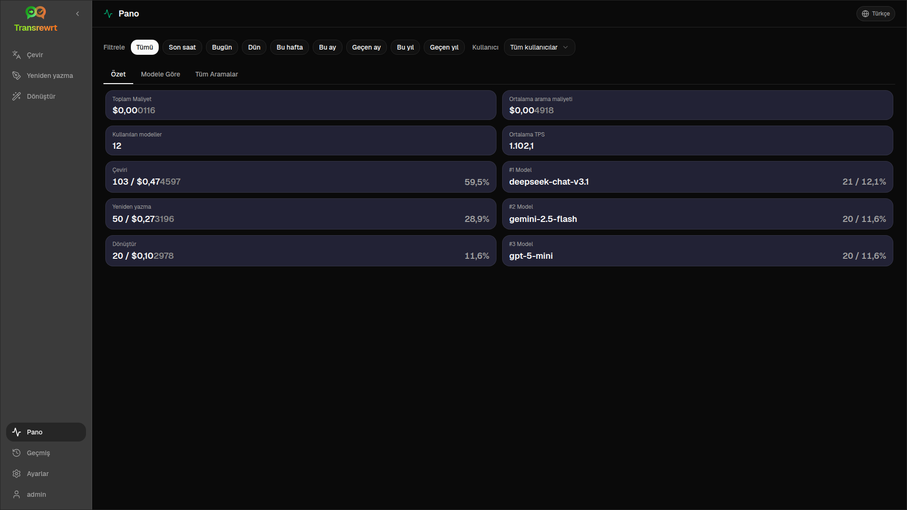

Uygulamayı ne kadar kullandığınızı ve maliyetini (ücretli modeller için) görmek için **Kontrol Paneli**'ni kullanın.

:::note
Ücretsiz modeller kullanıyorsanız, sağlayıcı maliyet takibini desteklemiyorsa veya yerel bir LLM kullanıyorsanız maliyet tutarları **0 $** olarak görünebilir. **Özet** bölümündeki çağrı sayısı KPI'ları gerçek kullanımı yansıtır; yalnızca seçilen dönemde etkinlik yoksa sıfır olurlar.
:::

## Verileri filtrele

Zaman aralığını değiştirmek için üstteki filtre düğmelerini kullanın.

**Kullanıcı** filtresi yalnızca web sürümündeki yöneticiler tarafından görülebilir; masaüstünde kullanılamaz.

## Sekmeler

- **Özet** — KPI'lar: toplam maliyet, kullanılan modeller, mod başına arama sayısı ve maliyeti, arama başına ortalama maliyet, ortalama TPS, arama sayısına göre en iyi modeller
- **Modele Göre** — model başına aramalar, maliyet ve TPS; mod dökümü için bir satırı genişletin
- **Tüm Aramalar** — dışa aktarma özellikli tam arama günlüğü (sayfalandırılmış veya kartlar)

## Verileri dışa aktar

Tabloları **JSON**, **CSV** veya **XLSX** olarak dışa aktarın.

## Bir model için depolanan kayıtları sil

**Modele Göre** veya **Tüm Aramalar** bölümünde, bir modele ait kayıtları kaldırmak için çöp kutusu simgesini kullanın.

:::caution
Silme işlemi geri alınamaz. Yaşa göre silmek veya tüm maliyet verilerini temizlemek için [Ayarlar → Maliyet Takibi](/docs/settings/#cost-tracking) bölümünü kullanın.
:::

## Sonraki adımlar

- [Geçmişe Göz At](/docs/history/)
- [Ayarlar](/docs/settings/)
- [Sık karşılaşılan sorunlar](/docs/common-issues/)
