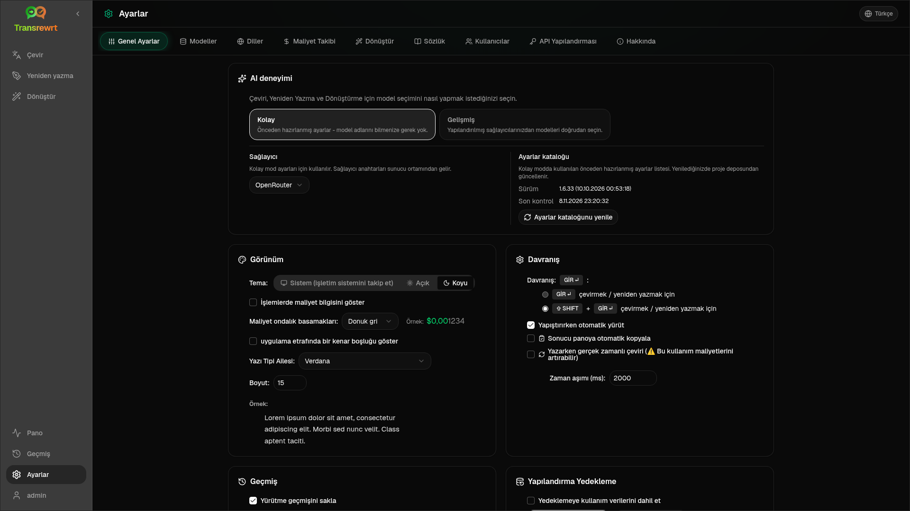

Uygulamanın nasıl davrandığını özelleştirmek için kenar çubuğundan **Ayarlar**'ı açın.

| Sekme | Masaüstü | Web (yönetici) | Web (kullanıcı) | Notlar |
| --- | :---: | :---: | :---: | --- |
| Genel Ayarlar | ✓ | ✓ | ✓ | **AI deneyimi** (Kolay / Gelişmiş) içerir |
| Modeller | ✓ | ✓ | ✓ | Kolay'da ön ayarlı kartlar, Gelişmiş'te model tablosu |
| Diller | ✓ | ✓ | ✓ | |
| Maliyet Takibi | ✓ | ✓ | — | |
| Dönüştür | ✓ | ✓ | ✓ | İstemlerin toplu içe/dışa aktarımı |
| Sözlük | ✓ | ✓ | ✓ | Çeviri için terim çiftleri |
| Kullanıcılar | — | ✓ | — | |
| API Yapılandırması | ✓ | ✓ | — | |
| Hakkında | ✓ | ✓ | ✓ | |

**Kolay** modda, araç çubuğundaki ön ayarlardan ve Genel Ayarlar'daki **Sağlayıcı**'dan yapay zekayı seçin; **Modeller** sekmesi salt okunur ön ayarlı kartları gösterir.

:::note
Web sürümünde, her kullanıcının kendi yapılandırması (yapay zeka deneyimi, sağlayıcı, modeller/ön ayarlar, diller, seçenekler, istemler) vardır. Yapılan değişiklikler diğer kullanıcıları etkilemez.
:::

## Genel Ayarlar

**AI deneyimi**

- **Kolay** (varsayılan): bir **Sağlayıcı** seçin. Bulut sağlayıcıları araç çubuğu ön ayarlarını kullanır. **Yerel LLM** bunun yerine yüklü yerel modelleri listeler. **Ayarlar kataloğunu yenile** proje deposundan en son ön ayar listesini getirir.
  - **Ücretsiz (OpenRouter)** — mevcut ücretsiz modellere yönlendirilen sıfır maliyetli seçenek; kalite ve kullanılabilirlik değişebilir
  - **Standart** — hafif ve uygun maliyetli; kısa metinler, hızlı taslaklar ve yüksek hacimli kullanım için en iyisi
  - **Gelişmiş** — daha yüksek maliyetle karmaşık veya incelikli içerik için yüksek doğruluklu model
  - **Teknik** — kod, API'ler, geliştirici belgeleri ve yapılandırılmış içerik için ayarlanmıştır; biçimlendirmeyi ve terminolojiyi korur
- **Gelişmiş**: araç çubuğundan modelleri seçin; listeyi [Modeller](#models) altında yönetin.

Araç çubuğu ön ayar/model menüsünden de Kolay ↔ Gelişmiş arasında geçiş yapabilirsiniz (**Kolay/Gelişmiş moda geç**, Ayarları Aç'ın üstünde).

**Görünüm** — Tema; **Eylemlerde maliyet bilgilerini göster**; **Maliyet kesir basamakları**; uygulama çevresindeki yalnızca web kenar boşluğu; **Yazı Tipi Ailesi** ve **Boyutu**.

**Davranış** — **Davranış: ENTER**; **Yapıştırırken otomatik yürüt**; **Sonucu panoya otomatik kopyala**; **Yazarken gerçek zamanlı çeviri**; **Zaman aşımı (ms)**.

**Geçmiş**

- **Yürütme geçmişini sakla** — [Geçmiş](/docs/history/) görünümü için girdi/çıktıyı depolar. Kapatmak onay ister ve depolanan metni kaldırabilir. *Yönetici tarafından devre dışı bırakıldı* olarak etiketlenmişse, `HISTORY_DISABLED` ayarlanır — bkz. [Yapılandırma](/docs/configuration/#privacy-mode).
- **Geçmiş verilerini sil** — depolanan metni yaşa göre kaldırın veya tümünü temizleyin. Maliyet toplamlarını **silmez** (bunun için Maliyet Takibini kullanın).

**Yapılandırma Yedeklemesi** (masaüstü ve web yöneticileri)

- İsteğe bağlı **Yedeklemeye kullanım verilerini dahil et**
- **Yapılandırmayı yedekle** — yapılandırma, durum, kullanıcılar, tercihler, istemler ve isteğe bağlı kullanım verileri içeren ZIP
- **Yedekten geri yükle** — kullanım verilerini geri yükleme ve/veya temizleme seçenekleriyle onay iletişim kutusu

Yedeklemeler masaüstü ve web arasında taşınabilir; web'de bir masaüstü yedeklemesini geri yüklemek, verileri yönetici kullanıcısına uygular.

## Modeller

**Modeller** sekmesi her zaman listelenir. **Kolay / Gelişmiş** geçiş düğmesi, uygulamanın tamamını iki [yapay zeka deneyimi](#general-settings) arasında değiştirir.

- **Kolay**, ön ayar başına bir salt okunur kart gösterir (örneğin **Ücretsiz (OpenRouter)** veya **Standart**). Her kart, yapılandırdığınız her sağlayıcı için ön ayarın ana ve yedek modelini listeler. **Sağlayıcı** çipleri kartları filtreler.
- **Gelişmiş**, her modelin bir tablosunu gösterir, şunlarla birlikte:
  - bir arama kutusu, **Sağlayıcı** çipleri, **Yalnızca Ücretsiz**, **Yalnızca seçilenler** ve **Yenile**
  - bir sıralama menüsü; varsayılan **Endeks: Yüksekten Düşüğe**'dir
  - her model için seçmek veya seçimini kaldırmak için bir onay kutusu
  - **Ön ayarlardan seçin**, bu, yapılandırılan her sağlayıcı için bir ön ayarın ana ve yedek modellerini ekler (**Tümünü yükle** her sağlayıcıyı yükler)
  - Önce onay isteyen **Tümünü Kaldır**
- Model kimlikleri bir sağlayıcı öneki kullanır (`openrouter/…`, `openai/…`, `local/…`, …)

Puan ve fiyat sütunları:

- **Dizin** — ChrF, Arena Puanı ve fiyattan harmanlanmış bir kalite puanı. Her sağlayıcı içinde sıralanır, bu nedenle sağlayıcılar arasında karşılaştırılamaz. Dizini olmayan modeller en alta sıralanır.
- **ChrF** — uygulamanın kullanıcı arayüzü dilleri için [languagebench](https://huggingface.co/spaces/fair-forward/languagebench)'ten ortalama çeviri kalitesi.
- **Arena** — [LMArena](https://huggingface.co/datasets/lmarena-ai/leaderboard-dataset) liderlik tablosundan Arena Puanı.
- **Giriş** / **Çıkış** — sağlayıcı kataloğundan veya [models.dev](https://models.dev/)'den 1 milyon jeton başına USD cinsinden fiyat. Tahmini bir fiyat yıldız işaretiyle işaretlenir. Bir çizgi (—) fiyatın bilinmediği anlamına gelir; yerel modeller "maliyetsiz - yerel" gösterir.

Veri kaynağını ve lisansını görmek için bir sütun başlığının üzerine gelin. Araç çubuğundaki model seçici, her modelin Dizinini küçük bir çip olarak gösterir; ChrF ve Arena değerleri için üzerine gelin.

Puanlar yalnızca bir rehberdir: kapsam eksiktir ve birçok modelin ChrF veya Arena puanı yoktur.

:::tip
Çeviri, Yeniden Yazma veya Dönüştürme için OpenRouter **Body Builder** (`openrouter/bodybuilder`) kullanmayın; bitmiş metin değil, JSON istek yükleri döndürür.
:::

Bir modeli seçmek veya seçimini kaldırmak için işaretleyin veya işaretini kaldırın. OpenRouter ücretsiz modeli isteğe bağlıdır — seçili modeller boş olabilir. Araç çubuğundan son modeli kaldırmak **Ayarlar → Modeller**'i açar. Mevcut model kullanılamaz hale gelirse, uygulama ücretsiz modeli zorlamak yerine listedeki bir sonraki modeli seçer.

## Diller

- **En çok kullanılan diller** — Çeviri ve Dönüştürme'deki dil listelerinin en üstüne sabitlenmiş
- **Özel dil** — yerleşik listede bulunmayan bir dil ekleyin

## Maliyet takibi

- **Toplam Maliyet**, **Değeri Kopyala**, **Maliyeti Sıfırla**
- **API anahtarı kullanımıyla senkronize et** — OpenRouter hesap kullanımıyla uyumlu hale getir (yalnızca OpenRouter)
- **API Anahtarı Kullanımı** — mevcut olduğunda OpenRouter ayrıntıları
- **Maliyet verilerini sil** — tüm veriler veya belirli bir tarihten eski girişler

OpenRouter ve xAI, API döndürdüğünde gerçek faturalandırılan maliyeti gösterir; diğer sağlayıcılar [models.dev](https://models.dev/) fiyatlandırmasından tahminleri kullanır. Tahminler fatura değildir.

:::caution
Maliyet verilerinin silinmesi geri alınamaz. Bir yedeğe ihtiyacınız varsa önce Geçmiş veya Kontrol Paneli → Tüm Çağrılar aracılığıyla dışa aktarın. Bu API çağrıları için ilgili girdi/çıktı geçmişi de kaldırılır.
:::

## Dönüştür

İstemleri toplu olarak yönetin: inceleyin, silin, içe aktarın, dışa aktarın ve örnek istemleri yükleyin.

## Terimler Sözlüğü

[Çeviri](/docs/translate/#use-the-glossary) sırasında uygulanan terim çiftlerini yönetin. Her terimin kaynak/hedef dili ve kaynak/hedef metni vardır.

- Alt satır ve **+** aracılığıyla ekleyin
- Dillere veya metne göre filtreleyin
- CSV veya XLSX içe/dışa aktarın; boş şablonları indirin

Masaüstü, terimler sözlüğünü yerel olarak depolar; web, kullanıcı başına depolar.

## Kullanıcılar

Yalnızca web (yöneticiler):

- Kullanıcı ekleyin, ayrıntıları güncelleyin, parolaları sıfırlayın, hesapları silin
- **Oturum Zaman Aşımı** — bir oturumun ne kadar sürdüğü (1 saatten 7 güne kadar); değişiklikler yalnızca yeni oturumlara uygulanır
- **Oturumları İptal Et** — bir kullanıcıyı tüm cihazlardan hemen oturumdan çıkarın

Oturum açmış her kullanıcı (yönetici olmayanlar dahil), kenar çubuğunun altındaki kullanıcı menüsünden kendi parolasını değiştirebilir veya oturumu kapatabilir.

## API Yapılandırması

Yalnızca kullandığınız sağlayıcıları yapılandırın: OpenRouter, OpenAI, Anthropic, Google Gemini, DeepSeek, Groq, Mistral, xAI, Cerebras, NVIDIA, Alibaba Cloud, apikey.fun, **Yerel LLM** (Ollama, LM Studio, llama.cpp veya benzeri için temel URL) ve isteğe bağlı özel OpenAI uyumlu bir sağlayıcı.

**Web (yönetici):** anahtarlar ortam değişkenlerinden gelir — bu sayfa hangilerinin ayarlandığını gösterir ve **Test Etmenizi** sağlar. Ortam değişkenlerini değiştirdikten sonra yeniden başlatın. [Yapılandırma](/docs/configuration/) bölümüne bakın.

**Masaüstü:** anahtarları (veya Yerel LLM URL'sini) girin ve **Kaydet** / **Düzenle** / **Test Et**. Anahtarlar şifreli olarak saklanır; mevcut değeri görüntüleyemezsiniz, yalnızca değiştirebilirsiniz.

:::tip
Başlamak için ücretli bir anahtara gerek yok: ücretsiz OpenRouter modellerini, diğer ücretsiz katman sağlayıcılarını veya [Ollama](https://ollama.com), LM Studio veya llama.cpp (örn. `translategemma:4b`) gibi yerel bir OpenAI uyumlu sunucuyu kullanın.
:::

## Hakkında

Uygulama adı, sürüm, derleme tarihi, lisans, üçüncü taraf bildirimleri ve depo bağlantısı.
