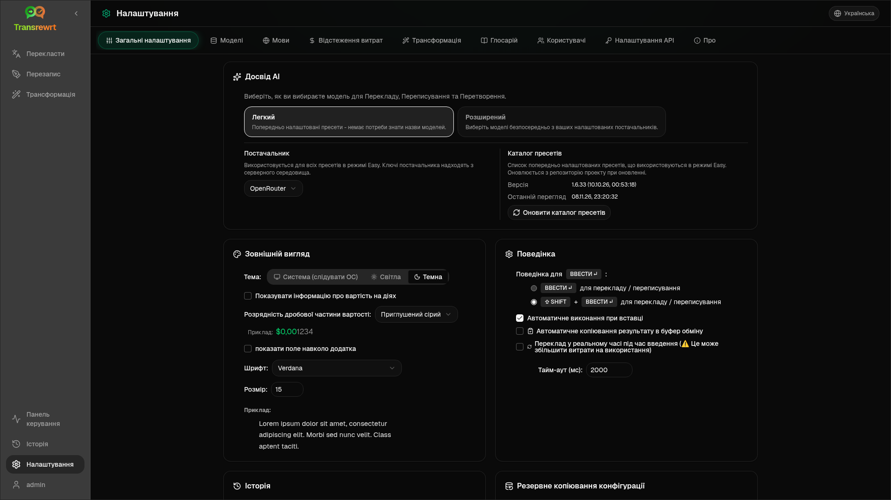

Відкрийте **Налаштування** з бічної панелі, щоб налаштувати поведінку програми.

| Вкладка | Десктоп | Веб (адміністратор) | Веб (користувач) | Примітки |
| --- | :---: | :---: | :---: | --- |
| Загальні налаштування | ✓ | ✓ | ✓ | Включає **Досвід AI** (Легкий / Розширений) |
| Моделі | ✓ | ✓ | ✓ | Попередньо встановлені картки в Easy, таблиця моделей в Advanced |
| Мови | ✓ | ✓ | ✓ | |
| Відстеження витрат | ✓ | ✓ | — | |
| Перетворення | ✓ | ✓ | ✓ | Масовий імпорт/експорт підказок |
| Глосарій | ✓ | ✓ | ✓ | Пари термінів для перекладу |
| Користувачі | — | ✓ | — | |
| Конфігурація API | ✓ | ✓ | — | |
| Про програму | ✓ | ✓ | ✓ | |

У режимі **Easy** виберіть ШІ за допомогою попередньо встановлених налаштувань на панелі інструментів і **Постачальника** в Загальних налаштуваннях; вкладка **Моделі** показує картки попередньо встановлених налаштувань лише для читання.

:::note
У веб-версії кожен користувач має власну конфігурацію (досвід ШІ, провайдер, моделі/пресети, мови, опції, підказки). Зміни не впливають на інших користувачів.
:::

## Загальні налаштування

**Досвід AI**

- **Легкий** (за замовчуванням): виберіть **Постачальника**. Хмарні провайдери використовують попередні налаштування панелі інструментів. **Local LLM** натомість перераховує встановлені локальні моделі. **Оновити каталог пресетів** отримує останній список пресетів з репозиторію проекту.
  - **Безкоштовно (OpenRouter)** — безкоштовний варіант, що направляється до доступних безкоштовних моделей; якість та доступність можуть відрізнятися
  - **Стандартний** — легкий та економічний; найкраще підходить для коротких текстів, швидких чернеток та великих обсягів використання
  - **Розширений** — високоточна модель для складного або нюансованого контенту, за вищою ціною
  - **Технічний** — налаштований для коду, API, документації розробника та структурованого контенту; зберігає форматування та термінологію
- **Розширений**: вибирайте моделі на панелі інструментів; керуйте списком у розділі [Моделі](#models).

Ви також можете перемикатися між Простим ↔ Розширеним режимами з меню попередніх налаштувань/моделей на панелі інструментів (**Переключити в Простий/Розширений режим**, над Відкритими налаштуваннями).

**Вигляд** — Тема; **Показувати інформацію про вартість у діях**; **Кількість знаків після коми для вартості**; відступи навколо програми лише для вебу; **Сімейство шрифтів** та **Розмір**.

**Поведінка** — **Поведінка для ENTER**; **Автоматичне виконання при вставці**; **Автоматичне копіювання результату в буфер обміну**; **Переклад у реальному часі під час набору тексту**; **Таймаут (мс)**.

**Історія**

- **Зберігати історію виконання** — зберігати вхідні/вихідні дані для перегляду [Історії](/docs/history/). Вимкнення вимагає підтвердження та може видалити збережений текст. Якщо позначено як *вимкнено адміністратором*, встановлено `HISTORY_DISABLED` — див. [Конфігурація](/docs/configuration/#privacy-mode).
- **Видалити дані історії** — видалити збережений текст за віком або очистити все. **Не** видаляє загальну вартість (для цього використовуйте відстеження витрат).

**Резервне копіювання конфігурації** (адміністратори настільних та веб-версій)

- Додатково **Включити дані використання в резервну копію**
- **Створити резервну копію конфігурації** — ZIP-архів з конфігурацією, станом, користувачами, налаштуваннями, підказками та додатковими даними використання
- **Відновити з резервної копії** — діалогове вікно підтвердження з опціями відновлення та/або очищення даних використання

Резервні копії можна переміщувати між настільною та веб-версіями; відновлення резервної копії настільної версії у веб-версії застосовує дані до облікового запису адміністратора.

## Моделі

Вкладка **Моделі** завжди відображається. Її перемикач **Easy / Advanced** перемикає всю програму між двома [інтерфейсами ШІ](#general-settings).

- **Легкий** показує одну картку лише для читання на кожен пресет (наприклад, **Безкоштовно (OpenRouter)** або **Стандартний**). Кожна картка містить основну та запасну модель пресету для кожного налаштованого вами постачальника. Чіпи **Постачальник** фільтрують картки.
- **Розширений** показує одну таблицю всіх моделей, з:
  - полем пошуку, чіпами **Постачальник**, **Тільки безкоштовні**, **Лише вибрані** та **Оновити**
  - меню сортування; за замовчуванням **Індекс: від найвищого до найнижчого**
  - прапорцем для кожної моделі, щоб вибрати або зняти вибір
  - **Вибрати з пресетів**, що додає основні та запасні моделі пресету для кожного налаштованого постачальника (**Завантажити все** завантажує всіх постачальників)
  - **Зняти вибір усіх**, що спочатку запитує підтвердження
- Ідентифікатори моделей використовують префікс постачальника (`openrouter/…`, `openai/…`, `local/…`, …)

Стовпці оцінки та ціни:

- **Індекс** — оцінка якості, що поєднує ChrF, Arena Score та ціну. Вона ранжується в межах кожного постачальника, тому не порівнюється між постачальниками. Моделі без індексу сортуються внизу.
- **ChrF** — середня якість перекладу з [languagebench](https://huggingface.co/spaces/fair-forward/languagebench) для мов інтерфейсу програми.
- **Arena** — Arena Score з таблиці лідерів [LMArena](https://huggingface.co/datasets/lmarena-ai/leaderboard-dataset).
- **Вхід** / **Вихід** — ціна в доларах США за 1 мільйон токенів, з каталогу постачальника або [models.dev](https://models.dev/). Орієнтовна ціна позначається зірочкою. Прочерк (—) означає, що ціна невідома; локальні моделі показують «безкоштовно - локально».

Наведіть курсор на заголовок стовпця, щоб побачити його джерело даних та ліцензію. Селектор моделі на панелі інструментів показує індекс кожної моделі як невелику фішку; наведіть на неї курсор, щоб побачити значення ChrF та Arena.

Оцінки є лише орієнтиром: охоплення неповне, і багато моделей не мають оцінки ChrF або Arena.

:::tip
Не використовуйте OpenRouter **Body Builder** (`openrouter/bodybuilder`) для перекладу, переписування або трансформації — він повертає корисні дані запиту JSON, а не готовий текст.
:::

Поставте або зніміть прапорець біля моделі, щоб вибрати або скасувати її вибір. Безкоштовна модель OpenRouter є необов’язковою — вибрані моделі можуть бути порожніми. Видалення останньої моделі з панелі інструментів відкриває **Налаштування → Моделі**. Якщо поточна модель стає недоступною, програма вибирає наступну модель у списку замість того, щоб примусово використовувати безкоштовну модель.

## Мови

- **Найпопулярніші мови** — закріплені біля верхньої частини списків мов у розділах Перекласти та Трансформація
- **Користувацька мова** — додайте мову, якої немає у вбудованому списку

## Відстеження витрат

- **Загальна вартість**, **Копіювати значення**, **Скинути вартість**
- **Синхронізувати з використанням API-ключа** — узгодити з використанням облікового запису OpenRouter (лише OpenRouter)
- **Використання API-ключа** — деталі OpenRouter, якщо доступні
- **Видалити дані про вартість** — усі дані або записи, старші за певну дату

OpenRouter та xAI показують фактичну вартість, коли API її повертає; інші постачальники використовують оцінки цін з [models.dev](https://models.dev/). Оцінки не є рахунками-фактурами.

:::caution
Видалення даних про вартість не можна скасувати. Спочатку експортуйте через Історію або Панель інструментів → Усі виклики, якщо вам потрібна резервна копія. Пов'язана історія вхідних/вихідних даних для цих викликів API також видаляється.
:::

## Трансформація

Масове керування підказками: перегляд, видалення, імпорт, експорт та завантаження зразків підказок.

## Глосарій

Керуйте парами термінів, застосованими під час [перекладу](/docs/translate/#use-the-glossary). Кожен термін має вихідну/цільову мову та вихідний/цільовий текст.

- Додайте за допомогою нижнього рядка та **+**
- Фільтруйте за мовами або текстом
- Імпортуйте/експортуйте CSV або XLSX; завантажуйте порожні шаблони

Настільна версія зберігає глосарій локально; веб-версія зберігає його для кожного користувача.

## Користувачі

Тільки веб-версія (адміністратори):

- Додавати користувачів, оновлювати деталі, скидати паролі, видаляти облікові записи
- **Час очікування сеансу** — як довго триває вхід (від 1 години до 7 днів); зміни застосовуються лише до нових входів
- **Скасувати сеанси** — негайно вийти з облікового запису користувача на всіх пристроях

Кожен авторизований користувач (включно з неадміністраторами) може змінити свій пароль або вийти з системи через меню користувача внизу бічної панелі.

## Налаштування API

Налаштовуйте лише ті провайдери, які ви використовуєте: OpenRouter, OpenAI, Anthropic, Google Gemini, DeepSeek, Groq, Mistral, xAI, Cerebras, NVIDIA, Alibaba Cloud, apikey.fun, **Local LLM** (базова URL-адреса для Ollama, LM Studio, llama.cpp або подібних) та додатковий користувацький провайдер, сумісний з OpenAI.

**Веб (адміністратор):** ключі надходять із змінних середовища — ця сторінка показує, які з них встановлені, і дозволяє **Тестувати**. Перезапустіть після зміни змінних середовища. Дивіться [Конфігурація](/docs/configuration/).

**Настільна версія:** введіть ключі (або URL-адресу Local LLM) та **Зберегти** / **Редагувати** / **Тестувати**. Ключі зберігаються в зашифрованому вигляді; ви не можете переглянути поточне значення, лише замінити його.

:::tip
Для початку не потрібен платний ключ: використовуйте безкоштовні моделі OpenRouter, інші безкоштовні провайдери або локальний сервер, сумісний з OpenAI, такий як [Ollama](https://ollama.com), LM Studio або llama.cpp (наприклад, `translategemma:4b`).
:::

## Про програму

Назва програми, версія, дата збірки, ліцензія, повідомлення третіх сторін та посилання на репозиторій.
