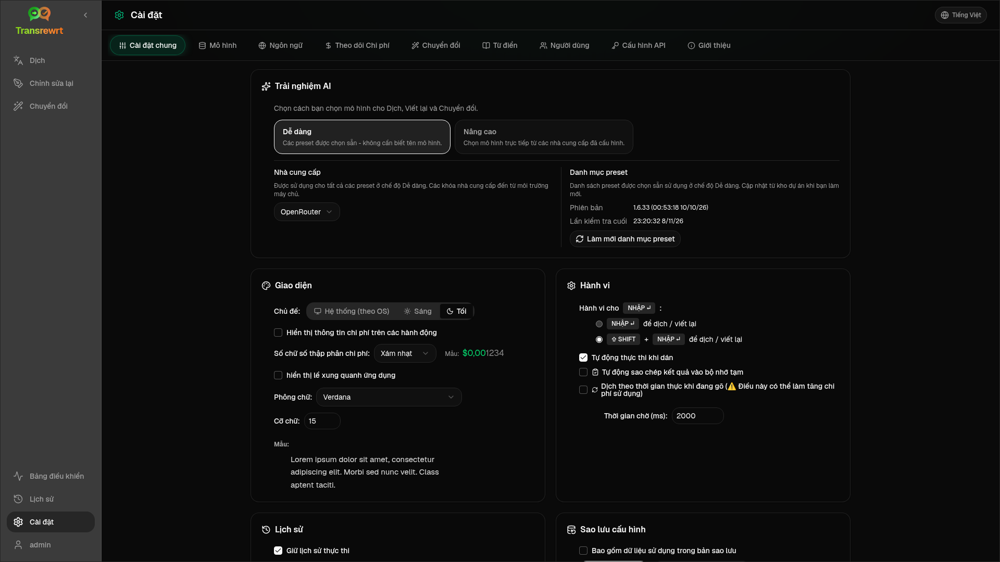

Mở **Cài đặt** từ thanh bên để tùy chỉnh cách ứng dụng hoạt động.

| Tab | Desktop | Web (admin) | Web (user) | Ghi chú |
| --- | :---: | :---: | :---: | --- |
| Cài đặt chung | ✓ | ✓ | ✓ | Bao gồm **trải nghiệm AI** (Dễ / Nâng cao) |
| Mô hình | ✓ | ✓ | ✓ | Thẻ cài đặt sẵn ở chế độ Dễ, bảng mô hình ở chế độ Nâng cao |
| Ngôn ngữ | ✓ | ✓ | ✓ | |
| Theo dõi chi phí | ✓ | ✓ | — | |
| Chuyển đổi | ✓ | ✓ | ✓ | Nhập/xuất hàng loạt lời nhắc |
| Thuật ngữ | ✓ | ✓ | ✓ | Các cặp thuật ngữ để dịch |
| Người dùng | — | ✓ | — | |
| Cấu hình API | ✓ | ✓ | — | |
| Giới thiệu | ✓ | ✓ | ✓ | |

Ở chế độ **Dễ**, chọn AI qua các cài đặt sẵn trên thanh công cụ và **Nhà cung cấp** trong Cài đặt chung; tab **Mô hình** hiển thị các thẻ cài đặt sẵn chỉ đọc.

:::note
Trong phiên bản web, mỗi người dùng có cấu hình riêng (trải nghiệm AI, nhà cung cấp, mô hình/cài đặt trước, ngôn ngữ, tùy chọn, lời nhắc). Các thay đổi không ảnh hưởng đến người dùng khác.
:::

## Cài đặt chung

**Trải nghiệm AI**

- **Dễ dàng** (mặc định): chọn một **Nhà cung cấp**. Các nhà cung cấp đám mây sử dụng các cài đặt trước trên thanh công cụ. **Local LLM** liệt kê các mô hình cục bộ đã cài đặt. **Làm mới danh mục preset** tìm nạp danh sách cài đặt trước mới nhất từ kho lưu trữ dự án.
  - **Miễn phí (OpenRouter)** — tùy chọn không mất phí được định tuyến đến các mô hình miễn phí có sẵn; chất lượng và tính khả dụng có thể thay đổi
  - **Tiêu chuẩn** — nhẹ và tiết kiệm chi phí; tốt nhất cho các văn bản ngắn, bản nháp nhanh và sử dụng với số lượng lớn
  - **Nâng cao** — mô hình có độ chính xác cao cho nội dung phức tạp hoặc sắc thái, với chi phí cao hơn
  - **Kỹ thuật** — được điều chỉnh cho mã, API, tài liệu dành cho nhà phát triển và nội dung có cấu trúc; giữ nguyên định dạng và thuật ngữ
- **Nâng cao**: chọn các mô hình trên thanh công cụ; quản lý danh sách trong [Mô hình](#models).

Bạn cũng có thể chuyển đổi Dễ ↔ Nâng cao từ menu cài đặt trước/mô hình trên thanh công cụ (**Chuyển sang chế độ Dễ/Nâng cao**, phía trên Mở Cài đặt).

**Giao diện** — Chủ đề; **Hiển thị thông tin chi phí trên các hành động**; **Số chữ số thập phân của chi phí**; lề chỉ dành cho web xung quanh ứng dụng; **Họ phông chữ** và **Kích thước**.

**Hành vi** — **Hành vi cho ENTER**; **Tự động thực thi khi dán**; **Tự động sao chép kết quả vào bộ nhớ tạm**; **Dịch theo thời gian thực khi gõ**; **Thời gian chờ (ms)**.

**Lịch sử**

- **Giữ lịch sử thực thi** — lưu trữ đầu vào/đầu ra cho chế độ xem [Lịch sử](/docs/history/). Tắt tính năng này sẽ yêu cầu xác nhận và có thể xóa văn bản đã lưu trữ. Nếu được gắn nhãn *bị quản trị viên vô hiệu hóa*, `HISTORY_DISABLED` được đặt — xem [Cấu hình](/docs/configuration/#privacy-mode).
- **Xóa dữ liệu lịch sử** — xóa văn bản đã lưu trữ theo tuổi hoặc xóa tất cả. **Không** xóa tổng chi phí (sử dụng Theo dõi chi phí cho việc đó).

**Sao lưu cấu hình** (quản trị viên máy tính để bàn và web)

- Tùy chọn **Bao gồm dữ liệu sử dụng trong bản sao lưu**
- **Sao lưu cấu hình** — ZIP với cấu hình, trạng thái, người dùng, tùy chọn, lời nhắc và dữ liệu sử dụng tùy chọn
- **Khôi phục từ bản sao lưu** — hộp thoại xác nhận với các tùy chọn để khôi phục và/hoặc xóa dữ liệu sử dụng

Các bản sao lưu có thể di chuyển giữa máy tính để bàn và web; khôi phục bản sao lưu máy tính để bàn trên web áp dụng dữ liệu cho người dùng quản trị viên.

## Mô hình

Tab **Mô hình** luôn được liệt kê. Nút chuyển đổi **Dễ / Nâng cao** của tab này sẽ chuyển đổi toàn bộ ứng dụng giữa hai [trải nghiệm AI](#general-settings).

- **Dễ dàng** hiển thị một thẻ chỉ đọc cho mỗi cài đặt trước (ví dụ: **Miễn phí (OpenRouter)** hoặc **Tiêu chuẩn**). Mỗi thẻ liệt kê mô hình chính và mô hình dự phòng của cài đặt trước đó cho mọi nhà cung cấp bạn đã cấu hình. Các chip **Nhà cung cấp** lọc các thẻ.
- **Nâng cao** hiển thị một bảng của mọi mô hình, với:
  - một hộp tìm kiếm, các chip **Nhà cung cấp**, **Chỉ miễn phí**, **Chỉ mục đã chọn** và **Làm mới**
  - một menu sắp xếp; mặc định là **Chỉ mục từ cao đến thấp**
  - một hộp kiểm cho mỗi mô hình để chọn hoặc bỏ chọn
  - **Chọn từ cài đặt sẵn**, thêm các mô hình chính và mô hình dự phòng của cài đặt trước cho mỗi nhà cung cấp đã cấu hình (**Tải tất cả** tải mọi nhà cung cấp)
  - **Bỏ chọn tất cả**, yêu cầu xác nhận trước
- ID mô hình sử dụng tiền tố nhà cung cấp (`openrouter/…`, `openai/…`, `local/…`, …)

Các cột điểm và giá:

- **Chỉ số** — điểm chất lượng được pha trộn từ ChrF, Điểm Arena và giá. Nó được xếp hạng trong mỗi nhà cung cấp, vì vậy không thể so sánh giữa các nhà cung cấp. Các mô hình không có Chỉ số sẽ được sắp xếp xuống cuối.
- **ChrF** — chất lượng dịch trung bình từ [languagebench](https://huggingface.co/spaces/fair-forward/languagebench) cho các ngôn ngữ giao diện người dùng của ứng dụng.
- **Arena** — Điểm Arena từ bảng xếp hạng [LMArena](https://huggingface.co/datasets/lmarena-ai/leaderboard-dataset).
- **Đầu vào** / **Đầu ra** — giá bằng USD trên 1 triệu token, từ danh mục nhà cung cấp hoặc [models.dev](https://models.dev/). Giá ước tính được đánh dấu bằng dấu hoa thị. Dấu gạch ngang (—) có nghĩa là giá không xác định; các mô hình cục bộ hiển thị "không có chi phí - cục bộ".

Di chuột qua tiêu đề cột để xem nguồn dữ liệu và giấy phép của nó. Bộ chọn mô hình trên thanh công cụ hiển thị Chỉ số của mỗi mô hình dưới dạng một chip nhỏ; di chuột qua nó để xem các giá trị ChrF và Arena.

Điểm chỉ là hướng dẫn: phạm vi không đầy đủ và nhiều mô hình không có điểm ChrF hoặc Arena.

:::tip
Không sử dụng OpenRouter **Body Builder** (`openrouter/bodybuilder`) cho Translate, Rewrite hoặc Transform — nó trả về các tải trọng yêu cầu JSON, không phải văn bản hoàn chỉnh.
:::

Đánh dấu hoặc bỏ đánh dấu một mô hình để chọn hoặc bỏ chọn nó. Mô hình miễn phí OpenRouter là tùy chọn — các mô hình đã chọn có thể trống. Xóa mô hình cuối cùng khỏi thanh công cụ sẽ mở **Cài đặt → Mô hình**. Nếu mô hình hiện tại không khả dụng, ứng dụng sẽ chọn mô hình tiếp theo trong danh sách thay vì buộc sử dụng mô hình miễn phí.

## Ngôn ngữ

- **Ngôn ngữ hàng đầu** — được ghim gần đầu danh sách ngôn ngữ trong Dịch và Chuyển đổi
- **Ngôn ngữ tùy chỉnh** — thêm ngôn ngữ bị thiếu trong danh sách tích hợp sẵn

## Theo dõi chi phí

- **Tổng chi phí**, **Sao chép giá trị**, **Đặt lại Chi phí**
- **Đồng bộ với sử dụng API key** — căn chỉnh với việc sử dụng tài khoản OpenRouter (chỉ OpenRouter)
- **Sử dụng API Key** — chi tiết OpenRouter khi có sẵn
- **Xóa dữ liệu chi phí** — tất cả dữ liệu hoặc các mục cũ hơn một ngày

OpenRouter và xAI hiển thị chi phí thực tế được lập hóa đơn khi API trả về; các nhà cung cấp khác sử dụng ước tính từ giá của [models.dev](https://models.dev/). Ước tính không phải là hóa đơn.

:::caution
Việc xóa dữ liệu chi phí không thể hoàn tác. Xuất qua Lịch sử hoặc Bảng điều khiển → Tất cả cuộc gọi trước nếu bạn cần sao lưu. Lịch sử đầu vào/đầu ra liên quan cho các cuộc gọi API đó cũng bị xóa.
:::

## Chuyển đổi

Quản lý hàng loạt lời nhắc: xem xét, xóa, nhập, xuất và tải các lời nhắc mẫu.

## Thuật ngữ

Quản lý các cặp thuật ngữ được áp dụng trong quá trình [dịch](/docs/translate/#use-the-glossary). Mỗi thuật ngữ có ngôn ngữ nguồn/đích và văn bản nguồn/đích.

- Thêm qua hàng dưới cùng và **+**
- Lọc theo ngôn ngữ hoặc văn bản
- Nhập/xuất CSV hoặc XLSX; tải xuống các mẫu trống

Máy tính để bàn lưu trữ bảng thuật ngữ cục bộ; web lưu trữ theo từng người dùng.

## Người dùng

Chỉ web (quản trị viên):

- Thêm người dùng, cập nhật chi tiết, đặt lại mật khẩu, xóa tài khoản
- **Thời gian chờ phiên** — thời gian đăng nhập kéo dài (1 giờ đến 7 ngày); các thay đổi chỉ áp dụng cho các lần đăng nhập mới
- **Thu hồi phiên** — đăng xuất người dùng khỏi tất cả các thiết bị ngay lập tức

Mọi người dùng đã đăng nhập (bao gồm cả những người không phải quản trị viên) đều có thể thay đổi mật khẩu của mình hoặc đăng xuất khỏi menu người dùng ở cuối thanh bên.

## Cấu hình API

Chỉ định cấu hình các nhà cung cấp bạn sử dụng: OpenRouter, OpenAI, Anthropic, Google Gemini, DeepSeek, Groq, Mistral, xAI, Cerebras, NVIDIA, Alibaba Cloud, apikey.fun, **LLM cục bộ** (URL cơ sở cho Ollama, LM Studio, llama.cpp hoặc tương tự) và một nhà cung cấp tương thích OpenAI tùy chỉnh tùy chọn.

**Web (quản trị viên):** khóa đến từ các biến môi trường — trang này hiển thị những khóa nào đã được đặt và cho phép bạn **Kiểm tra**. Khởi động lại sau khi thay đổi biến môi trường. Xem [Cấu hình](/docs/configuration/).

**Máy tính để bàn:** nhập khóa (hoặc URL LLM cục bộ) và **Lưu** / **Chỉnh sửa** / **Kiểm tra**. Khóa được lưu trữ được mã hóa; bạn không thể xem giá trị hiện tại, chỉ có thể thay thế nó.

:::tip
Không cần khóa trả phí để bắt đầu: sử dụng các mô hình OpenRouter miễn phí, các nhà cung cấp miễn phí khác hoặc máy chủ tương thích OpenAI cục bộ như [Ollama](https://ollama.com), LM Studio hoặc llama.cpp (ví dụ: `translategemma:4b`).
:::

## Giới thiệu

Tên ứng dụng, phiên bản, ngày xây dựng, giấy phép, thông báo của bên thứ ba và liên kết kho lưu trữ.
