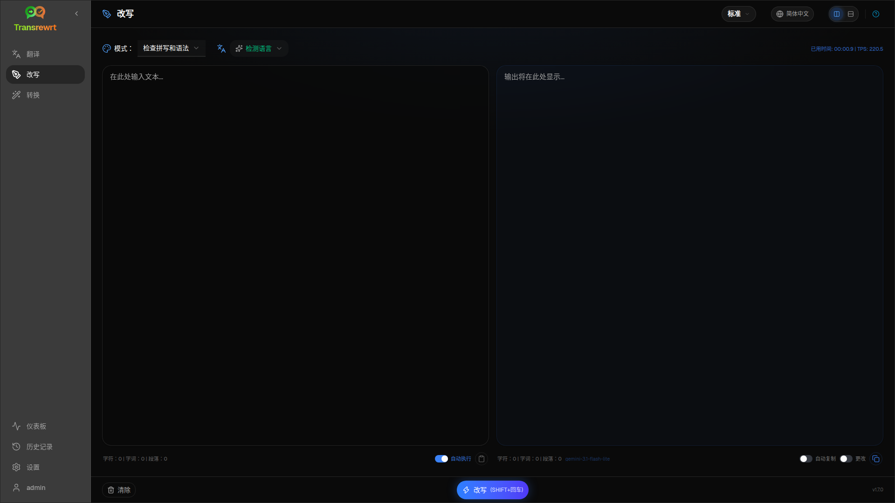

使用 **重写** 可在不改变主要含义的情况下改进措辞。文本保持同一语言。

模式包括：

- **检查拼写和语法**
- **提高清晰度**
- **其他版本**（一次运行提供多个改写版本）
- **设为正式** / **设为非正式**
- **缩短** / **扩展**
- **设为技术**

## 重写文本

1. 打开 **重写**。
2. 选择一个 **模式**。
3. 可选：将 **源语言** 设为你的文本所用语言（或保留 **自动检测语言**）。
4. 在 **输入** 中输入或粘贴文本。
5. 点击 **重写**。
6. 在 **输出** 中查看结果。

[布局切换和键盘快捷键](/docs/translate/#layout-and-keyboard) 的使用方式与翻译相同。

:::tip
重写完成后，**复制** 旁边会显示一个 **显示更改**（**更改**）开关，适用于 **每个** 重写模式。切换该开关可显示或隐藏输入与输出之间的差异。
:::

:::note
**其他版本**会在**单次**运行中返回多个改写版本，以 `----` 分隔。这与 **改写…** 不同，后者会随时间生成版本历史记录。
:::

## 优化重写

成功运行后，输出侧会显示 **重新表述…** 和版本下拉菜单（与 [翻译](/docs/translate/#refine-a-translation) 的思路相同，但文本保持同一语言并沿用当前 **模式**）：

1. **改写…**（无选择内容）— 另一种使用不同措辞的完整重写。最多五个版本。点击 **停止重写** 取消。
2. **词语替换** — 选择文本，然后右键单击或 **改写…**。
3. 每个请求可能会增加使用成本。

## 后续步骤

- [翻译文本](/docs/translate/)
- [通过提示词转换](/docs/transform/)
- [常见问题](/docs/common-issues/)
