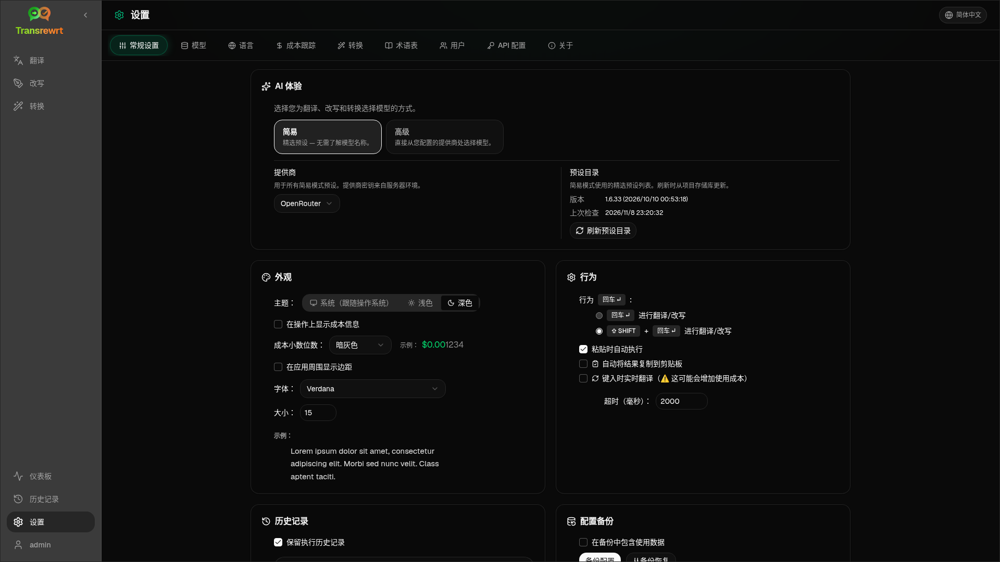

从侧边栏打开 **设置** 以自定义应用的行为。

| 选项卡 | 桌面版 | 网页版（管理员） | 网页版（用户） | 备注 |
| --- | :---: | :---: | :---: | --- |
| 常规设置 | ✓ | ✓ | ✓ | 包含 **AI 体验**（简易 / 高级） |
| 模型 | ✓ | ✓ | ✓ | 简易模式中的预设卡片，高级模式中的模型表格 |
| 语言 | ✓ | ✓ | ✓ | |
| 成本跟踪 | ✓ | ✓ | — | |
| 转换 | ✓ | ✓ | ✓ | 提示词的批量导入/导出 |
| 术语表 | ✓ | ✓ | ✓ | 用于翻译的术语对 |
| 用户 | — | ✓ | — | |
| API 配置 | ✓ | ✓ | — | |
| 关于 | ✓ | ✓ | ✓ | |

在 **简易** 模式下，通过工具栏中的预设选择 AI，并在通用设置中选择 **提供商**；**模型** 标签页显示只读的预设卡片。

:::note
在网页版中，每个用户都有自己的配置（AI 体验、提供商、模型/预设、语言、选项、提示词）。更改不会影响其他用户。
:::

## 常规设置

**AI 体验**

- **Easy**（默认）：选择一个**Provider**。云提供商使用工具栏预设。**本地 LLM**则列出已安装的本地模型。**刷新预设目录**从项目仓库获取最新的预设列表。
  - **Free (OpenRouter)** — 路由到可用免费模型的零成本选项；质量和可用性可能有所不同
  - **Standard** — 轻量且高性价比；最适合短文本、快速草稿和高频使用
  - **Advanced** — 适用于复杂或细微内容的高精度模型，成本较高
  - **Technical** — 针对代码、API、开发者文档和结构化内容进行调优；保留格式和术语
- **Advanced**：在工具栏中挑选模型；在[模型](#models)下管理列表。

您也可以通过工具栏的预设/模型菜单切换简易 ↔ 高级（**切换到简易/高级模式**，位于打开设置上方）。

**外观** — 主题；**在操作上显示费用信息**；**费用小数位数**；仅网页版的应用外边距；**字体族**和**大小**。

**行为** — **ENTER 行为**；**粘贴时自动执行**；**自动将结果复制到剪贴板**；**输入时实时翻译**；**超时 (ms)**。

**历史**

- **保留执行历史记录** — 为[历史记录](/docs/history/)视图存储输入/输出。关闭时会要求确认，并可能移除已存储的文本。如果标记为*已被管理员禁用*，则设置了 `HISTORY_DISABLED` — 参见[配置](/docs/configuration/#privacy-mode)。
- **删除历史记录数据** — 按存在时间移除已存储的文本或清除全部。**不会**删除成本总计（为此请使用成本跟踪）。

**配置备份**（桌面版和网页版管理员）

- 可选的 **在备份中包含使用数据**
- **备份配置** — 包含配置、状态、用户、偏好设置、提示词以及可选使用数据的 ZIP 文件
- **从备份恢复** — 带有恢复和/或清除使用数据选项的确认对话框

备份可在桌面版和网页版之间迁移；在网页版恢复桌面版备份时，数据会应用到管理员用户。

## 模型

**模型** 标签页始终显示。其 **简易 / 高级** 切换开关可在两种 [AI 体验](#general-settings) 之间切换整个应用。

- **Easy** 为每个预设显示一张只读卡片（例如 **Free (OpenRouter)** 或 **Standard**）。每张卡片列出了您已配置的每个提供商的该预设主模型和备用模型。**Provider** 筛选标签用于筛选卡片。
- **Advanced** 显示包含每个模型的表格，具有：
  - 搜索框、**Provider** 筛选标签、**仅免费**、**仅选中** 和 **Refresh**
  - 排序菜单；默认为 **索引从高到低**
  - 每个模型对应一个复选框，用于选择或取消选择
  - **从预设中选择**，为每个已配置的提供商添加预设的主模型和备用模型（**全部加载** 加载所有提供商）
  - **取消全选**，此操作会先要求确认
- 模型 ID 使用提供商前缀（`openrouter/…`、`openai/…`、`local/…`、…）

评分和价格列：

- **索引** — 由 ChrF、Arena Score 和价格综合得出的质量评分。它在每个提供商内排名，因此不可跨提供商比较。没有索引的模型排在最底部。
- **ChrF** — 来自 [languagebench](https://huggingface.co/spaces/fair-forward/languagebench) 的应用界面语言平均翻译质量。
- **Arena** — 来自 [LMArena](https://huggingface.co/datasets/lmarena-ai/leaderboard-dataset) 排行榜的 Arena Score。
- **输入** / **输出** — 每百万 token 的美元价格，来自提供商目录或 [models.dev](https://models.dev/)。估算价格以星号标注。破折号（—）表示价格未知；本地模型显示“无成本 - 本地”。

将鼠标悬停在列标题上可查看其数据来源和许可证。工具栏中的模型选择器以小标签形式显示每个模型的索引；将鼠标悬停在其上可查看 ChrF 和 Arena 值。

评分仅供参考：覆盖范围不完整，许多模型没有 ChrF 或 Arena 评分。

:::tip
不要将 OpenRouter **Body Builder** (`openrouter/bodybuilder`) 用于翻译、重写或转换 —— 它返回的是 JSON 请求负载，而非最终文本。
:::

勾选或取消勾选模型以选择或取消选择它。OpenRouter 免费模型是可选的——已选模型可以为空。从工具栏中移除最后一个模型会打开 **设置 → 模型**。如果当前模型变得不可用，应用会选择列表中的下一个模型，而不是强制使用免费模型。

## 语言

- **置顶语言** — 固定在翻译和转换语言列表的顶部附近
- **自定义语言** — 添加内置列表中缺失的语言

## 成本跟踪

- **总费用**、**复制值**、**重置成本**
- **与 API 密钥使用情况同步** — 与 OpenRouter 账户使用情况对齐（仅限 OpenRouter）
- **API 密钥使用情况** — 可用时显示 OpenRouter 详情
- **删除成本数据** — 所有数据或早于特定日期的记录

OpenRouter 和 xAI 在 API 返回实际计费成本时显示该成本；其他提供商使用 [models.dev](https://models.dev/) 定价的估算值。估算值不是发票。

:::caution
费用数据删除无法撤销。如需备份，请先通过历史或仪表板 → 全部调用导出。这些 API 调用相关的输入/输出历史也会被一并删除。
:::

## 转换

批量管理提示词：查看、删除、导入、导出和加载示例提示词。

## 术语表

管理在[翻译](/docs/translate/#use-the-glossary)过程中应用的术语对。每个术语包含源语言/目标语言和源文本/目标文本。

- 通过底部行和 **+** 添加
- 按语言或文本筛选
- 导入/导出 CSV 或 XLSX；下载空白模板

桌面版在本地存储术语表；网页版按用户存储。

## 用户

仅限网页版（管理员）：

- 添加用户、更新详情、重置密码、删除账户
- **会话超时** — 登录状态的持续时间（1 小时到 7 天）；更改仅对新登录生效
- **撤销会话** — 立即将用户从所有设备登出

每个已登录的用户（包括非管理员）都可以从侧边栏底部的用户菜单更改自己的密码或登出。

## API 配置

仅配置您使用的提供商：OpenRouter、OpenAI、Anthropic、Google Gemini、DeepSeek、Groq、Mistral、xAI、Cerebras、NVIDIA、阿里云、apikey.fun、**本地 LLM**（Ollama、LM Studio、llama.cpp 或类似工具的基础 URL），以及可选的自定义兼容 OpenAI 的提供商。

**网页版（管理员）：** 密钥来自环境变量 —— 此页面显示哪些已设置，并允许您进行 **测试**。更改环境变量后请重启。参见[配置](/docs/configuration/)。

**桌面版：** 输入密钥（或本地 LLM URL）并 **保存** / **编辑** / **测试**。密钥经过加密存储；您无法查看当前值，只能替换它。

:::tip
开始使用无需付费密钥：使用免费的 OpenRouter 模型、其他免费层级的提供商，或本地兼容 OpenAI 的服务器，例如 [Ollama](https://ollama.com)、LM Studio 或 llama.cpp（例如 `translategemma:4b`）。
:::

## 关于

应用名称、版本、构建日期、许可证、第三方声明和仓库链接。
