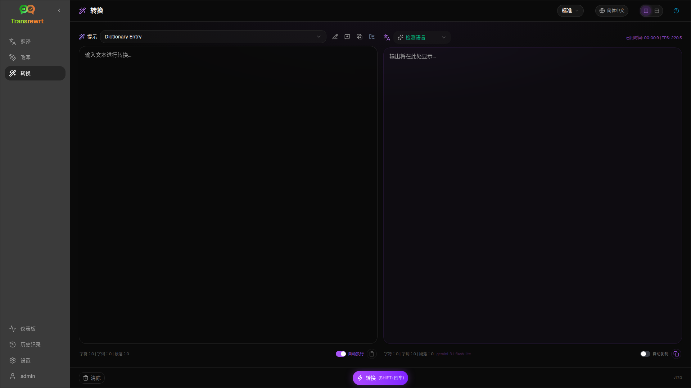
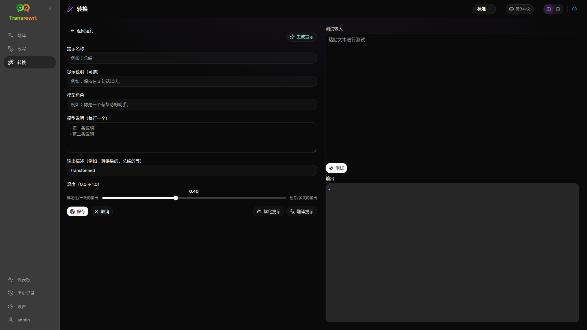

当你希望 AI 遵循自定义指令时，请使用 **Transform**——总结、润色电子邮件、提取要点、重新排版文本，或任何你定义的工作流。

## 运行现有提示词

1. 打开 **Transform**。
2. 从列表中选择一个提示词。
3. 如果出现 **From** 语言框，请根据需要设置一种语言。
4. 在 **Input** 中输入或粘贴文本。
5. 点击 **Transform**。
6. 在 **Output** 中查看结果。

[布局切换和键盘快捷键](/docs/translate/#layout-and-keyboard) 的使用方式与翻译相同。

## 加载示例提示词

如果列表为空，请在 Transform 工作区中点击 **加载示例提示**（也可在 [设置 → Transform](/docs/settings/#transform) 中找到）。示例为英文；加载后，编辑提示并根据需要使用 **翻译提示**。

## 创建提示词

1. 点击 **新建提示**。
2. 点击 **生成提示**。
3. 描述您希望提示执行的操作。
4. 选择预设（简单）或模型（高级）。
5. 查看草稿并点击 **Save**。

## 编辑提示词

编辑器位于左侧；测试区位于右侧。

主要字段：

- **提示名称** — 显示在提示列表中
- **提示说明（可选）** — 运行提示时的简短提示
- **模型角色** — AI 的整体角色
- **模型说明（每行一个）** — 需遵循的规则
- **输出描述** — 结果的简短标签（例如：已摘要）
- **温度（0.0 → 1.0）** — 值越低越稳定；值越高越多变
- **询问目标语言** — 运行时添加语言选择器

辅助功能：**生成提示**、**优化提示**、**翻译提示**（简单使用预设；高级使用模型列表）。

:::caution
在 **返回运行** 之前请点击 **保存**。未保存即返回将丢弃编辑内容。
:::

## 日常使用前测试

在构建或比较提示词时，使用右侧的测试面板和示例文本。

在[设置 → 转换](/docs/settings/#transform)下批量导出和导入提示词。

## 后续步骤

- [设置](/docs/settings/)
- [浏览历史](/docs/history/)
- [常见问题](/docs/common-issues/)
