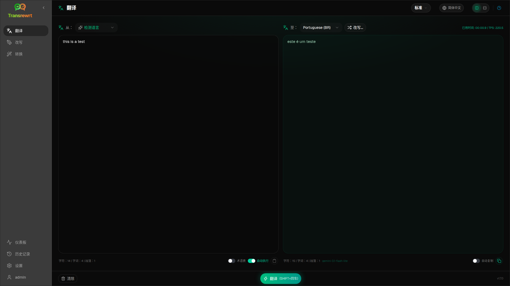

使用 **Translate** 将文本从一种语言转换为另一种语言。

## 前提条件

- 至少一个提供商密钥（桌面版）或服务器环境变量密钥（网页版）— 参见 [API 密钥](/docs/api-key/)
- 在工具栏中选择一个 **preset**（简易模式）或 **model**（高级模式）

## 翻译文本

1. 在侧边栏中打开**翻译**。
2. 在**源语言**中选择一种语言（或**检测语言**）。
3. 在**目标语言**中选择一种语言。
4. 在工具栏中选择预设或模型。
5. 在 **Input** 中输入或粘贴文本。
6. 点击 **Translate**。
7. 在 **Output** 中查看结果，如需要可复制。

**Top languages** 显示在列表顶部 — 可在 [设置 → 语言](/docs/settings/#languages) 中设置。

## 实用设置

在 [设置 → 通用设置](/docs/settings/#general-settings) 中：

- **粘贴时自动执行** — 粘贴后立即运行
- **自动将结果复制到剪贴板** — 成功运行后复制
- **输入时实时翻译** — 输入时运行（可能会增加成本）
- **超时 (ms)** — 实时运行前等待
- **Behaviour for ENTER** — 决定 Enter 是运行任务还是插入新行

## 布局与键盘

- **Layout toggle** — 面板上方的按钮可在 **side-by-side** 和 **stacked** 输入/输出布局之间切换。该选择适用于翻译、重述和转换，并会在此设备上记住。
- **Enter** 或 **Shift+Enter** 运行任务，具体取决于 **Behaviour for ENTER**（见上文）。
- **Escape** 清空输入面板（或先关闭已打开的菜单或对话框）。

## 优化翻译

运行成功后，**Rephrase…** 和一个版本下拉菜单会出现在 **To:** 选择器旁边：

1. **重述…**（未选择内容）— 对相同输入进行另一次完整翻译。最多**五**个版本；模型会看到之前的版本，因此措辞可能会有所不同。点击**停止翻译**可取消正在运行的重述。
2. **词语替换** — 选择单词或短语，然后右键单击或**重述…**。选择一个替代词来替换该片段（为了语法可能略微扩展）。达到五个版本时，仅更新第 5 个版本。
3. 每次重述或替换请求都会再次使用模型，并可能增加成本。

## 使用术语表

**glossary** 是针对某语言对的源/目标术语对。启用后，匹配的术语会发送给模型，从而保持首选措辞的一致性。

1. 在输入面板中打开**词汇表**。
2. 照常翻译 — 该**源语言** / **目标语言**对的术语会自动应用。
3. 点击**添加到词汇表**（在**源语言:** 旁边）以快速捕获新对。
4. 在[设置 → 词汇表](/docs/settings/#glossary)中管理所有术语。

:::note
术语表术语按语言对匹配。不能与作为源的**检测语言**一起使用。
:::

## 后续步骤

- [重写文本](/docs/rewrite/)
- [使用提示词转换](/docs/transform/)
- [常见问题](/docs/common-issues/)
