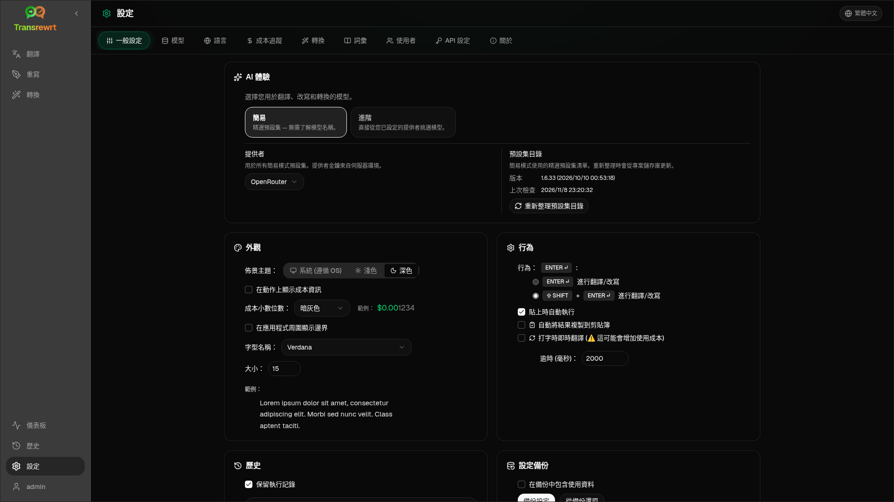

從側邊欄開啟 **設定** 以自訂應用程式的行為。

| 分頁 | 桌面版 | 網頁版 (管理員) | 網頁版 (使用者) | 備註 |
| --- | :---: | :---: | :---: | --- |
| 一般設定 | ✓ | ✓ | ✓ | 包含 **AI 體驗** (簡易 / 進階) |
| 模型 | ✓ | ✓ | ✓ | 簡易模式中的預設卡片，進階模式中的模型表格 |
| 語言 | ✓ | ✓ | ✓ | |
| 成本追蹤 | ✓ | ✓ | — | |
| 轉換 | ✓ | ✓ | ✓ | 提示詞的批量匯入/匯出 |
| 詞彙表 | ✓ | ✓ | ✓ | 用於翻譯的術語對 |
| 使用者 | — | ✓ | — | |
| API 設定 | ✓ | ✓ | — | |
| 關於 | ✓ | ✓ | ✓ | |

在**簡易**模式中，透過工具列的預設項目及一般設定中的**供應商**來選擇 AI；**模型**分頁會顯示唯讀的預設卡片。

:::note
在網頁版本中，每位使用者都有自己的設定（AI 體驗、供應商、模型／預設集、語言、選項、提示詞）。變更不會影響其他使用者。
:::

## 一般設定

**AI 體驗**

- **簡易** (預設)：選擇 **供應商**。雲端供應商使用工具列預設集。**本地 LLM** 則改為列出已安裝的本地模型。**重新整理預設集目錄** 會從專案儲存庫擷取最新的預設集清單。
  - **免費 (OpenRouter)** — 路由至可用免費模型的零成本選項；品質與可用性可能有所變動
  - **標準** — 輕量且符合成本效益；最適合短文、快速草稿與高用量使用
  - **進階** — 適用於複雜或細微內容的高準確度模型，成本較高
  - **技術** — 針對程式碼、API、開發者文件與結構化內容調校；保留格式與術語
- **進階**：在工具列中挑選模型；在 [模型](#models) 下管理清單。

您也可以從工具列的預設集／模型選單切換簡易 ↔ 進階（**切換至簡易／進階模式**，位於「開啟設定」上方）。

**外觀** — 主題；**在動作上顯示成本資訊**；**成本小數位數**；僅限網頁版的應用程式邊界；**字型家族**與**大小**。

**行為** — **行為：ENTER**；**貼上時自動執行**；**自動將結果複製到剪貼簿**；**即時翻譯輸入內容**；**逾時 (ms)**。

**歷史**

- **保留執行記錄** — 為[歷史記錄](/docs/history/)檢視儲存輸入/輸出。關閉時會要求確認，並可能移除已儲存的文字。若標示為*已被管理員停用*，表示已設定 `HISTORY_DISABLED` — 請參閱[設定](/docs/configuration/#privacy-mode)。
- **刪除歷史記錄** — 依時間移除已儲存的文字或清除全部。**不會**刪除成本總計（請使用成本追蹤來執行此操作）。

**設定備份**（桌面版與網頁版管理員）

- 可選的 **在備份中包含使用資料**
- **備份設定** — 包含設定、狀態、使用者、偏好設定、提示詞與可選使用資料的 ZIP 檔案
- **從備份還原** — 帶有還原及/或清除使用資料選項的確認對話框

備份可以在桌面版與網頁版之間移動；在網頁版還原桌面版備份會將資料套用至管理員使用者。

## 模型

**模型**分頁會始終列出。其**簡易 / 進階**切換開關可在兩種 [AI 體驗](#general-settings)之間切換整個應用程式。

- **簡易** 會為每個預設顯示一張唯讀卡片（例如 **免費 (OpenRouter)** 或 **標準**）。每張卡片列出您已設定的每個提供者的主要與備用模型。**提供者** 標籤可篩選卡片。
- **進階** 會顯示包含每個模型的表格，具備：
  - 搜尋框、**提供者** 標籤、**僅免費**、**僅選取項** 與 **重新整理**
  - 排序選單；預設為 **索引由高到低**
  - 每個模型的核取方塊，可選取或取消選取
  - **從預設中選擇**，會為每個已設定的提供者新增預設的主要與備用模型（**全部載入** 會載入所有提供者）
  - **取消全選**，會先要求確認
- 模型 ID 使用提供者前綴（`openrouter/…`、`openai/…`、`local/…`、…）

分數與價格欄位：

- **索引** — 由 ChrF、Arena Score 及價格綜合計算的品質分數。此分數在各供應商內排名，因此無法跨供應商比較。沒有索引的模型會排在最後。
- **ChrF** — 來自 [languagebench](https://huggingface.co/spaces/fair-forward/languagebench) 的平均翻譯品質，以應用程式介面語言計算。
- **Arena** — 來自 [LMArena](https://huggingface.co/datasets/lmarena-ai/leaderboard-dataset) 排行榜的 Arena Score。
- **輸入** / **輸出** — 每百萬 Token 的美元價格，取自供應商目錄或 [models.dev](https://models.dev/)。估計價格以星號標示。破折號（—）表示價格未知；本機模型顯示「無成本 - 本機」。

將滑鼠懸停在欄位標題上可查看其資料來源與授權。工具列中的模型選擇器會以小型標籤顯示每個模型的索引；將滑鼠懸停在上面可查看 ChrF 與 Arena 數值。

分數僅供參考：涵蓋範圍並不完整，許多模型沒有 ChrF 或 Arena 分數。

:::tip
請勿使用 OpenRouter **Body Builder** (`openrouter/bodybuilder`) 進行翻譯、改寫或轉換 — 它會傳回 JSON 請求負載，而非完成的文字。
:::

勾選或取消勾選模型以選取或取消選取它。OpenRouter 免費模型為選用項目 — 已選模型可以為空。從工具列移除最後一個模型時會開啟**設定 → 模型**。若目前模型變為不可用，應用程式會改為選取清單中的下一個模型，而非強制使用免費模型。

## 語言

- **頂端語言** — 固定在翻譯與轉換的語言清單頂端附近
- **自訂語言** — 新增內建清單中缺少的語言

## 成本追蹤

- **總計費用**、**複製值**、**重設成本**
- **與 API 金鑰使用量同步** — 與 OpenRouter 帳戶使用量對齊（僅限 OpenRouter）
- **API 金鑰使用量** — 可用時顯示 OpenRouter 詳細資料
- **刪除成本資料** — 全部資料或早於指定日期的項目

OpenRouter 與 xAI 會在 API 回傳時顯示實際計費成本；其他供應商則使用來自 [models.dev](https://models.dev/) 定價的預估值。預估值並非發票。

:::caution
成本資料刪除無法復原。如果您需要備份，請先透過歷史或儀表板 → 所有呼叫匯出。這些 API 呼叫的相關輸入/輸出歷史也會被移除。
:::

## 轉換

批次管理提示詞：檢閱、刪除、匯入、匯出與載入範例提示詞。

## 詞彙表

管理在[翻譯](/docs/translate/#use-the-glossary)期間套用的詞彙配對。每個詞彙都具有來源/目標語言以及來源/目標文字。

- 透過底部的列和 **+** 新增
- 按語言或文字篩選
- 匯入/匯出 CSV 或 XLSX；下載空白範本

桌面版會將詞彙表儲存在本機；網頁版會為每個使用者儲存。

## 使用者

僅限網頁版（管理員）：

- 新增使用者、更新詳細資料、重設密碼、刪除帳戶
- **工作階段逾時** — 登入持續時間（1 小時至 7 天）；變更僅適用於新的登入
- **撤銷工作階段** — 立即將使用者從所有裝置登出

每個已登入的使用者（包括非管理員）都可以從側邊欄底部的使用者選單變更自己的密碼或登出。

## API 設定

僅設定您使用的提供者：OpenRouter、OpenAI、Anthropic、Google Gemini、DeepSeek、Groq、Mistral、xAI、Cerebras、NVIDIA、Alibaba Cloud、apikey.fun、**本地 LLM**（Ollama、LM Studio、llama.cpp 或類似工具的基礎 URL），以及一個選用的自訂 OpenAI 相容提供者。

**網頁版（管理員）：** 金鑰來自環境變數 — 此頁面會顯示已設定的金鑰，並讓您 **測試**。變更環境變數後請重新啟動。請參閱[設定](/docs/configuration/)。

**桌面版：** 輸入金鑰（或本機 LLM URL）並 **儲存** / **編輯** / **測試**。金鑰會以加密方式儲存；您無法檢視目前的值，只能取代它。

:::tip
開始時不需要付費金鑰：使用免費的 OpenRouter 模型、其他免費層級提供者，或本機 OpenAI 相容伺服器，例如 [Ollama](https://ollama.com)、LM Studio 或 llama.cpp（例如 `translategemma:4b`）。
:::

## 關於

應用程式名稱、版本、建置日期、授權、第三方通知和存放庫連結。
