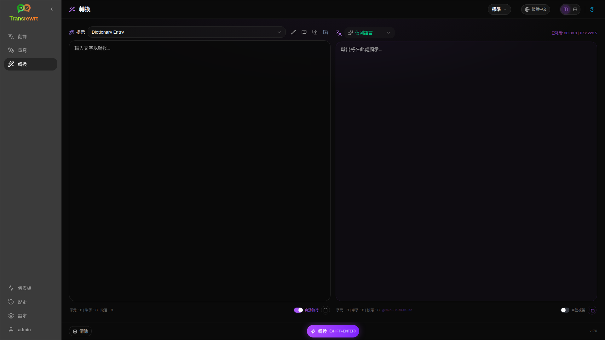
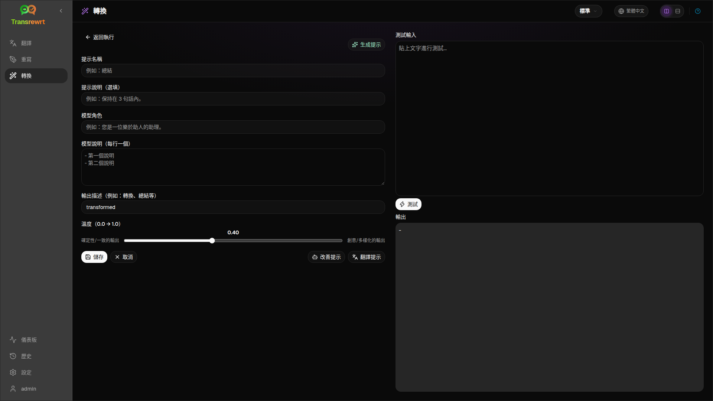

當您希望 AI 遵循自訂指示時，請使用 **Transform** — 摘要、潤飾電子郵件、擷取重點、重新排版文字，或任何您定義的工作流程。

## 執行現有提示詞

1. 開啟 **Transform**。
2. 從清單中選擇提示詞。
3. 若出現 **From** 語言方塊，請視需要設定語言。
4. 在 **Input** 中輸入或貼上文字。
5. 點擊 **Transform**。
6. 在 **Output** 中檢視結果。

[版面配置切換和鍵盤快捷鍵](/docs/translate/#layout-and-keyboard) 的運作方式與翻譯功能相同。

## 載入範例提示詞

如果清單為空，請在 Transform 工作區中點擊 **載入範例提示**（亦可在 [設定 → Transform](/docs/settings/#transform) 中找到）。範例為英文；載入後，編輯提示並視需要使用 **翻譯提示**。

## 建立提示詞

1. 點擊 **新增提示**。
2. 點擊 **生成提示**。
3. 描述您希望提示執行的操作。
4. 選擇預設值（簡易）或模型（進階）。
5. 檢閱草稿並點擊 **Save**。

## 編輯提示詞

編輯器位於左側；測試區位於右側。

主要欄位：

- **提示名稱** — 顯示在提示清單中
- **提示說明（選填）** — 執行提示時的簡短提示
- **模型角色** — AI 的整體角色
- **模型說明（每行一個）** — 要遵循的規則
- **輸出描述** — 結果的簡短標籤（例如摘要）
- **溫度（0.0 → 1.0）** — 較低則較穩定；較高則更多樣
- **詢問目標語言** — 執行時新增語言選擇器

輔助工具：**生成提示**、**改善提示**、**翻譯提示**（簡易使用預設值；進階使用模型清單）。

:::caution
在 **返回執行** 之前請點擊 **儲存**。未儲存即返回將捨棄編輯。
:::

## 日常使用前測試

在建立或比較提示詞時，請使用右側的測試面板搭配範例文字。

在[設定 → 轉換](/docs/settings/#transform)中大量匯出與匯入提示詞。

## 後續步驟

- [設定](/docs/settings/)
- [瀏覽歷史](/docs/history/)
- [常見問題](/docs/common-issues/)
