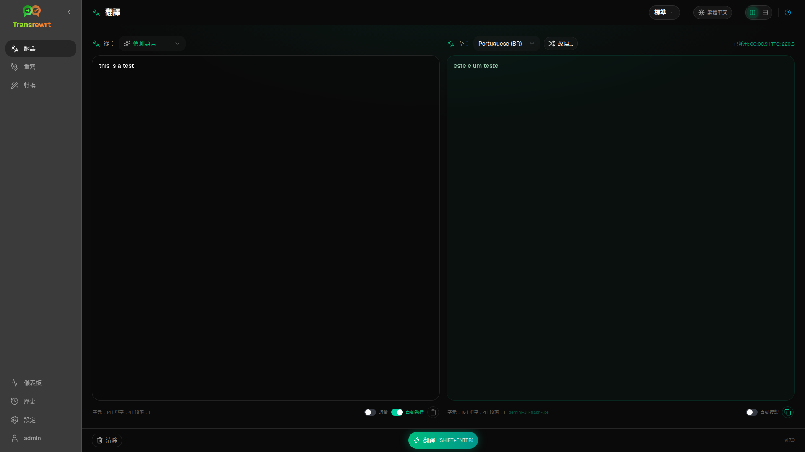

使用 **Translate** 將文字從一種語言轉換為另一種語言。

## 先決條件

- 至少一個供應商金鑰（桌面版）或伺服器環境金鑰（網頁版）— 請參閱 [API 金鑰](/docs/api-key/)
- 已在工具列選取 **preset**（簡易）或 **model**（進階）

## 翻譯文字

1. 在側邊欄中開啟**翻譯**。
2. 在**從**中選擇一種語言（或**偵測語言**）。
3. 在**到**中選擇一種語言。
4. 在工具列中選擇預設或模型。
5. 在 **Input** 中輸入或貼上文字。
6. 點擊 **Translate**。
7. 在 **Output** 中閱讀結果，如有需要再複製。

**Top languages** 會顯示在清單最前面 — 請在 [設定 → 語言](/docs/settings/#languages) 中設定。

## 實用設定

在 [設定 → 一般設定](/docs/settings/#general-settings) 中：

- **貼上時自動執行** — 貼上後立即執行
- **自動將結果複製到剪貼簿** — 成功執行後進行複製
- **輸入時即時翻譯** — 在您輸入時執行（可能會增加成本）
- **逾時 (ms)** — 即時執行前的等待時間
- **Behaviour for ENTER** — 決定 Enter 是執行工作還是插入新行

## 版面與鍵盤

- **Layout toggle** — 面板上方的按鈕可切換 **side-by-side** 與 **stacked** 的輸入/輸出版面。此選擇會套用至 Translate、Rewrite 與 Transform，並在此裝置上記住。
- **Enter** 或 **Shift+Enter** 會執行工作，視 **Behaviour for ENTER** 而定（見上文）。
- **Escape** 會清除輸入面板（或先關閉已開啟的選單或對話框）。

## 改寫翻譯

成功執行後，**Rephrase…** 與版本下拉選單會出現在 **To:** 選擇器旁：

1. **重新措辭…**（未選取）— 對相同輸入的另一次完整翻譯。最多 **五** 個版本；模型會查看先前版本，因此措辭可能會有所不同。按一下 **停止翻譯** 以取消正在進行的重新措辭。
2. **詞語替代選項** — 選取詞語或短語，然後按一下滑鼠右鍵或選擇 **重新措辭…**。挑選一個替代選項來取代該範圍（可能會為了語法而稍微擴大範圍）。在五個版本時，僅會更新版本 5。
3. 每次重新措辭或替代選項請求都會再次使用模型，並可能會增加費用。

## 使用詞彙表

**glossary** 是某個語言對的來源/目標術語配對。啟用後，相符的術語會傳送給模型，以保持偏好的用語一致。

1. 在輸入面板中開啟 **詞彙表**。
2. 照常翻譯 — 該 **來源** / **目標** 配對的術語會自動套用。
3. 按一下 **新增至詞彙表** (在 **來源:** 旁邊) 以快速擷取新的配對。
4. 在 [設定 → 詞彙表](/docs/settings/#glossary) 中管理所有術語。

:::note
詞彙表術語會根據語言對進行匹配。它們無法與 **偵測語言** 作為來源語言搭配使用。
:::

## 後續步驟

- [重寫文字](/docs/rewrite/)
- [使用提示詞轉換](/docs/transform/)
- [常見問題](/docs/common-issues/)
